# Slides: Drawing the Rest of the Owl: A Blueprint for Your Software Factory

[Back to the notes](../talks/drawing-the-rest-of-the-owl.md)

[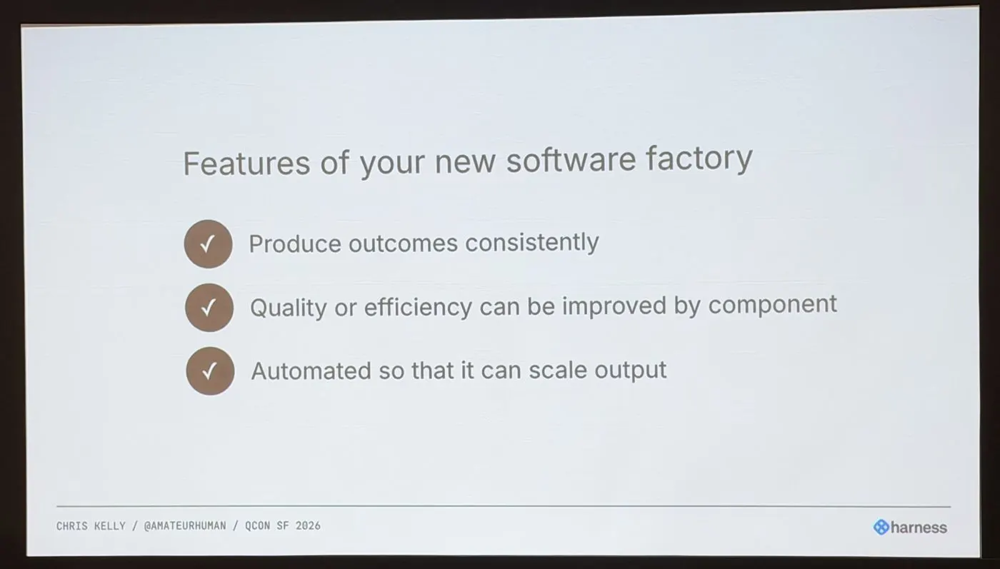](../slides/drawing-the-rest-of-the-owl/deep/p6065.webp)

*Slide 1: Features of your new software factory*

[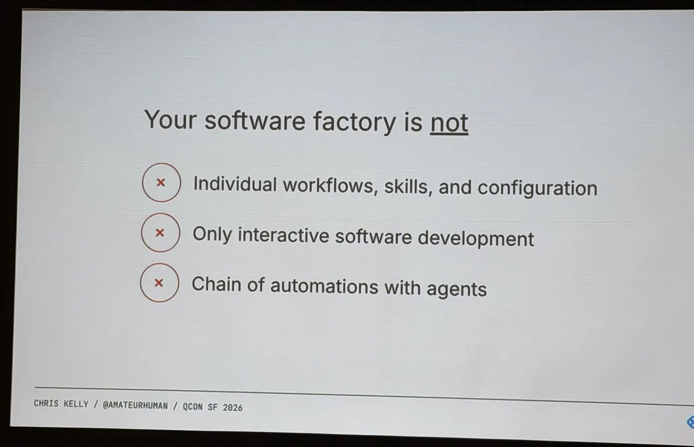](../slides/drawing-the-rest-of-the-owl/deep/p6066.webp)

*Slide 2: Your software factory is not*

[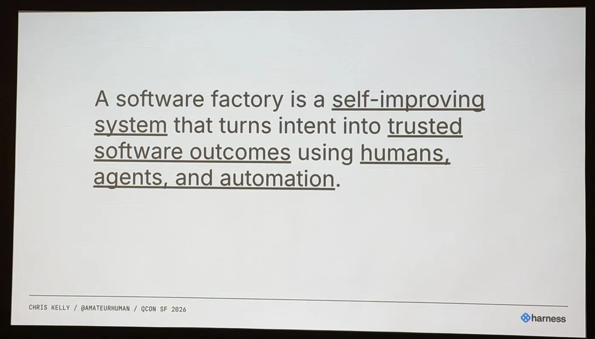](../slides/drawing-the-rest-of-the-owl/deep/p6068.webp)

*Slide 3: A software factory is a self-improving system*

[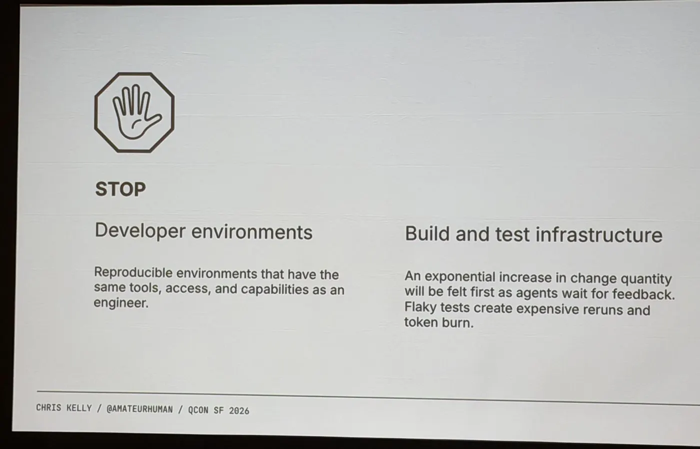](../slides/drawing-the-rest-of-the-owl/deep/p6069.webp)

*Slide 4: Stop: developer environments, build and test infrastructure*

[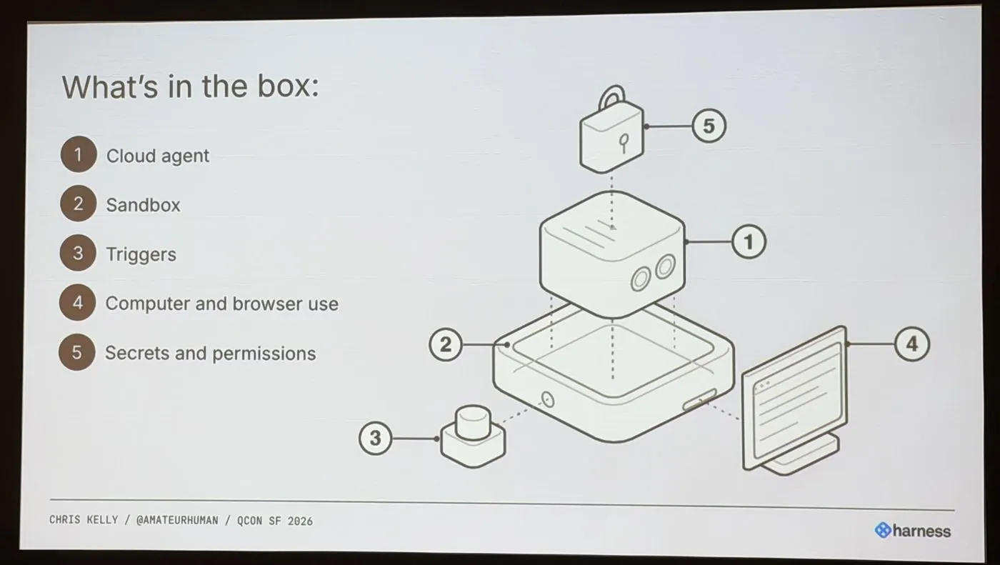](../slides/drawing-the-rest-of-the-owl/deep/p6070.webp)

*Slide 5: What’s in the box*

[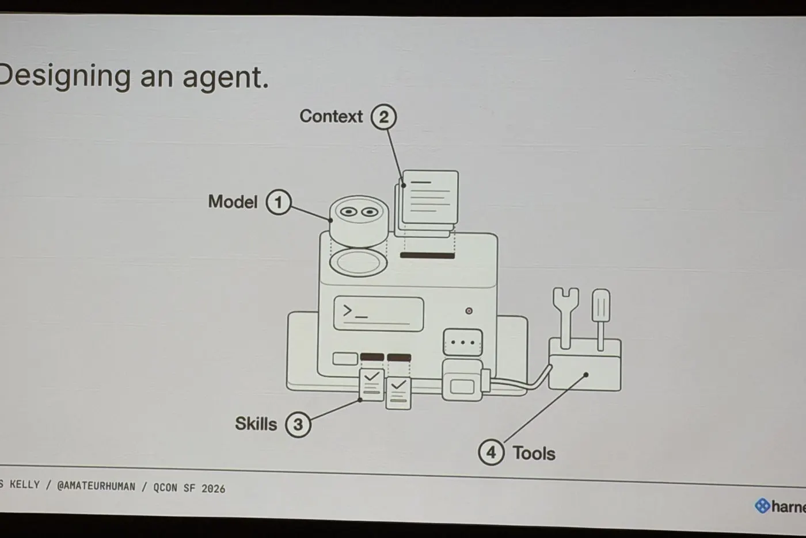](../slides/drawing-the-rest-of-the-owl/deep/p6071.webp)

*Slide 6: Designing an agent*

[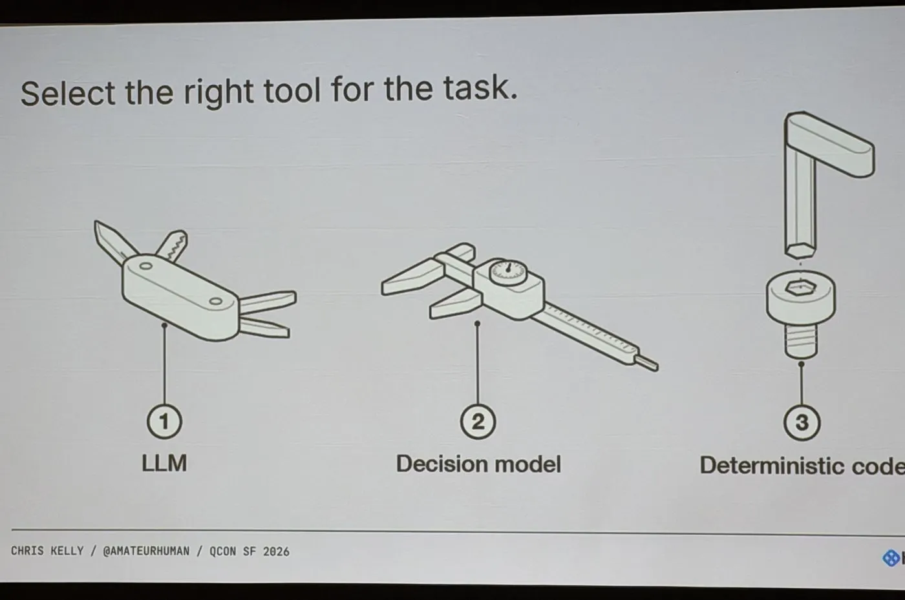](../slides/drawing-the-rest-of-the-owl/deep/p6072.webp)

*Slide 7: Select the right tool for the task*

[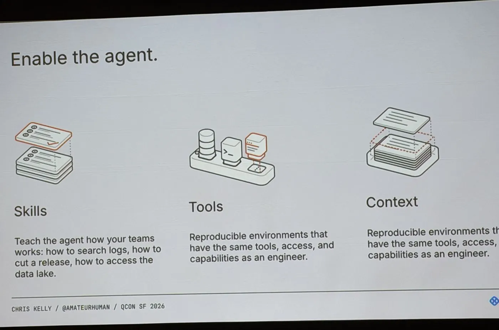](../slides/drawing-the-rest-of-the-owl/deep/p6073.webp)

*Slide 8: Enable the agent: skills, tools, context*

[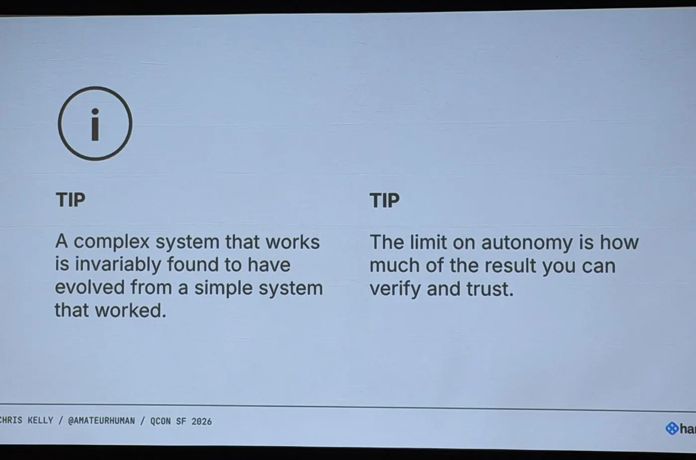](../slides/drawing-the-rest-of-the-owl/deep/p6074.webp)

*Slide 9: Tips: start simple; autonomy is limited by verification*

[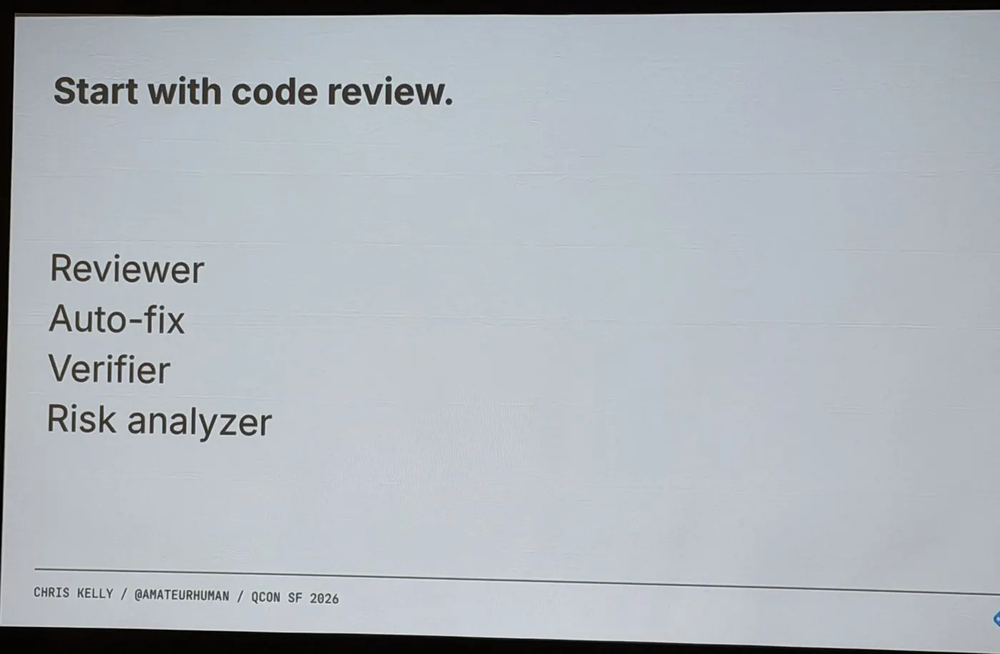](../slides/drawing-the-rest-of-the-owl/deep/p6075.webp)

*Slide 10: Start with code review*

[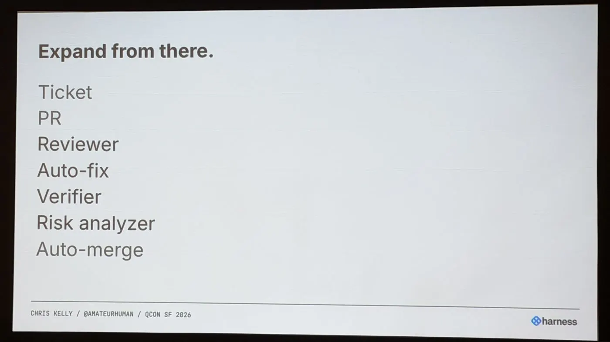](../slides/drawing-the-rest-of-the-owl/deep/p6076.webp)

*Slide 11: Expand from there*

[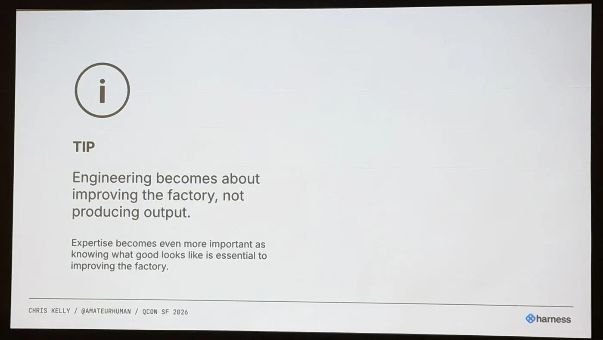](../slides/drawing-the-rest-of-the-owl/deep/p6077.webp)

*Slide 12: Tip: engineering becomes about improving the factory*

[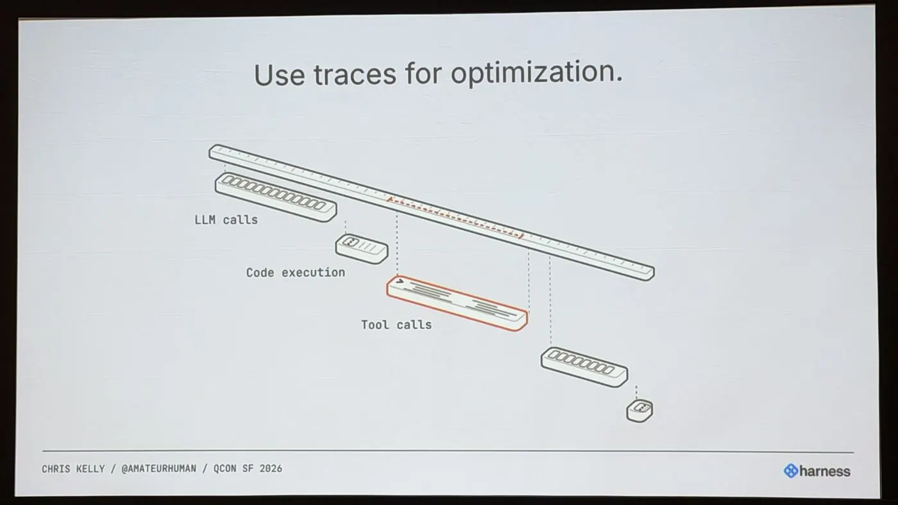](../slides/drawing-the-rest-of-the-owl/deep/p6078.webp)

*Slide 13: Use traces for optimization*

[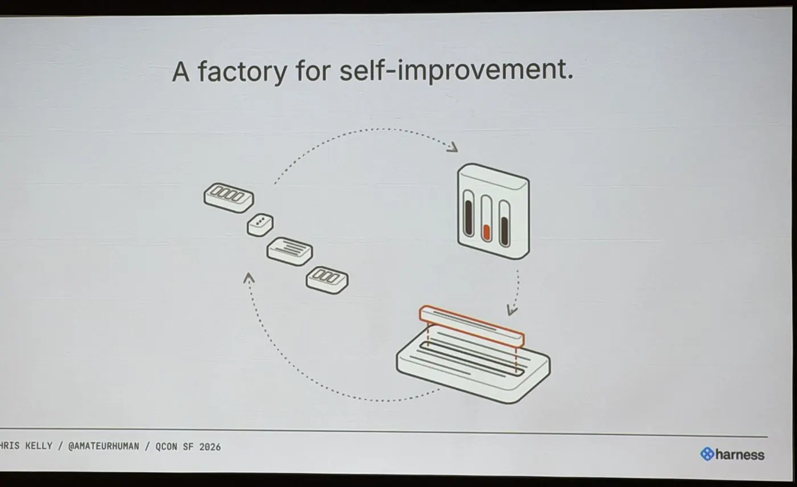](../slides/drawing-the-rest-of-the-owl/deep/p6079.webp)

*Slide 14: A factory for self-improvement*

[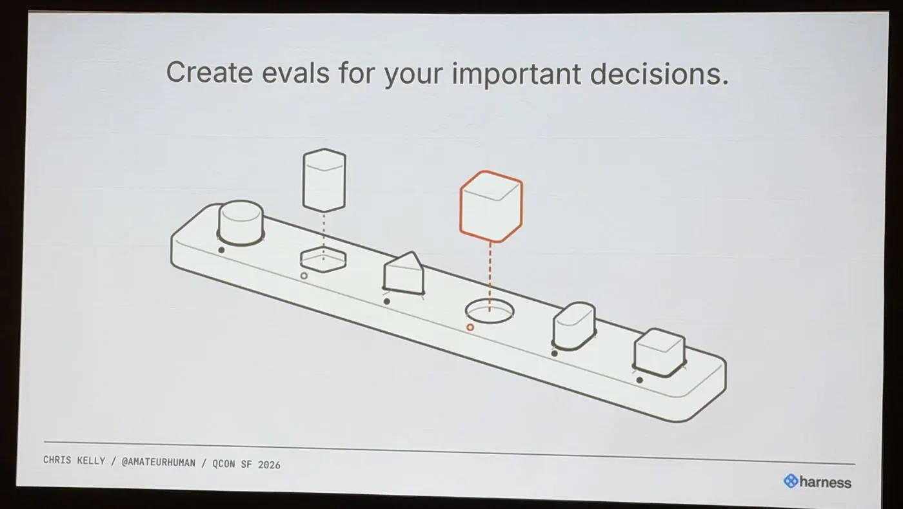](../slides/drawing-the-rest-of-the-owl/deep/p6080.webp)

*Slide 15: Create evals for your important decisions*

[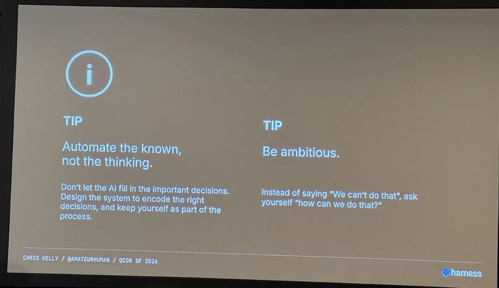](../slides/drawing-the-rest-of-the-owl/deep/p6081.webp)

*Slide 16: Tips: automate the known, not the thinking; be ambitious*
