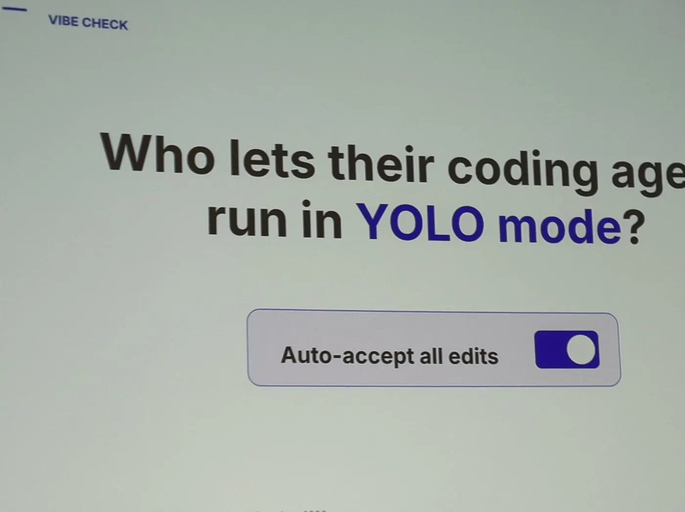
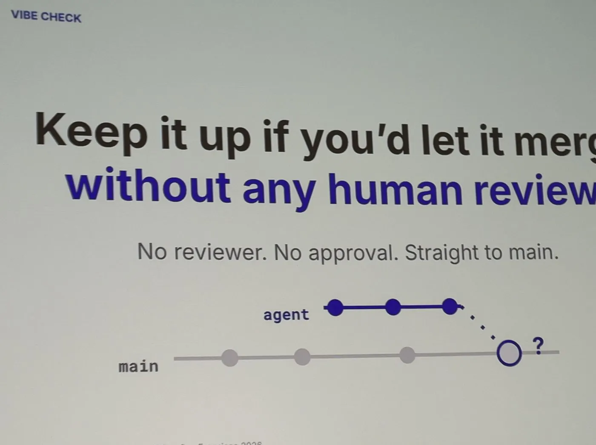
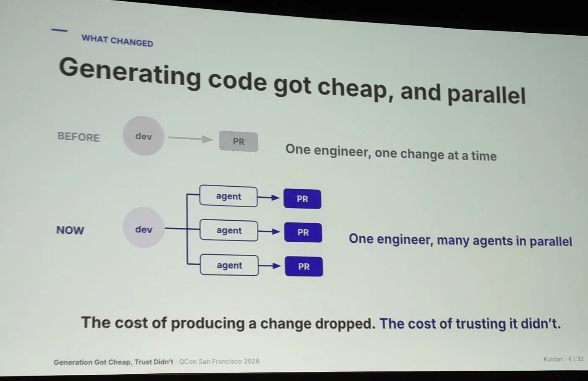
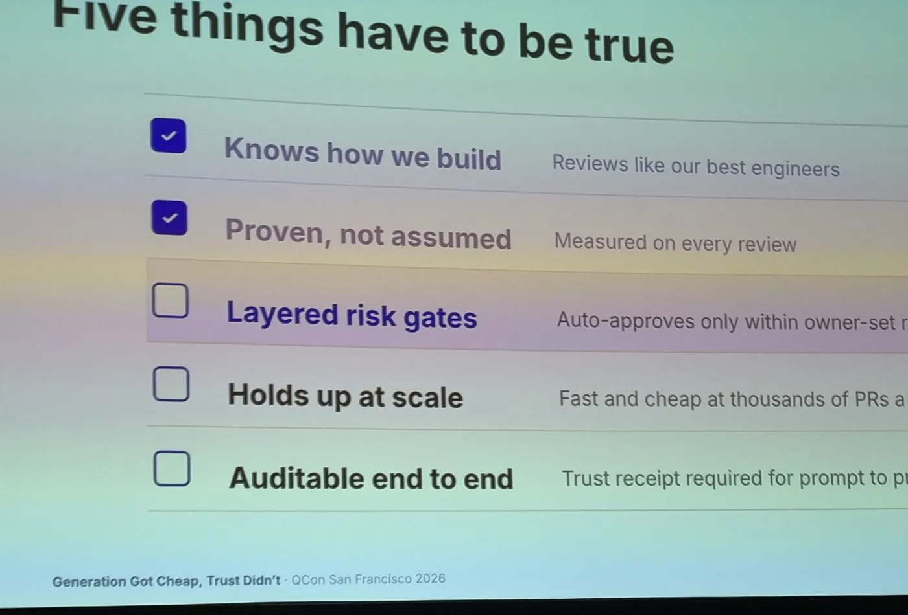
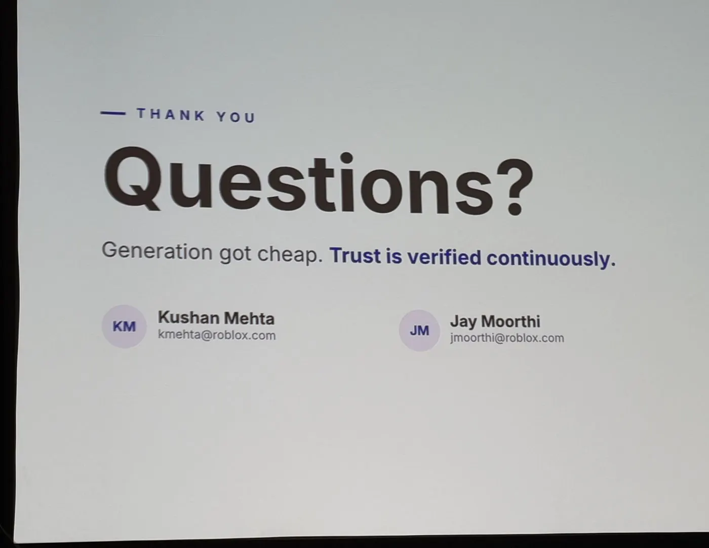

# Slides: Generation Got Cheap, Trust Didn't: Scaling Agentic Changes from Prompt to Prod at Roblox

[Back to the notes](../talks/generation-got-cheap-trust-didnt.md)

*Slide 2: Vibe check: who runs agents in YOLO mode?*

*Slide 3: Vibe check: would you let it merge with no human review?*

*Slide 4: Generating code got cheap, and parallel*

*Slide 5: Generation scales. Review doesn't.*

*Slide 6: North star: alert to auto-merge in 22 minutes*

*Slide 7: Five things have to be true*

*Slide 8: The context gap*

[![Slide 9: Alignment engine, slide 9 of 32. Exemplars encode our experts' judgment. Historical code review data (comments, diffs, PR context) goes through filter noise, semantic comment vectors, a clustering algorithm, recurring theme clusters, extract exemplars, ranked candidate exemplars with citations, then an expert review interface to promote or discard, into an aligned exemplar knowledge base of curated rules used by AI coding agents. 1 Discover: mine years of review comments. 2 Capture: experts promote the pattern and reason. 3 Enforce: every matching PR gets checked.](../slides/generation-got-cheap-trust-didnt/deep/s09.webp)](../slides/generation-got-cheap-trust-didnt/deep/s09.webp)

*Slide 9: Exemplars encode experts' judgment*

[![Slide 10: Experts write and test exemplars. Screenshot of the Alignment Engine Playground: exemplar ID no-blocking-task-awaiting, category Performance, a description warning about blocking calls inside a high-frequency loop, file patterns for C# files, and an evaluation suite with test cases pointing at sandbox PRs and expected outcomes (should find violation or should be clean), reporting accuracy, precision, recall and F1. Steps: describe the standard with good and bad examples, scope by file pattern, test on real PRs, check precision and recall.](../slides/generation-got-cheap-trust-didnt/deep/s10.webp)](../slides/generation-got-cheap-trust-didnt/deep/s10.webp)

*Slide 10: Experts write and test exemplars*

*Slide 11: 72% precision, 88% recall*

[![Slide 11+: Proven, not assumed. Evals built from real failures. Engineering evidence (incidents, missed bugs, rejected findings, historical PRs) feeds agentic case generation (reconstruct PR context, verify discoverability with pre-merge evidence only, generate eval candidate), human curation, then a bug eval set and a clean eval set alongside public benchmarks, comparative evaluation of candidate reviewers, refine reviewer, code review agent, review feedback loops back as new evidence. Real failures, 600+ curated PRs: about 500 must catch, 100+ stay silent; every agent prompt and model change is tested.](../slides/generation-got-cheap-trust-didnt/deep/s12.webp)](../slides/generation-got-cheap-trust-didnt/deep/s12.webp)

*Slide 12: Evals built from real failures*

*Slide 13: Checklist: two of five done*

*Slide 14: Correct isn't the same as safe to ship*

[![Slide 11+: Layered risk gates. Owners decide how much risk is OK. A pull request goes through an owner-configured merge policy with boundaries managed as code. Agent judgment, model-produced signals: code correctness and confidence, low-risk change type, blast-radius risk within the permitted level (reach, severity, recoverability), with team risk guidance overriding the shared company baseline. Deterministic checks enforced in code: team ownership boundaries, permitted file paths (sensitive files always need a human), required tests and CI, branch protections. Every condition met leads to autonomous merge; otherwise human review with findings and risk rationale attached.](../slides/generation-got-cheap-trust-didnt/deep/s15.webp)](../slides/generation-got-cheap-trust-didnt/deep/s15.webp)

*Slide 15: Owners decide how much risk is OK*

*Slide 16: Built for thousands of PRs a day*

*Slide 17: Shared context, paid for once*

[![Slide 11+: Part 2, the audit trail. For every merged line: which agent, model, and conversation. Funnel: about 10 to the 8 AI line edits fleet-wide in the last 14 days, narrowed by same author (10 to the 5), same repository (10 to the 4), same file path (10 to the 3), exact line hash (2), edit before commit (2), one fingerprint linking conversation, model and tool. Why vendor numbers fail: they count what AI generated, not what survived review and merged; one PR mixes several agents, hand edits and automation; no industry standard for edit telemetry. 500K+ merged lines a day. Vast majority of new code attributed to an AI coding tool or generator.](../slides/generation-got-cheap-trust-didnt/deep/s18.webp)](../slides/generation-got-cheap-trust-didnt/deep/s18.webp)

*Slide 18: For every merged line: agent, model, conversation*

*Slide 19: Anyone can see how their code got written*

[![Slide 23: Part 2, example PR, slide 23 of 32. backoff.go lines 41 to 47, nextBackoff with an empty-regions guard added by the agent in rev 1 and a capped exponent added after review. Conversation 8c2f: ticket BUG-4821, players stuck reconnecting after regional failover; agent reproduced and added an empty-list guard; review found an unbounded shift that overflows and wraps the delay to zero; agent capped the exponent at 6 and clamped to maxBackoff. Fingerprint 4be1, tool coding-tool-a, model model-x.](../slides/generation-got-cheap-trust-didnt/deep/s23.webp)](../slides/generation-got-cheap-trust-didnt/deep/s23.webp)

*Slide 23: Click a line, open the conversation that wrote it*

[![Slide 24: Part 2, seeing what agents do. What Roblox scale means for AI, in a given week: about 250M LLM calls, 3T+ tokens, 1M+ conversations, coming from 100+ production agents (2x in 3 months), 12 coding agents, 50 models. Problems: visibility (no shared standard for availability, performance, safety, security, correctness), spend (fast-growing, leadership needs team and user attribution), efficiency (no levers company-wide). Needs: handles today's scale, room to grow, lives in developers' daily workflow. We didn't build an AI-only stack. We extended the one we already run.](../slides/generation-got-cheap-trust-didnt/deep/s24.webp)](../slides/generation-got-cheap-trust-didnt/deep/s24.webp)

*Slide 24: What Roblox scale means for AI*

[![Slide 25: Slide 25 of 32. We extended what we already ran, not an AI-only stack. Simplified schematic: LLM gateway (zero-touch, every service behind it) and client telemetry (rich, opt-in, coding agents and onboarded agents) feed an OpenTelemetry Collector that normalizes, enriches, redacts and routes into Kafka, then StarRocks, read by a Grafana plugin for engineers and an MCP server for agents. 10M+ msgs/sec already flowing through the OTel pipeline. Goal: capture 100% of LLM and agent traffic. Powers code fingerprinting, usage and cost reporting, online LLM judges, offline evals and a coding benchmark.](../slides/generation-got-cheap-trust-didnt/deep/s25.webp)](../slides/generation-got-cheap-trust-didnt/deep/s25.webp)

*Slide 25: We extended what we already ran*

*Slide 26: Usage, cost monitoring and efficiency*

*Slide 27: Online evals: LLM judges, on by default*

[![Slide 28: Continuous LLM judges with a Judge Library. Capture from the LLM gateway and client telemetry; prepare once (redacted at ingest, store only each delta with no repeated context prefix, common turn parser); judge = event filter + prompt, with default judges on every gateway service, a Judge Library teams contribute to, and the smallest model by default with a daily frontier re-judge flagging disagreements; deliver to dashboards and alerts, StarRocks, the data warehouse and agent-bench. 12 to 28x less data stored, about 15 min event to verdict, 19 judges, 50x cheaper than frontier on everything.](../slides/generation-got-cheap-trust-didnt/deep/s28.webp)](../slides/generation-got-cheap-trust-didnt/deep/s28.webp)

*Slide 28: Continuous LLM judges with a Judge Library*

[![Slide 29: Offline evals gate changes before they ship, scored on correctness, cost and latency. Shared framework built on the Harbor OSS agent eval framework, each trial in its own container in VMs for isolation and cheat detection. A Roblox-internal task benchmark for coding agents and skills across every model and coding tool, with a Roblox SWE-bench from merged PRs using sealed tasks. Agent-specific eval suites; one team landed 500+ cases in its first week. 900+ eval cases in the first 7 weeks: 52 in week 1, 87 in weeks 2 to 5, about 800 in weeks 6 to 7.](../slides/generation-got-cheap-trust-didnt/deep/s29.webp)](../slides/generation-got-cheap-trust-didnt/deep/s29.webp)

*Slide 29: Offline evals gate changes before they ship*

*Slide 30: From prompt to prod, not just faster coding*

*Slide 31: The trust receipt and takeaways*

*Slide 32: Questions*
