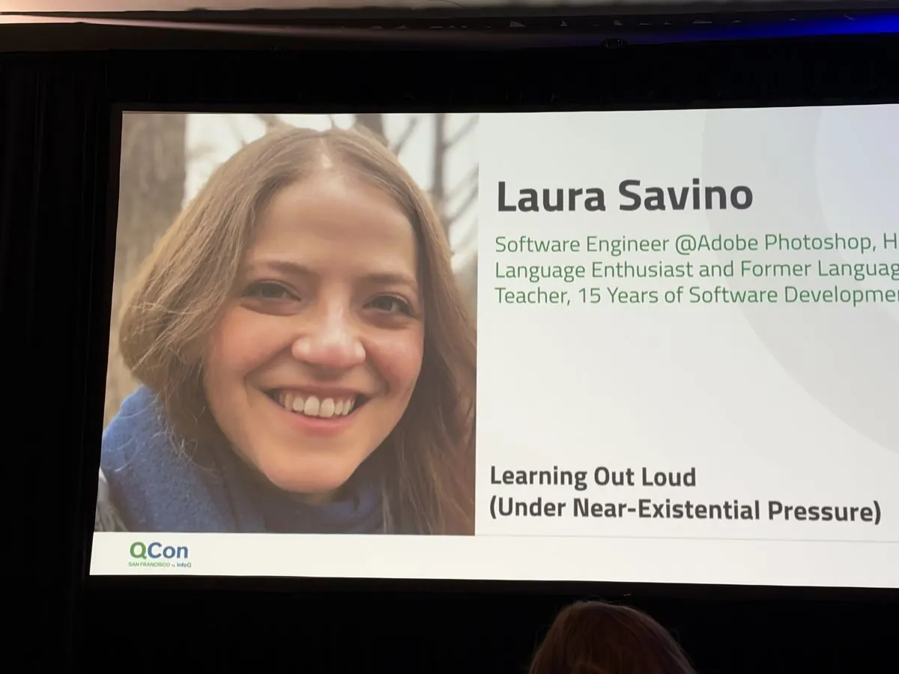
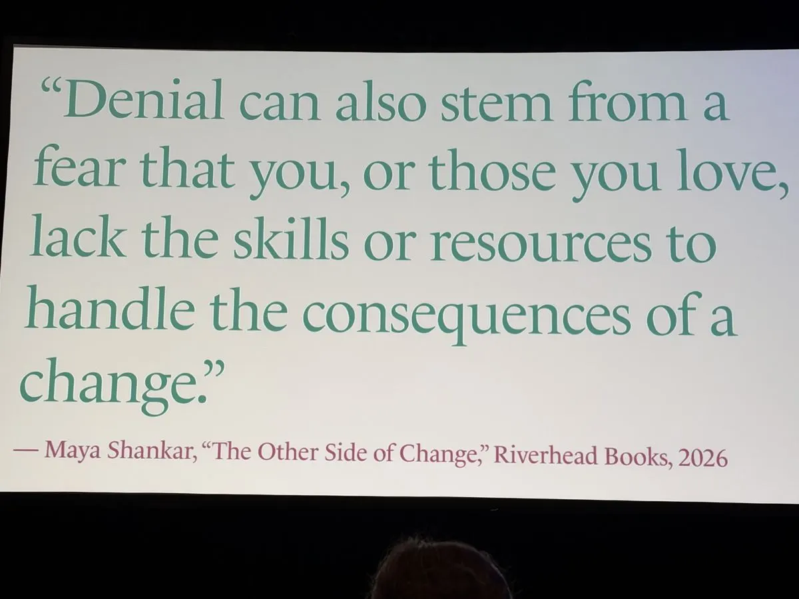
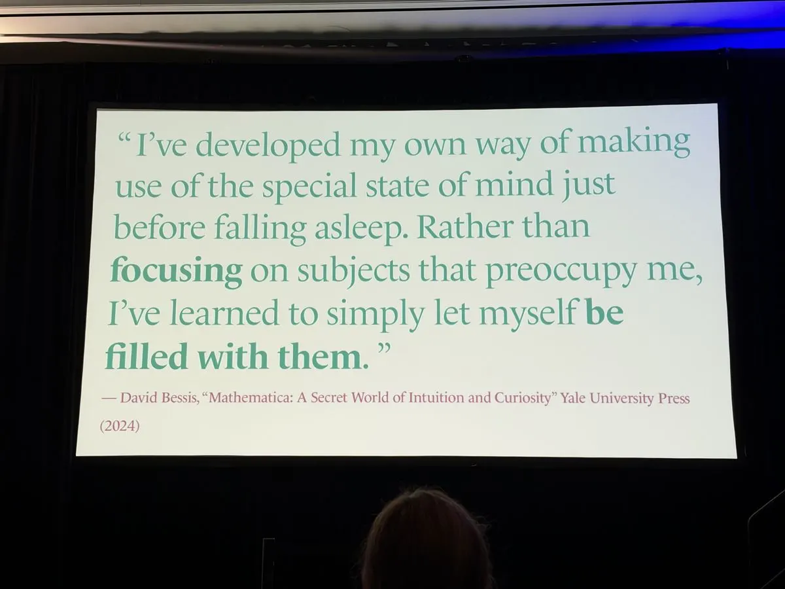
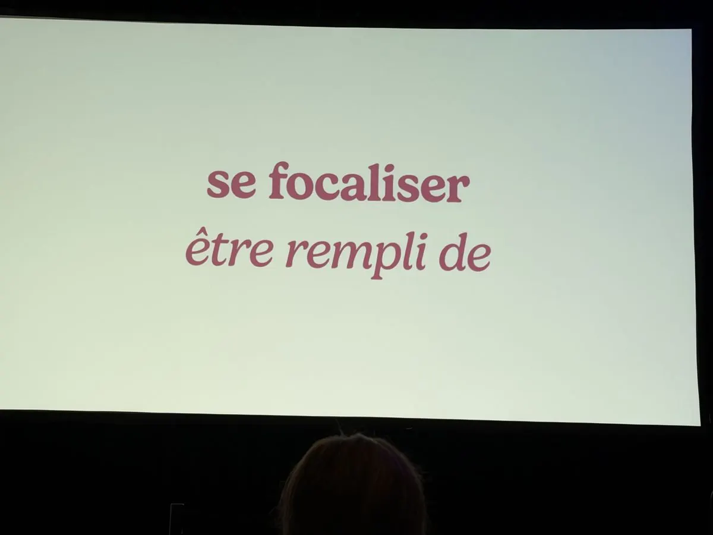
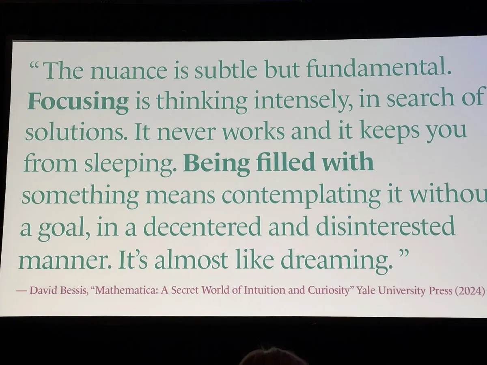
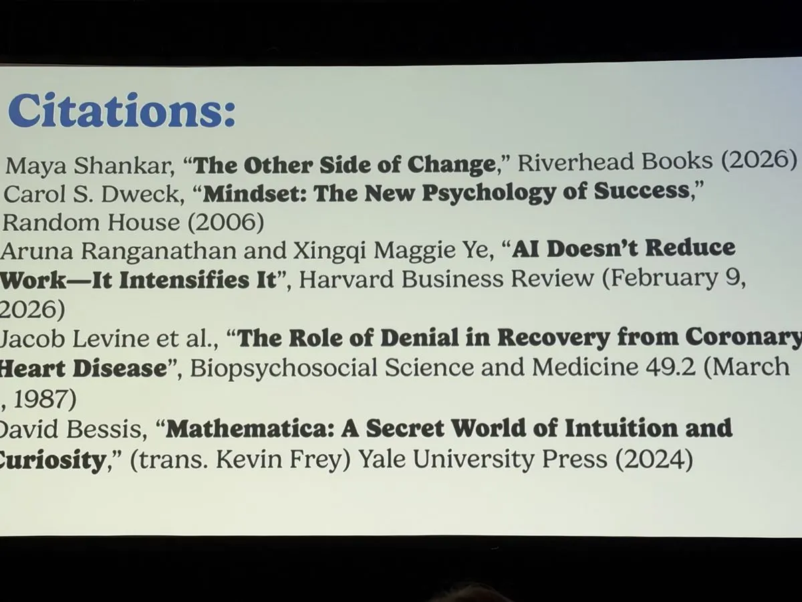

# Slides: Learning Out Loud (Under Near-Existential Pressure)

[Back to the notes](../talks/learning-out-loud-under-near-existential-pressure.md)

*Slide 1: Title card*

*Slide 2: Denial as fear of not coping*

*Slide 3: Bessis on being filled with a problem*

*Slide 4: Two French verbs*

*Slide 5: Focusing versus being filled with*

*Slide 6: Citations*
