# Slides: Observability: The Missing Control Plane for Agentic Engineering

[Back to the notes](../talks/observability-the-missing-control-plane-for-agentic-engineering.md)

[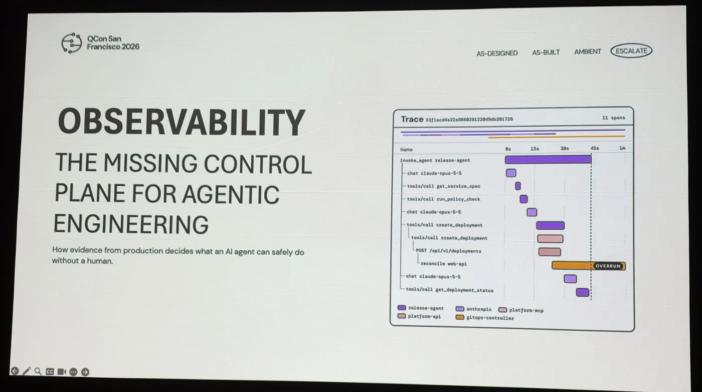](../slides/observability-the-missing-control-plane-for-agentic-engineering/deep/s01.webp)

*Slide 1: Title: the missing control plane for agentic engineering*

[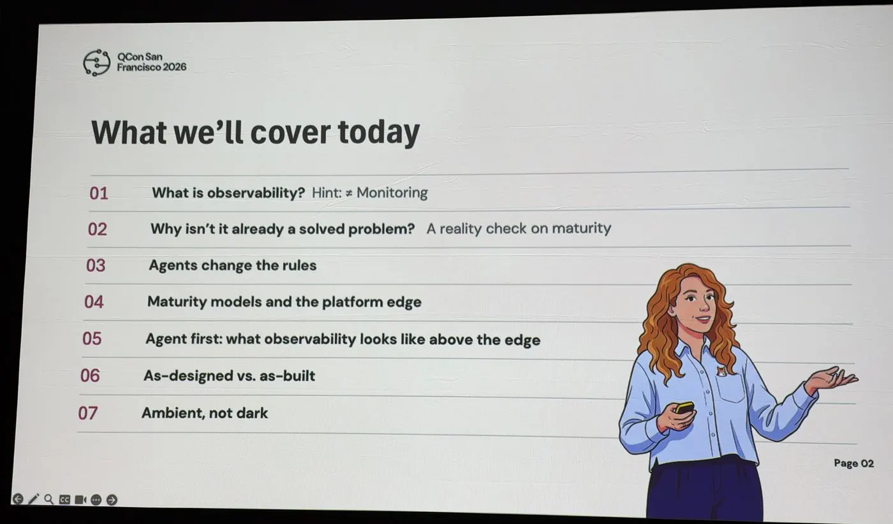](../slides/observability-the-missing-control-plane-for-agentic-engineering/deep/s02.webp)

*Slide 2: What we'll cover today*

*Slide 3: Known-unknowns versus unknown-unknowns.*

*Slide 4: Instrumentation alone doesn't give you the capability.*

[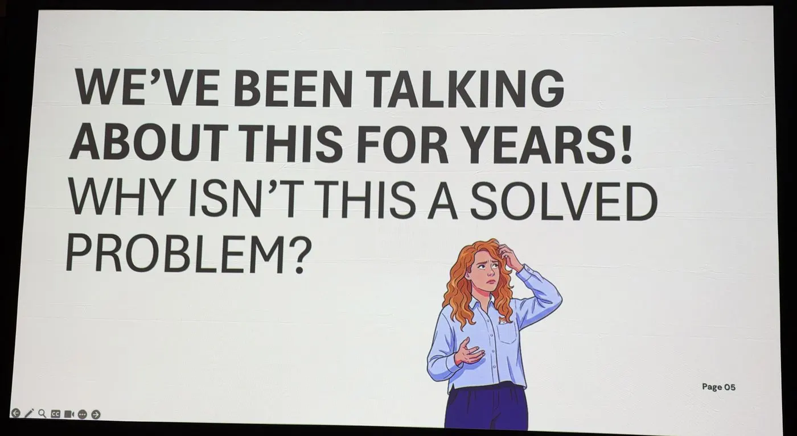](../slides/observability-the-missing-control-plane-for-agentic-engineering/deep/s05.webp)

*Slide 5: Why isn't this a solved problem?*

[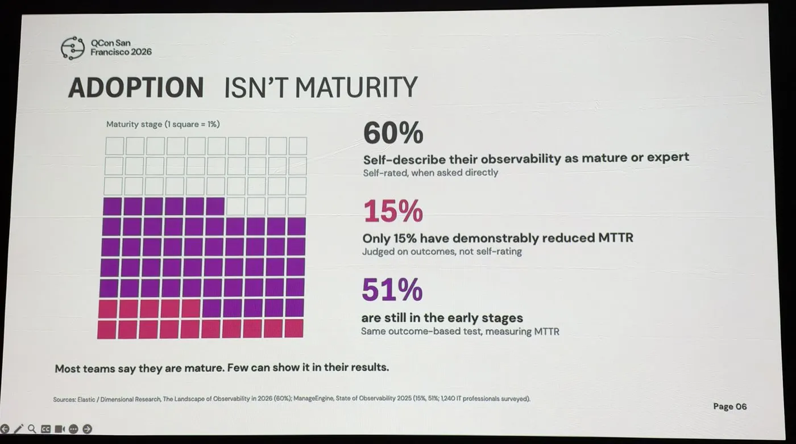](../slides/observability-the-missing-control-plane-for-agentic-engineering/deep/s06.webp)

*Slide 6: Self-rating versus outcomes.*

*Slide 7: A data problem handed to non-data teams.*

[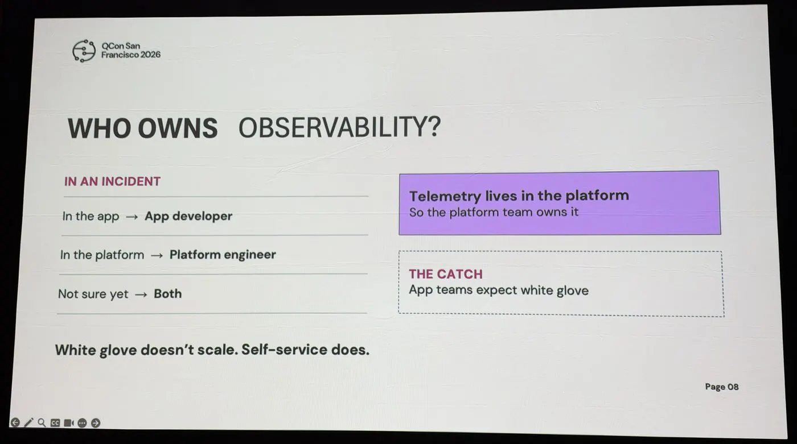](../slides/observability-the-missing-control-plane-for-agentic-engineering/deep/s08.webp)

*Slide 8: Who owns observability?*

*Slide 9: Three teams with a stake in one capability.*

*Slide 10: Curate the shape of the data, not the questions.*

*Slide 11: Deterministic tests guarding probabilistic systems.*

[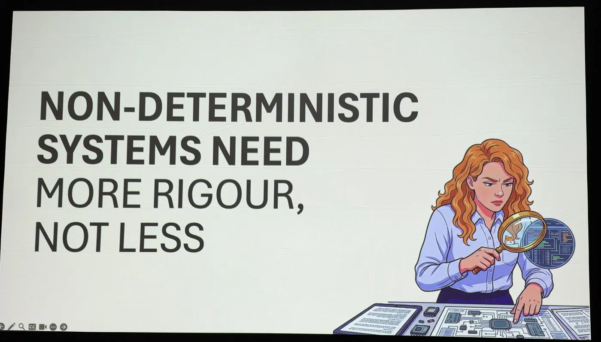](../slides/observability-the-missing-control-plane-for-agentic-engineering/deep/s12.webp)

*Slide 12: Non-deterministic systems need more rigour*

*Slide 13: We know what to do; few do it.*

[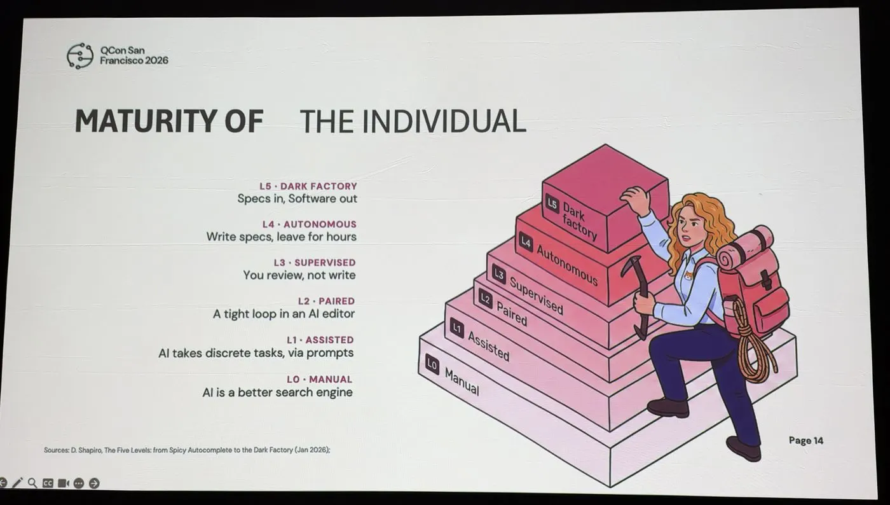](../slides/observability-the-missing-control-plane-for-agentic-engineering/deep/s14.webp)

*Slide 14: Maturity of the individual (Shapiro)*

[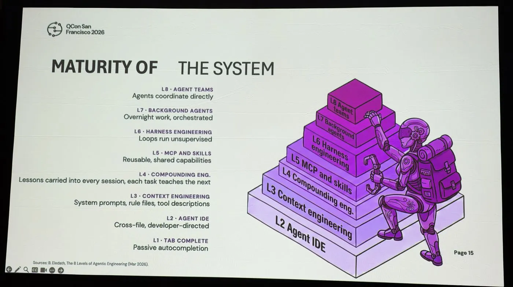](../slides/observability-the-missing-control-plane-for-agentic-engineering/deep/s15.webp)

*Slide 15: Maturity of the system (Eledath)*

[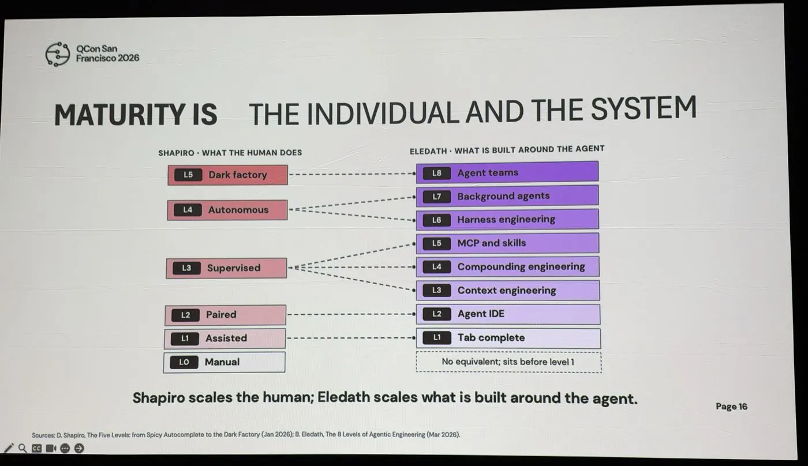](../slides/observability-the-missing-control-plane-for-agentic-engineering/deep/s16.webp)

*Slide 16: Shapiro and Eledath side by side.*

*Slide 17: Her ladder, with the platform edge.*

*Slide 18: Trace the whole scenario; more autonomy needs more evidence.*

*Slide 19: Prompt, tool and model changes ship like releases.*

[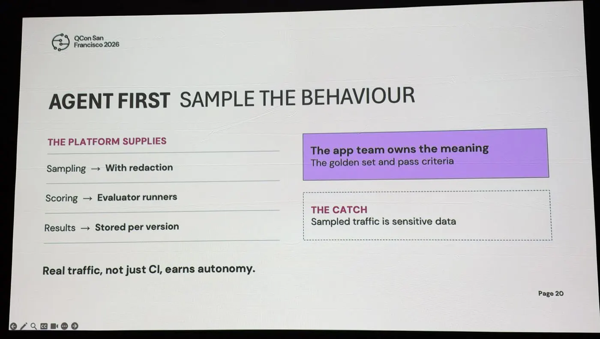](../slides/observability-the-missing-control-plane-for-agentic-engineering/deep/s20.webp)

*Slide 20: Agent first: sample the behaviour*

[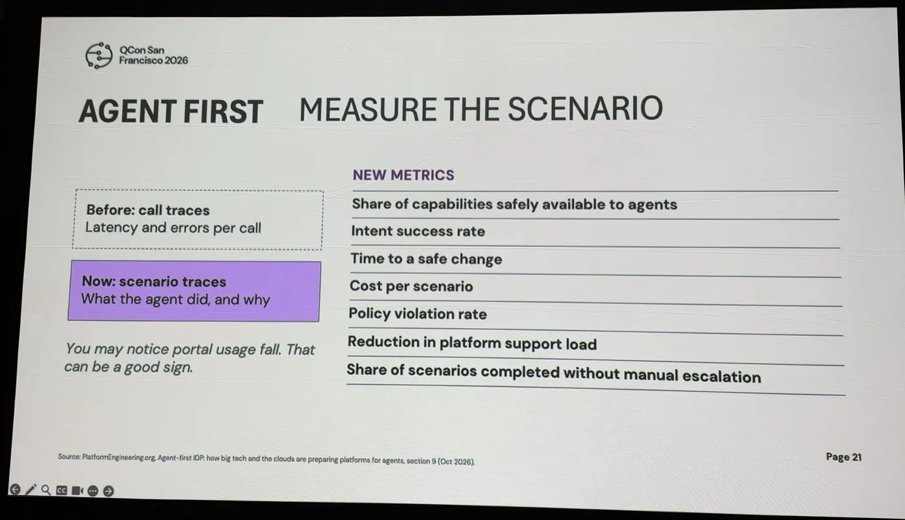](../slides/observability-the-missing-control-plane-for-agentic-engineering/deep/s21.webp)

*Slide 21: Agent first: measure the scenario*

*Slide 22: A drift check as a governed, traceable chain.*

[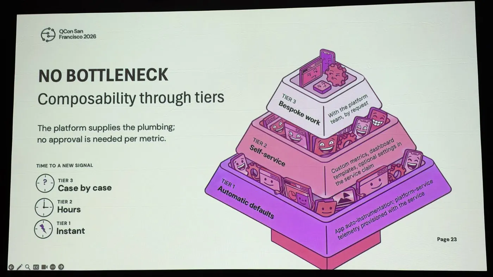](../slides/observability-the-missing-control-plane-for-agentic-engineering/deep/s23.webp)

*Slide 23: Three tiers; no ticket per metric.*

[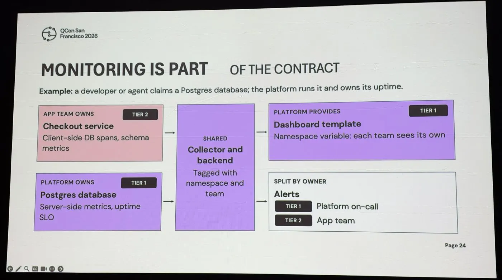](../slides/observability-the-missing-control-plane-for-agentic-engineering/deep/s24.webp)

*Slide 24: Monitoring is part of the contract*

[![Slide: Three parts, one gap. Capabilities: functions to invoke, such as provision infrastructure, deploy applications, retrieve operational data. Context: what should exist, application metadata, architecture, configuration and change records. Controls: rules that hold, approvals, role-based access, non-human identity and delegated permissions. What's missing: every model of context describes the as-designed state. None tells the agent what is actually running. Production telemetry is the as-built half, and observability reconciles the two.](../slides/observability-the-missing-control-plane-for-agentic-engineering/deep/s25.webp)](../slides/observability-the-missing-control-plane-for-agentic-engineering/deep/s25.webp)

*Slide 25: Capabilities, context, controls, and the missing half.*

[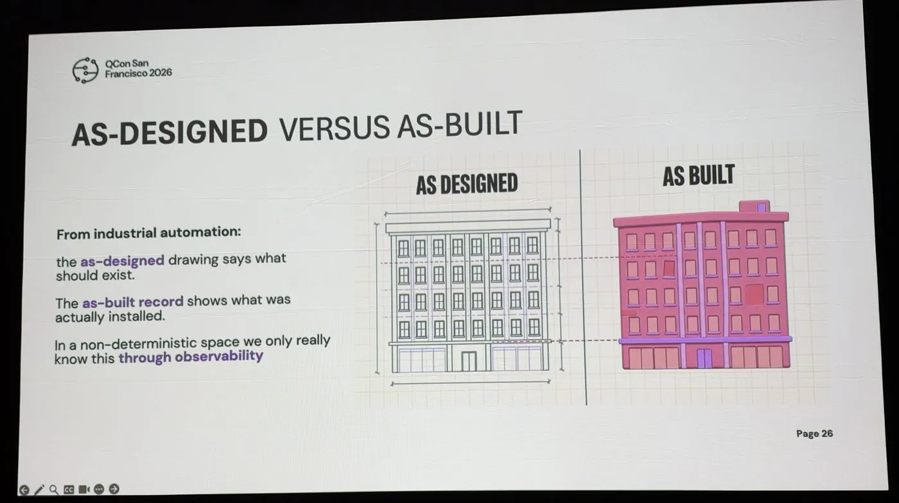](../slides/observability-the-missing-control-plane-for-agentic-engineering/deep/s26.webp)

*Slide 26: The drawing and the building never quite match.*

[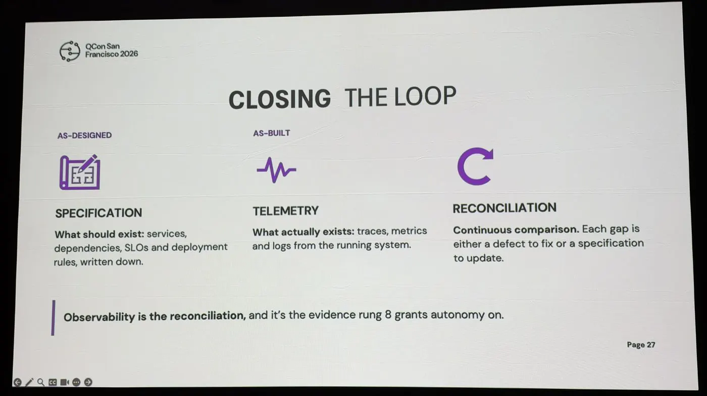](../slides/observability-the-missing-control-plane-for-agentic-engineering/deep/s27.webp)

*Slide 27: Closing the loop*

*Slide 30: Failure, investigate, resolve, escalate.*

[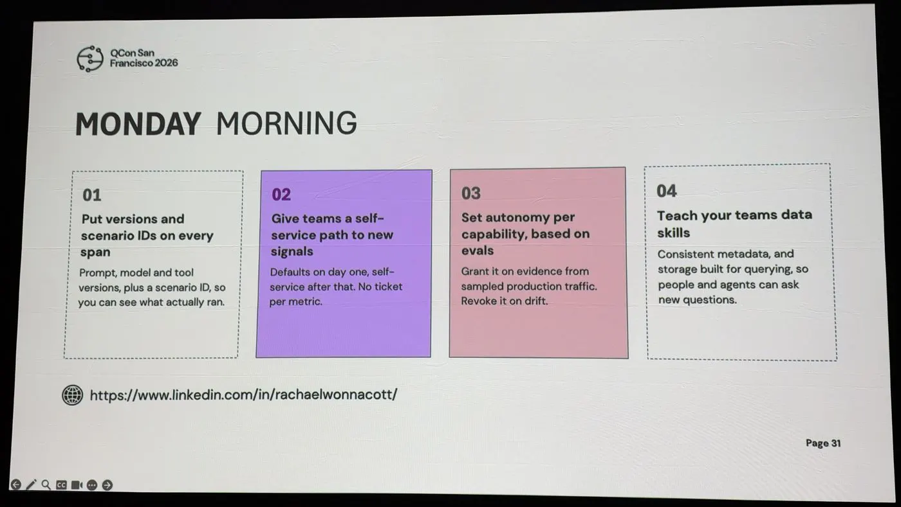](../slides/observability-the-missing-control-plane-for-agentic-engineering/deep/s31.webp)

*Slide 31: Four things to start on Monday.*
