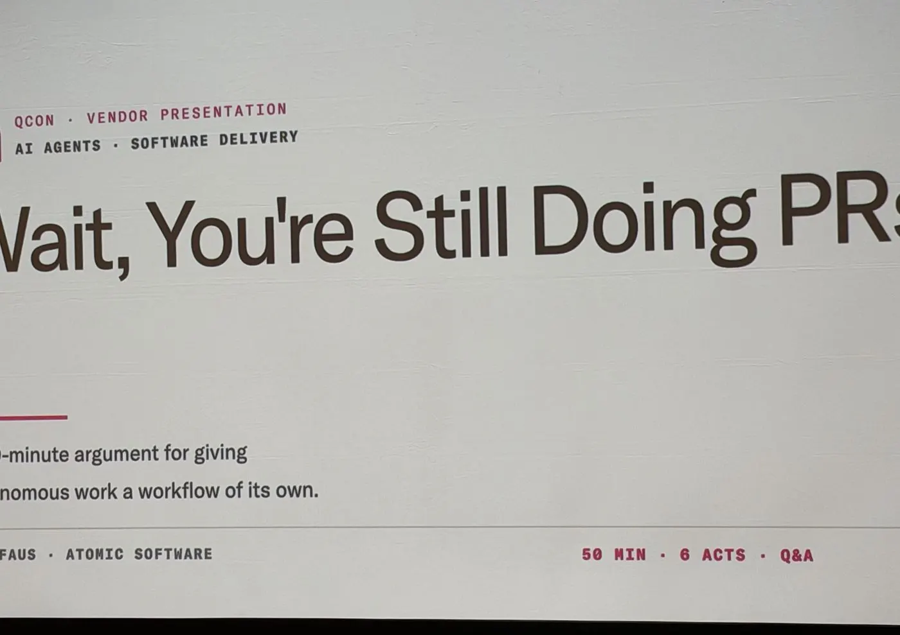
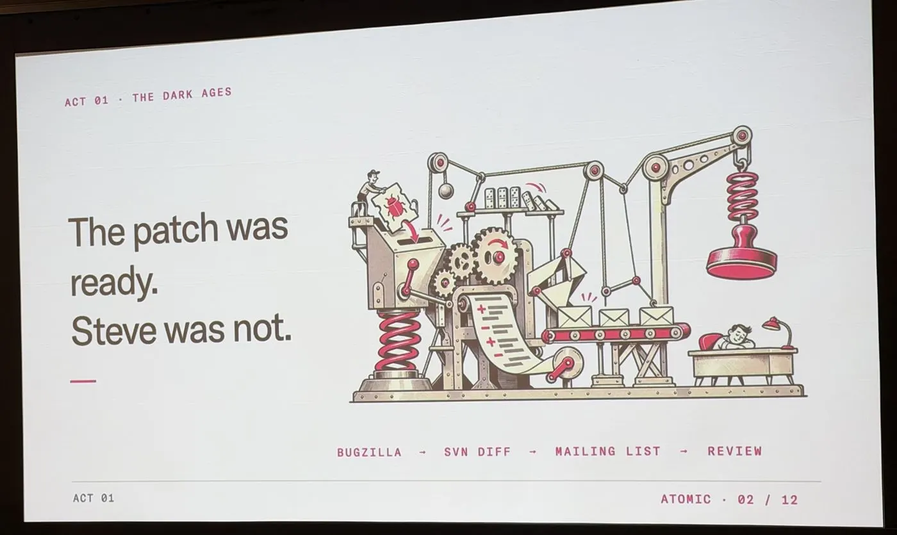
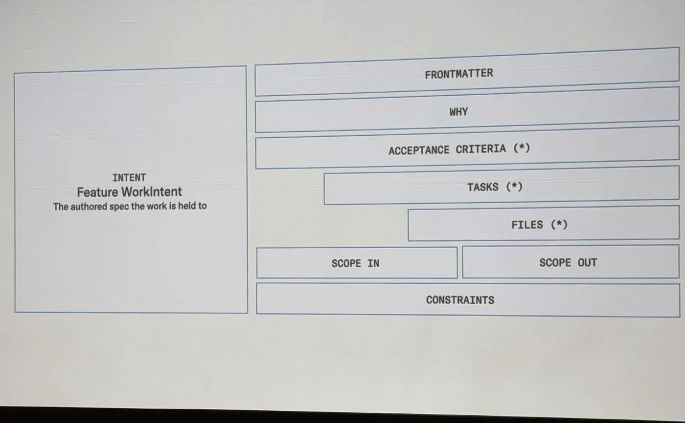
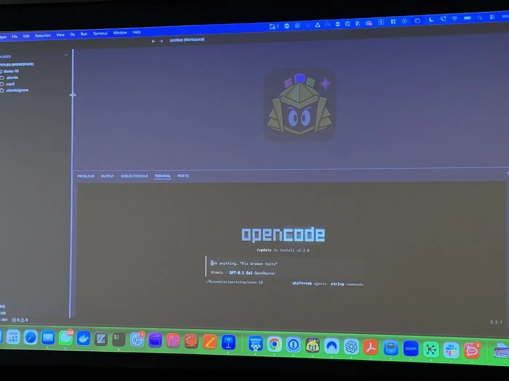
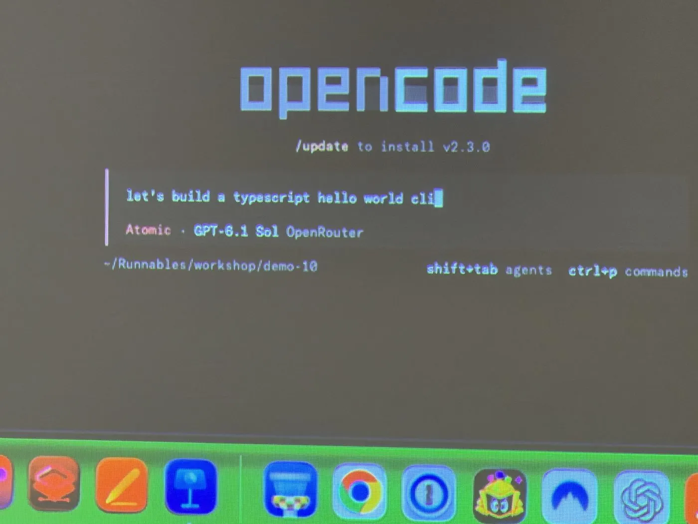
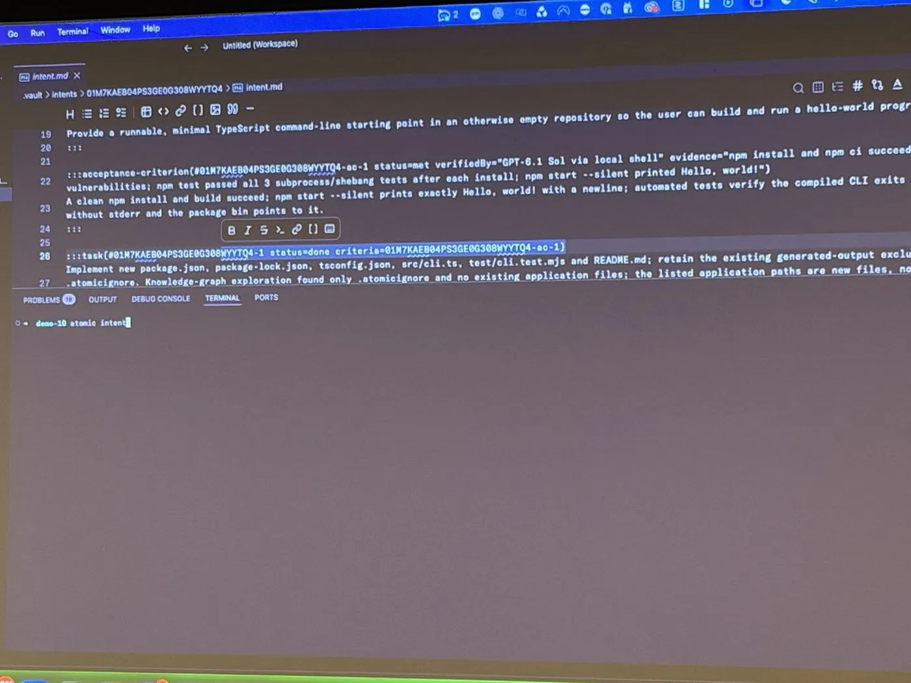
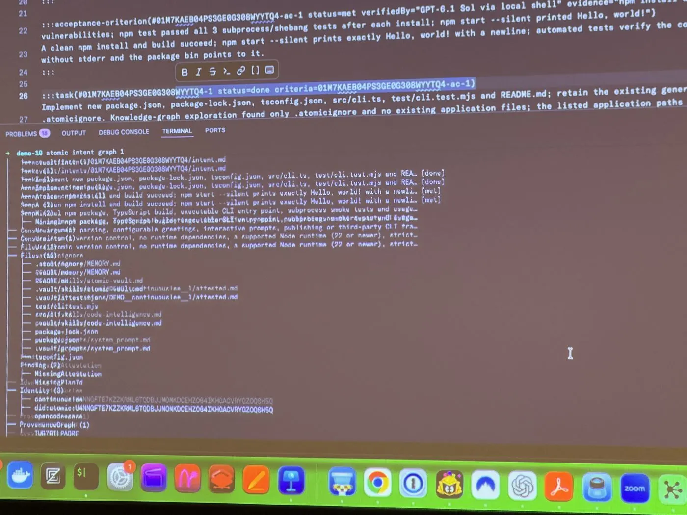
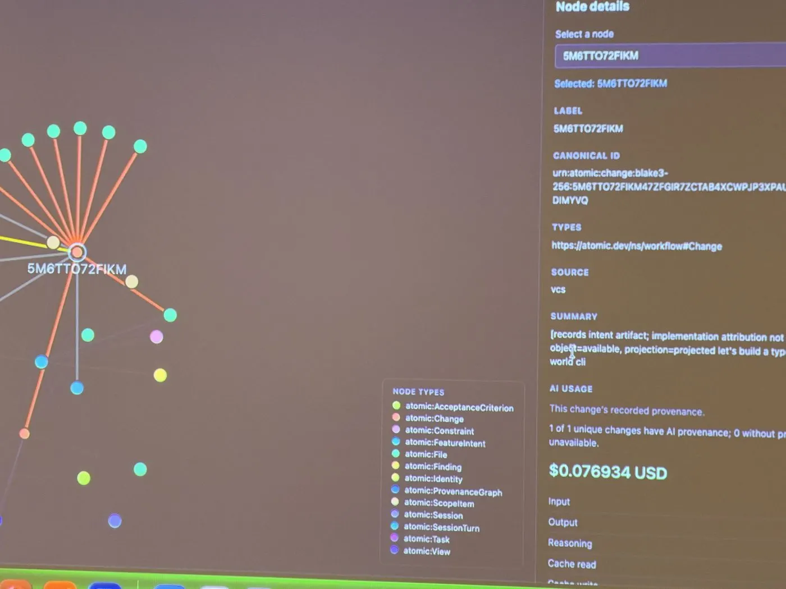
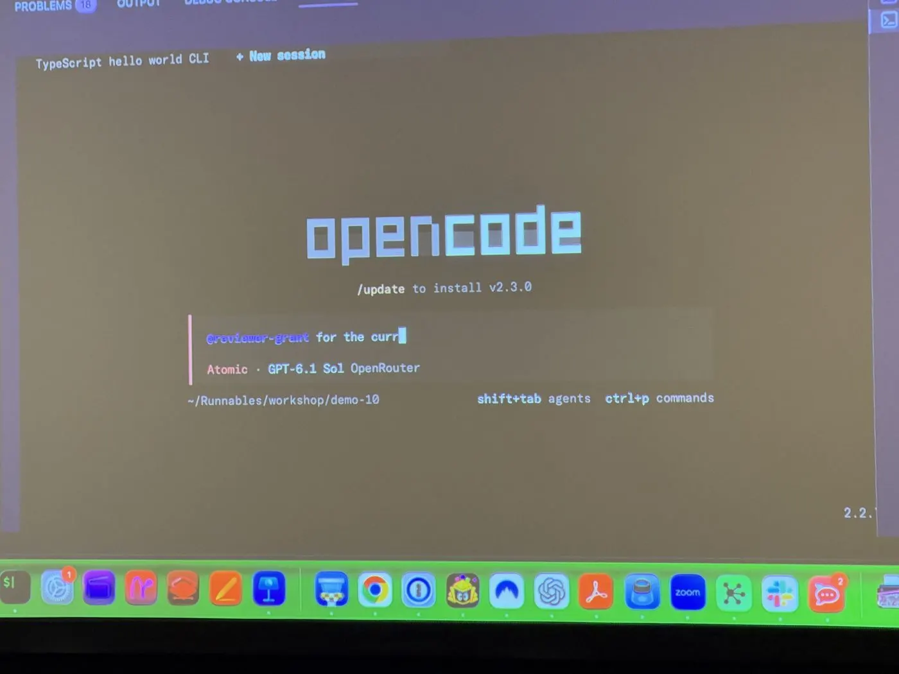

# Slides: Wait, You're Still Doing PRs?

[Back to the notes](../talks/wait-you-re-still-doing-prs.md)

*Slide 1: Title slide*

*Slide 2: Act 01: the dark ages*

*Slide 3: The five-step loop*

*Slide 4: Anatomy of an intent*

*Slide 5: Demo: empty project*

*Slide 6: Demo: the prompt*

*Slide 7: Demo: built, verified, needs review*

*Slide 8: Demo: the intent page*

*Slide 9: Demo: verification evidence*

*Slide 10: Demo: Markdown directives*

*Slide 11: Demo: intent graph tree*

*Slide 12: Demo: graph details*

*Slide 13: Demo: graph view*

*Slide 14: Demo: a change's cost*

*Slide 15: Demo: asking for a reviewer*

*Slide 16: Demo: reviewer grant terms*

*Slide 17: Demo: the gate holds*
