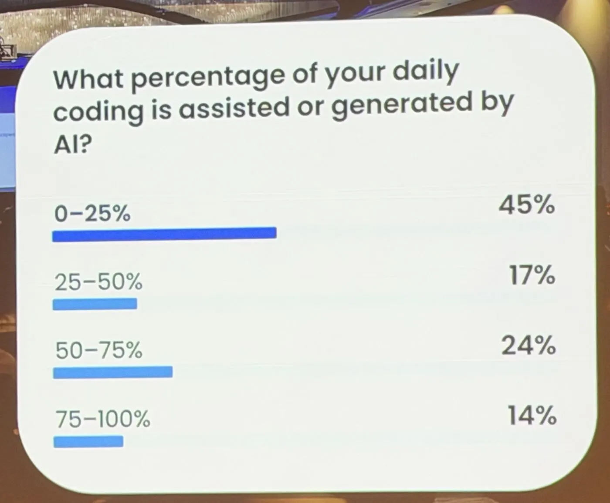
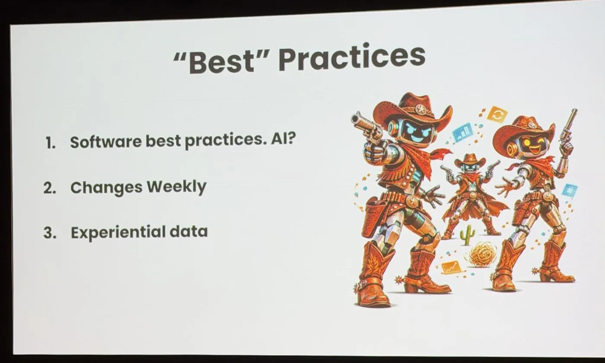
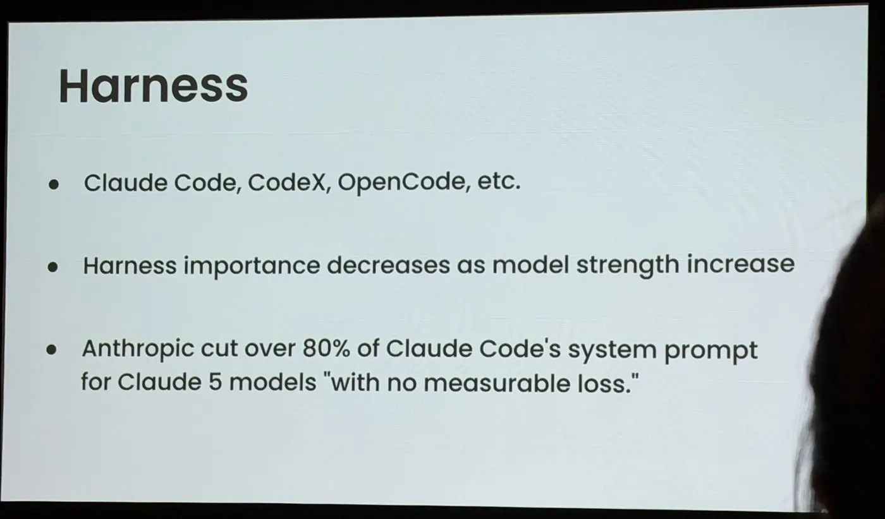
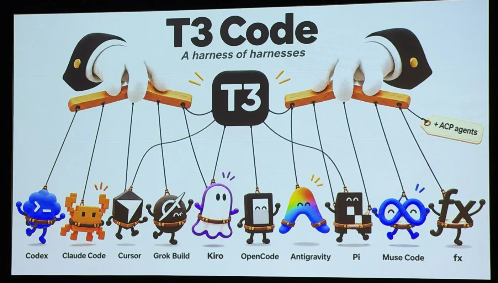
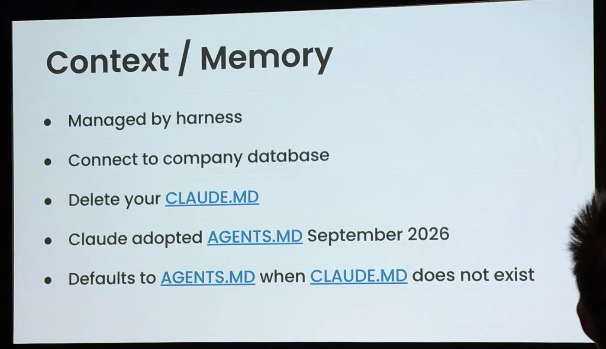
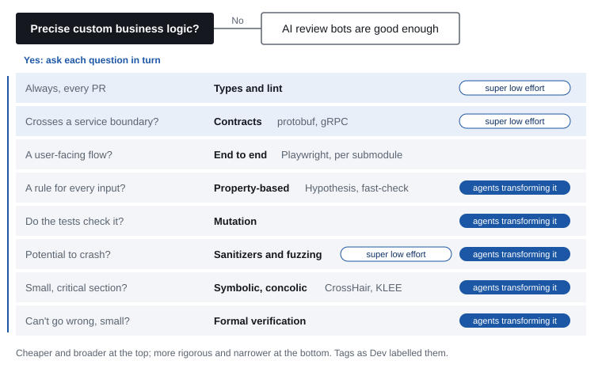
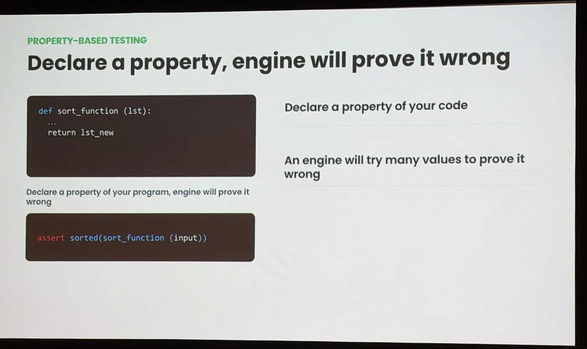
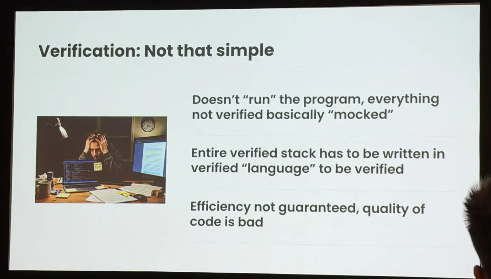

# AI-Assisted Coding Master Class: Build Your Mission Control

**Speakers:** Sepehr Khosravi (Founder, OneKit); Dev Bali (ML Systems PhD Student, UC Berkeley)  
QCon SF 2026 · Training (half day) · Thu Nov 19, 13:00 · Seacliff AB  
[Session page](https://qconsf.com/training/nov2026/ai-assisted-coding-master-class-build-your-mission-control)

> A half-day training. Sepehr Khosravi covered running a personal AI coding stack; Dev Bali gave a ladder of tests, from types and contracts up to formal proofs, for trusting AI-written code.

## Key points

- Sepehr showed his poll from last year's QCon SF: 45% of people had AI assist 0 to 25% of their coding and 14% had it do 75 to 100%. This year, by show of hands, about 70% of the room said AI did 100% of their coding. He said Copilot had been the top tool in last year's poll.
- He said there are no settled practices for AI coding yet. On hard tasks he lowers the effort setting before dropping to a smaller model. He cited Anthropic cutting over 80% of Claude Code's system prompt for its Claude 5 models.
- He said generic skills will expire as models improve, and the skills worth keeping encode your own workflow. He summarized Anthropic's hill-climbing guide: design an eval on real tasks, validate the grader, then make one change per round and check for overfitting.
- He described five software factories credited to Cole Medin (dark, fleet, PR, release and self-improving) and said he would build one to learn, not as a general recommendation.
- Dev said human review was never good at catching bugs. He cited ordinary reviewers catching seeded security flaws 3% to 21% of the time, so AI review only has to beat it. Code without precise business logic can rely on AI review bots.
- For code with precise business logic he gave a ladder. It starts with types and lint on every PR and contracts at every service boundary. It continues through end-to-end, property-based and mutation testing to fuzzing, symbolic execution and formal verification.
- He said tests are only a gate if they are real. He cited coding agents adding mocks in 36% of commits against 26% for humans, and Meta finding 277 of 571 bug-catching tests added no line coverage. His advice: prefer properties and contracts over mocks.
- He said agents are making fuzzing, property-based, symbolic and mutation testing much cheaper, but formal verification was still too slow and fragile in his own project. For most applications he concluded testing is enough.

From my recording of the three-hour session and 48 photos of the screen, kept here as 44 slides in the order shown (repeat shots dropped). These are phone photos, not the deck: QCon will post the real slides later and I will swap them in. Parts of the deck were not photographed, including Sepehr's skills comparison, his hill-climbing results and his industry slides; those parts come from the recording only. Most of the third hour was small-group discussion, which I left out.

## The session in brief

This was a half-day training in two parts. Sepehr Khosravi opened with a poll of the room and the same poll from last year, then walked through what works for him personally with AI coding agents: choosing model and effort, the harness, skills as personal workflows, hill climbing against an eval, and five kinds of software factory. His framing was honest: there are no settled best practices, they change weekly, and most of what anyone knows is from experience.

Dev Bali took the second hour and it was the part I came for. His argument: human review was never very good at catching bugs, AI review only has to beat it, and the real lever is testing. He laid out a ladder of checks from types and lint through contracts, end-to-end, property-based testing, mutation testing, fuzzing and symbolic and concolic execution to formal verification. For each, he asked which question it answers, how much effort it takes and whether agents are changing it. His conclusion was that for most applications good testing is enough, and formal verification is still too hard outside small, critical pieces of code.

> “Check the tests themselves. Prefer properties and contracts over mocks.” (Slide 28)

## In depth

This follows the order of the session. Slide numbers refer to the 44 kept photos.

### Part 1. Where the room stands (Slides 1–4)

Sepehr ran the same polls he ran at QCon SF last year. Poll Everywhere did not cooperate this time, so he took the current answers by show of hands and put last year's results on screen. Last year 45% said 0–25% of their daily coding was assisted or generated by AI, 17% said 25–50%, 24% said 50–75% and 14% said 75–100%. On skill level, 59% called themselves intermediate and only 24% advanced or expert. He also asked about monthly AI budgets per person (answers spread from under \$200 to unlimited) and monthly tokens. This year about 70% of the room kept their hands up at 100%, a huge jump from 14% at 75–100% a year ago.

He said Copilot had been the top tool in last year's poll. Nothing in this year's session put it on the map: his harness slide named Claude Code, Codex and OpenCode, and the T3 Code slide shows ten harnesses without it.

*Slide 2: Last year's poll: share of daily coding done with AI*

*Slide 4: “Best” practices: they change weekly*

On budgets he set two ends of the range: Jensen Huang saying he would be alarmed if a \$500,000 engineer did not use at least \$250,000 of tokens, and a company that capped AI spend at a small monthly amount per person and found its heaviest use was people turning documents into slides. I could not confirm the second company from the recording.

> nobody has settled best practices for AI coding; the session shared what has worked for two people, not a standard.

### Models, effort and harnesses (Slides 5–10)

Sepehr is a former ML platform engineer at Coinbase who now runs a startup; his slide claims 2,396 PRs and 120 billion tokens in the last month. He was clear that a startup searching for product fit works very differently from a large company. For choosing a model, he sends people to Arena, which ranks models by blind human votes, because benchmarks are easy to game. His chart (slide 6, illustrative, not data) shows small and large models converging on simple tasks. Mistake number one, in his words, is dropping to a smaller model when you should first lower the effort setting.

On harnesses (Claude Code, Codex, OpenCode), his point was that they matter less as models get stronger, citing Anthropic's cut of over 80% of Claude Code's system prompt. His own front end is T3 Code, an open-source “harness of harnesses” that drives the agents you already pay for from one inbox-style interface, handles git worktrees, chains results across harnesses (build with one, test with another) and restarts threads after a reboot. His one complaint was friction switching between threads; he has built his own “chief of staff” router model to sit above sub-agent chats.

*Slide 7: The harness matters less as models get stronger*

*Slide 8: T3 Code: one surface over ten harnesses, none of them Copilot*

He closed this part on “touchpoints”: software work is starting to look like ML engineering, where you work whenever the model finishes, so he launches agents from his phone and from a Pebble ring while out walking.

### MCP, CLIs, skills and context (Slides 11–13)

The comparison slide puts the three ways an agent reaches a tool side by side. MCP injects the full tool schema (the slide puts that at 32k–82k tokens), handles per-user OAuth and works multi-tenant, but is token-heavy. A CLI costs about 200 tokens because the model already knows commands like `gh pr list --json` from training, runs locally and composes with Unix pipes, but has no per-user OAuth. A skill costs about 30 tokens idle and loads its SKILL.md (about 800 tokens) on demand. His update: Claude Code now loads MCP tools dynamically, so the old context-bloat argument against MCP is mostly gone. The one place he still prefers a CLI is the big, popular tools the model has seen thousands of times in training.

On context: Claude Code adopted AGENTS.md in September 2026 and falls back to it when no CLAUDE.md exists, so he tells people to have their agent fold CLAUDE.md into one AGENTS.md. He also pointed at Anthropic's `/doctor` check for trimming instruction files that newer models no longer need.

*Slide 11: MCP, CLI and skills, by token cost*

*Slide 12: Context and memory: one AGENTS.md*

On skills, he spent credits analyzing the most popular public skill collections. Matt Pocock's are about getting the plan right before writing code (his best-known is grill-me); Garry Tan's gstack skills are much longer and are about running a whole software company; a third author he named spends heavily on agent review loops. His own skills are short workflows (slide 13): `/options`, `/battle-arena`, `/hill-climb`, `/make-it-better`, `/giveme3` (three UI mockups to choose from). He often just says them out loud instead. His view: most generic skills will expire as models improve; the ones worth keeping are tied to how you and your company work, and the best use of other people's skills is to learn how they think.

### Hill climbing (Slides 14–15)

He summarized Anthropic's guide to automating eval design and hill climbing. Five steps: design the eval from real production tasks, validate the grader, run diagnostic checks (grader, plumbing, headroom), make one change per round, and check for overfitting with held-out data, repeating the last two until the score stops moving. Pick a metric that does not top out near 100%. Use the cheapest grader that fits: programmatic checks (exact match, a JSON schema, tests that pass) where output is constrained, and an LLM judge with checkable yes-or-no claims, not a 1-to-5 scale, where it is open-ended. Never judge with the model you are testing.

His examples, from the recording: letting a loop run overnight to make slow pages about twice as fast, and 38 rounds over two days to fix a feature he had rushed. He also let two models act as judges ranking his UI against a target, which he admitted breaks Anthropic's advice.

*Slide 14: Hill climbing in five steps*

*Slide 15: Validate the grader*

### Five software factories, and his own stack (Slides 16–17)

Credited to Cole Medin: a factory is a system where humans plan and judge and agents do everything in between. The **dark factory** (nobody checks the work) fails because your written idea never matches what you meant the first time. The **fleet factory** (tests decide what merges) works for testable, well-bounded work like migrations; he cited Spotify. The **PR factory** (you read every PR) is where most people are. The **release factory** plans several tickets, ships them to staging, and a person tests staging. The **self-improving factory** lets production signals write the tickets. His advice: build one to learn, and for non-technical colleagues; he would not build one as a general recommendation yet.

His own stack (slide 17) is mostly non-code automation: tickets and suggestions prepared every morning from a goals document and a screen-watching agent, hill climbs at night, and lots of voice prompts. He ended on the industry: forward-deployed engineer roles growing fast, flatter organizations, and product judgment as the skill that keeps engineers employed. Those figures were spoken, not shown, so I have left the numbers out.

*Slide 16: The five software factories*

### Part 2. What the room actually runs (Slides 18–22)

Dev opened with his own poll: which of these have you used? AI code review led at 45% of answers, then end-to-end testing at 25%, explicit boundary contracts like gRPC at 10%, mutation testing at 8%, formal verification at 5%, property-based testing, fuzzing and symbolic execution at 3% each, and concolic testing at 0%. The poll capped its responses partway through (the screen reads “Activity is full”), and the shares add to 100%, so they are shares of all answers, not of people.

He then showed how Anthropic's Claude Code team moves a change to merge, from its October 2026 post: local testing guided by skills, required CI where red blocks the merge, AI review that labels findings important, nit or security, human approval scaled by risk, and a merge queue that reruns checks on main. He marked AI review as the only probabilistic step; the rest pass or fail.

*Slide 18: The room: AI review is common, everything past end-to-end is rare*

*Slide 19: Anthropic's life of a change*

On human review, he cited ordinary reviewers catching a seeded security flaw only 3% to 21% of the time, and Semgrep's line that AI review only has to beat that. AI reviewers like CodeRabbit are, in his words, another coding-agent session on top of the diff. They are useful because not every developer does a final check, but their limit is that we cannot state precisely what we want. The configuration matters to cut false positives; his CodeRabbit example (slide 22) adds path rules such as flagging any non-additive change under `proto/` and requiring a down migration for every database migration.

*Slide 21: Human review was never perfect*

*Slide 22: CodeRabbit path rules, including proto files*

His own story (slide 23): an LLM inference scheduler he built with Claude Code and a markdown spec of 200–300 lines, which ended in long debugging runs, several rewrites and a codebase “kind of written by me”. A complete, precise spec is usually too long to write, which is why he turned to testing.

### The ladder (Slides 24, 44)

This is the slide of the session. It starts with one question: does the change carry precise, custom business logic? If not, AI review bots are good enough. If it does, ask in order: does it run on every PR, does it cross a service boundary, is it a user-facing flow, is there a rule that holds for every input, do the tests actually check it, can it crash, is it a small critical section, and can it never be allowed to go wrong? Each answer points to a kind of check. Dev tagged types, contracts and sanitizers as “super low effort” and marked property-based testing, mutation, fuzzing, symbolic execution and formal verification as “agents transforming it”. The first build (slide 24) had seven rungs; the final one (slide 44) added formal verification and a note on end-to-end: “Submodules!”.

![Slide 44: Which testing, where: tools at our disposal. Precise custom business logic? No: AI review bots good enough. Yes, then ask: always, every PR: types and lint, strict TS, Semgrep, super low effort. Crosses a service boundary: contracts, protobuf, gRPC, super low effort. A user-facing flow: end to end, Playwright, submodules. A rule that holds for every input: property-based, Hypothesis, fast-check, agents transforming it. Do the tests actually check it: mutation, agents transforming it. Potential to crash: sanitizers and fuzzing, super low effort, agents transforming it. Small critical section: symbolic and concolic, CrossHair, KLEE, agents transforming it. Can't go wrong, small critical: formal verification, agents transforming it.](../slides/ai-assisted-coding-master-class-build-your-mission-control/deep/s44.webp)

*Slide 44: Tools at our disposal: the full ladder*

### Types, contracts and real tests (Slides 25–29)

**Types and lint.** The cheapest rung, and agents need it more than people: AI agents use TypeScript's `any` nine times more often than humans, so ban it in lint (`no-explicit-any`, `ban-ts-comment`). Slide 25 lists what teams run in November 2026: `tsc --strict` with ESLint v10 and typescript-eslint or Biome 2.5 for TypeScript; pyright or mypy strict plus Ruff for Python; the compiler, golangci-lint and Clippy for Go and Rust; and Semgrep for team rules, CodeQL for security, and dependency-cruiser or import-linter to enforce layers.

**Contracts.** Where code crosses a service boundary, both sides agree on a schema, code on each side is generated from it, and CI diffs it against main so a breaking change fails the build before any consumer breaks. His example is a protobuf field changed from `int64` to `double`, caught by `buf breaking`. The line I wrote down: agents rewrite the inside; humans review the contract.

*Slide 25: Types and lint: what teams run*

*Slide 26: Contracts: a breaking change fails the build*

**Unit tests that aren't.** Agents often produce as many lines of test as code, but a unit test that mocks every step of a function checks what the code does, not what it is supposed to do. It hits 100% line coverage, has to change whenever the implementation changes, and still misses the bug (his slide: “but 2 + 2 = 5”). He did not blame the agents: during training, coverage is the easiest reward signal to hand them. Three figures back this up (slide 28): coding agents add mocks in 36% of commits against 26% for humans; at Meta, 277 of 571 tests that caught real faults added no line coverage, so a coverage bar would have thrown them away; and TDD inside the agent loop cost 3 to 8.5 times the tokens with no clear quality gain in a small study.

**Test inside the box, then the seams.** Testing everything end to end across four modules with five behaviors each means up to 5⁴ = 625 paths, slow, flaky and hard to locate. Testing each module end to end at its interface means 4 × 5 = 20 tests plus a few across the seams, and a failure points to one box, which also keeps an agent's change inside it. An audience question asked why end-to-end is “too expensive”; his answer was compute and time on a large codebase, and that splitting into modules is a one-time investment that pays off more the more you rely on AI.

![Slide 28: Testing AI-written code: tests are the gate, if they're real. 36% versus 26% of commits add mocks, coding agents versus humans (Hora and Robbes, MSR 2026, 1.2M commits, 2,168 repos). 277 of 571 bug-catching tests added no line coverage, a coverage bar would drop them (Meta ACH, FSE 2025, mutation-guided). 3 to 8.5 times the tokens for TDD inside the agent loop, with no clear quality gain (Böckeler, martinfowler.com, Aug 2026, small study). Check the tests themselves. Prefer properties and contracts over mocks. Don't let the code's author grade its own homework.](../slides/ai-assisted-coding-master-class-build-your-mission-control/deep/s28.webp)

*Slide 28: Tests are the gate, if they're real*

*Slide 29: Test inside the box, then the seams*

> don't let the code's author grade its own homework. Prefer properties and contracts over mocks, and check the tests themselves.

### The rungs agents are transforming (Slides 30–35)

Dev's pattern for this half: these techniques have existed for decades and were used by the few people who cared most about correctness. They were hard to configure; agents now do the configuring.

**Fuzzing.** Feed a function millions of random inputs, keep the ones that reach new code and mutate them, and save the input that crashes it. His example is a libFuzzer harness for a PNG parser that ends in an AddressSanitizer heap overflow; the same idea exists as `go test -fuzz`, cargo-fuzz, Jazzer for the JVM and Atheris for Python. What agents change: an expert used to hand-write one harness per function and fix the build. Now LLM pipelines read the project, write the harness, fix the build and check it reaches the target. The HarnessAgent study got working harnesses within three tries for 87% of C and 81% of C++ targets across 243 OSS-Fuzz projects and found 15 new vulnerabilities.

**Property-based testing.** Declare a property of your code (a sort always returns a sorted list with the same elements; decode undoes encode) and an engine tries many values to prove it wrong. It takes more effort than fuzzing because you are writing part of the specification; miss something and you get false positives, allow invalid inputs and you get noise. Agents help by using the code's semantics to aim for a counterexample instead of guessing.

*Slide 31: Fuzzing: the harness writes itself*

*Slide 32: Property-based testing*

**Symbolic and concolic execution.** Don't guess the input, solve for it. Inputs become symbols, each branch adds a condition to the path, and a solver (Z3) finds inputs for each path; random inputs almost never reach `x > 10 and 2x = y + 7`, a solver returns x = 11, y = 15 directly. Concolic runs a real input, flips one branch and solves again. Tools: CrossHair, KLEE, SymCC. Unlike line coverage, it covers paths and records the state of variables on each one, which answers questions like “which roles can reach this query”. It blows up on loops and needs per-language engineering; agents now decide what to make symbolic and summarize constraints across languages (Agentic Concolic Execution, IEEE S&P 2026), and Dev's lab is working on this.

**Mutation testing.** This one tests your tests: the tool makes many small changes to your code (for example charging `0` instead of `cart.total`), runs the suite against each, and any mutant that survives marks a line nothing checks. Easy to start (one command, only changed files on a PR), slow to run (the whole suite once per mutant), and hard to act on, because someone has to read every survivor and write the test. Agents help by choosing realistic mutants instead of random ones, which is what Meta's ACH does. Asked why not just add more tests, he said mutation testing is not widely used for exactly that reason: it only tells you where to look.

*Slide 33: Symbolic and concolic execution*

*Slide 35: Mutation testing: does any test notice?*

### Formal verification, and who it is for (Slides 36–43)

The big claim: Martin Kleppmann predicted in December 2025 that AI will make formal verification mainstream, because humans write the spec and AI writes the code and the proof. Boris Cherny posted in September that Opus 5.5 formally verified the Claude Agent SDK in Lean and produced 16 bug-fixing PRs, sometimes combining Lean with TLA+. The appeal is that the human job shrinks to the spec and the proof checker cannot be fooled. Dev's map of the landscape (slide 39): Dafny and F\* verify then compile to mainstream languages; Verus adds proofs to a subset of Rust; Lean and Rocq are proof assistants (CompCert, a C compiler, is proved in Rocq); TLA+, Quint and P check the design, not your code.

Then his own attempt, on the same scheduler. A simple case (a sorted list and an add function, with pre- and post-conditions) is easy. His real spec (slide 41) took hours to “compile”, had to be precise and was edited many times, and agents started reward-hacking toward anything that compiled. His conclusions: verification does not run the program, so anything unverified is effectively mocked; the whole stack has to be in the verified language; and efficiency is not guaranteed, with code quality often poor. The developers he and his lab talked to (people who still review code, startup developers who will not be slowed down, vibe coders, managers) would not switch to a verified stack, but would use tools that slot into their testing pipeline without getting in the way. His verdict: for most applications testing is enough; formal verification belongs to small, very low-level systems that need guarantees. For distributed systems, he noted, the modeling (TLA+-style model checking of the protocol) was always most of the work, and that has not changed.

![Slide 39: The landscape: four ways to verify. Dafny and F star: verify, then compile; Dafny compiles to C#, Java, Go, Python, JS; F star extracts to OCaml, F# and C, HACL star crypto ships in Firefox, Linux, Python. Verus: invariants on top of Rust, specs and proofs in Rust syntax erased at compile, only a subset of Rust. Lean and Rocq: formal math, proof assistants first; Lean 4 compiles to C, Rocq extracts to OCaml, CompCert a C compiler is proved in Rocq. TLA+, Quint, P: model checking, checks the design not your code; code generation is rare, PGo compiles PlusCal to Go.](../slides/ai-assisted-coding-master-class-build-your-mission-control/deep/s39.webp)

*Slide 39: Four ways to verify*

*Slide 42: Verification: not that simple*

> the ladder, not the top rung. Most of the value is in types, contracts, real tests and mutation checks, which are cheap now; formal methods are for the few small pieces that must never fail.

## The testing ladder, rung by rung

Dev's slide is the one I want to keep coming back to, so this section breaks it down. For each rung: the question that sends you there, what the check does, the tools he named, and equivalents for Java and Spring, Angular and TypeScript, and Python. Tools in the last column were not named in the talk; I found and checked them afterwards.

| Rung                                                | Question                            | Named in the talk                                                       | Java / Spring                                                                                 | TypeScript                                          | Python                                      |
|-----------------------------------------------------|-------------------------------------|-------------------------------------------------------------------------|-----------------------------------------------------------------------------------------------|-----------------------------------------------------|---------------------------------------------|
| **Types and lint**; Super low effort                | Always, every PR                    | strict TS, Semgrep, CodeQL, dependency-cruiser, import-linter           | Compiler warnings as errors, ArchUnit for layers                                              | `tsc --strict`, typescript-eslint `no-explicit-any` | pyright or mypy strict, Ruff, import-linter |
| **Contracts**; Super low effort                     | Crosses a service boundary?         | protobuf, gRPC, `buf breaking`                                          | Spring Cloud Contract, Pact JVM                                                               | Pact JS, generated clients from OpenAPI             | Pact Python, Schemathesis                   |
| **End to end**                                      | A user-facing flow?                 | Playwright, per submodule                                               | Playwright for every stack, run per module at its interface rather than across everything     |                                                     |                                             |
| **Property-based**; Agents transforming it          | A rule that holds for every input?  | Hypothesis, fast-check                                                  | jqwik on JUnit 5                                                                              | fast-check                                          | Hypothesis                                  |
| **Mutation**; Agents transforming it                | Do the tests actually check it?     | (no tool named)                                                         | PIT                                                                                           | StrykerJS                                           | mutmut                                      |
| **Sanitizers and fuzzing**; Super low effort Agents | Potential to crash?                 | libFuzzer, AddressSanitizer, go test -fuzz, cargo-fuzz, Jazzer, Atheris | Jazzer (runs as JUnit tests; see the maintenance note below)                                  | Jazzer.js (same note)                               | Atheris                                     |
| **Symbolic / concolic**; Agents transforming it     | Small, critical section?            | CrossHair, KLEE, SymCC, Z3                                              | No mainstream agent-ready option I could confirm; treat as research                           |                                                     | CrossHair                                   |
| **Formal verification**; Agents transforming it     | Can't go wrong, small and critical? | Dafny, F\*, Verus, Lean, Rocq, TLA+, Quint, P                           | Dafny compiles to Java, C#, Go, Python and JavaScript; TLA+ for protocol and workflow designs |                                                     |                                             |

#### Types and lint : every PR

The cheapest gate and the one agents most need, because they reach for escape hatches like `any`. In Java the compiler already does most of the type work; the gap is architecture rules, which is what ArchUnit, dependency-cruiser and import-linter encode as tests (“controllers never call repositories directly”). Semgrep covers team-specific rules; CodeQL covers security queries.

#### Contracts : every service boundary

The rung that gets the least attention. A contract is a machine-readable agreement about the shape of messages between two services. It can be **schema-first** (an OpenAPI, protobuf, Avro or JSON Schema file that both sides generate code from, diffed in CI) or **consumer-driven** (the consumer's tests record what it actually uses, and the provider's build replays those expectations). Dev's point is that agents may rewrite everything inside a service as long as the contract holds, and people review changes to the contract.

#### End to end : user-facing flows

Still needed for the flows a customer walks through, but scoped per module so a failure points to one place. The “Submodules!” note on the final slide is the instruction.

#### Property-based : rules for every input

Where business rules are invariants: an order total is never negative, applying then removing a discount returns the original price, serialize then deserialize returns the same object, the same inputs always produce the same price. An agent can propose properties; a person should read each one, because the property is the spec.

#### Mutation : are the tests real?

The check that answers “did the agent write tests that test anything”. Running it only on changed files keeps it affordable on a PR; surviving mutants become a list of lines no test checks.

#### Fuzzing, symbolic, formal : small and critical

Fuzzing matters most for parsers, file handling and anything taking untrusted input. Symbolic execution and formal verification are for small pieces where a wrong answer is unacceptable; Dev's own experience says to expect hours per proof and specs that need several rewrites.

### Contract testing in detail

Contracts depend on what crosses the boundary. Dev's example was protobuf over gRPC; a lot of service traffic is REST and events, which have their own versions of the same check.

| Boundary             | Contract file                 | Breaking-change check in CI                                                                                                                         | Consumer-driven option                                                |
|----------------------|-------------------------------|-----------------------------------------------------------------------------------------------------------------------------------------------------|-----------------------------------------------------------------------|
| gRPC services        | `.proto`                      | `buf breaking --against '.git#branch=main'`; the `bufbuild/buf-action` GitHub Action runs it on every PR                                            | Generated stubs on both sides; the contract is the proto              |
| REST APIs            | OpenAPI spec                  | `oasdiff breaking base.yaml head.yaml --fail-on ERR`; Specmatic has a similar backward-compatibility check                                          | Pact (HTTP pacts) or Spring Cloud Contract with stub runner           |
| Kafka events         | Avro, protobuf or JSON Schema | Schema registry compatibility (BACKWARD by default; Confluent recommends BACKWARD_TRANSITIVE for protobuf), checked before publishing a new version | Pact message pacts or Spring Cloud Contract messaging                 |
| Front end to its API | OpenAPI spec                  | Generate the TypeScript client from the spec and compile with `tsc --strict`; a renamed field breaks the build                                      | Pact JS                                                               |
| Any HTTP API, live   | OpenAPI spec                  | Schemathesis generates property-based requests from the spec and checks responses match it                                                          | Not a contract between teams, but catches drift between spec and code |

The review side is the other half. Dev's CodeRabbit example flags any non-additive change under `proto/`; the same rule can live in an AI reviewer's path instructions for `openapi/`, schema folders and migrations, so the one thing a person must read in an agent's PR is the contract diff.

    # proto: fail the PR on a breaking change
    buf breaking --against '.git#branch=main'
    # OpenAPI: fail on definite breaks, report possible ones
    oasdiff breaking origin-main/openapi.yaml openapi.yaml --fail-on ERR

## Numbers I checked

Status: Checked found in the source; Caveat holds with a condition; Slide only taken from the slide, not verified.

| Claim                                                          | Figure                                                                                                        | Source                                                                                                                                                                                                                                                                                                            | Status     |
|----------------------------------------------------------------|---------------------------------------------------------------------------------------------------------------|-------------------------------------------------------------------------------------------------------------------------------------------------------------------------------------------------------------------------------------------------------------------------------------------------------------------|------------|
| Last year's QCon SF poll: share of daily coding assisted by AI | 45% at 0–25%; 14% at 75–100%                                                                                  | Sepehr's own poll, slide 2                                                                                                                                                                                                                                                                                        | Slide only |
| Last year's poll: advanced or expert                           | 24% (12% + 12%)                                                                                               | Slide 3; 59% intermediate                                                                                                                                                                                                                                                                                         | Slide only |
| This year's room at the top of the range                       | About 70% at 100%                                                                                             | Show of hands, from my notes in the room; the audio transcript is garbled here                                                                                                                                                                                                                                    | Caveat     |
| Copilot the top tool in last year's poll                       | \#1                                                                                                           | Spoken only, no slide; the recording is unclear at that point                                                                                                                                                                                                                                                     | Caveat     |
| Tokens a \$500,000 engineer should use                         | \$250,000                                                                                                     | [Jensen Huang on the All-In podcast at GTC 2026](https://www.tomshardware.com/tech-industry/artificial-intelligence/jensen-huang-says-nvidia-engineers-should-use-ai-tokens-worth-half-their-annual-salary-every-year-to-be-fully-productive-compares-not-using-ai-to-using-paper-and-pencil-for-designing-chips) | Checked    |
| Claude Code system prompt cut for Claude 5 models              | Over 80%                                                                                                      | [Anthropic, the new rules of context engineering](https://claude.com/blog/the-new-rules-of-context-engineering-for-claude-5-generation-models): “no measurable loss on our coding evaluations”. Anthropic's own evals, not published                                                                              | Caveat     |
| Claude Code adopts AGENTS.md                                   | Sept 2026                                                                                                     | Claude Code 2.1.277, Sep 18, 2026, reads AGENTS.md when no CLAUDE.md exists ([Thariq Shihipar, quoted](https://simonwillison.net/2026/Sep/18/thariq-shihipar/))                                                                                                                                                   | Checked    |
| Token cost: MCP schema vs CLI vs skill                         | 32k–82k vs ~200 vs ~30 idle                                                                                   | Slide 11; no source given                                                                                                                                                                                                                                                                                         | Slide only |
| Sepehr's last month                                            | 2,396 PRs, 120B tokens                                                                                        | Slide 5, his own figures                                                                                                                                                                                                                                                                                          | Slide only |
| Room poll: tools used                                          | AI review 45%, E2E 25%, contracts 10%, mutation 8%, formal 5%, PBT, fuzzing and symbolic 3% each, concolic 0% | Slide 18. The poll hit its response cap, and shares sum to about 100%, so they are shares of answers, not of people                                                                                                                                                                                               | Caveat     |
| Ordinary code review catching a seeded security flaw           | 3% and 21%                                                                                                    | [Semgrep, Oct 9, 2026](https://semgrep.dev/blog/2026/end-is-nigh-for-code-review), citing [Braz et al., ICSE 2022](https://arxiv.org/abs/2202.04586); two seeded flaws, at best 61% with a tailored checklist                                                                                                     | Checked    |
| Commits that add mocks, agents vs others                       | 36% vs 26%                                                                                                    | [Hora and Robbes, MSR 2026](https://arxiv.org/abs/2602.00409); 1.2M commits in 2,168 TypeScript, JavaScript and Python repos                                                                                                                                                                                      | Checked    |
| Bug-catching tests that added no line coverage                 | 277 of 571                                                                                                    | [Meta ACH, FSE 2025](https://arxiv.org/abs/2501.12862): 49% of tests that killed a mutant added no line coverage. Kotlin Android classes, privacy hardening                                                                                                                                                       | Caveat     |
| Tokens for TDD inside the agent loop                           | 3–8.5x                                                                                                        | [Böckeler, martinfowler.com, Aug 2026](https://martinfowler.com/articles/exploring-gen-ai/tdd-in-the-agent-loop.html). An exploratory, small study; cache reads overstate the cost                                                                                                                                | Caveat     |
| AI agents' use of `any` vs humans                              | 9x                                                                                                            | [Lee, Hassan and Hindle, MSR 2026](https://arxiv.org/abs/2602.17955), TypeScript projects                                                                                                                                                                                                                         | Checked    |
| LLM-written fuzz harnesses that work within three tries        | 87% C, 81% C++; 15 new vulnerabilities in 11 projects                                                         | [Yang et al., HarnessAgent, arXiv 2512.03420](https://arxiv.org/abs/2512.03420); 243 OSS-Fuzz projects. The authors' own evaluation                                                                                                                                                                               | Caveat     |
| Paths vs tests in the boundaries example                       | 625 vs 20                                                                                                     | Slide 29; 5⁴ = 625 and 4 × 5 = 20, rerun                                                                                                                                                                                                                                                                          | Checked    |
| AI will make formal verification mainstream                    | Dec 2025                                                                                                      | [Kleppmann, Dec 8, 2025](https://martin.kleppmann.com/2025/12/08/ai-formal-verification.html)                                                                                                                                                                                                                     | Checked    |
| Opus 5.5 verifying the Claude Agent SDK in Lean                | 16 PRs                                                                                                        | Boris Cherny's post of Sep 22, 2026, as shown on slide 36 and [reported](https://explainx.ai/blog/boris-cherny-opus-5-5-lean-tla-formal-verification-sdk-2026). A social post, not a write-up                                                                                                                     | Caveat     |

## About the speakers

**Sepehr Khosravi** is the founder of OneKit and award-winning faculty at UC Berkeley, where he teaches generative AI and rapid product development; his slide lists three terms of an AI entrepreneurship course. He was previously in machine learning at Coinbase (ML platform engineer) and Tesla, and founded AI Scouts, a free program teaching students to build AI apps ([QCon bio](https://qconsf.com/training/nov2026/ai-assisted-coding-master-class-build-your-mission-control)). He was open that his habits are a startup founder's.

**Dev Bali** is a third-year ML systems PhD student at UC Berkeley, advised by Matei Zaharia and Scott Shenker, with papers at OSDI, SIGCOMM and ASPLOS. His current work is fair scheduling for LLM inference ([Token Latency Fairness, arXiv 2609.18112](https://arxiv.org/abs/2609.18112), the scheduler from his story) and using formal verification and symbolic execution as guardrails for LLM coding. He described himself as the academic view in the room.

## Terms and technologies

### Agents, harnesses and context

[Claude Code](https://code.claude.com/docs)  
Anthropic's agentic coding CLI and harness. The source of the 80% prompt cut and the AGENTS.md change.

[Codex](https://github.com/openai/codex)  
OpenAI's coding agent and CLI, one of the harnesses on Sepehr's slide.

[OpenCode](https://opencode.ai)  
An open-source terminal coding agent that works with many model providers.

[T3 Code](https://github.com/pingdotgg/t3code)  
MIT-licensed “agent harness control surface” from T3 Tools: one desktop, web and mobile app that drives Claude Code, Codex, Cursor, Grok Build, OpenCode and others with your existing subscriptions. Sepehr's daily driver.

[Arena](https://arena.ai)  
Formerly LMArena and Chatbot Arena: a leaderboard built from blind, side-by-side human votes on model answers. Sepehr trusts it over benchmarks.

[MCP](https://modelcontextprotocol.io)  
Model Context Protocol, the standard for connecting agents to tools and data. Costly in tokens when every tool schema is loaded; Claude Code now loads tools on demand.

CLI tools  
Command-line programs like [gh](https://cli.github.com) that agents call through the shell. Cheap in tokens because models learned the commands in training.

[Skills](https://code.claude.com/docs/en/skills)  
Folders of instructions (SKILL.md) an agent loads only when relevant. Sepehr's point: keep the ones that encode your own workflow.

[AGENTS.md](https://agents.md)  
A shared instruction file read by many coding agents; Claude Code reads it when there is no CLAUDE.md, since version 2.1.277.

[Pebble Index 01](https://techcrunch.com/2025/12/09/pebbles-founder-introduces-a-75-ai-smart-ring-for-recording-brief-notes-with-a-press-of-a-button)  
A voice-note ring from Core Devices, the company that revived Pebble, with a battery meant to last years and custom voice actions via MCP. Sepehr uses it to start agents while out walking.

[mattpocock/skills](https://github.com/mattpocock/skills)  
Matt Pocock's public skills, including grill-me (be interviewed about a plan until every branch is resolved) and improve-codebase-architecture.

[gstack](https://github.com/garrytan/gstack)  
Garry Tan's Claude Code skills that act as product, engineering, design, review, QA and release roles.

### Evals and factories

[Hill climbing](https://claude.dev/blog/automating-eval-design-and-hillclimbing/)  
Improve a system against an eval one change at a time, keeping changes that raise the score on held-out data. Anthropic ships it as `/claude-api build-eval` and `/claude-api hillclimb`.

LLM as judge  
Using a model to grade open-ended output. Best with yes-or-no checkable claims and a different model from the one being tested.

Software factory  
A system where people plan and judge and agents do the rest. Sepehr's five kinds come from [Cole Medin](https://www.youtube.com/@colemedin); an [explainer](https://www.mindstudio.ai/blog/ai-software-factory-types-explained) lists the same five.

### Review and testing

[CodeRabbit](https://docs.coderabbit.ai)  
An AI code review service for pull requests, configured with `.coderabbit.yaml`, including per-path review instructions.

Types and lint  
Static checks before anything runs: a strict type checker plus linters. [no-explicit-any](https://typescript-eslint.io/rules/no-explicit-any/) bans TypeScript's escape hatch; [Semgrep](https://semgrep.dev) and [CodeQL](https://codeql.github.com) run custom and security rules; [dependency-cruiser](https://github.com/sverweij/dependency-cruiser) and [import-linter](https://github.com/seddonym/import-linter) enforce layers.

[ArchUnit](https://www.archunit.org)  
A Java library for writing architecture rules as unit tests. Not named in the talk; the Java equivalent of dependency-cruiser.

[Contract testing](https://docs.pact.io)  
Checking that two services agree on the messages between them, by diffing a shared schema or replaying the consumer's recorded expectations against the provider.

[Protocol Buffers](https://protobuf.dev)  
Google's schema language and binary format for structured data; the usual contract for [gRPC](https://grpc.io) services. Field numbers and types are the contract.

[buf breaking](https://buf.build/docs/breaking/)  
Buf's command that compares a protobuf schema with a past version, such as main, and fails on breaking changes.

[oasdiff](https://github.com/oasdiff/oasdiff)  
Compares two OpenAPI specs and reports breaking changes by severity; `--fail-on ERR` makes it a CI gate. Not named in the talk.

[Specmatic](https://docs.specmatic.io/contract_driven_development/backward_compatibility)  
Turns an OpenAPI spec into contract tests and stubs, with a backward-compatibility check. Not named in the talk.

[Pact](https://docs.pact.io)  
Open-source consumer-driven contract testing for HTTP and messages, with libraries for Java, JavaScript, Python and more. Not named in the talk.

[Spring Cloud Contract](https://docs.spring.io/spring-cloud-contract/reference/)  
Consumer- and producer-driven contracts for Spring apps, generating provider tests and consumer stubs. Not named in the talk.

[Schema registry compatibility](https://docs.confluent.io/platform/current/schema-registry/fundamentals/schema-evolution.html)  
Confluent Schema Registry checks each new Avro, protobuf or JSON Schema version against earlier ones under a compatibility type before accepting it. Not named in the talk.

[Schemathesis](https://schemathesis.readthedocs.io/)  
Generates property-based tests from an OpenAPI or GraphQL schema and checks a running API against it. Built on Hypothesis. Not named in the talk.

End-to-end testing  
Exercising a whole user flow through the real system. Dev's advice: per module, at its interface.

[Playwright](https://playwright.dev)  
Microsoft's browser automation and testing framework, the end-to-end tool on Dev's slide.

Property-based testing  
State a property that should hold for all inputs and let an engine search for a counterexample, shrinking it to the smallest failing case.

[Hypothesis](https://hypothesis.readthedocs.io)  
Property-based testing for Python, named on the slide.

[fast-check](https://fast-check.dev)  
Property-based testing for JavaScript and TypeScript, named on the slide.

[jqwik](https://jqwik.net)  
Property-based testing for Java and Kotlin on JUnit 5. Not named in the talk.

Mutation testing  
Make small changes to the code and check whether any test fails; survivors show lines nothing checks.

[PIT](https://pitest.org)  
Mutation testing for the JVM, with Maven and Gradle plugins. Not named in the talk.

[Stryker](https://stryker-mutator.io)  
Mutation testing for JavaScript and TypeScript (StrykerJS), C# and Scala. Not named in the talk.

[mutmut](https://github.com/boxed/mutmut)  
Mutation testing for Python. Not named in the talk.

Fuzzing  
Feeding a program large numbers of generated inputs, guided by coverage, to find crashes and hangs.

[libFuzzer](https://llvm.org/docs/LibFuzzer.html)  
LLVM's in-process, coverage-guided fuzzer; the harness on Dev's slide.

[AddressSanitizer](https://clang.llvm.org/docs/AddressSanitizer.html)  
A compiler-inserted memory error detector that turns silent overflows into crashes a fuzzer can catch.

[Jazzer](https://github.com/CodeIntelligenceTesting/jazzer)  
Coverage-guided fuzzing for the JVM, based on libFuzzer; Jazzer.js does the same for Node. Both repos now say Code Intelligence has stopped maintaining them as open source, so check status before adopting.

[Atheris](https://github.com/google/atheris)  
Coverage-guided fuzzing for Python.

[OSS-Fuzz](https://google.github.io/oss-fuzz/)  
Google's continuous fuzzing service for open-source projects; the benchmark in the HarnessAgent study.

Symbolic execution  
Running a program on symbolic inputs and using a solver to find inputs for each path.

Concolic execution  
Concrete plus symbolic: run a real input, record the path's conditions, flip one and solve for a new input.

[Z3](https://github.com/Z3Prover/z3)  
Microsoft Research's SMT solver, used by most symbolic execution tools.

[CrossHair](https://github.com/pschanely/CrossHair)  
Symbolic analysis for Python that checks contracts and type hints by searching for counterexamples.

[KLEE](https://klee-se.org)  
A symbolic execution engine for C programs built on LLVM. SymCC is a compiler-based alternative.

[ConcoLLMic](https://github.com/ConcoLLMic/ConcoLLMic)  
The agentic concolic execution tool from the IEEE S&P 2026 paper on slide 34.

### Formal verification

[Formal verification](https://en.wikipedia.org/wiki/Formal_verification)  
Proving mathematically that code meets a specification for all inputs, checked by a proof checker.

[Kleppmann's prediction](https://martin.kleppmann.com/2025/12/08/ai-formal-verification.html)  
Martin Kleppmann's Dec 2025 post arguing AI will make formal verification cheap enough for the mainstream.

[Dafny](https://dafny.org)  
A verification-aware language that compiles to C#, Java, Go, Python and JavaScript. [F\*](https://fstar-lang.org) is a proof-oriented language used for the HACL\* crypto library.

[Verus](https://github.com/verus-lang/verus)  
Writes specs and proofs for Rust code in Rust syntax, erased at compile time.

[Lean](https://lean-lang.org)  
A proof assistant and programming language. [Rocq](https://rocq-prover.org) (formerly Coq) is the proof assistant behind the verified [CompCert](https://compcert.org) C compiler.

[TLA+](https://lamport.azurewebsites.net/tla/tla.html)  
Leslie Lamport's language for specifying and model-checking system designs, especially concurrent and distributed ones. [Quint](https://quint-lang.org) and [P](https://p-org.github.io/P/) do similar jobs.

[Vericoding](https://github.com/Beneficial-AI-Foundation/vericoding-benchmark)  
Generating formally verified code from formal specs, as opposed to vibe coding; slide 36 cites the term.

## Reading, tools and repos

### Primary sources from the slides

- [How the Claude Code team does code review](https://claude.dev/blog/solving-code-review-at-anthropic/), Osmani, Lunt and Wang, Oct 15, 2026 (slide 19).
- [Automating eval design and hillclimbing with Claude](https://claude.dev/blog/automating-eval-design-and-hillclimbing/), Lance Martin, Sep 28, 2026 (slides 14–15).
- [The new rules of context engineering for Claude 5 generation models](https://claude.com/blog/the-new-rules-of-context-engineering-for-claude-5-generation-models) (slide 7).
- [The End Is Nigh for Code Review](https://semgrep.dev/blog/2026/end-is-nigh-for-code-review), Semgrep, Oct 9, 2026 (slide 21).
- [Are Coding Agents Generating Over-Mocked Tests?](https://arxiv.org/abs/2602.00409) Hora and Robbes, MSR 2026.
- [Mutation-Guided LLM-based Test Generation at Meta](https://arxiv.org/abs/2501.12862), FSE 2025, and Meta's [engineering post](https://engineering.fb.com/2025/09/30/security/llms-are-the-key-to-mutation-testing-and-better-compliance/).
- [TDD inside the agent loop: theater or actual value?](https://martinfowler.com/articles/exploring-gen-ai/tdd-in-the-agent-loop.html) Birgitta Böckeler.
- [Mining Type Constructs Using Patterns in AI-Generated Code](https://arxiv.org/abs/2602.17955), MSR 2026.
- [HarnessAgent: scaling automatic fuzzing harness construction](https://arxiv.org/abs/2512.03420), Yang et al.
- [Agentic Concolic Execution](https://srg.doc.ic.ac.uk/publications/26-concollmic-sp.html), Luo, Zhao, Wolff, Cadar and Roychoudhury, IEEE S&P 2026.
- [Prediction: AI will make formal verification go mainstream](https://martin.kleppmann.com/2025/12/08/ai-formal-verification.html), Kleppmann.
- [Token Latency Fairness: Performance Isolation for Multi-Tenant LLM Serving](https://arxiv.org/abs/2609.18112), Bali et al. (slide 38).

### GitHub repos

- [pingdotgg/t3code](https://github.com/pingdotgg/t3code): T3 Code.
- [mattpocock/skills](https://github.com/mattpocock/skills) and [garrytan/gstack](https://github.com/garrytan/gstack): the skill collections Sepehr compared.
- [bufbuild/buf-action](https://github.com/bufbuild/buf-action): lint and breaking-change checks for protobuf on every PR.
- [oasdiff/oasdiff](https://github.com/oasdiff/oasdiff): OpenAPI breaking-change detection.
- [pact-foundation](https://github.com/pact-foundation) and [spring-cloud/spring-cloud-contract](https://github.com/spring-cloud/spring-cloud-contract): consumer-driven contracts.
- [CodeIntelligenceTesting/jazzer](https://github.com/CodeIntelligenceTesting/jazzer), [google/atheris](https://github.com/google/atheris): fuzzing for the JVM and Python.
- [pschanely/CrossHair](https://github.com/pschanely/CrossHair), [ConcoLLMic/ConcoLLMic](https://github.com/ConcoLLMic/ConcoLLMic): symbolic and agentic concolic execution.
- [Beneficial-AI-Foundation/vericoding-benchmark](https://github.com/Beneficial-AI-Foundation/vericoding-benchmark): LLMs writing verified code in Dafny, Verus and Lean.

### Related sessions

The three conference days are done; the second training day is Friday. The closest talks this week were Atomic's “Wait, you're still doing PRs?”, Roblox's “Generation got cheap, trust didn't”, Aviator's “How to kill the code review” and Forter's “You can't read the code anymore”, which all moved review toward evidence.
