# Beyond the Model: Engineering the Agent Harness for Autonomous Software Delivery

**Speaker:** Jayant Kulkarni (Senior Solution Architect, Client Engineering, IBM)  
QCon SF 2026 · Sponsored Solution Track I · Mon Nov 16, 11:45 · Pacific LM  
[Session page](https://qconsf.com/presentation/nov2026/beyond-model-engineering-agent-harness-autonomous-software-delivery) · [All 33 slides](../gallery/beyond-the-model-engineering-the-agent-harness.md)

> IBM pitched Bob as a harness for the whole software lifecycle, with modes, rules, skills, hooks and human approval gates around the model.

## Key points

- He traced a shift from prompt engineering in 2023 to context engineering in 2025 to harness engineering in 2026. He said the bottleneck is the agent's ecosystem, not the model's intelligence.
- His harness had four parts: context architecture, agent specialization, persistent memory, and structured execution with human checkpoints.
- Bob works in three modes. Ask is read-only discovery, Plan writes a Markdown plan a person approves, and Agent edits code, runs subagents and MCP tools, and runs tests and scans.
- The default workflow has two human gates: approval of the plan, and approval of shell and Git actions before a commit or pull request. The slides say CI/CD release gates are separate.
- Running /init scans a repo and writes AGENTS.md plus rules files for each mode. The slides give a 270,000-token context window per conversation and advise planning, saving artifacts, then starting a new conversation to implement.
- His maturity curve had four stages, Assist, Delegate, Tailor, and Scale and Extend, illustrated by converting Rundeck jobs to Ansible.
- In recorded demos on IBM's Galaxium Travels sample app, Bob generated Mermaid architecture, class, sequence and use-case diagrams. He said it took about seven to ten minutes.
- He created an asvs-audit skill that checked seven OWASP ASVS Level 1 controls. It reported findings with severity and file location and listed issues it left out of scope.
- The slides claimed 20-80% productivity gains (about 45% on average), 20-40% faster complex delivery and about 40% lower compute cost. They stated no quantified security rate.
- The pricing section showed a SaaS versus self-hosted table and no prices. Self-hosted adds air-gapped deployment and privately hosted models but lacks multimodal routing.

## The talk in brief

Jayant’s premise matches the morning keynote: the model is an engine sitting in a garage until you build a harness around it. He traced the field from prompt engineering (2023) to context engineering (2025) to harness engineering (2026), then presented IBM Bob as IBM’s harness for the whole software lifecycle: an IDE and a CLI with three working modes, project context written to AGENTS.md, rules per mode, skills, hooks, MCP tools, and human approval gates.

Most of the hour was recorded demos against IBM’s Galaxium Travels sample app: generating architecture, class, sequence and use-case diagrams from an unfamiliar repo; writing an OWASP ASVS audit skill and running it; turning a plain-English comment into code with literate coding; and a tour of the settings, budget and hooks screens. This was a sales session. The productivity and cost figures on the slides are IBM’s own, mostly without a published method, and the pricing part of the agenda showed deployment options but no prices.

> “The real measure of success is not how much code AI writes, but how confidently and efficiently we can deliver a correct software change.” (Slide 9)

## In depth

Slide numbers follow the order photographed: 22 deck slides, 8 demo frames and 3 IDE screenshots (33 in all). PowerPoint’s status bar showed a 52-slide deck, so he skipped many slides.

### From prompts to harnesses (slides 1–6)

The agenda (slide 1) promised seven parts: agentic AI, Bob’s introduction, the maturity curve and strengths, demos, pricing and competitive landscape, customer quotes and Q&A. He opened with a timeline of model families from the 1957 perceptron through transformers to today’s multimodal and agentic models (slide 3), then argued that enterprises need agents for different reasons than individual developers do. Work spans the whole lifecycle, context is fragmented across systems, and more code under AI means more governance obligations (slide 4).

Slide 5 sets out three disciplines, each fixing the previous one’s limit. Prompt engineering (2023) says what to do but lacks repository knowledge. Context engineering (2025) supplies requirements and architecture but runs into context-window limits and overload. Harness engineering (2026) adds governed execution so the outcome is repeatable and traceable. He described the failure that drives this: as a session fills its window, irrelevant detail piles up and the model drifts. His summary line: prompts instruct, context grounds, harnesses enable controlled execution.

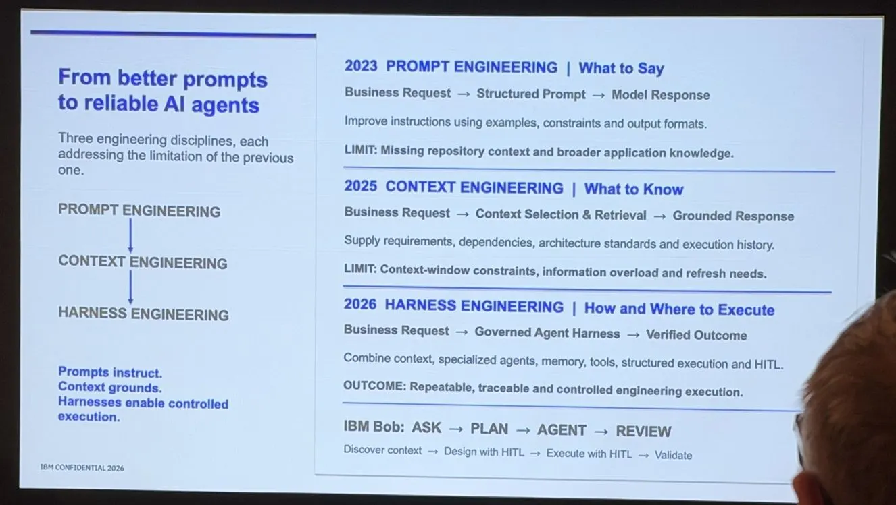

*Slide 5: Three disciplines, each fixing the last one’s limit.*

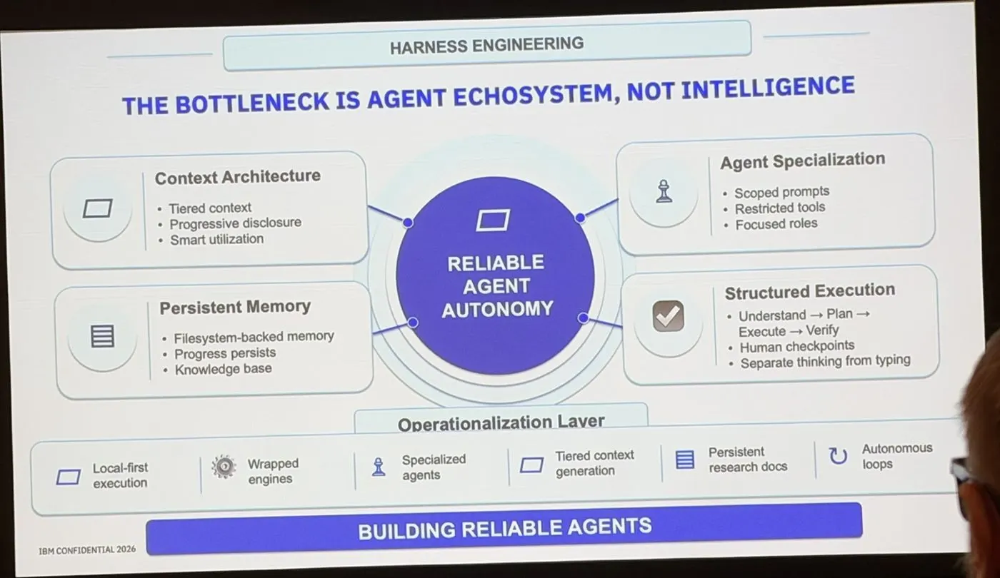

*Slide 6: Four parts of the harness around the model.*

> the same model gives very different results depending on what context, tools and checkpoints surround it. That is the keynote’s argument, told from a vendor’s side.

### What Bob is, and the maturity curve (slides 7–12)

IBM describes Bob as an “AI SDLC partner” that works with real codebases (slide 8). It went generally available on April 28, 2026, after running inside IBM since June 2025, and the IDE is a fork of VS Code. Slide 10 lists analyst and press coverage from late April and early May.

The maturity curve (slide 11) is the slide most worth keeping. It uses one running example, converting Rundeck jobs to Ansible, across four stages:

| Stage            | What the developer does                                                                        | Context rule                          |
|------------------|------------------------------------------------------------------------------------------------|---------------------------------------|
| 1 Assist         | Small natural-language requests; accept or reject every change in a diff view.                 | Keep the context window small.        |
| 2 Delegate       | Give Bob a whole objective; it plans, a person reviews, then it implements across files.       | One plan per conversation.            |
| 3 Tailor         | Encode standards in AGENTS.md, rules and custom modes; set tool restrictions and permissions.  | Keep organizational context concise.  |
| 4 Scale & extend | Use Bob Shell for automation and headless runs; connect Git, Ansible and the CMDB through MCP. | Watch context window and token usage. |

Its footer covers context management: a 270,000-token window per conversation, built from the system prompt, mode, rules, MCP tool definitions, messages and file reads. The best strategy, in order, is plan, save artifacts, start a new conversation, reference files, implement. It also says to prefer direct file references over pasting and to keep MCP configurations lean. Slide 12 shows Bob on an infinity-loop SDLC (code, build, test, review, release, iterate, plan, govern) with the message that a team can start at any stage.

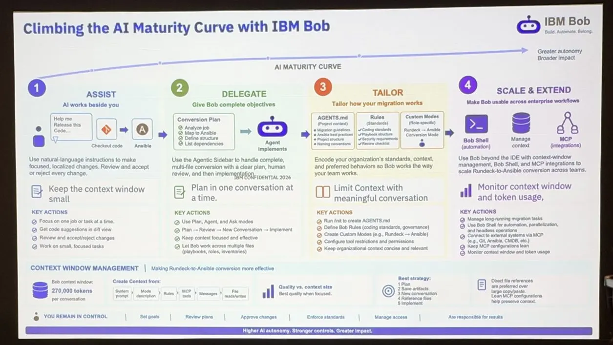

*Slide 11: Assist, Delegate, Tailor, Scale & Extend.*

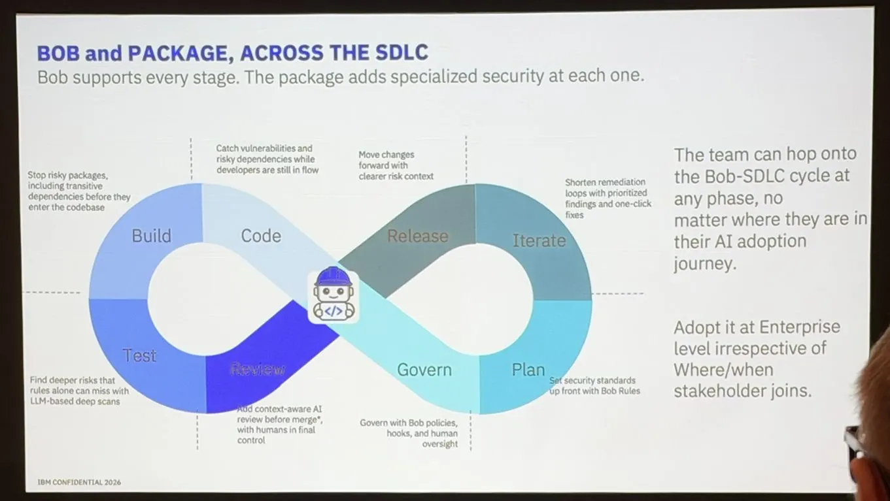

*Slide 12: Join the loop at any stage.*

> the four stages are a usable maturity ladder with a concrete context rule at each step.

### Modes, workflow and claimed strengths (slides 13–17)

Slide 13 separates what Bob knows (skills), what it can use (tools: files, commands, APIs, MCP) and what it is allowed to do (modes and rules), and shows a four-step skill that loads documentation, reads Git sources, maps dependencies and writes a Markdown report for people to review. Slide 14 is the end-to-end workflow, redrawn below from slides 14 and 29. Setup writes AGENTS.md and mode-specific rules under `.bob/rules-ask`, `.bob/rules-plan` and `.bob/rules-agent`.

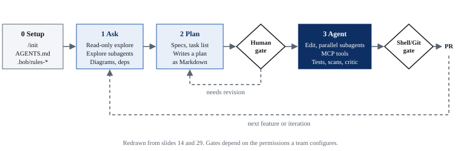

Slide 16 is the clearest statement of who controls what in each mode, and it ends with a caveat worth repeating: mode capabilities and approvals depend on product configuration, and CI/CD review and release gates are separate.

| Mode  | What Bob does                                                    | Output                                            | Developer control                                                    |
|-------|------------------------------------------------------------------|---------------------------------------------------|----------------------------------------------------------------------|
| Ask   | Explores repos, explains code, inspects dependencies. Read-only. | Architecture findings and answers                 | Validate requirements and decide whether planning is needed.         |
| Plan  | Breaks requirements into ordered tasks and designs the change.   | Reviewable Markdown plan with acceptance criteria | Review, challenge and approve before implementation.                 |
| Agent | Writes files, coordinates subagents, runs commands and checks.   | Diffs, tests, security findings, Git/PR handoff   | Approve sensitive operations; review diffs; follow release controls. |

Slides 15 and 17 list the strengths IBM claims: hybrid deployment (SaaS, on-prem, air-gapped through a bastion host), multi-model routing, “Bob findings” for inline security scanning and secrets detection, compliance expertise for FedRAMP, HIPAA and PCI, and native support for Java, COBOL, RPG and IBM i. Slide 17 attaches the benefit numbers covered in section 04.

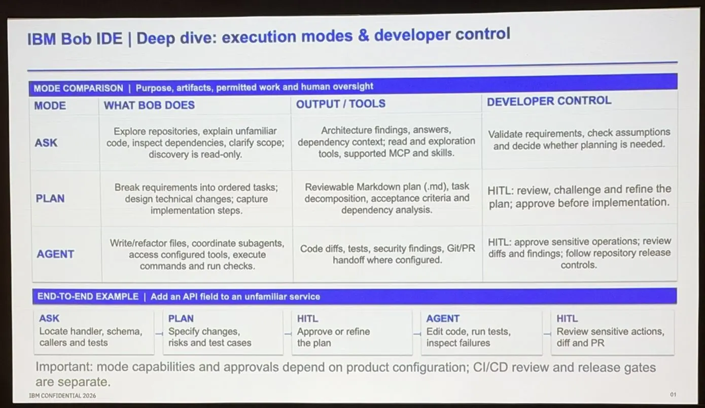

*Slide 16: Who controls what in each mode.*

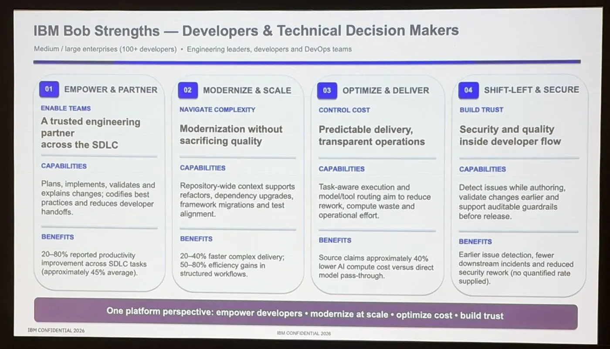

*Slide 17: Claimed benefits, including the 45% average.*

> two human gates (plan approval, then shell and Git actions) are built into the flow by default, with CI/CD gates still the team’s job.

### Demo 1: diagrams from an unfamiliar repo (slides 18–20)

The demos were screen recordings made the day before, played from QuickTime. He cloned Galaxium Travels, a fictional space-travel booking app with a React and TypeScript front end, a Python back end that exposes both a REST API and an MCP interface, a Java hold service and a SQLite database. Running `/init` produced a four-item to-do list: check for an existing AGENTS.md or rules files, identify the stack and build and test commands, analyze architecture and code style, and write AGENTS.md. It found an existing AGENTS.md and updated it (+53, −149 lines).

He then asked Bob for a Mermaid class diagram of the Python models and Java domain classes, and in turn an entity-relationship view, sequence diagrams and use cases, saved to files for later reference. By his account the whole set took about seven to ten minutes. His point: the developer is new, the code isn’t, and diagrams are how a newcomer catches up.

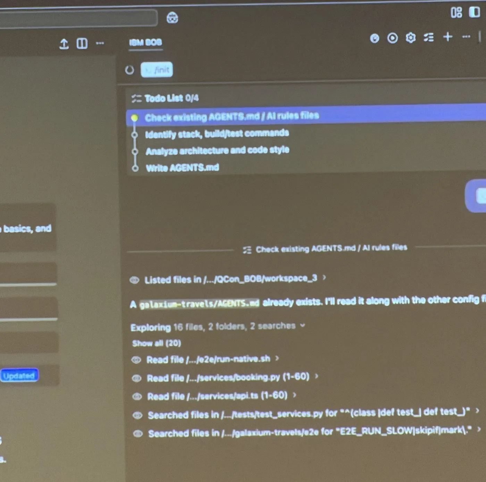

*Slide 19: /init plans its own work first.*

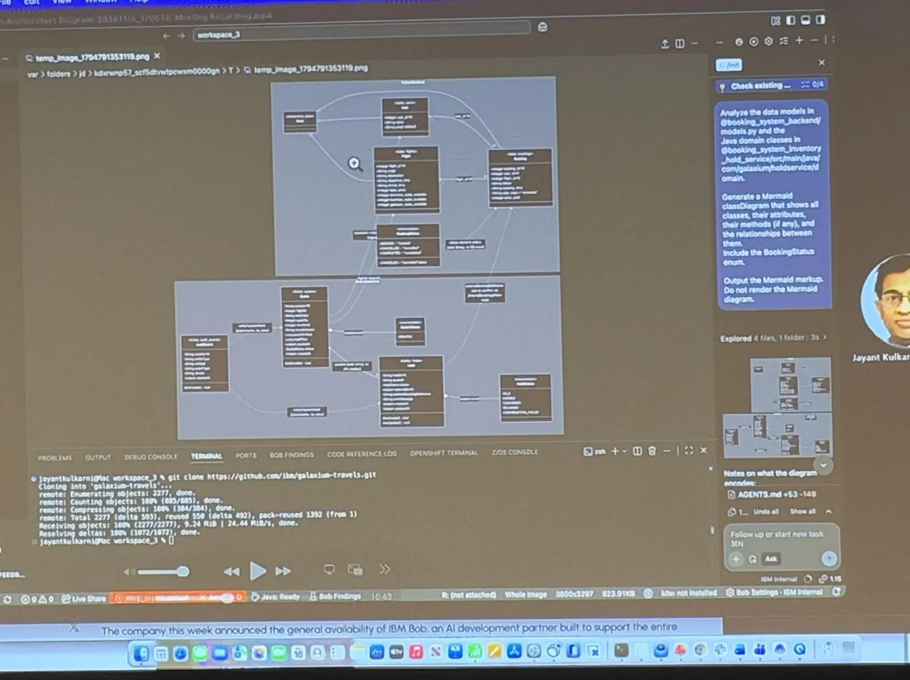

*Slide 20: Class diagram from the Python and Java models.*

### Demo 2: an audit skill (slides 21–23)

He created a workspace skill called `asvs-audit` (“audits a codebase against OWASP ASVS Level 1 access control, input validation, API security, and configuration requirements”), with “allow Bob to use this skill” switched on so it triggers automatically. Plan mode broke the audit into five sub-tasks: discover; access control (ASVS V4.1.3, V4.1.5, V4.2.1); input and URL data (V5.1.1, V13.1.3); CORS and headers (V14.5.3, V14.4.1); and findings and summary.

The findings included no authentication, an IDOR on the bookings and cancel endpoints, unauthenticated MCP tools, unbounded strings, and a wildcard CORS origin combined with credentials. Each came with a severity, a file location and a fix. The plan also noted what it saw but left out of scope (a seat-count race condition, a seed function that wipes the database on startup, a root container user, unpinned dependencies) and said it would not produce SARIF or OSCAL files. He said the app was chosen because it has known flaws. The run took 10 to 13 minutes, by his account.

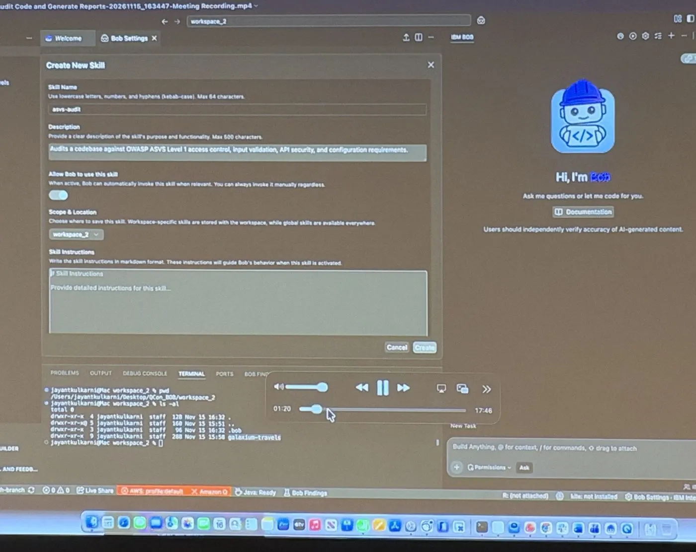

*Slide 22: Creating the asvs-audit skill.*

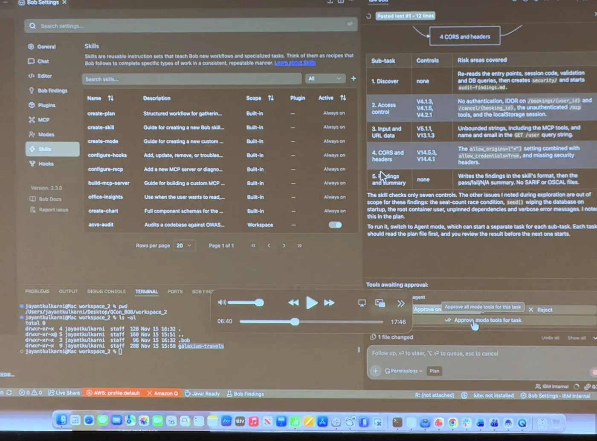

*Slide 23: Five sub-tasks, seven controls, out-of-scope issues listed.*

> the useful part isn’t the scan itself. It’s that the skill pins the scope to named controls and says what it didn’t check.

### Demo 3 and the IDE tour (slides 24–28)

Literate coding means writing a natural-language instruction inside the source file and letting Bob turn it into code in place. He first had Bob fix missing dependencies flagged in red, then wrote “the back end is unreliable, add retry logic”, and Bob inserted it. He said instructions can be written in other languages, such as French. He then asked Bob to explain a block of a React component, which it did line by line (slide 25).

The settings tour showed the governance surface:

- **Tool auto-approval** toggles per tool group: read, edit, execute, MCP, mode switching and subtasks. In his setup only read was on (slide 25).
- **Account and budget**: team “IBM Internal”, add-ons for the IBM i and IBM Z premium packages, a monthly budget of 250 Bobcoins with 52.33 used (21%), resetting monthly, and a link to Bobalytics (slide 26).
- **Built-in skills** such as create-plan, create-skill, create-mode, configure-hooks, configure-mcp, build-mcp-server, office-insights and create-chart, plus a marketplace for team-built skills, modes and MCP servers (slide 27).
- **Hooks**: five global hooks, on SessionStart, PreToolUse for file writes and for commands, PostToolUse for file writes, and Stop, each running a shell script under `~/.bob/hooks` (slide 28). The event names match Claude Code’s.

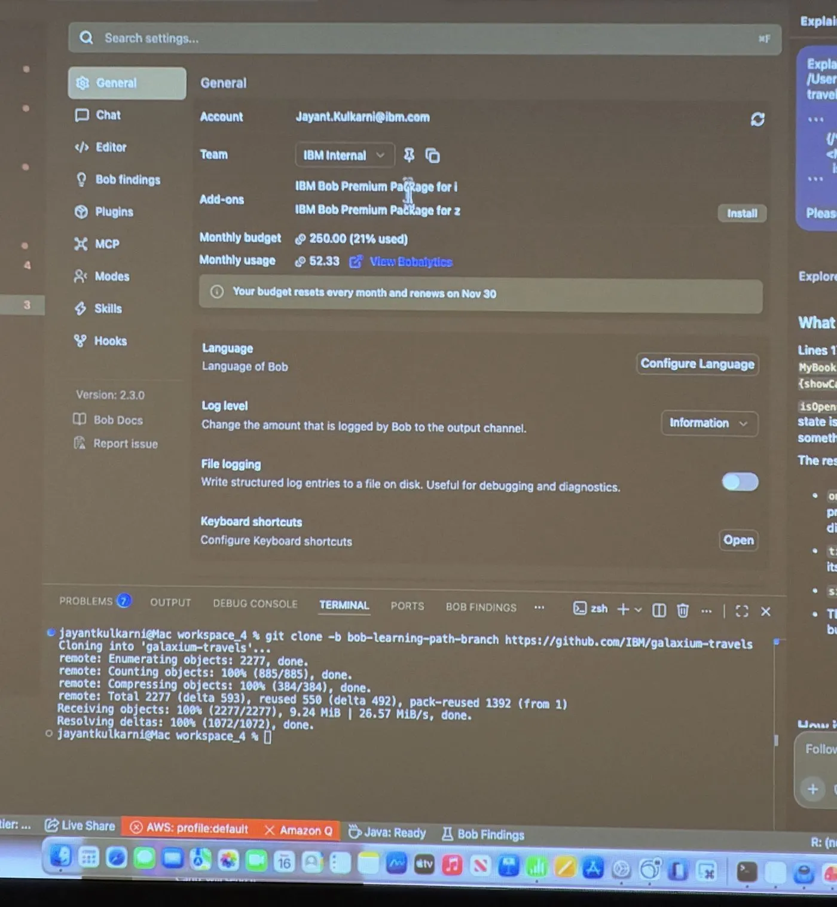

*Slide 26: Budget, usage and premium add-ons.*

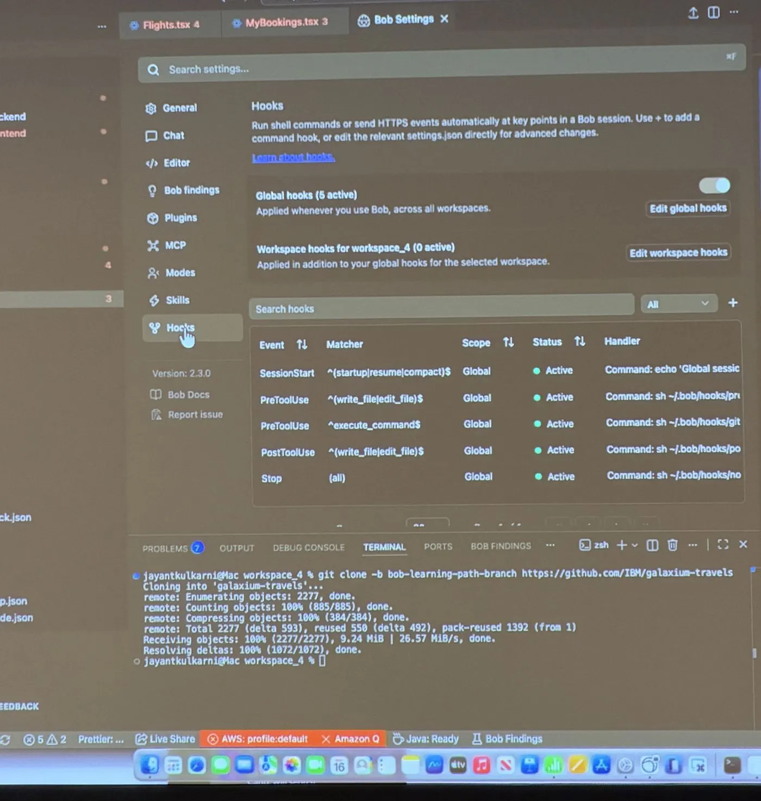

*Slide 28: Five global lifecycle hooks.*

### Roadmap, deployment and testimonials (slides 29–33)

Back in the deck, slide 29 is the workflow diagram above, with the footer “Human review remains part of the workflow: plan approval and permissioned shell/Git actions.” Slide 30 is an October to December roadmap. Items include a local sandbox meant to satisfy CISO requirements, built-in web search, an internal marketplace (Bob Bazaar), admin group policies, intent classification in Bobalytics, a Bob Desktop app for non-technical users, plugins for VS Code and IntelliJ IDEA, remote background agents running tasks in parallel, semantic search across repositories, team budgets and seat controls, observability integration, and on-prem deployment on plain Kubernetes without OpenShift. Its footnote says dates are estimates and external release follows internal by one to two months.

The “pricing and competitive landscape” section turned out to be slide 31, a SaaS versus self-hosted table and no prices. Self-hosted has the same platform but lacks multimodal routing. It adds air-gapped deployment, privately hosted models and reuse of existing model licenses and infrastructure. Slides 32 and 33 are customer and partner quotes from CDW, Fresche Solutions, Act Digital, VirtusLab, Novadoc and Novacomp. No competitors were named.

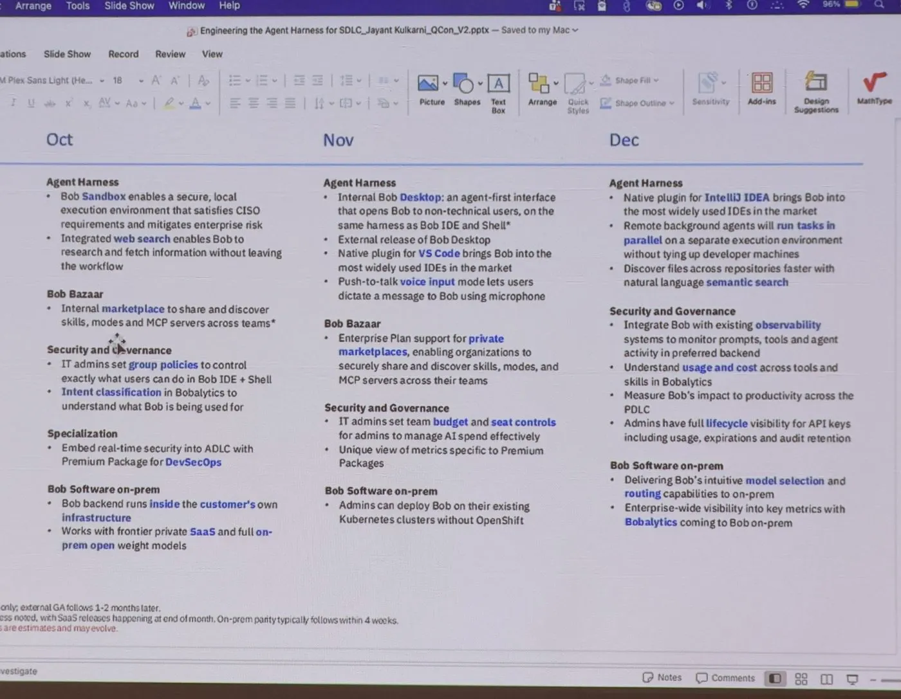

*Slide 30: Roadmap through December. Dates are estimates.*

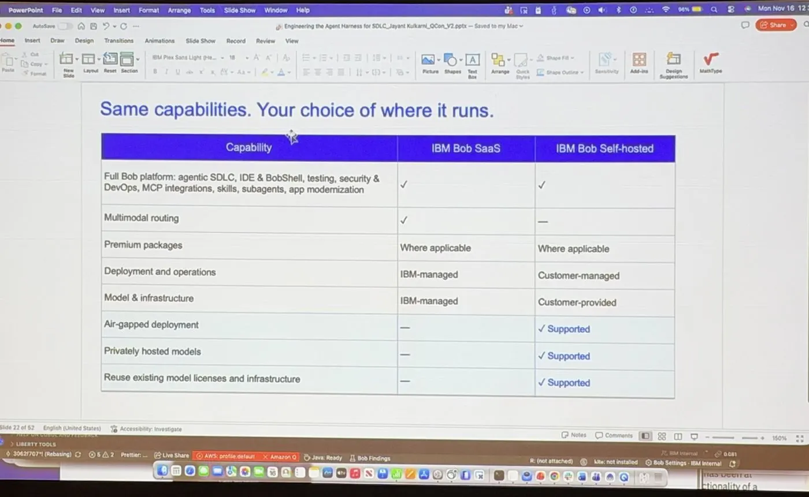

*Slide 31: SaaS versus self-hosted.*

What the abstract promised versus what was shown: the session page described a live multi-step change with parallel agents and validation before merge, and the same harness across IDE, CLI and CI/CD. The demos were recorded and single-agent; parallel agents and CI/CD appeared only on slides and the roadmap.

## Numbers I checked

Every figure below is IBM’s unless marked. None has an independent measurement behind it.

| Claim                                                       | Figure                                                    | Source                                                                                                                                                                                   | Status                                                                                                                                                                                                                           |
|-------------------------------------------------------------|-----------------------------------------------------------|------------------------------------------------------------------------------------------------------------------------------------------------------------------------------------------|----------------------------------------------------------------------------------------------------------------------------------------------------------------------------------------------------------------------------------|
| Bob users inside IBM; average productivity gain             | 80,000+; 45%                                              | [IBM newsroom, Apr 28, 2026](https://newsroom.ibm.com/2026-04-28-introducing-ibm-bob-ai-development-partner-that-takes-enterprises-from-ai-assisted-coding-to-production-ready-software) | Caveat Self-reported by surveyed IBM users. IBM’s blog footnotes it only as “IBM Internal Data”, with no baseline or sample size.                                                                                                |
| Reported productivity range across SDLC tasks               | 20–80%                                                    | Slide 17                                                                                                                                                                                 | Slide only Range not found in IBM’s public material.                                                                                                                                                                             |
| Faster complex delivery; efficiency in structured workflows | 20–40%; 50–80%                                            | Slide 17                                                                                                                                                                                 | Slide only                                                                                                                                                                                                                       |
| Lower AI compute cost than calling a model directly         | ~40%                                                      | Slide 17 (“source claims”)                                                                                                                                                               | Slide only [IBM’s blog](https://www.ibm.com/new/announcements/shifting-from-ai-assisted-coding-to-ai-assisted-delivery-with-ibm-bob) gives no cost figures.                                                                      |
| Security outcomes                                           | none                                                      | Slide 17                                                                                                                                                                                 | Slide only The slide itself says “no quantified rate supplied”.                                                                                                                                                                  |
| Context window per conversation                             | 270,000 tokens                                            | Slide 11; [Multishoring on Bob V2](https://multishoring.com/blog/from-hackathon-demo-to-enterprise-use-case-ibm-dev-day/)                                                                | Caveat Third-party write-up describes 270K isolated context per subagent.                                                                                                                                                        |
| Generally available; internal start                         | Apr 28, 2026; Jun 2025 (100 devs)                         | [IBM UK newsroom](https://uk.newsroom.ibm.com/Introducing-IBM-Bob-AI-Development-Partner)                                                                                                | Checked                                                                                                                                                                                                                          |
| List prices (not shown in the talk)                         | Pro \$20 / 50 coins; Pro+ \$60 / 180; Ultra \$200 / 1,000 | [bob.ibm.com/pricing](https://bob.ibm.com/pricing)                                                                                                                                       | Caveat Indicative and per month. Enterprise pricing is by quote. At launch it was \$20 for 40 coins and \$200 for 500, about \$0.50 a coin ([The Register](https://www.theregister.com/2026/04/28/ibms_ai_coding_partner_bob/)). |
| Premium packages                                            | DevSecOps \$20, Java \$20, IBM i \$40, Z enterprise only  | [bob.ibm.com/pricing](https://bob.ibm.com/pricing)                                                                                                                                       | Checked Per month, indicative.                                                                                                                                                                                                   |
| Demo account budget                                         | 250 coins; 52.33 used (21%)                               | Slide 26                                                                                                                                                                                 | Slide only An IBM internal account.                                                                                                                                                                                              |
| Time to generate diagrams; to run the audit                 | ~7–10 min; 10–13 min                                      | Spoken during recorded demos                                                                                                                                                             | Speaker only Not timed live.                                                                                                                                                                                                     |
| Controls checked by the audit skill                         | 7 (ASVS Level 1)                                          | Slide 23                                                                                                                                                                                 | Slide only Control IDs match ASVS 4.0.3 numbering.                                                                                                                                                                               |

## About the speaker

**Jayant Kulkarni** is a Senior Solution Architect in IBM Technology’s Client Engineering group, the team that builds proofs of concept with customers. His QCon profile lists about 30 years across supply chain, banking, telecommunications, networking and automotive, an MBA, a master’s in data science, and PhD study in quantum computing. The demos were recorded on his own IBM account. The session ran in a sponsored track; IBM confirmed the slides may be shared.

## Terms and technologies

### Harness and context

[Harness engineering](https://claude.ai/artifact/HMh7MpE5JiJLRpHtVPvmPs)  
Designing everything around the model (context, tools, permissions, checks) so agent work is repeatable. The theme of Monday’s keynote (linked: my write-up); Jayant used the same 2023 → 2025 → 2026 framing.

[Context engineering](https://en.wikipedia.org/wiki/Prompt_engineering)  
Choosing what goes into the model’s context window: requirements, code, rules, tool results. Slide 5 places it between prompts and harnesses.

Progressive disclosure  
Loading only what the current step needs and fetching more on demand, instead of front-loading everything. One of the context-architecture items on slide 6.

[AGENTS.md](https://agents.md)  
An open convention: a Markdown file at the repo root telling coding agents how to build, test and follow conventions. Bob’s `/init` writes one, much as Claude Code writes CLAUDE.md.

Subagents  
Helper agents with their own isolated context, spawned for one sub-task so the main conversation stays small. Bob uses explore subagents in Ask mode and parallel ones in Agent mode.

[Model Context Protocol (MCP)](https://modelcontextprotocol.io)  
Open protocol for connecting agents to tools and data. Galaxium’s back end exposes MCP tools, and the audit found those tools unauthenticated.

### IBM Bob features

[IBM Bob](https://bob.ibm.com/docs/ide)  
IBM’s AI development tool: a VS Code-based IDE plus Bob Shell, generally available since April 2026. It succeeds watsonx Code Assistant.

[Modes](https://bob.ibm.com/docs/ide/features/modes)  
Ask (read-only), Plan (design and a Markdown plan) and Agent (edit and execute), each with its own tool access. Custom modes can be created and shared.

Skills  
Reusable instruction sets, stored in `.bob/skills/` per workspace or globally, that Bob can invoke automatically when relevant. The asvs-audit demo is one.

[Lifecycle hooks](https://bob.ibm.com/docs/ide/configuration/lifecycle-hooks)  
Shell commands that run at session start, before and after tool use, around compaction and at stop. Only prompt-submit, pre-tool-use and pre-compact hooks can block. Admins can enforce hooks centrally.

[Bob Shell](https://bob.ibm.com/docs/shell/core-concepts/tools)  
Bob in the terminal, usable headless in automation. Stage 4 of the maturity curve.

[Literate coding](https://bob.ibm.com/docs/ide/tutorials/generate-code-from-comments)  
Writing an instruction in plain language inside the source file and having Bob generate the code in place. The name borrows from Knuth’s [literate programming](https://en.wikipedia.org/wiki/Literate_programming).

[Bobcoins](https://bob.ibm.com/pricing)  
Bob’s usage currency, an abstraction over model tokens. Each action consumes coins based on compute. Plans include a monthly allowance.

Bobalytics  
Bob’s usage and cost dashboard: coin consumption, budgets and, on the roadmap, intent classification and per-skill cost.

[IBM Granite](https://www.ibm.com/granite)  
IBM’s own open model family. Bob routes tasks across Granite, open-source and frontier models.

[Galaxium Travels](https://github.com/IBM/galaxium-travels)  
IBM’s public sample app for Bob tutorials, with deliberate flaws. The demos ran on its `bob-learning-path-branch`.

[Mermaid](https://mermaid.js.org)  
Text-based diagram language that renders in GitHub and many docs tools. Bob saved its class, sequence and use-case diagrams as Mermaid.

### Security and compliance

[OWASP ASVS](https://github.com/OWASP/ASVS)  
OWASP’s Application Security Verification Standard, a catalog of testable security requirements in three levels. Level 1 is the baseline. Version 5.0 shipped in May 2025; the demo used 4.0.3 control numbers.

[IDOR](https://cheatsheetseries.owasp.org/cheatsheets/Insecure_Direct_Object_Reference_Prevention_Cheat_Sheet.html)  
Insecure direct object reference: an endpoint that trusts an ID in the URL, so one user can read or change another’s records.

[CORS](https://developer.mozilla.org/en-US/docs/Web/HTTP/CORS)  
Browser rules for cross-origin requests. Allowing any origin together with credentials is a known misconfiguration.

[SARIF](https://www.oasis-open.org/committees/sarif/)  
OASIS standard JSON format for static-analysis findings, which GitHub and GitLab ingest. The demo skill did not emit it.

[OSCAL](https://csrc.nist.gov/Projects/open-security-controls-assessment-language)  
NIST’s machine-readable format for security controls and assessment results, used in FedRAMP packages.

[FedRAMP](https://www.fedramp.gov)  
US government security authorization program for cloud services.

[HIPAA](https://www.hhs.gov/hipaa)  
US health-data privacy and security law.

[PCI DSS](https://www.pcisecuritystandards.org)  
Card-industry security standard for systems that handle payment card data.

### Platforms, languages and tools

[IBM Z](https://www.ibm.com/z)  
IBM’s mainframe line. The Z premium package targets COBOL and PL/I modernization and is sold to enterprises only.

[IBM i](https://www.ibm.com/products/ibm-i)  
IBM’s integrated operating system for Power servers (formerly AS/400), where much RPG code lives.

[RPG](https://en.wikipedia.org/wiki/IBM_RPG)  
IBM’s business programming language for IBM i. One testimonial said Bob admits when it doesn’t know an RPG op-code.

[COBOL](https://en.wikipedia.org/wiki/COBOL)  
The long-lived business language of mainframe systems; the Q&A covered COBOL-to-Java work.

[Rundeck](https://www.rundeck.com)  
Runbook automation tool for scheduling and running operational jobs. The source side of slide 11’s running example.

[Ansible](https://www.ansible.com)  
Red Hat’s automation tool built on YAML playbooks, roles and inventories. The target side of that example.

[VS Code](https://code.visualstudio.com)  
Microsoft’s open-source editor. Bob’s IDE is a fork of it, like Cursor and Kiro; native VS Code and IntelliJ plugins are on the roadmap.

[IntelliJ IDEA](https://www.jetbrains.com/idea/)  
JetBrains’ Java IDE. A Bob plugin is planned for December.

[Kubernetes](https://kubernetes.io)  
Container orchestration platform. On-prem Bob is planned to run on plain Kubernetes.

[OpenShift](https://www.redhat.com/en/technologies/cloud-computing/openshift)  
Red Hat’s enterprise Kubernetes distribution, which on-prem Bob first required.

[Perceptron](https://en.wikipedia.org/wiki/Perceptron)  
Rosenblatt’s 1957 single-layer neural network, where slide 3’s timeline starts.

[Transformer](https://en.wikipedia.org/wiki/Transformer_(deep_learning_architecture))  
The 2017 attention-based architecture behind today’s language models.

## Reading and tools

### Primary sources

- [IBM press release: Introducing IBM Bob](https://newsroom.ibm.com/2026-04-28-introducing-ibm-bob-ai-development-partner-that-takes-enterprises-from-ai-assisted-coding-to-production-ready-software) (Apr 28, 2026)
- [IBM blog: Shifting from AI-assisted coding to AI-assisted delivery](https://www.ibm.com/new/announcements/shifting-from-ai-assisted-coding-to-ai-assisted-delivery-with-ibm-bob), with the Blue Pearl and APIS IT customer claims
- [Bob tutorial on Galaxium Travels](https://bob.ibm.com/docs/ide/getting-started/tutorials/introduction), the same path the demos followed, including [managing the context window](https://bob.ibm.com/docs/ide/tutorials/context-window)
- [Bob August 2026 release notes](https://bob.ibm.com/blog/august-2026-release-2): the Hooks tab and centrally enforced hooks
- [Bob pricing](https://bob.ibm.com/pricing)

### Coverage cited on slide 10, and since

- [DevOps.com: IBM Bob takes AI coding assistants to the next level](https://devops.com/ibm-bob-takes-ai-coding-assistants-to-the-next-level/), quoting Mitch Ashley of The Futurum Group
- [IDC: IBM Bob and the rise of agentic SDLC platforms](https://www.ibm.com/forms/mkt-whitepaper-17653) (gated, via IBM)
- [IBM Bob: Agentic SDLC platform targets enterprise delivery](https://www.efficientlyconnected.com/ibm-bob-agentic-sdlc-platform-enterprise-delivery/) (the slide credits SiliconANGLE)
- [The Register on GA, pricing and early security findings](https://www.theregister.com/2026/04/28/ibms_ai_coding_partner_bob/)
- [InfoWorld on the July multi-agent and cost-analytics update](https://www.infoworld.com/article/4195291/ibm-bob-expands-beyond-code-generation-to-orchestrate-the-entire-sdlc.html)

### Related sessions

- [The Harness Is the New Operating System](https://claude.ai/artifact/HMh7MpE5JiJLRpHtVPvmPs), Manju Rajashekhar’s keynote (Monday, our write-up).
- **Still ahead:** [You Steer, Agents Execute](https://qconsf.com/presentation/nov2026/you-steer-agents-execute-developer-led-modernization-agentic-ai), Sunil Murthy (IBM), Tue 10:35 AM, Marina. The follow-on IBM session on modernization.
- **Still ahead:** [Drawing the Rest of the Owl: A Blueprint for Your Software Factory](https://qconsf.com/presentation/nov2026/drawing-rest-owl-blueprint-your-software-factory), Chris Kelly (Harness), Tue 1:35 PM, Pacific LM.
- **Still ahead:** [How To Kill the Code Review](https://qconsf.com/presentation/nov2026/how-kill-code-review), Ankit Jain (Aviator), Wed 3:55 PM, Ballroom A.

