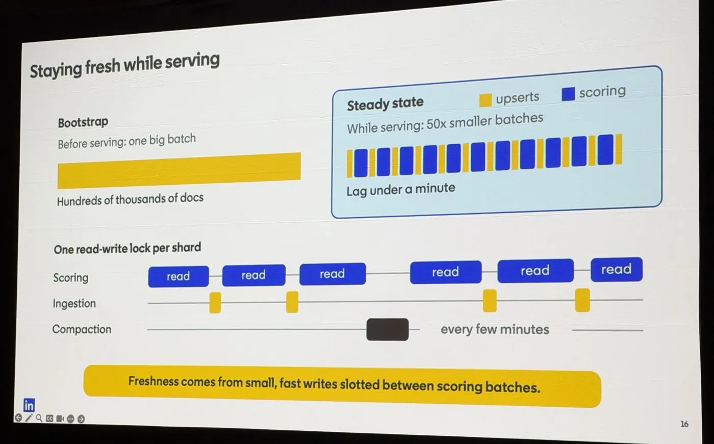
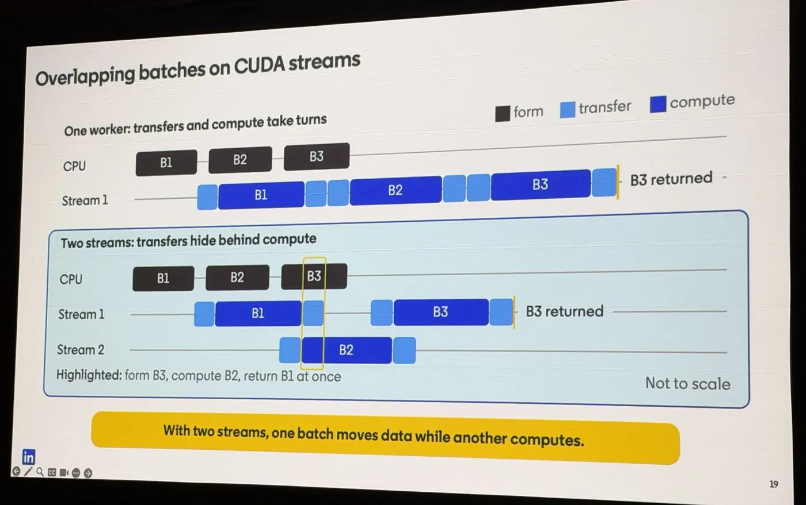
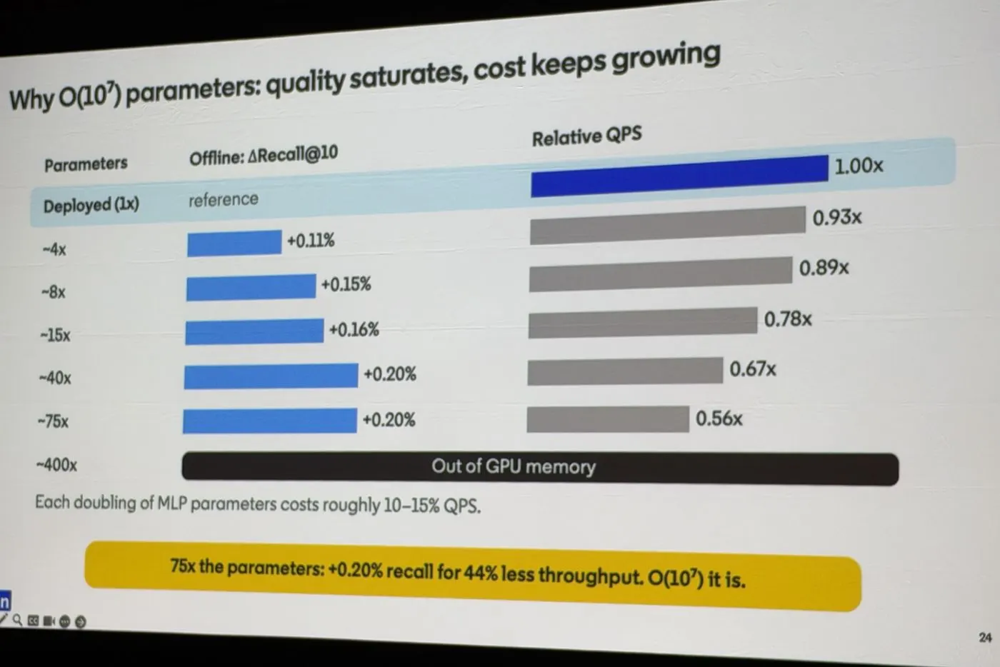
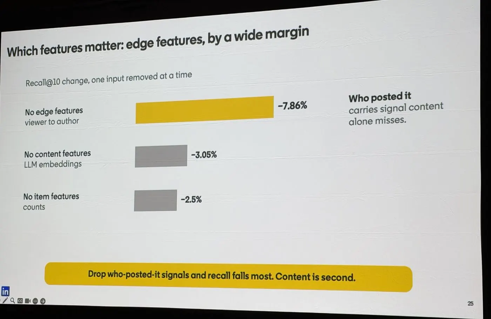
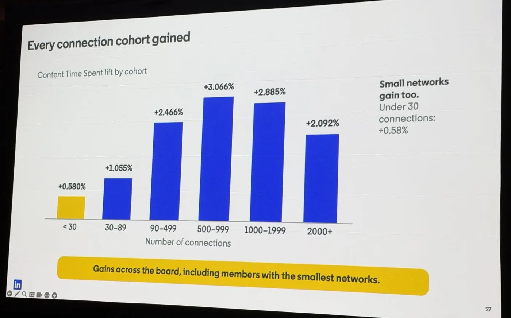

# Bridging Retrieval and Ranking: From LLM Embeddings and Graph Features to a GPU-Served DLRM

**Speaker:** Sudarshan Srinivasa Ramanujam (Lead Engineer, LinkedIn)  
QCon SF 2026 · Engineering AI Systems · Tue Nov 17, 15:55 · Pacific DEKJ  
[Session page](https://qconsf.com/presentation/nov2026/bridging-retrieval-and-ranking-llm-embeddings-and-graph-features-gpu-served) · [All 20 slides](../gallery/bridging-retrieval-and-ranking.md)

> LinkedIn moved a full ranking model into Feed retrieval on GPUs. Who posted it carried more signal than LLM embeddings, and the serving tricks took one GPU from 75 to 700 QPS.

## Key points

- Most AI products are a funnel; if retrieval misses an item, no ranker downstream can recover it.
- LLM embeddings lifted engagement for suggested posts but lost engagement for posts from a member's network, even with affinity written into the prompt.
- LinkedIn now scores tens of thousands of connected-content candidates per request with a full ranking model on H200 GPUs, inside a 120 ms p99 budget.
- Removing viewer-to-author edge features cut Recall@10 by 7.86%, against 3.05% for removing LLM content features and 2.5% for item counts.
- A CPU hash map per shard maps document IDs to GPU rows. It cut lookups for a batch of 8 from 47 ms to 1 ms and made batch inserts 52 times faster.
- Sorting a request's edges once and binary-searching per post replaced an O(N·K) scan, with up to 200 times fewer operations.
- Batching alone took throughput from 75 to 120 QPS per GPU; the CPU map, batching and two CUDA streams together reached 700.
- The index holds 1.3 billion documents, 400 million per GPU, and stays fresh within a minute through CDC upserts between scoring batches.
- A model 75 times bigger gained 0.20% recall for 44% less throughput, so they shipped one with about ten million parameters.
- Ten experiments share one index with separate queues for about 8% of throughput; content time spent rose 2.5% in A/B tests.

From the session audio and my photos of the slides. I have 20 of the 29 slides; 1, 8, 9, 11 to 13, 21, 22 and 26 are missing, and I filled those parts from the audio and the team’s preprint. Slide numbers match his deck. This was the most technical talk of the day, so I added a primer and an MVP sketch of my own after the in-depth section.

## The talk in brief

Most AI products are a funnel: a cheap retrieval step cuts billions of items to thousands, and an expensive ranker scores the survivors. If retrieval misses a post, no ranker downstream can save it. LinkedIn’s retrieval layer for posts from your network used LLM embeddings and a dot product. It knew what a post said but not who you are to the author.

So the team moved a full deep learning recommendation model down into retrieval. It scores tens of thousands of candidates per request on H200 GPUs inside a 120 ms p99 budget. It joins viewer-to-author edge features to each post, and it reads an index of 1.3 billion documents kept fresh within a minute. Content time spent rose 2.5% in A/B tests. Most of the talk was serving engineering: give the GPU the dense math, and move hashing, lookups and other irregular work to the CPU.

> “If retrieval misses it, no ranker downstream can save it.” (Slide 3)

New to retrieval systems? The primer explains every moving part in plain terms before you read the in-depth section.

## In depth

The talk ran in four parts: the problem, the model change, the serving stack, and results. The [preprint](https://arxiv.org/abs/2609.22441) covers the same system and filled some gaps in my photos.

### Every AI product is a funnel (slides 2–5)

Feeds, search, ads and RAG for LLMs share one shape. A corpus of millions to billions of items goes through a cheap retrieval step, typically kNN or ANN over embeddings, where thousands survive. A rich, expensive ranker scores hundreds, and the user sees the top few. He said the Feed takes about 500 ms end to end, and retrieval gets roughly half of that.

The ranker sees semantics from the LLM, author affinity, request context, post features and feature crosses. The old retriever saw only the semantics: a dot product over 1.3 billion documents. His goal was to bring ranking signals down so both layers agree on what a good candidate is.

*Slide 3: Every AI product you ship is a funnel.*

*Slide 4: The ranker knows things the retriever never sees.*

Recall at the top of the funnel is the ceiling on quality at the bottom.

### Why bigger embeddings weren’t enough (slides 6–7)

LinkedIn splits the Feed into two problems. Unconnected (suggested) content is every post on LinkedIn, matched by what it says; their LLM embedding work was enough there. Connected content is posts from your first-degree network, plus second-degree posts your connections engaged with. That’s tens of thousands of candidates per viewer, out of 1.3 billion.

They tried the same fine-tuned LLM embeddings on connected content and engagement fell. His example: two posts on the same topic, one from your teammate and one from someone you met once. The embeddings score them the same, and you only care about one. They even wrote engagement counts into the prompt. It still couldn’t capture the difference, so they passed affinity as explicit features instead.

*Slide 6: Connected content: who posted it matters.*

*Slide 7: Why bigger LLM embeddings were not enough.*

### From a dot product to a full model (slides 8–13)

Slides 8, 9 and 11 to 13 are missing from my photos; this part is from the audio. Candidate filtering happens off the GPU. The GPU index is keyed by document ID, but “posts by my connections” needs an index keyed by author. A separate timeline index returns documents by the viewer’s connections. Each request then carries the viewer’s full set of affinities, the superset of authors they’re connected to, while document features live on the GPU next to the model.

The starting point was GPU retrieval as ranking from LiNR (CIKM 2024): keep every document embedding on the GPU and score the whole corpus with one batched dot product. That replaced approximate search with exact search. The new system keeps the GPU-resident index but swaps the dot product for a full model. That raised four problems: find candidates fast across a sharded, replicated index; batch requests with very different candidate counts; join edge features per request; and fit index, features, activations and model in GPU memory.

*Slide 10: Same GPU-resident index, a full model instead of a dot product.*

### Where does doc X live? (slides 14–16)

Ingestion and scoring both ask the same question. Ingestion runs about 10⁴ upserts a second: is this document already here, and which row do I write? Scoring gets tens of thousands of IDs per request: which rows hold these? Rows are positions in a GPU tensor, not document IDs. Searching for them on the GPU didn’t scale, even with sorting.

The answer is a CPU hash map per shard from doc ID to row. It costs a few GB of host memory per shard. Batch inserts got 52 times faster, and a lookup for a batch of 8 went from 47 ms to 1 ms. He called this the theme of the talk: GPUs are great at matrix math and bad at hashing, searching and lookups.

Freshness is the other half. Bootstrap loads the index in big batches before serving. In steady state, writes come in batches 50 times smaller, slotted between scoring batches, with lag under a minute. One read-write lock per shard means a read or a write runs at any moment, never both. A compaction job every few minutes evicts old documents so the index doesn’t grow without bound. Static features like author and creation time are written once; popularity and engagement rates change fast and flow in continuously.

*Slide 15: One CPU hash map per shard.*

*Slide 16: Staying fresh while serving.*

The GPU keeps the dense math. The CPU keeps the map.

### Joining edges and batching uneven requests (slides 17–20)

Each request brings N candidates (tens of thousands) and the viewer’s K edges (a few thousand authors), with counts by action type and time window. Scanning the edges for every post is O(N·K), about 10⁷ operations. Sorting the edges once by author ID and binary-searching for each post is O((N+K) log K), up to 200 times fewer operations. Posts with no matching author get zeros.

Batching is harder because one viewer has 3,000 connections and another has 20. Padding every request to the longest wastes memory and lookups. Instead they form a batch up to a size or wait limit, concatenate every real candidate, do one GPU gather, and only then scatter back per request and pad. CUDA streams do the rest: with one stream, transfers and compute take turns; with two, one batch moves data while another computes.

He was candid about his first guess. He expected a batch of 8 to give 8 times the QPS, and called it a blunder. The bottleneck wasn’t compute; it was getting data into the GPU. Batching alone took 75 QPS to 120. The CPU map plus batching plus streams took it to 700, on the same hardware, model and workload with ingestion running.

*Slide 17: Viewer-to-author affinity joins in per request, without a scan.*

*Slide 18: Gather once, then scatter and pad.*

*Slide 19: Overlapping batches on CUDA streams.*

*Slide 20: Putting it together: 9.3x throughput.*

Remove the irregular bottleneck first. Then batching pays off.

### Experiments and the model (slides 21–24)

A dedicated index and GPU cluster per experiment would never get budget. Each request carries an experiment ID that routes it to a slot with its own queue and workers. Only the index and GPU memory are shared, and the index holds the superset of features. Ten experiments cost about 8% of throughput, 600 to 550 QPS. A drastically different feature set gets a smaller cluster of its own.

The model itself is simple, by his account. A dedicated tower takes the LLM features: the post embedding, and the viewer as several interest clusters. They take six months of the viewer’s engagement, look up those posts’ embeddings and run Ward hierarchical clustering, weighting each cluster by engagement volume. That gives a sports interest and an oil-and-gas interest each a fair chance. Bucketized post features (type, age) and the edge features join that tower in a backbone MLP. It predicts three things: a click, a contribution (like, comment or share) and a long dwell, combined as a weighted sum.

On model size, quality saturates and cost keeps growing. Each doubling of MLP parameters costs roughly 10 to 15% QPS. So they shipped O(10⁷) parameters.

| Parameters vs deployed | Offline ΔRecall@10 | Relative QPS |
|------------------------|--------------------|--------------|
| 1x (deployed)          | reference          | 1.00x        |
| ~4x                    | +0.11%             | 0.93x        |
| ~8x                    | +0.15%             | 0.89x        |
| ~15x                   | +0.16%             | 0.78x        |
| ~40x                   | +0.20%             | 0.67x        |
| ~75x                   | +0.20%             | 0.56x        |
| ~400x                  | Out of GPU memory  |              |

*Slide 23: What the serving stack delivers.*

*Slide 24: Why O(10⁷) parameters.*

Measure quality and throughput together. 75 times the parameters bought +0.20% recall for 44% less throughput.

### Results, what’s next, and the Q&A (slides 25–29)

The ablation removed one input at a time. No edge features: Recall@10 down 7.86%. No LLM content features: down 3.05%. No item counts: down 2.5%. Online, content time spent rose 2.5%; he said teams are usually happy with half a percent. Every connection cohort gained, from +0.58% for members with under 30 connections to +3.07% for 500 to 999. The small-network gain surprised the team.

Next on the list: move the feature index into CPU memory to make room for bigger models, lock-free updates so the GPU doesn’t idle during writes, sparse tensors for one-hot features, dynamic batching tuned per model, and sequence architectures like the ones in modern LLMs.

Two audience questions were useful. How do embedding or feature changes reach documents already indexed? A key-value store is the source of truth, and a CDC event replaces the whole row, found through the hash map. How did they weigh the 2.5% against infrastructure cost? The model-size curve is the decision tool: if recall rises 1% while cost rises 2%, that’s a trade worth making.

*Slide 25: Edge features matter most, by a wide margin.*

*Slide 27: Every connection cohort gained.*

*Slide 28: What’s next: freeing GPU memory and removing static limits.*

*Slide 29: Takeaways.*

## Numbers I checked

Checked on Nov 17, 2026. The preprint is the team’s own paper, so it confirms what they reported, not an independent result.

| Claim                                           | Figure                                       | Source                                                                        | Status                                         |
|-------------------------------------------------|----------------------------------------------|-------------------------------------------------------------------------------|------------------------------------------------|
| Content time spent, online A/B                  | +2.5%                                        | Slide 5; [preprint abstract](https://arxiv.org/abs/2609.22441); session page  | Checked self-reported                          |
| Recall@10 drop without edge features            | −7.86%                                       | Slide 25; preprint abstract                                                   | Checked                                        |
| Recall@10 drop without content or item features | −3.05%, −2.5%                                | Slide 25; preprint ablation                                                   | Checked                                        |
| Throughput per GPU                              | 75 → 700 QPS (9.3x)                          | Slides 20, 23; the preprint reports relative gains of the same order          | Caveat same hardware and model, their workload |
| Batching alone                                  | 75 → 120 QPS (1.6x)                          | Slide 20; 120 ÷ 75 = 1.6                                                      | Checked arithmetic                             |
| Scoring budget                                  | p99 ≤ 120 ms                                 | Slides 20, 23; preprint abstract                                              | Checked                                        |
| Index size                                      | 1.3B documents; 400M per H200                | Slides 5, 23; preprint says over one billion, a few hundred million per shard | Checked                                        |
| Doc ID lookup, batch of 8                       | 47 ms → 1 ms                                 | Slide 15; preprint                                                            | Checked                                        |
| Batch insert speedup                            | 52x                                          | Slide 15; preprint                                                            | Checked                                        |
| Edge join                                       | Up to 200x fewer operations                  | Slide 17; preprint                                                            | Checked                                        |
| Ingestion                                       | ~10⁴ upserts/s, lag under 1 minute           | Slides 14, 16; preprint                                                       | Checked                                        |
| Ten experiments on one index                    | 600 → 550 QPS, about 8%                      | Slide 23; 50 ÷ 600 = 8.3%                                                     | Slide only                                     |
| Bigger model trade-off                          | 75x parameters: +0.20% recall, 0.56x QPS     | Slide 24; 1 − 0.56 = 44% less throughput                                      | Checked arithmetic                             |
| Deployed model size                             | O(10⁷) parameters                            | Slide 24; the preprint frames it as a 50x scale-up over the previous model    | Slide only exact count not confirmed           |
| Lift by connection cohort                       | +0.58% (under 30) to +3.07% (500–999)        | Slide 27                                                                      | Slide only                                     |
| End-to-end Feed latency                         | About 500 ms, retrieval about half           | Spoken                                                                        | Talk only                                      |
| LiNR, the GPU retrieval it builds on            | +3% relative professional daily active users | [LiNR, CIKM 2024](https://arxiv.org/abs/2407.13218)                           | Checked self-reported                          |
| H200 memory                                     | 141 GB HBM3e at 4.8 TB/s                     | [NVIDIA](https://www.nvidia.com/h200)                                         | Checked vendor spec                            |

## About the speaker

Sudarshan Srinivasa Ramanujam is a lead engineer at LinkedIn working on Feed ranking and retrieval modeling. He’s on the Feed AI team, seven years at LinkedIn and three of them on LLMs for retrieval, per his slide. On stage he described the team as the one that decides the order in which you see items. He co-authored [LinkedIn Post Embeddings](https://arxiv.org/abs/2405.11344) (CIKM 2025) and [Large Scale Retrieval for the LinkedIn Feed using Causal Language Models](https://arxiv.org/abs/2510.14223), published by AAAI in 2026. The [Connected Content Retriever](https://arxiv.org/abs/2609.22441) paper behind this talk is in review at WWW. Off the clock: hiking, road biking, bouldering and Arsenal.

## Terms and technologies

### Retrieval and ranking

[Retrieval-ranking funnel](https://engineering.linkedin.com/blog/2019/06/community-focused-feed-optimization)  
The standard recommender shape: cheap retrieval narrows a huge corpus, then progressively richer rankers score fewer items. The frame for the whole talk.

[LLM embeddings](https://arxiv.org/abs/2405.11344)  
Vectors from a language model that capture what a post means. LinkedIn’s post embeddings power retrieval and ranking; they missed who posted it.

[kNN and ANN](https://github.com/facebookresearch/faiss)  
Exact and approximate nearest neighbor search over embeddings. LiNR moved LinkedIn from approximate to exact search on GPUs.

[DLRM](https://arxiv.org/abs/1906.00091)  
Deep learning recommendation model, after Meta’s 2019 paper: embeddings for sparse features, MLPs for dense ones, and explicit feature interactions. He used it loosely for “a full ranking model.”

Edge features  
Features on the relationship between viewer and author, such as how often you liked, commented on or dwelled on their posts in the last day, month or year. The biggest single signal in the ablation.

[Recall@K](https://en.wikipedia.org/wiki/Precision_and_recall)  
The share of relevant items found in the top K. Here it measures how well retrieval agrees with the full ranker.

[Ward’s method](https://en.wikipedia.org/wiki/Ward%27s_method)  
An agglomerative clustering criterion that merges the pair of clusters adding the least variance. Used to split a viewer’s history into several interest clusters.

[Multi-task MLP](https://arxiv.org/pdf/2302.03525)  
One network predicting several outcomes at once, here click, contribution and long dwell, blended into a single score.

### Serving and data

[LiNR](https://arxiv.org/abs/2407.13218)  
LinkedIn’s GPU retrieval system (CIKM 2024): documents and model weights live on the GPU, with exhaustive scoring, pre-filtering and live updates. The base this work extends.

[NVIDIA H200](https://www.nvidia.com/h200)  
A Hopper data-center GPU with 141 GB of HBM3e. The memory is why 400 million documents fit per GPU.

[CUDA streams](https://docs.nvidia.com/cuda/pdf/CUDA_C_Programming_Guide.pdf)  
Independent queues of GPU work. With two, data transfer for one batch overlaps compute for another.

[Timeline index](https://engineering.linkedin.com/blog/2016/03/followfeed--linkedin-s-feed-made-faster-and-smarter)  
An index from author to the content they created, from LinkedIn’s FollowFeed. Used here to find candidates from your network before the GPU sees them.

[Change data capture (CDC)](https://en.wikipedia.org/wiki/Change_data_capture)  
Streaming every insert, update and delete from a source database as events. Keeps the GPU index in sync with the key-value store that’s the source of truth.

[Read-write lock](https://en.wikipedia.org/wiki/Readers%E2%80%93writer_lock)  
Lets many readers or one writer in at a time. One per shard today; lock-free updates are next.

### For the MVP

[pgvector](https://github.com/pgvector/pgvector)  
Open-source vector search inside Postgres, with exact search and HNSW or IVFFlat approximate indexes. Keeps vectors next to the rest of your data and your JOINs.

[FAISS](https://github.com/facebookresearch/faiss)  
Meta’s library for similarity search over dense vectors, with GPU indexes. The usual next step past Postgres.

[Debezium](https://github.com/debezium/debezium)  
Open-source log-based CDC for Postgres, MySQL and others, usually through Kafka. An easy way to get LinkedIn-style freshness.

[SCIP](https://github.com/sourcegraph/scip)  
A language-agnostic code index format for definitions and references. A source of call-graph edges for code retrieval.

## Reading and tools

- Gupta, Srinivasa Ramanujam and others, [Connected Content Retriever: Dense Graph Edge Features for Pre-Ranking at LinkedIn](https://arxiv.org/abs/2609.22441). The paper behind the talk.
- Borisyuk and others, [LiNR: Model Based Neural Retrieval on GPUs at LinkedIn](https://arxiv.org/abs/2407.13218) (CIKM 2024).
- [LinkedIn Post Embeddings](https://arxiv.org/abs/2405.11344) (CIKM 2025) and [Large Scale Retrieval for the LinkedIn Feed using Causal Language Models](https://arxiv.org/abs/2510.14223) (AAAI 2026).
- [An Industrial-Scale Sequential Recommender for LinkedIn Feed Ranking](https://arxiv.org/abs/2602.12354) (2026), the ranker downstream of all this.
- Naumov and others, [Deep Learning Recommendation Model for Personalization and Recommendation Systems](https://arxiv.org/abs/1906.00091) (Meta, 2019).
- [pgvector](https://github.com/pgvector/pgvector) and [FAISS](https://github.com/facebookresearch/faiss) for the MVP.

### Related sessions

- [Drawing the Rest of the Owl](drawing-the-rest-of-the-owl.md) (Harness, earlier today). A context engine for code, the same retrieval problem for code.
- [Skills, memory or fine-tuning](skills-memory-or-fine-tuning.md) (Monday). Where context should live for agents.

