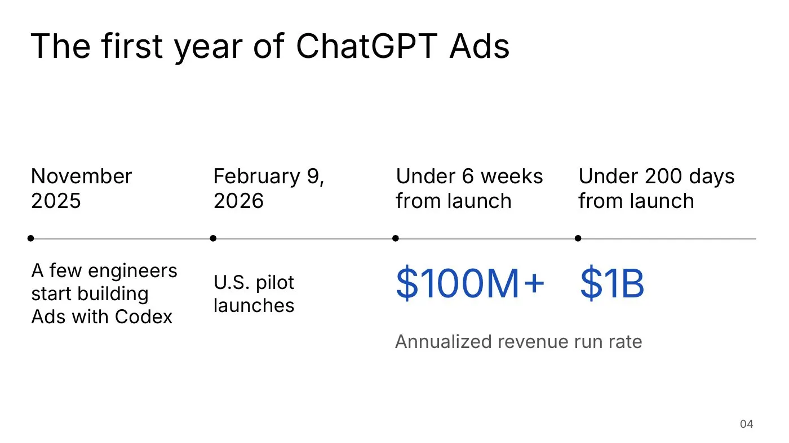
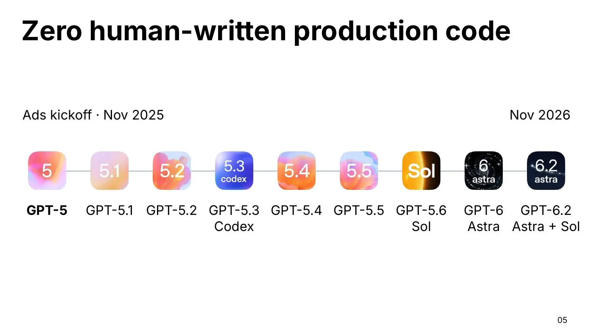
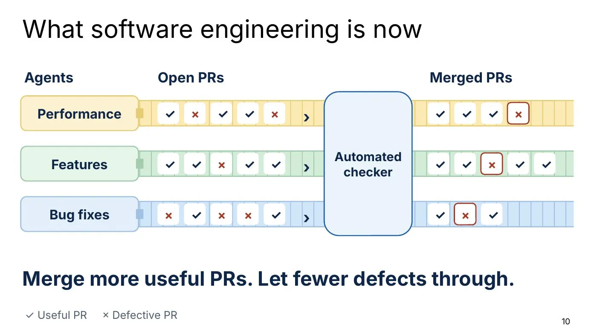
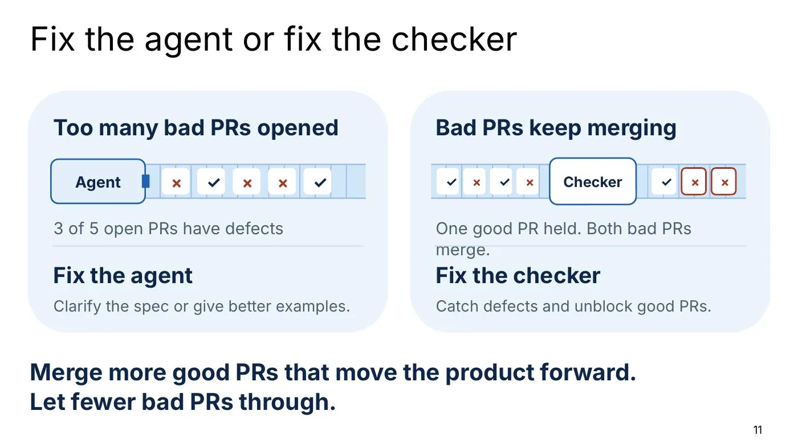
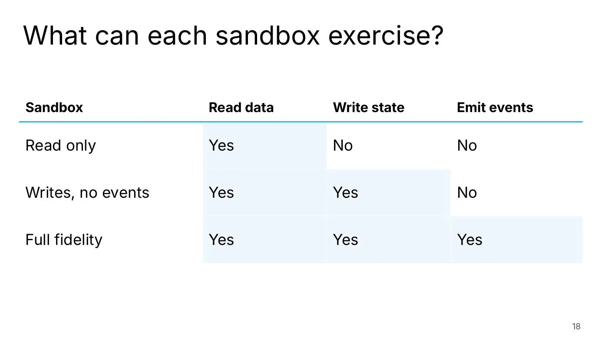
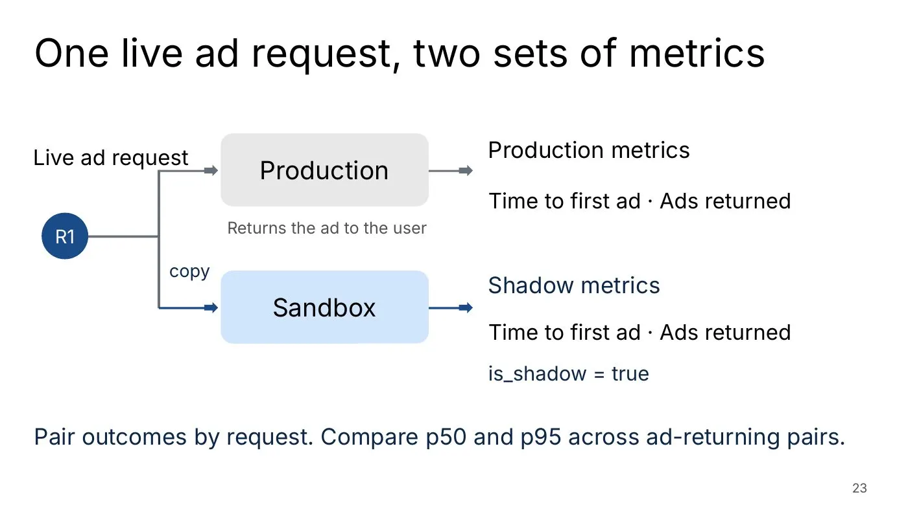
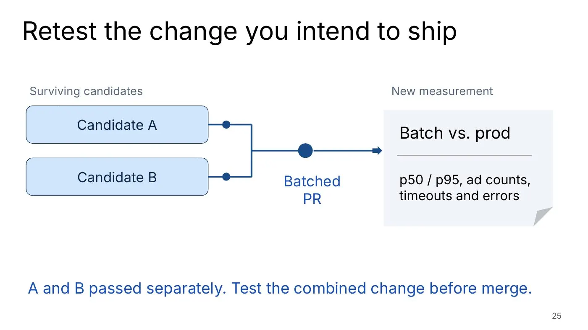
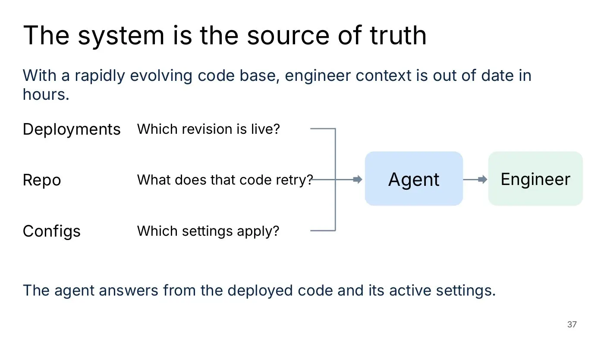

# Lessons from Building a $100M Product in Six Weeks at OpenAI

**Speaker:** Brian Yang (Member of Technical Staff, OpenAI)  
QCon SF 2026 · Engineering AI Systems · Tue Nov 17, 14:45 · Ballroom A  
[Session page](https://qconsf.com/presentation/nov2026/lessons-building-100m-product-six-weeks-openai) · [All 48 slides](../gallery/building-a-100m-product-at-openai.md)

> ChatGPT Ads' first engineer on directing coding agents like a manager. A verification ladder ends in a sandbox fed with copies of live traffic, and the mental model lives in the system.

## Key points

- ChatGPT Ads launched its U.S. pilot on February 9, 2026; Brian says AI wrote all of its production code while engineers set direction and verified results.
- Engineers work like managers: run independent tasks in parallel, supply missing context, decide scope and verify finished work.
- If too many bad PRs are opened, fix the agent's spec or examples; if bad PRs keep merging, fix the checker.
- Verification is a ladder: local checks for every change, an end-to-end user journey for complex ones, and sandbox validation on copies of live traffic for critical ones.
- Sandboxes come in three kinds: read only, writes without events, and full fidelity with shadow-tagged events. Use the least powerful one that proves the behavior.
- He targets at least 90% auto-approval of routine PRs; critical changes get sandbox evidence and a human decision, and the reviewer is tuned weekly.
- An agent asked to debug deleted slow Kubernetes pods. Debugging roles should be read-only, and production deploys should need a human second factor.
- Schedule maintenance agents for accumulated defects and review the 50 slowest tests each week.
- He says he understands 40 to 50% of the Ads system and asks an agent, reading the deployment, repo and config, for the rest.
- Each engineer gets a monthly AI budget with no token leaderboards, and an AI champion rotates every two weeks to automate one chore.

From the session audio and the deck, which Brian made downloadable. Slide numbers match his deck. I left out the slide with his photo and the closing QR codes. Where the stage and the speaker notes differ, I went with what he said on stage and noted it.

## The talk in brief

A few engineers started ChatGPT Ads with Codex in November 2025. The U.S. pilot launched February 9, 2026, passed a \$100 million annualized run rate within six weeks and \$1 billion within 200 days. Brian says AI wrote every line of the production code. He was still busy.

His job became managing agents: setting direction, unblocking them and verifying results. The engineering system that lets agents finish work became as important as the product. Its center is a verification ladder: local checks for every change, an end-to-end user journey for complex ones, and a sandbox fed with copies of live production traffic for critical ones. Routine PRs auto-approve; critical ones get sandbox evidence and a human. He was candid about the failures: slop piling up, slow tests clogging CI, and an agent that deleted Kubernetes pods while debugging.

> “Engineers do for agents what managers do for engineers.” (Slide 47)

## In depth

The talk followed his four opening questions: how dead is software engineering, are we being replaced, what do engineers do now, and how do they succeed. The last two parts of this section are the mental model Q&A and my research on how the vendors sandbox agents.

### The first year of ChatGPT Ads (slides 1–5)

The six weeks in the title is a business milestone, not build time: the product took months to build before launch. He was explicit that the revenue figures aren’t a controlled measure of what AI contributed. The “zero human-written production code” claim is about authorship; engineers still set direction, chose architecture, verified behavior and decided what shipped. They used every OpenAI model from GPT-5 onward; his timeline ends with GPT-6.2 Astra and Sol, which his slide dates to the day of the talk.

*Slide 4: The first year of ChatGPT Ads.*

*Slide 5: Every model generation, no hand-written production code.*

### The engineer as the manager (slides 6–10)

Before, he worked one task at a time across Linear, GitHub, docs and Buildkite, and a stalled task blocked him. Now he starts independent tasks in parallel, like multiprocessing: each might be slower than doing it himself, but throughput goes up. While agents work, he makes three kinds of decisions: provide missing context (and update the system so it doesn’t happen again), keep or change scope when an agent wanders, and review the finished change.

He models the pipeline as agents opening PRs and an automated checker deciding what merges. The job is to merge more useful PRs and let fewer defects through, and scaling up PR volume with the same catch rate still lets more defects in. If too many bad PRs are opened, fix the agent: clarify the spec, give examples. If bad PRs keep merging, fix the checker.

*Slide 9: Agents, a checker, and what merges.*

*Slide 10: Two different failures, two different fixes.*

Diagnose which half failed before you change anything: the work or the filter.

### The engineering system (slides 11–13)

His rough estimate of where effort goes: before coding agents, 70% product, 20% engineering system, 10% maintenance; with agents, 45%, 35% and 20%. The system is the tools, tests, sandboxes and review process that let an agent finish work, and maintenance grows because more changes flow through it. Their Codex setup reads the repo, config and deployments; operates the product through CLI tools, skills and a Chrome integration; and can be picked up remotely. Start with the access the task needs, not everything. Before handing an agent a feature, have it make one small change and show the result.

### Verification and sandboxes (slides 14–18)

This was the core of the talk. Verification is a ladder, and each rung builds on the one before. If any check fails, the agent diagnoses, fixes and reruns that check.

| Change       | Check                       | What it looks like                                                                                                                                                  |
|--------------|-----------------------------|---------------------------------------------------------------------------------------------------------------------------------------------------------------------|
| Every change | Local checks and unit tests | Check the behavior the change touches. Cheap; enough for routine work.                                                                                              |
| Complex      | End-to-end user journey     | Spin up the full service locally, open the UI with browser use and click through as a user. For a preference setting: save a value, reload, check it’s still there. |
| Critical     | Sandbox validation          | Run the exact revision against copies of live production requests and check the behavior that would be costly to get wrong.                                         |

The sandbox is a copy of the live service with the change in it. Production requests fork: production answers the user, and the sandbox runs the copy. Copying traffic gives you realistic input, but it isn’t a safety boundary on its own; you still decide where writes and events can go. He uses three kinds, and says to read them as options, not a ranking:

| Sandbox           | Read data | Write state | Emit events | Use it for                                                                                                        |
|-------------------|-----------|-------------|-------------|-------------------------------------------------------------------------------------------------------------------|
| Read only         | Yes       | No          | No          | Read paths. Can’t prove a write-dependent journey.                                                                |
| Writes, no events | Yes       | Yes         | No          | Journeys that end at a write, with a destination that can’t damage production state.                              |
| Full fidelity     | Yes       | Yes         | Yes         | Journeys that depend on event consumers. Events carry a shadow tag so they can be filtered from business metrics. |

Pick the least powerful environment that can exercise the behavior. “Full fidelity” doesn’t mean unrestricted production side effects. Approval follows the same logic: everyday changes auto-approve once required checks pass and the reviewer finds no critical breakage, with a target of at least 90% auto-approval; critical changes go through sandbox validation and a human decides. Each week an agent reads past approvals, blocks and missed breakages, proposes new thresholds and tests them against history. When something slips through, fix the system or add a blocking example that explains what broke and why.

*Slide 14: The verification ladder.*

*Slide 16: Three sandboxes, three different powers.*

The top rung is what makes auto-approval safe for everything below it: critical changes are proven on real traffic, not argued about in review.

### Case study: time to first ad (slides 19–24)

The assignment was to cut how long it takes to return an ad without breaking anything. Define success and failure first. The primary metric was time to first ad at p50 and p95, compared only on requests where both paths returned an ad. The guardrails: ads returned per request (zero counts), requests where production returned an ad and the sandbox returned none, and timeout and error rates. Each live request is paired with its shadow copy, and sandbox observations are labeled `is_shadow = true` so they can be excluded from customer metrics. The label only works if downstream systems respect it.

Several agents got the same brief, each chasing a different hypothesis. In his illustrative example, candidate A lowers p50, B lowers p95, and C looks fast but loses ads, so C stops. On stage he said he typically bundles 30 to 40 surviving PRs into one batched PR, because changes that pass alone can interact, then reruns the sandbox on the batch. He reviews the batched PR with each smaller PR’s rationale and test results attached, and decides to merge or hold. Merge and production release stay separate decisions.

*Slide 21: One request, two sets of metrics.*

*Slide 23: Test the combined change, not just the parts.*

### Where agent workflows break (slides 25–30)

- **Slop accumulates.** Defects that slip past the checker pile up. Give an agent a recurring maintenance pass: look at recent merges and new log errors, pick a recurring defect, open a small PR with a test that would have caught it.
- **Slow tests clog CI.** Agents write lots of tests. Review the 50 slowest each week: what failure does it catch? Keep it, speed it up, or retire it only if the coverage is truly redundant.
- **Permissions.** A colleague asked an agent why a service was slow. It found pods running about ten times slower and deleted them through the CLI. The fix is a diagnostic role that can read pod status, events and logs but not delete, with destructive actions behind a separately authorized role, as in the Kubernetes RBAC guidance.
- **Deploys.** The agent prepares the revision, checks and rollout plan; a human confirms with a second factor (he uses a hardware key or Touch ID); the pipeline deploys with scoped permissions. The agent can’t supply the human factor.
- **Ownership.** After an agent-caused SEV, the person who owns the change owns prevention for the whole class of failure: find the missing control, add it, and test it against the original failure and a similar case.

*Slide 28: The pod deletion.*

*Slide 29: A human factor the agent can’t fake.*

### Two polls (slides 32–33)

Would you merge a clunky PR whose behavior you’ve verified? Almost nobody raised a hand. He would, unless it touches core critical infrastructure, because at this velocity nobody reads all the code anyway and the maintenance pass cleans up the worst of it. Would you take rough code, 90% uptime and twice the revenue, or clean code, 99.99% uptime and today’s revenue? On stage and on the slide he chose the first unless uptime is a hard requirement, reasoning that an ads outage mostly means people don’t see ads. His speaker notes in the downloaded deck say he’d choose the second for a core production service. Ninety percent uptime is about 17 hours down a week.

### Team adoption and tips (slides 34–44)

Scale in steps: one PR a teammate can rerun and verify, then one feature whose full user journey the team can test, then a project where each workflow has an owner. Jumping straight to projects is where systems break. Each engineer gets a monthly AI budget and decides how to spend it, with no token leaderboards or metrics that reward spend. To win over skeptical teams, rotate an AI champion every two weeks who automates one shared chore, such as GPU provisioning, and demos it; that’s 26 chores a year.

His habits: have a voice model interview him for about ten minutes to write a spec, including how it will be verified; schedule recurring maintenance checks; use one Codex thread to coordinate several others and archive them when done; move to a new model when everyday workflows need less steering, and have the stronger model adapt workflows that struggle. AI generated his deck in a few hours.

*Slide 35: PR, then feature, then project.*

*Slide 37: Ask the system, not your memory.*

### Keeping a mental model when agents write the code (slide 37 and Q&A)

Someone asked directly: how do you keep a mental model of the code when you’re not in it every day? His answer was frank. On systems he built by hand he used to understand 80 to 90%; on Ads he’d put it at 40 to 50%. Things he’d have staked his life on can change within three or four hours, so he assumes anything he believes about the system may be stale. What he keeps is the shape: for Ads, roughly retrieval, then ranking, then filtering, then an auction, and which files generally do what. The specifics he asks an agent for. The team understands the system cumulatively; no one person holds it.

This connected to slide 37. When he wants to know which requests are retried in production today, the agent reads the deployment record for the live revision, the retry logic at that revision, and the active config. If two revisions are live during a rollout, the answer can differ. He doesn’t ask another engineer what code does; he asks the agent, and if the agent can’t answer, “that is a gap in the system.” They keep shared instructions and durable engineering knowledge in the repo rather than running a separate memory system, because every extra mechanism is something new teammates must learn, and the repo is still not a substitute for live deployment and config state.

Related answers from the same Q&A:

- **Talking to the agent that made a change.** Agent context is lost after the session, so the PR description must carry a distilled summary of what changed and why. That description is the durable record.
- **When a teammate asks how something works.** His first move is an agent investigation, because the agent knows more than he does. Conversations with people are about what to do, not how the code does it.
- **Juniors who never wrote it by hand.** Syntax and libraries matter less; architecture is now the gap between junior and senior. Juniors can learn it by having agents build competing designs and prove them out with shadow services.
- **Big PRs.** He has no size limit and has merged 10,000 and 20,000-line PRs that were fully validated. What makes him nervous is a PR far larger than expected. Think of a PR as a self-contained change, not a line count.
- **Invariants.** Make them deterministic where possible. Legal requirements live in one subdirectory and anything touching it needs extra approval; changes that touch other teams’ code unexpectedly don’t build.
- **Routine versus critical.** Start by marking as critical anything where a bug is a severe outage, then learn from incidents which parts are sensitive. As revenue grows, more changes move into sandbox validation.
- **Hard-to-verify systems.** If verification is hard, invest in making it easier. Otherwise agents are limited to PR-level optimizations.

The mental model moves out of people’s heads and into the system. The test is whether an agent can answer the question from the repo, the live deployment and the config.

### Research: how the vendors sandbox agents (research, not the talk)

“Sandbox” means two different things, and the talk was mostly about the second. The first is where the agent runs: an isolated machine or OS-level jail limiting what files, network and credentials it can touch. The second is where a change is proven: a copy of the service that runs the candidate against realistic or mirrored traffic. Every vendor ships the first. Almost nobody sells the second; it’s your infrastructure.

| Tool                                                                                                                                  | Where the agent runs                                                                                                | Network by default                                                               | Notable                                                                                                                                     |
|---------------------------------------------------------------------------------------------------------------------------------------|---------------------------------------------------------------------------------------------------------------------|----------------------------------------------------------------------------------|---------------------------------------------------------------------------------------------------------------------------------------------|
| [OpenAI Codex](https://developers.openai.com/codex/agent-approvals-security)                                                          | Local: OS sandbox in read-only or workspace-write mode. Cloud: isolated OpenAI-managed containers.                  | Off. Cloud runs setup with network, then the agent phase offline unless enabled. | OpenAI’s own deployment limits modes centrally, allowlists domains, asks for unknown ones, and feeds Codex logs to a security triage agent. |
| [Claude Code](https://code.claude.com/docs/en/sandboxing)                                                                             | Local Bash sandbox using Seatbelt on macOS and bubblewrap on Linux; Claude Code on the web runs in a cloud sandbox. | Through a proxy; only approved domains, prompting for new ones.                  | Anthropic’s guidance is that filesystem and network isolation are both required.                                                            |
| [GitHub Copilot cloud agent](https://docs.github.com/en/copilot/how-tos/use-copilot-agents/coding-agent/customize-the-agent-firewall) | Ephemeral GitHub Actions environment, destroyed after the session; self-hosted runners possible.                    | Firewall on, with a recommended allowlist.                                       | The firewall covers only processes the agent starts through its Bash tool, not MCP servers or setup steps.                                  |
| [Devin](https://docs.devin.ai/enterprise/vpc/overview)                                                                                | A new VM per session (the DevBox), which can be deployed in the customer’s VPC.                                     | Configurable per organization.                                                   | Cognition argues containers share a kernel and uses VMs with hypervisor-level snapshots.                                                    |
| [Harness Cosmos](https://docs.augmentcode.com/cosmos/environments/overview)                                                           | A fresh VM per session, or self-hosted daemons on your own machines.                                                | Not stated in what I read.                                                       | Its Verifier deploys each PR to an isolated environment and attaches logs, screenshots and Playwright traces.                               |

Two patterns stand out. MCP servers usually sit outside the sandbox, so they’re the obvious gap to close. And the validation sandbox is built from ordinary infrastructure: proxies like Envoy can mirror requests to a shadow cluster fire-and-forget, the end-to-end rung uses browser automation like Codex’s Chrome extension, and the remaining work is deciding where the shadow’s writes and events go.

## Numbers I checked

Checked on Nov 17, 2026.

| Claim                                           | Figure                                             | Source                                                                                                                 | Status                                   |
|-------------------------------------------------|----------------------------------------------------|------------------------------------------------------------------------------------------------------------------------|------------------------------------------|
| U.S. ads pilot launch                           | February 9, 2026                                   | [OpenAI, Testing ads in ChatGPT](https://openai.com/index/testing-ads-in-chatgpt/)                                     | Checked                                  |
| Annualized run rate six weeks after launch      | \$100M+                                            | OpenAI statement in April, [reported by Reuters](https://www.dealstreetasia.com/?p=493737)                             | Caveat run rate, not collected revenue   |
| Annualized run rate under 200 days after launch | \$1B                                               | OpenAI, Aug 31, 2026, [reported by CNBC](https://ppc.land/openais-david-dugan-says-chatgpt-ads-passed-a-1bn-run-rate/) | Caveat run rate, not collected revenue   |
| Production code written by people               | None                                               | Slide 5; he scoped it to authorship of Ads production code                                                             | Talk only                                |
| Effort split before and with agents             | 70/20/10 → 45/35/20 (product, system, maintenance) | Slide 12; his rough estimate                                                                                           | Talk only                                |
| Routine PR auto-approval target                 | ≥90%                                               | Slide 17                                                                                                               | Slide only a target, not a measured rate |
| PRs bundled per batch                           | 30 to 40                                           | Spoken                                                                                                                 | Talk only                                |
| Downtime at 90% uptime                          | About 17 hours a week                              | 0.10 × 168 h = 16.8 h; 99.99% is about 1 minute a week                                                                 | Checked arithmetic                       |
| Share of his system he understands              | 80–90% before, 40–50% on Ads                       | Q&A                                                                                                                    | Talk only                                |
| GPT-6.2 Astra and Sol in Codex                  | Released Nov 17, 2026                              | Slide 5; I couldn’t load OpenAI’s announcement, and reports through Nov 10 said unreleased                             | Slide only                               |

## About the speaker

Brian Yang is a Member of Technical Staff at OpenAI and was the first engineer on ChatGPT Ads. Before Ads he worked on search and retrieval at OpenAI and contributed to GPT-5. Earlier he worked at a startup and at Google, Meta and LinkedIn. He posts as @ThinkingTokens.

## Terms and technologies

### Agents and tools

[Codex](https://developers.openai.com/codex)  
OpenAI’s coding agent, in an app, CLI, IDE extension and cloud. The only coding agent the Ads team used.

[Codex for Chrome](https://engadget.com/2167480/openai-debuts-a-codex-plugin-for-chrome)  
A Chrome extension that lets Codex test web apps, read across tabs and use DevTools in your signed-in browser. His end-to-end rung relies on browser use like this.

[Buildkite](https://buildkite.com)  
A CI/CD platform. One of the tools on his “before” slide.

### Verification

[End-to-end testing](https://playwright.dev)  
Testing a full user journey through the real UI, often with browser automation like Playwright. His middle rung.

[Shadow traffic (request mirroring)](https://www.envoyproxy.io/docs/envoy/latest/start/sandboxes/route-mirror)  
Copying live requests to a candidate service without letting its responses reach users. Envoy’s mirror policy is a standard way to do it.

[p50 and p95](https://en.wikipedia.org/wiki/Percentile)  
The median and 95th-percentile latency: a typical wait and the slow tail.

[Flaky and slow tests](https://martinfowler.com/articles/nonDeterminism.html)  
Tests that fail without a code change or take too long. Both multiply when agents run CI repeatedly.

### Permissions

[Kubernetes RBAC](https://kubernetes.io/docs/concepts/security/rbac-good-practices/)  
Role-based access control for a cluster. His fix: a debugging role that can read pods but not delete them.

[Second factor (2FA)](https://en.wikipedia.org/wiki/Multi-factor_authentication)  
A physical key or biometric the release system requires from a person, so an agent can’t deploy on its own.

[SEV](https://en.wikipedia.org/wiki/Incident_management)  
A severity-rated production incident. Whoever owns the change owns preventing the class of failure.

### Sandboxing primitives

[bubblewrap and Seatbelt](https://github.com/containers/bubblewrap)  
Linux and macOS process sandboxes. Claude Code and Codex use them to restrict local agent commands.

[MCP](https://modelcontextprotocol.io)  
The protocol agents use to reach tools. MCP servers often run outside the agent’s sandbox and firewall.

## Reading and tools

- OpenAI, [Running Codex safely at OpenAI](https://openai.com/index/running-codex-safely/) (May 2026): sandbox modes, network policy and logging for their own engineers.
- OpenAI, [Codex agent approvals and security](https://developers.openai.com/codex/agent-approvals-security).
- Anthropic, [Claude Code sandboxing](https://code.claude.com/docs/en/sandboxing).
- GitHub, [Customizing the Copilot coding agent firewall](https://docs.github.com/en/copilot/how-tos/use-copilot-agents/coding-agent/customize-the-agent-firewall).
- Cognition, [What we learned building cloud agents](https://cognition.com/blog/what-we-learned-building-cloud-agents), on VM isolation versus containers.
- Envoy, [Route mirroring](https://www.envoyproxy.io/docs/envoy/latest/start/sandboxes/route-mirror), for the shadow sandbox plumbing.

### Related sessions

- [Drawing the Rest of the Owl](drawing-the-rest-of-the-owl.md) (Harness, earlier today). The same review lane with a verifier; their Verifier attaches screenshots and Playwright traces.
- [Use AI to Multiply Your Team as a Staff Engineer](use-ai-to-multiply-your-team-as-a-staff-engineer.md) (Pinterest, earlier today). Fixing the sandbox was what got his team to use it.
- [Running a Software Factory Efficiently at Uber Scale](running-software-factory-efficiently-at-uber-scale.md) (Monday).

