# Drawing the Rest of the Owl: A Blueprint for Your Software Factory

**Speaker:** Chris Kelly (Product Lead, Harness)  
QCon SF 2026 · Sponsored Solution Track IV · Tue Nov 17, 13:35 · Pacific LM  
[Session page](https://qconsf.com/presentation/nov2026/drawing-rest-owl-blueprint-your-software-factory)

> Cosmos's product lead, a month after Harness bought it from Augment Code, lays out how to build a software factory. Fix environments and CI first, then automate code review end to end.

## Key points

- A software factory is a self-improving system that turns intent into trusted software outcomes using humans, agents and automation.
- Personal workflows, interactive prompting and a chain of automations that never improves are not a factory yet.
- Before building one, invest in reproducible developer environments and in build and test infrastructure that can take more changes.
- The box needs a cloud agent, a sandbox, triggers, computer and browser use, and secrets kept out of the agent's environment.
- Pick the model per job, use deterministic code where you can, write skills only for organization-specific work, and give agents every tool engineers use.
- He said bad output is now mostly a context problem rather than a model problem.
- Start with code review: a nitpicky reviewer, an auto-fixer, a verifier that shows the change working, and a risk analyzer that decides what needs a person.
- He said two reviewers per PR is not a SOC 2 requirement but a control companies wrote for themselves.
- Improve the factory with traces, a weekly self-improvement agent using a judge, and evals for critical decisions.
- Automate the known, not the thinking, and ask what it would take instead of saying it can't be done.

From the session audio and photos of 16 slides. The photos start about five minutes in, so the title slide and opening are recovered from the audio. This was a sponsored session, and Chris builds the product he describes. The talk itself stayed mostly vendor-neutral; the vendor claims below come from my research, not the stage, and are marked. The model names he gave are garbled in the audio, so I’ve left versions out.

## The talk in brief

Chris Kelly runs product for Cosmos, Augment Code’s software factory platform, which Harness bought in October. His talk was a blueprint, not a demo. A software factory is a self-improving system that turns intent into trusted software outcomes using humans, agents and automation. You are already partway there if you have linting, CI and code review.

Before building one, fix your developer environments and your build and test infrastructure. Then give agents a computer: a cloud agent, a sandbox, triggers, browser use and a safe way to handle secrets. Start with code review, made of four agents (reviewer, auto-fix, verifier, risk analyzer), and expand from there. Your job becomes improving the factory with traces, a weekly self-improvement loop and evals.

> “The limit on autonomy is how much of the result you can verify and trust.” (Slide 9)

## In depth

The talk ran in three parts: what a factory is, how to build one, and how to keep it improving. The last part of this section is my research on what Harness bought, not something said in the talk.

### What a software factory is, and isn’t (slides 1–3)

Chris has been at Augment for two and a half years, back to when autocomplete was the big idea. He now does nearly all his engineering through Cosmos and cloud agents and mostly looks at verification. He compared this moment to DevOps a decade ago: nobody has the practices figured out yet, and anyone who says they have is selling something. He also argued it isn’t new. Linting, CI and code review are factory parts we’ve built for decades to get consistent, faster, safer output.

He doesn’t mean a widget line. He wants three things from the metaphor: consistent outcomes, components you can improve or swap one at a time, and output you can scale up. Three things are not yet a factory: one person’s workflows and skills on their own machine, prompting an agent every few minutes, and a chain of automations that never improves itself. His definition: a self-improving system that turns intent into trusted software outcomes using humans, agents and automation. He doesn’t expect a dark factory with no humans any time soon.

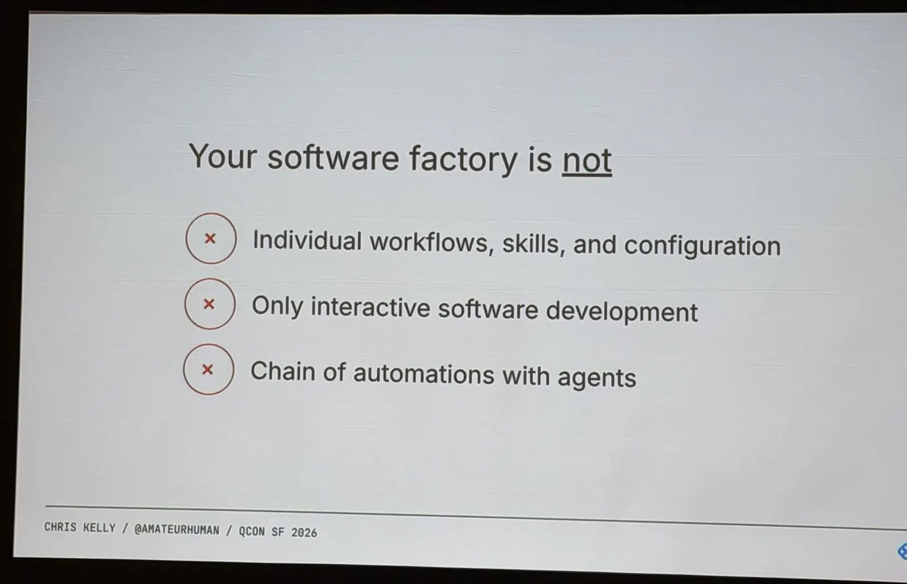

Slide 2. What a factory is not.

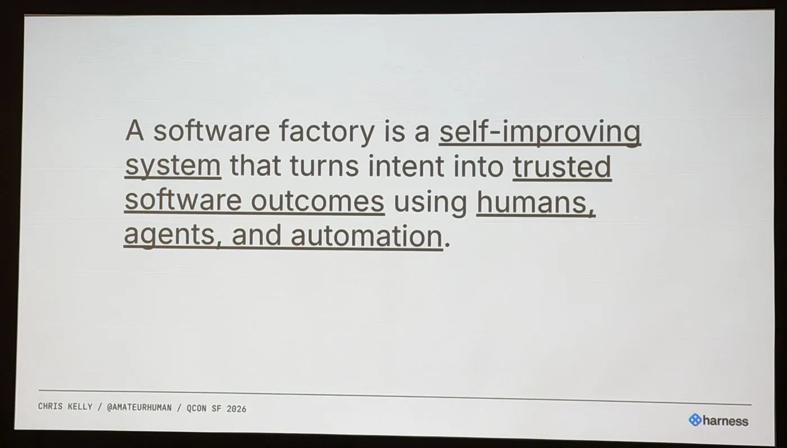

Slide 3. His definition.

If it doesn’t improve itself and nobody trusts its output, it’s automation, not a factory.

### Before you build: environments and CI (slide 4)

Two investments come first. Developer environments: every agent needs a computer that works the way an engineer’s does, reproducible in a sandbox. Build and test infrastructure: a factory multiplies the number of changes, so slow suites and flaky tests become merge-queue backups and expensive reruns. His aside: almost everything that helps a factory also helps people, and it used to be hard to fund. Now that it’s for AI, it gets budget, so use that.

### What’s in the box, and designing the agent (slides 5–9)

| Part                     | Why                                                                                                                                                              |
|--------------------------|------------------------------------------------------------------------------------------------------------------------------------------------------------------|
| Cloud agent              | Your laptop closes. Models will run for days, not minutes, and parallel workspaces don’t fit on one machine.                                                     |
| Sandbox                  | A container or VM, depending on your infrastructure. Agents need a computer.                                                                                     |
| Triggers                 | A person, an error report, a bug report, internal feedback. Without triggers you’re still prompting.                                                             |
| Computer and browser use | To see the UI it built, capture screenshots and video, and use systems that have no API or MCP server yet.                                                       |
| Secrets and permissions  | Keep GitHub tokens, MCP logins and SSH keys out of the sandbox. An agent running untrusted code can read anything in its environment, so inject secrets instead. |

Coding agents like Claude Code or the Copilot CLI are tuned to write code, but a factory does more than write code, so you design each agent. Pick the model per job and stay model-agnostic: at Augment the review agent and the authoring agent run on different vendors’ models, for cost and capability. Pick the tool per job: an LLM is the blunt instrument; a smaller decision model handles triage and classification; deterministic code is cheapest when the work is known. He pointed to code mode, where the model writes a script instead of spending tokens on each step.

Skills should cover only what is unique to your organization, such as how to search your logs, cut a release or write a changelog. Models will absorb generic skills like writing better React. Give agents every tool an engineer uses, through MCP servers you build if needed. And context: “slop is not a model problem anymore. It’s mostly a context problem.” Specs, architecture decisions and the rest depend on the task. His two rules for growing it: complex systems that work evolve from simple ones (Gall’s law), and autonomy is capped by how much you can verify.

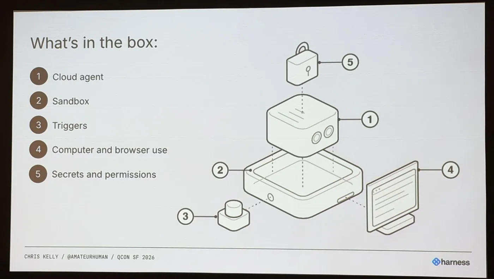

Slide 5. What’s in the box.

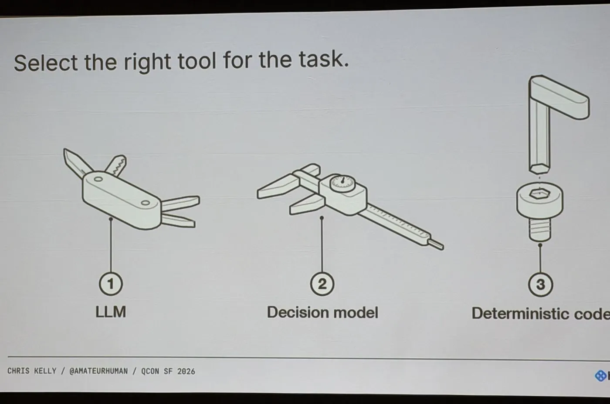

Slide 7. Not every step needs an LLM.

One slide error: on slide 8 the caption under Context repeats the Tools caption. The audio is the source for what he meant.

Build the box once (computer, triggers, secrets), then tune each agent’s model, tools, skills and context to its job.

### Start with code review (slides 10–12)

Almost everyone starts with review. It’s tractable, you already have standards, everything else in the factory flows through it, and it needs no one to change how they work: whether someone uses Claude Code or Cursor, their PR enters the pipeline. A show of hands put about half the room using AI for coding, and about half using AI review that a person still reads. A report a person reads doesn’t remove the bottleneck.

| Step          | What it does                                                                                                                                                       |
|---------------|--------------------------------------------------------------------------------------------------------------------------------------------------------------------|
| Reviewer      | As nitpicky as possible. Nobody is reading it and agents don’t mind pedantry, so it’s just a list of expectations.                                                 |
| Auto-fix      | Every comment, from an agent or a person, goes back to the agent that wrote the code, which fixes it and replies on the PR with the commit. A few rounds are fine. |
| Verifier      | Spins up an environment, turns on the flag and shows the change working: before and after, screenshots, video, logs. This is what the human looks at.              |
| Risk analyzer | Scores the blast radius. If it’s low risk, verified and meets the standards, let the agent or the author merge.                                                    |

He was blunt that people were never good at reviewing for security or bugs anyway. He also said the two-reviewer rule many companies have is not a SOC 2 requirement; it’s what they wrote in their own controls, and controls can change. From there you expand both ways: ticket, PR, review, auto-fix, verify, risk, auto-merge. At Harness, an employee feedback channel in Slack is read by a triage agent that files bugs, questions and feature requests by team; bugs go to a PR author agent and the on-call engineer reviews if needed. He suggested the same for error reports and incidents, so a fix might be waiting when you wake up.

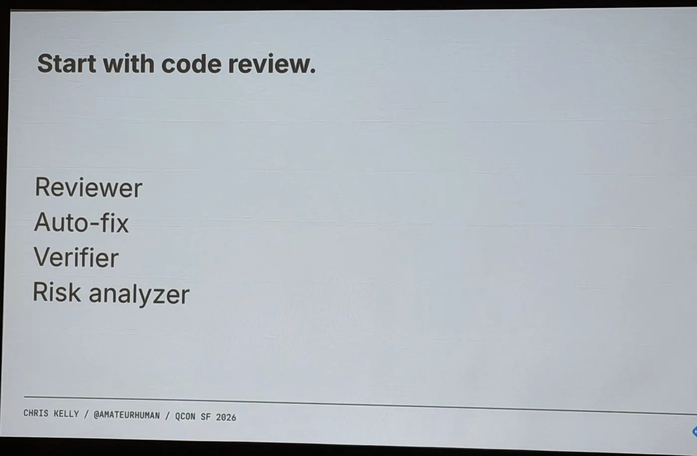

Slide 10. The first lane.

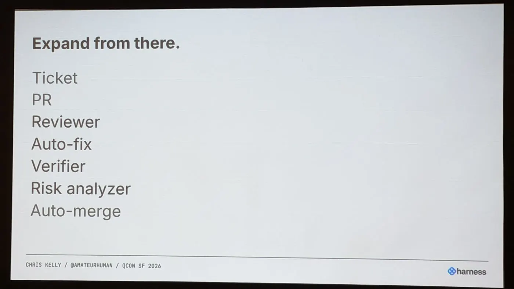

Slide 11. Then the whole path.

Automate review all the way to a merge decision, and spend human attention on the verifier’s evidence.

### Keeping the factory improving (slides 12–16)

People hate the term because they picture themselves on the line. His framing: you’re the industrial designer. You need to know what a good widget looks like to design the factory, so expertise matters more, and when output is bad you fix the factory instead of hand-writing the code. Three tools:

- **Traces.** Every LLM call, tool call and code execution in a session. Your first factory will be expensive; traces show which LLM calls could be a cheaper model and which tool calls could be code, which costs nothing.
- **A self-improvement loop.** An agent that reads all the traces on a schedule, say weekly, uses a judge to find what was inefficient, and changes its own prompts, rules and skills.
- **Evals.** For critical decisions such as your code review. Without them you can’t tell whether a cheaper model or a prompt change made things better or worse. Asking your team works for a while, not at scale.

He closed with two tips. Automate the known, not the thinking: system design shouldn’t be handed to an agent, and you need a new way to think when you’re no longer thinking while typing code. And be ambitious: instead of “we can’t do that”, ask what it would take. His example was letting agents read customer data to triage bug reports, then discarding the trace so it doesn’t sit in logs.

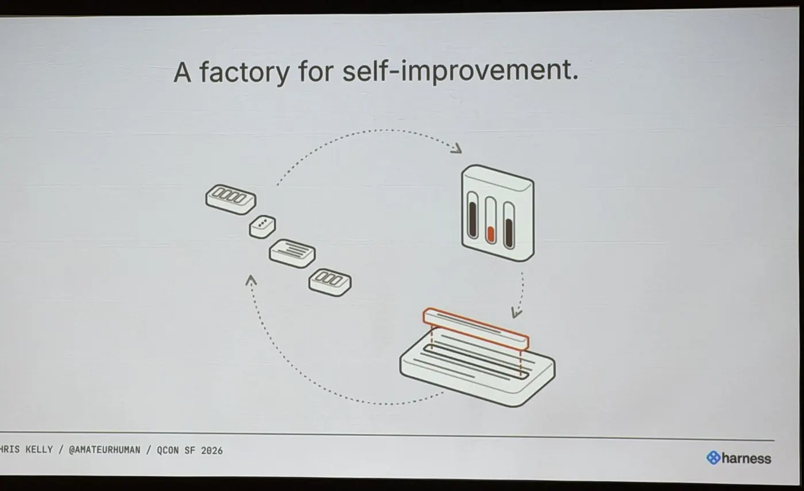

Slide 14. A factory that improves itself.

Slide 16. Closing tips.

### From the Q&A

- **Reviewer and fixer going in circles.** Keep the authoring agent on the fixes, since it has the context. Tell it explicitly when to stop and ask for help, because models don’t ask on their own. Send an agent after any run that loops to find what guideline or doc would have prevented it.
- **Agents adding needless guards.** Put the real constraints in the rules (for example, “we never deploy services out of order”). Typed languages help; untyped code invites defensive code.
- **Cost in a first factory.** Get visibility per session, set budget caps per task or provider, and learn which model is good enough for which job. Don’t run code review on the most expensive model.
- **Keeping up with an agent-written codebase.** Nobody understood a large codebase end to end anyway. When the risk analyzer scores a PR as risky, it writes a custom guide for the human reviewer. A daily internal changelog and weekly “what changed” reports help teams track the areas they own.

### Context: what Harness bought from Augment (research, not the talk)

On October 8, 2026, [Harness announced](https://www.harness.io/blog/harness-acquires-augment-code-cosmos) it had bought select Augment Code assets: Cosmos, the Auggie CLI, the Code Context Engine and related technology, with the team behind them. Cosmos becomes the Harness Cosmos Software Factory Agent. Augment’s [own post](https://augmentcode.com/blog/augment-code-next-chapter) calls it a sale of select assets and doesn’t say what happens to the rest of the company or its IDE extensions. Terms weren’t disclosed. Neither post gives pricing or guidance for existing Augment customers.

| Piece          | What it is                                                                                                                                                                                                                                                                                         | Where it fits for Harness                                                                                                                      |
|----------------|----------------------------------------------------------------------------------------------------------------------------------------------------------------------------------------------------------------------------------------------------------------------------------------------------|------------------------------------------------------------------------------------------------------------------------------------------------|
| Cosmos         | Event-triggered agents (“Experts”) such as PR Author, Deep Reviewer, Risk Analyzer, Verifier, Incident Investigator and Feedback Triager. Each session runs in a fresh VM or on your own machines through a self-hosted daemon. Experts, environments and workflows are defined in versioned YAML. | The idea-to-code step, handing off to Harness’s delivery, security testing, runtime protection and cost agents.                                |
| Context Engine | A semantic index of a codebase, exposed over MCP since February 2026 so Claude Code, Cursor, Codex and other MCP clients can query it. Local mode runs through the Auggie CLI; remote mode uses an Augment-hosted index across repos.                                                              | To be paired with Harness’s Software Delivery Knowledge Graph (services, pipelines, deployments, incidents). Harness describes this as a plan. |
| Auggie CLI     | Augment’s command-line agent, also the tool that applies Cosmos configuration and runs the self-hosted daemon.                                                                                                                                                                                     | No stated plans beyond being part of the deal.                                                                                                 |

Harness’s [governance write-up](https://www.harness.io/blog/inside-a-governed-software-factory-with-harness-cosmos) says its OPA policies can gate Cosmos worker agents, so an agent can’t merge to main even if prompted to; every merge stays a human decision; and each change has an audit trail from trigger to production. Its `cosmos approve` command auto-approves only when the requester owns every changed file, no findings are open and the Verifier found nothing contradicting. The talk’s four-step review lane maps directly onto those Experts.

## Numbers we checked

Checked on Nov 17, 2026. The talk had almost no figures; most of these come from my research and are vendor-reported.

| Claim                                                         | Figure                                                                                                                          | Source                                                                                                                                                   | Status                                                          |
|---------------------------------------------------------------|---------------------------------------------------------------------------------------------------------------------------------|----------------------------------------------------------------------------------------------------------------------------------------------------------|-----------------------------------------------------------------|
| Harness bought Cosmos, Auggie CLI and the Code Context Engine | Announced Oct 8, 2026; terms not disclosed                                                                                      | [Harness blog](https://www.harness.io/blog/harness-acquires-augment-code-cosmos), [Augment blog](https://augmentcode.com/blog/augment-code-next-chapter) | Checked                                                         |
| Two reviewers per PR is not a SOC 2 requirement               | SOC 2 doesn’t name code review; auditors test the controls you wrote                                                            | [Probo](https://www.probo.com/blog/2025-11-09-do-you-need-code-reviews), [Scrums.com](https://www.scrums.com/blog/soc2-engineering-teams)                | Caveat your own policy and other regulations still apply        |
| Augment’s own factory, Nov 2025 to Jul 2026                   | 17,200 merged PRs; size-adjusted output per developer 4.5×; median time to merge 11.2 h → 3.1 h; 14-day revert rate 1.9% → 0.4% | [Augment blog](https://augmentcode.com/blog/beyond-ai-coding-agents-how-we-built-augments-software-factory)                                              | Vendor no control group; model upgrades in the same period      |
| Share of Augment’s code reviews run through Cosmos            | 97%                                                                                                                             | [Cosmos product page](https://augmentcode.com/product/cosmos)                                                                                            | Vendor                                                          |
| Context Engine MCP improves agent output                      | 70%+ across Claude Code, Cursor and Codex; 300 Elasticsearch PRs, 900 attempts                                                  | [Augment changelog](https://www.augmentcode.com/changelog/context-engine-mcp-in-ga)                                                                      | Vendor Augment’s own benchmark                                  |
| Auggie CLI cost                                               | Matches Claude Code’s SWE-bench Pro pass rate at 53% lower cost per task                                                        | [Harness blog](https://www.harness.io/blog/inside-a-governed-software-factory-with-harness-cosmos)                                                       | Vendor                                                          |
| Knowledge Graph query cost                                    | About 12K tokens vs 250K+ through raw APIs                                                                                      | [Harness blog](https://www.harness.io/blog/inside-a-governed-software-factory-with-harness-cosmos)                                                       | Vendor                                                          |
| Augment default model in Cosmos                               | GPT-5.6 Sol, from July 29, 2026                                                                                                 | [Augment blog](https://www.augmentcode.com/blog/eight-models-in-eight-weeks-gpt-5-6-sol-is-now-our-default)                                              | Checked the talk named a Sol model for review; versions garbled |
| Budget cap example                                            | “Don’t spend more than \$1,000” on one problem, or \$100                                                                        | Spoken in Q&A                                                                                                                                            | Talk only illustrative                                          |

## About the speaker

Chris Kelly is a Product Lead at Harness, listed on the QCon speaker page, and led product for Cosmos at Augment Code, where he spent two and a half years. Before that he worked on developer experience at New Relic, GitHub, Salesforce and FireHydrant. At QCon SF 2025 he gave Augment’s sponsored talk “Vibes Won’t Cut It: Agentic Engineering in Production”. He goes by @amateurhuman online.

## Terms and technologies

### The factory

[Software factory](https://www.augmentcode.com/product/software-factory)  
A repeatable system where agents, automation and people move work from intent to shipped change. His definition adds that it must improve itself.

[Cosmos](https://augmentcode.com/product/cosmos)  
Augment’s platform for running event-triggered agents across the SDLC, now the Harness Cosmos Software Factory Agent.

[Harness and its Knowledge Graph](https://www.harness.io/products/platform/knowledge-graph)  
Harness is a software delivery platform (CI, CD, security, cost). Its Software Delivery Knowledge Graph models services, pipelines, deployments and incidents for its agents.

[Context Engine](https://www.augmentcode.com/changelog/context-engine-mcp-in-ga)  
Augment’s semantic code index, available as an MCP server to any MCP-compatible agent.

[Sandbox and self-hosted daemon](https://docs.augmentcode.com/cosmos/environments/overview)  
The isolated machine an agent works in. Cosmos uses a fresh cloud VM per session or a daemon on your own hardware.

### Building agents

[Claude Code](https://code.claude.com/docs)  
Anthropic’s coding agent. One of the coding agents he said are tuned to write code rather than do the rest of the factory’s work.

[Model Context Protocol (MCP)](https://modelcontextprotocol.io)  
A standard way to give agents tools. He suggested building MCP servers for your logs and internal systems.

[Agent Skills](https://agentskills.io/specification)  
Folders of instructions an agent loads when needed. He would write them only for organization-specific work.

[Code mode](https://blog.cloudflare.com/code-mode/)  
Cloudflare’s pattern of having the model write code that calls tools, instead of calling each tool directly. Fewer tokens for multi-step work.

[Gall’s law](https://en.wikipedia.org/wiki/John_Gall_(author))  
A complex system that works evolved from a simple system that worked. His tip on slide 9.

### Review and improvement

[Flaky test](https://martinfowler.com/articles/nonDeterminism.html)  
A test that passes or fails without any code change. In a factory, every flake is a rerun agents pay for.

[Traces](https://opentelemetry.io/docs/concepts/signals/traces/)  
The record of every step in a session. For agents, each LLM call, tool call and code execution.

[Evals and LLM judges](https://en.wikipedia.org/wiki/LLM-as-a-Judge)  
Repeatable tests of an agent’s decisions, often scored by another model. Needed before changing a model or prompt.

[SOC 2](https://en.wikipedia.org/wiki/System_and_Organization_Controls)  
An AICPA attestation that tests a service organization’s controls against its Trust Services Criteria. It tests the controls you describe; it doesn’t prescribe two reviewers.

[Open Policy Agent (OPA)](https://www.openpolicyagent.org)  
A policy-as-code engine. Harness uses it to gate pipelines and, with Cosmos, worker agents.

## Reading and tools

- Harness, [Harness acquires Augment Code](https://www.harness.io/blog/harness-acquires-augment-code-cosmos) and [Inside a governed software factory](https://www.harness.io/blog/inside-a-governed-software-factory-with-harness-cosmos).
- Augment, [How we built Augment’s software factory](https://augmentcode.com/blog/beyond-ai-coding-agents-how-we-built-augments-software-factory), the timeline and metrics behind the talk.
- Augment, [Context Engine MCP](https://www.augmentcode.com/changelog/context-engine-mcp-in-ga) and the [Cosmos environments docs](https://docs.augmentcode.com/cosmos/environments/overview).
- Cloudflare, [Code Mode: the better way to use MCP](https://blog.cloudflare.com/code-mode/).

### Related sessions

- [Running a Software Factory Efficiently at Uber Scale](running-software-factory-efficiently-at-uber-scale.md) (Monday). The same lanes at far larger scale, built in-house.
- [Use AI to Multiply Your Team as a Staff Engineer](use-ai-to-multiply-your-team-as-a-staff-engineer.md) (Pinterest, earlier today). Autoship is a homegrown version of the same ticket-to-PR lane.
- [Skills, Memory, or Fine-Tuning?](skills-memory-or-fine-tuning.md) (Lucidic, this morning). The evals and self-improvement loop in more depth.

## All slides

[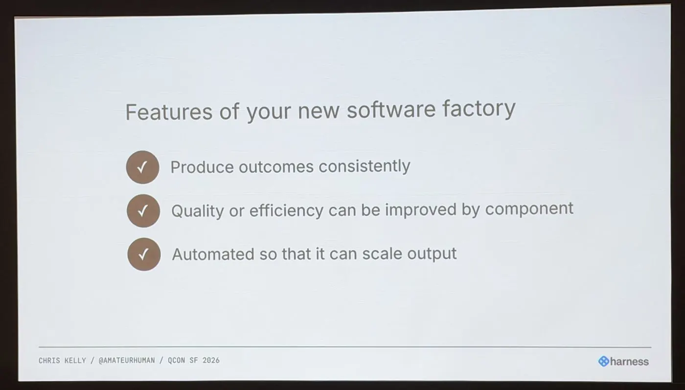](../slides/drawing-the-rest-of-the-owl/deep/p6065.webp)

Slide 1. Features of your new software factory

Slide 2. Your software factory is not

Slide 3. A software factory is a self-improving system

[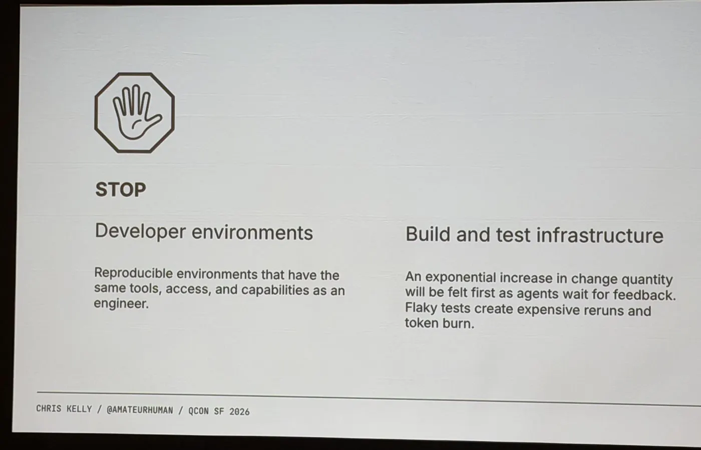](../slides/drawing-the-rest-of-the-owl/deep/p6069.webp)

Slide 4. Stop: developer environments, build and test infrastructure

Slide 5. What’s in the box

[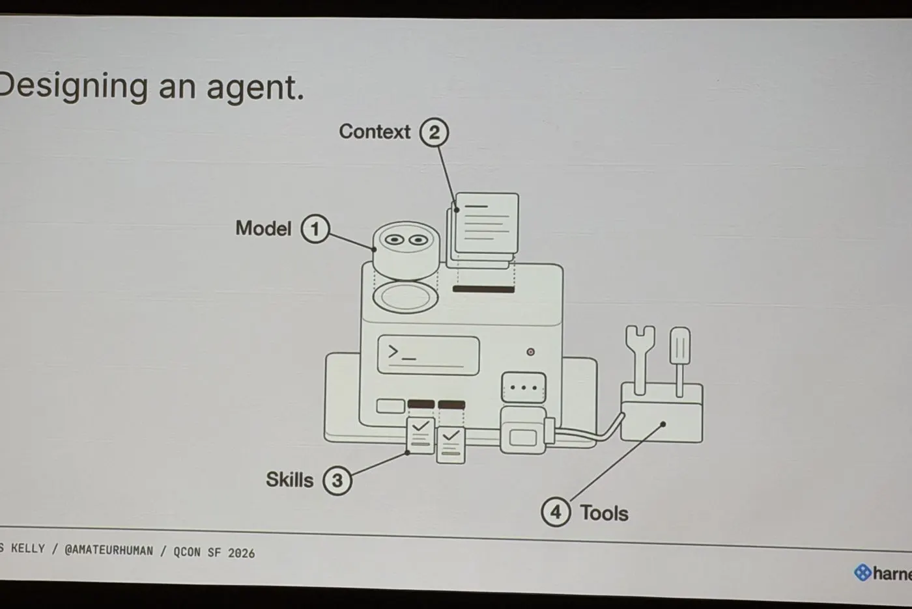](../slides/drawing-the-rest-of-the-owl/deep/p6071.webp)

Slide 6. Designing an agent

Slide 7. Select the right tool for the task

[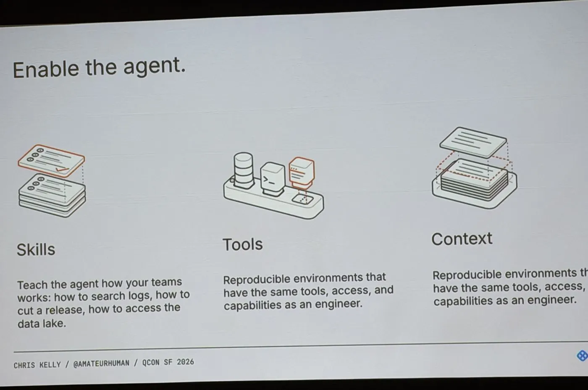](../slides/drawing-the-rest-of-the-owl/deep/p6073.webp)

Slide 8. Enable the agent: skills, tools, context

[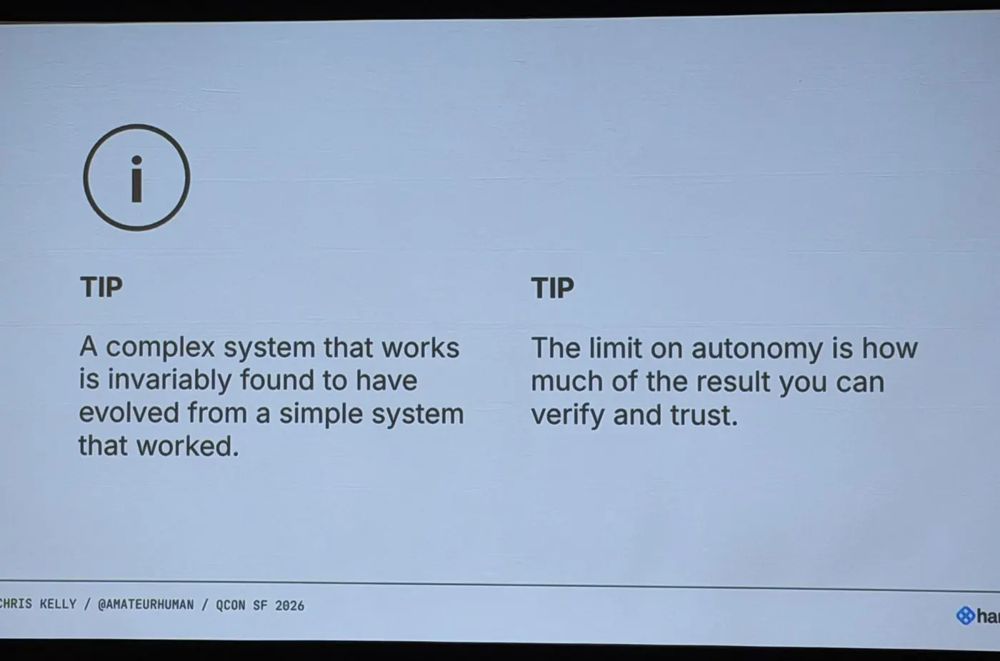](../slides/drawing-the-rest-of-the-owl/deep/p6074.webp)

Slide 9. Tips: start simple; autonomy is limited by verification

Slide 10. Start with code review

Slide 11. Expand from there

[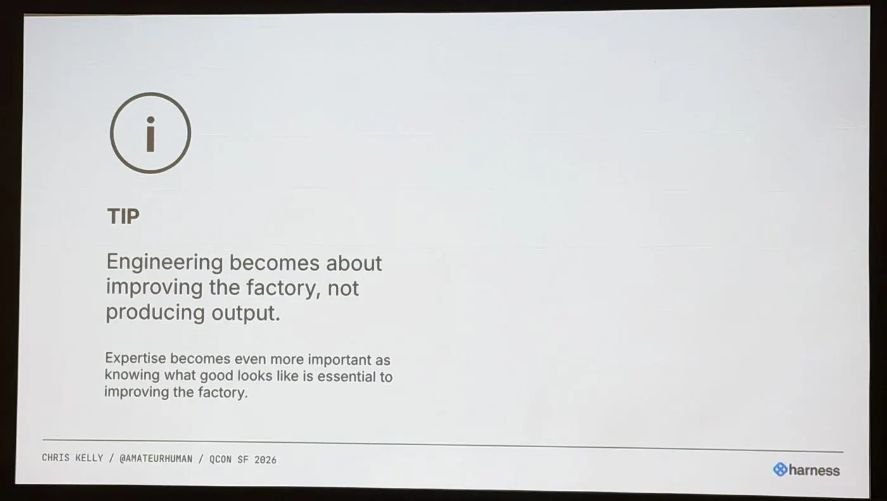](../slides/drawing-the-rest-of-the-owl/deep/p6077.webp)

Slide 12. Tip: engineering becomes about improving the factory

[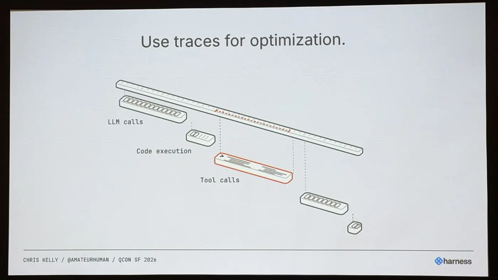](../slides/drawing-the-rest-of-the-owl/deep/p6078.webp)

Slide 13. Use traces for optimization

Slide 14. A factory for self-improvement

[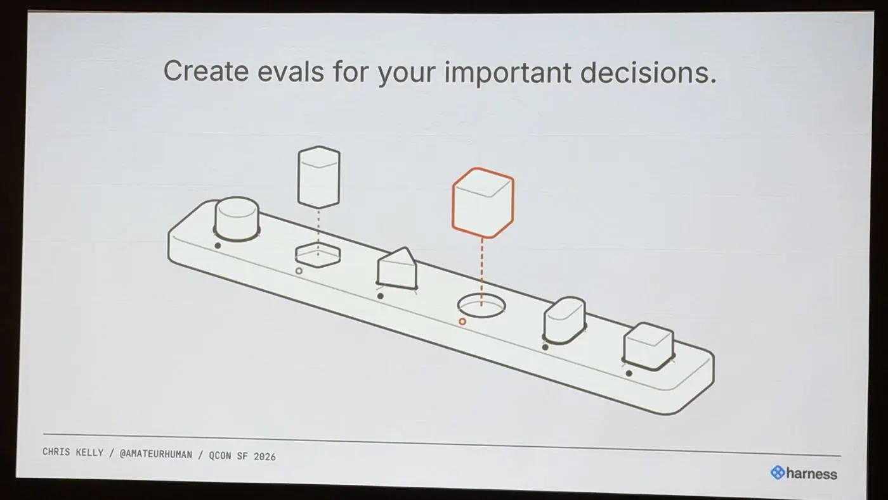](../slides/drawing-the-rest-of-the-owl/deep/p6080.webp)

Slide 15. Create evals for your important decisions

[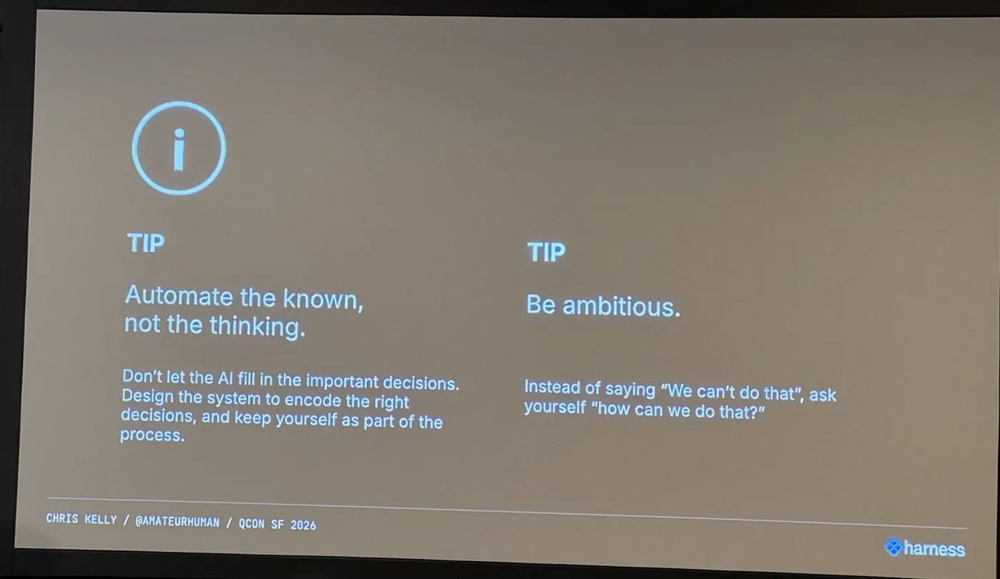](../slides/drawing-the-rest-of-the-owl/deep/p6081.webp)

Slide 16. Tips: automate the known, not the thinking; be ambitious
