# Game Time: How to (Unsuccessfully) 10x in a Week & (Successfully) 10x in a Year

**Speaker:** Plum Ertz (Senior Director of Engineering, Ro)  
QCon SF 2026 · Keynote · Wed Nov 18, 17:15 · Ballroom A  
[Session page](https://qconsf.com/keynote/nov2026/game-time-how-unsuccessfully-10x-week-successfully-10x-year) · [All 66 slides](../gallery/game-time-10x-in-a-week-and-in-a-year.md)

> Ro's Plum Ertz on how a last-minute 2025 Super Bowl ad overwhelmed its intake site. Then a year of targets, tabletop rehearsals and queueing made the 2026 ad a non-event for the system.

## Key points

- In late January 2025 Ro got a last-minute streaming Super Bowl ad and about ten days to make its onboarding sites handle it. The team split the week between quick performance fixes and load testing.
- They built a k6 API load test from Chrome network logs in a day and a half, against a six-week estimate. It showed the fixes helped a little and that a synchronous member UUID call was the choke point.
- On the day, a logged-in user icon on the cached marketing pages made one uncacheable call per visit. That overwhelmed its service and the ingress proxy. Patients still got care, but load times reached 15 to 22 seconds and cleanup took a week.
- Baseline traffic turned out to be near the system's limits. To prove a long cross-team list of changes worked together, they ran monthly tabletop sessions called D&D, Durability and Dependability, from March to May 2025, until the scenario healed itself.
- Their rules for the sessions: count only what is in production, keep it to two hours, and pick curious, talkative people who know the system. Non-engineers were included, and one asked which chart says the system is safe to use.
- For Super Bowl LX they set a per-service target called pathological load, from other companies' Super Bowl traffic and their own funnel. A service was done when it held the target for five minutes. Tests moved to k6 browser journeys compared day over day.
- They cut the intake from about 60 API calls to the 2 it needs. A client-side request handler layer blocks unknown calls and bundles the rest into one payload. On the server, an SQS queue and a fixed pool of workers running idempotent steps flattened the spike.
- They shipped in small releases with no code freeze and load tested production up to the intake database write. On game day they saw their busiest minute and hour ever, with the system at business as usual.

From an audio recording and 81 photos of the deck, kept here as 66 slides. The deck is one hand-drawn canvas that the speaker zoomed around, so it has no slide numbers; slides are numbered in the order shown and repeated frames were dropped. The “2 \< 60” frame was not photographed on its own; it shows on the zoomed-out canvas (slide 64). The recording starts partway through the host’s introduction.

## The talk in brief

At the end of January 2025, Ro got a last-minute deal on a streaming Super Bowl ad and about ten days to answer one question: can our site handle it? Plum Ertz’s team spent the week on two tracks, quick performance fixes and a k6 load test built in a day and a half, and found their choke point in a member ID call they could not fix in a week. Then the ad ran and something else broke: a logged-in user icon on the cached marketing pages made one uncacheable call per visitor, which swamped its service and the internal ingress proxy. Patients still got care, but load times hit 15 to 22 seconds and a week of cleanup followed.

The second half is the year after. Baseline traffic was already near the system’s limits, so they worked a long list of changes across teams and checked it with monthly tabletop sessions they called D&D, Durability and Dependability. With about five months before Super Bowl LX they set one target per service, “pathological load”, moved to k6 browser tests, cut the intake flow from 60 API calls to the two it needs with a client-side request layer, and put a queue and a fixed pool of workers between the spike and the old systems. On the day of the 2026 ad, Ro had its biggest minute of traffic and its biggest hour of new patients, and the system graph stayed flat.

> “Cached HTML != cached XHR.” (Slide 65, the first of four takeaways)

## In depth

### The question and the week (Slides 1-16)

Ro is a New York telehealth company. Its onboarding runs across two public sites: a mostly static marketing site and a healthcare intake flow that leans on some of the company’s oldest, largest and least optimized databases. The ask came from a senior leader late on a January day: could the site handle a streaming Super Bowl ad? The game was about a week out. Plum translated “handle” two ways. The business meant business as usual. Engineering meant anything short of a server catching fire.

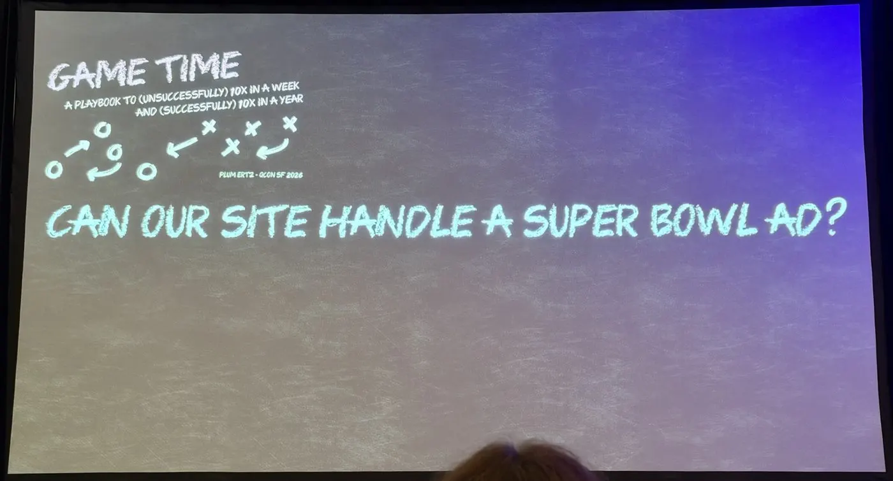

*Slide 3: The question*

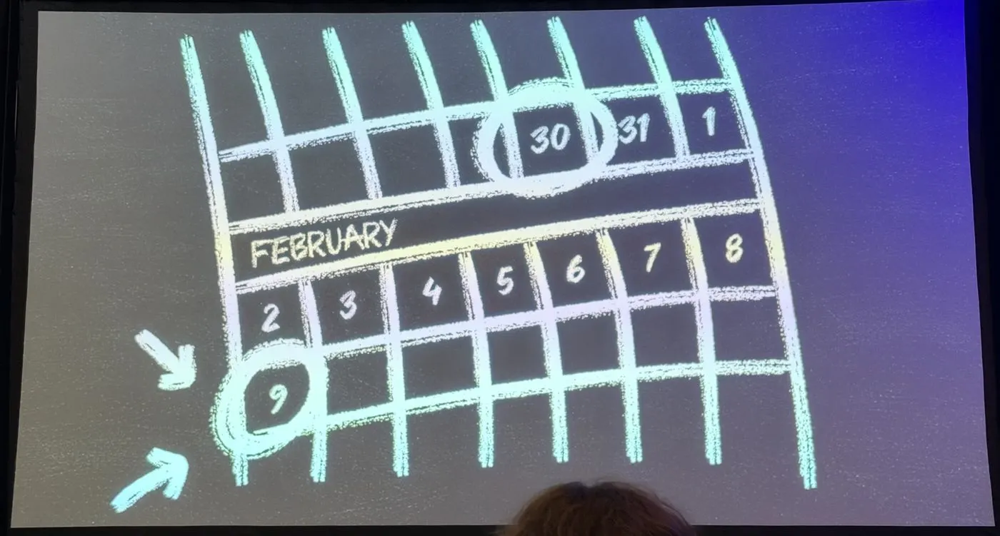

*Slide 7: One week*

Nobody could say yes or no, because they had never run at that scale and their largest events already ran hot: CPU spikes and exhausted connection pools. So the game plan had two tracks. Performance work went after N+1 queries and blocking synchronous calls, including product analytics calls that blocked the product until the analytics write was confirmed. Load testing was the measuring stick. Their reason: broad performance work feels like progress, and without a goal you can spend a week shaving milliseconds off one endpoint while another still takes minutes.

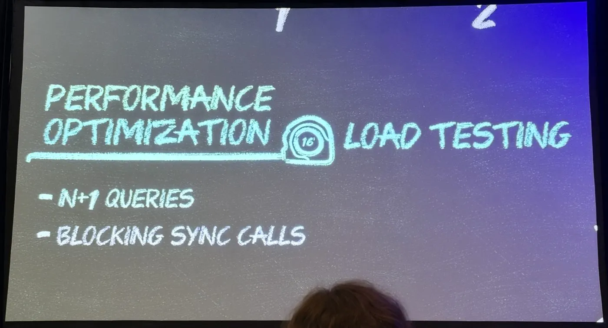

*Slide 9: Quick wins*

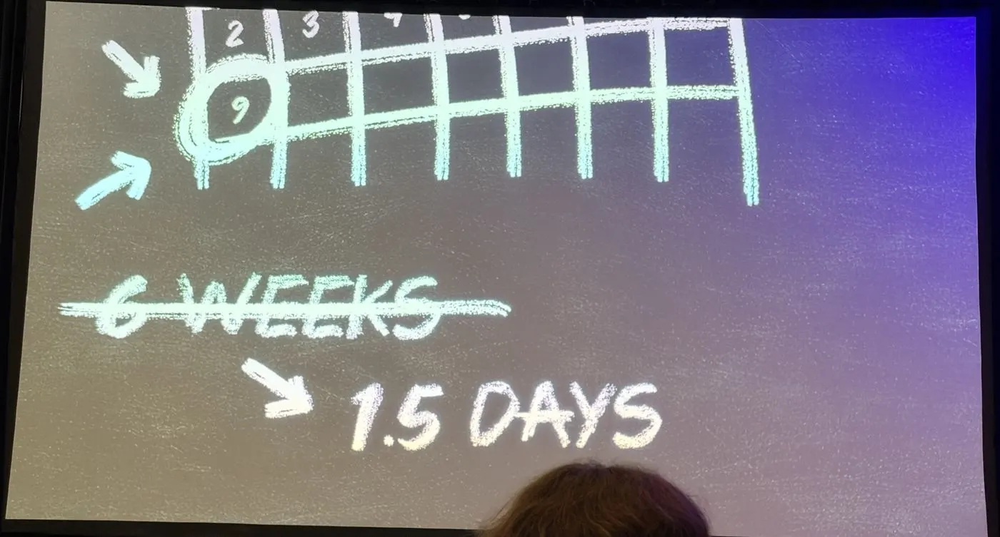

*Slide 12: 6 weeks became 1.5 days*

The team had always had reasons not to load test: no production-like data in staging, user behavior that varied too much, missing infrastructure, other priorities. With the game a week away, they built a k6 API test by clicking through the site in Chrome, pulling the network log and turning it into a script. The k6 browser tests were still beta at the time, so they used the HTTP API. The result: the performance wins helped a bit, not much. The choke point was the synchronous call that creates the member UUID at the start of onboarding, which every later call needs. It carries seven-plus years of business rules on infrastructure already scaled to its limit.

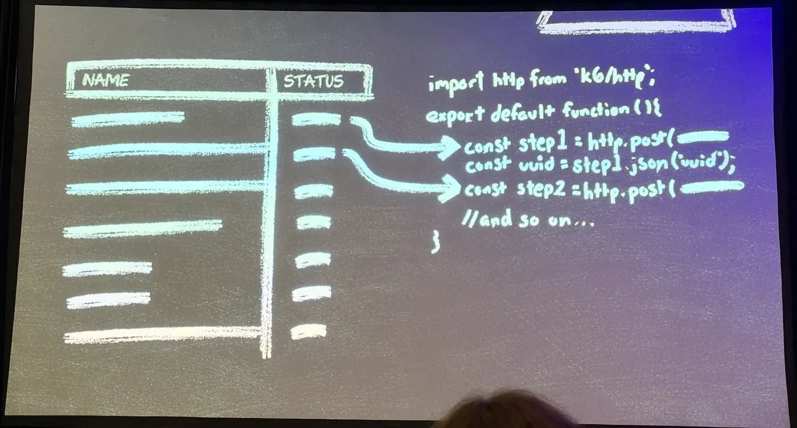

*Slide 14: A test built from browser logs*

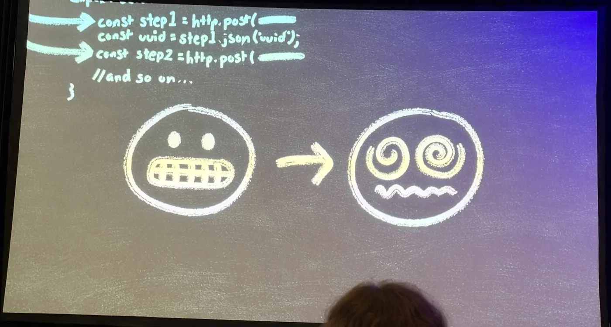

*Slide 16: Test results*

> a rough test that shows where you fall over first beats a perfect test you never build.

### Game day 2025 (Slides 17-26)

The Slack thread on slide 17 is from the weekend before the game. Staging tests showed the queue holding up and member create still the limiting factor, and the team decided 8 PM on a Friday was not the time to make member create asynchronous. A principal engineer’s reply on the slide: “hahahahaha COWARDS”. Plum’s line on the trade-off was to avoid changes that added more risk than the traffic itself.

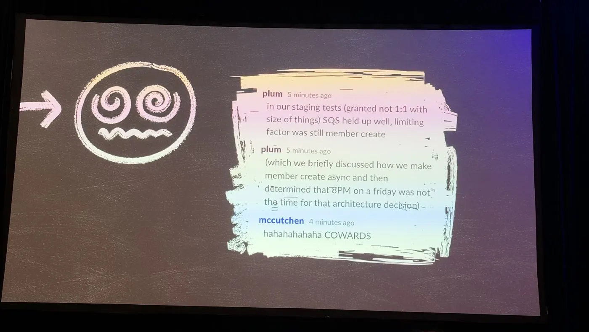

*Slide 17: The 4 AM Slack thread*

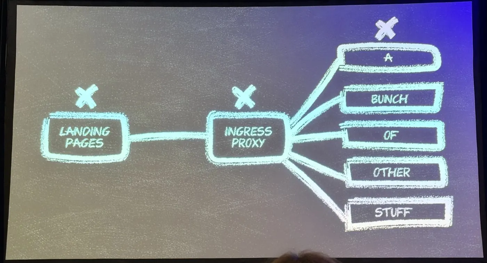

*Slide 20: The cascade*

The member create choke point behaved as predicted: people who got that far waited 15 to 22 seconds. What broke first was the marketing site. Every landing page had a user icon that shows your initials if you are logged in. That call is user-specific and can’t be cached, so each landing page hit during the ad made one, which overwhelmed the service behind it and the ingress proxy that carries the rest of the internal traffic. No healthcare was compromised and patients were still onboarded, but it was not business as usual.

The Monday after went to dashboards and cleanup. The product analytics service was one of the casualties, so much of the data from the day was lost. Sporadic network failures had left events queued or stuck, and it took a week to unstick them. Plum approved the PR that removed the icon; it shipped that Monday.

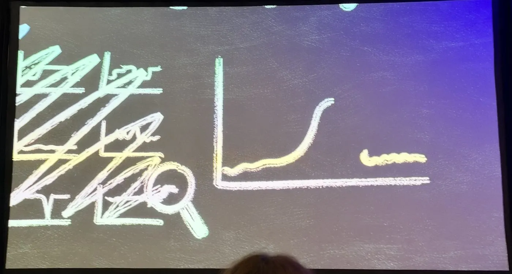

*Slide 24: Analytics that rocketed off*

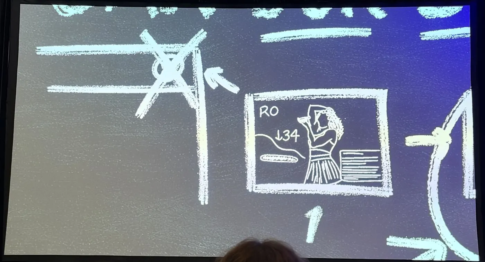

*Slide 26: The icon goes*

### Changing the game: D&D (Slides 27-38)

The data from 2025 showed something worse than one bad day: baseline traffic was already close to the system’s limits. Ro’s patients stay on the platform for years, so each cohort keeps adding load. The new clock was the time until everyday traffic hit the ceiling. The fix was a long, distributed list of changes across teams, with different timelines and priorities, and Plum’s usual tool, a spreadsheet, could check off tasks but couldn’t prove the changes worked together in production.

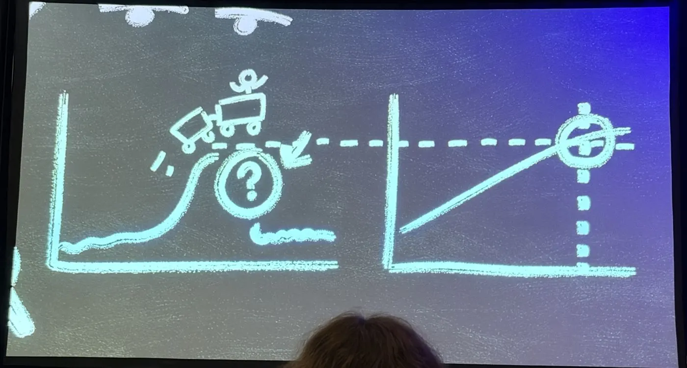

*Slide 28: Time until the limit*

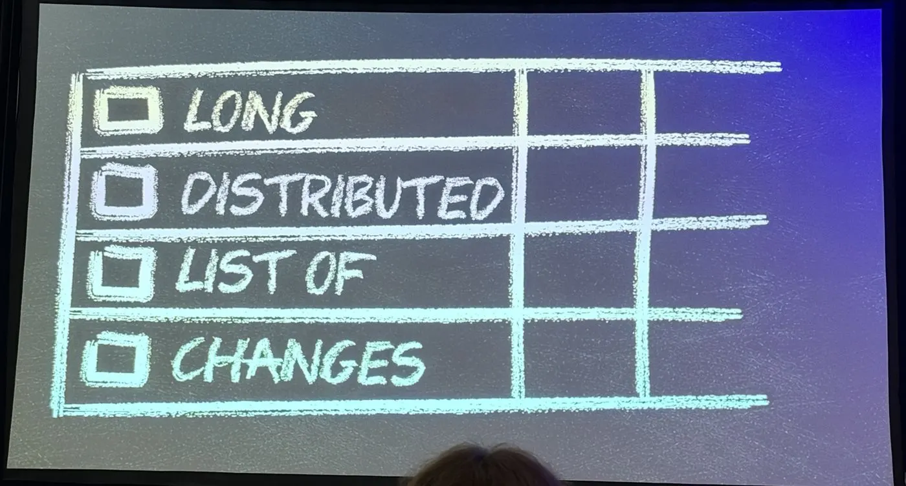

*Slide 30: Not a spreadsheet problem*

So they rehearsed. They kept the format of a Dungeons & Dragons session, renamed it Durability and Dependability, and played through a real scenario: sporadic failures from internal network pressure under high traffic. Plum gave three reasons for a tabletop exercise over another simulation: zero cost (they already had data from a real failure), zero stress (no boss on the bridge call), and access for non-engineers. The care team and clinical operations are part of real incidents, so they were part of the sessions. One of them asked which of the many Datadog charts tells you the system is safe to use. Nobody had an answer that day; the team built one later.

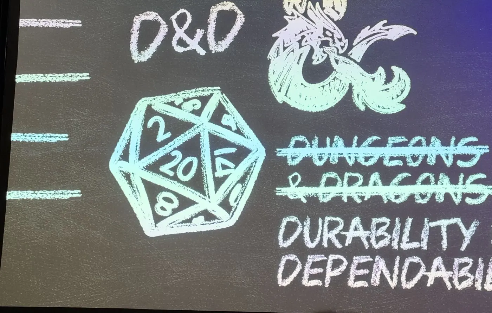

*Slide 32: Durability and Dependability*

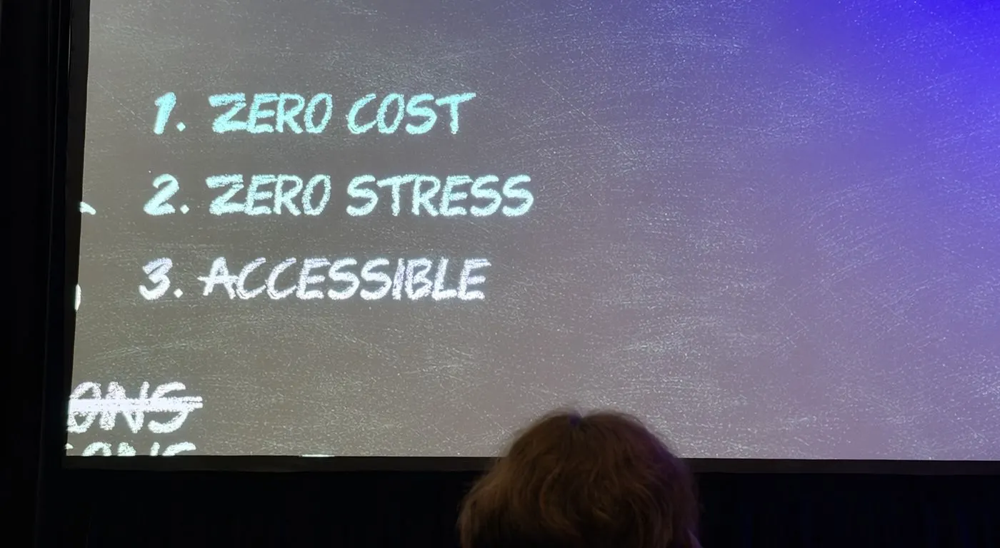

*Slide 34: Why tabletop*

Gameplay was a replay from the start of the spike: what each service does, what fails downstream, what people outside engineering do. The party won if the system survived with no manual remediation. Plum’s three rules:

| Rule                      | What it means                                                                                                    |
|---------------------------|------------------------------------------------------------------------------------------------------------------|
| 1\. Play in the present   | Only what is in production right now counts. Work in next week’s sprint and a PR not yet deployed do not.        |
| 2\. Focus time frame      | Two hours, notifications off, not a replay in real time.                                                         |
| 3\. Pick the right people | People who know the system and are curious and talkative. A room of smart, quiet people makes for a bad session. |

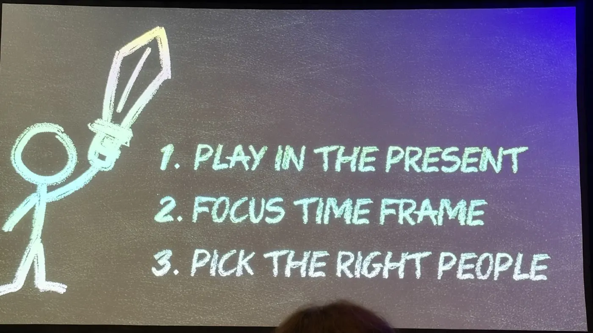

*Slide 37: The rules*

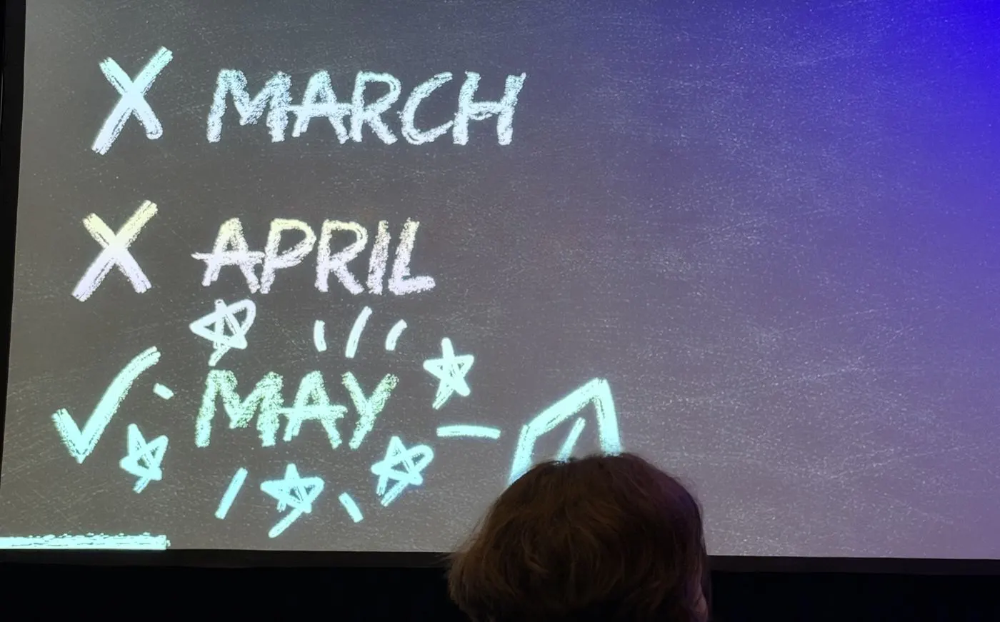

*Slide 38: Three sessions*

They ran the same scenario with the same people once a month for three months, March, April and May. The system was what changed between sessions. Plum called social pressure the strongest accountability mechanism they had: nobody wanted to say for the third time that their item still wasn’t done. By the May session the whole scenario healed itself. The aside on slide 33 was the 1980 ARPANET outage, which Plum said had a monitor that would have caught it if it hadn’t been misconfigured.

> a recurring rehearsal of one scenario, scored only on what is in production, works as a delivery tracker for cross-team changes.

### The year: a target and better tests (Slides 39-43)

By September 2025 the system had more headroom, but a Super Bowl was a step change, not an optimization. They had just over five months. Plum’s point was that more time doesn’t change the game plan: start with the onboarding flow and a metric, because five months is plenty of time to get distracted.

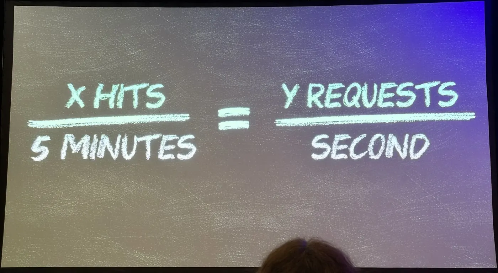

*Slide 39: Setting the target*

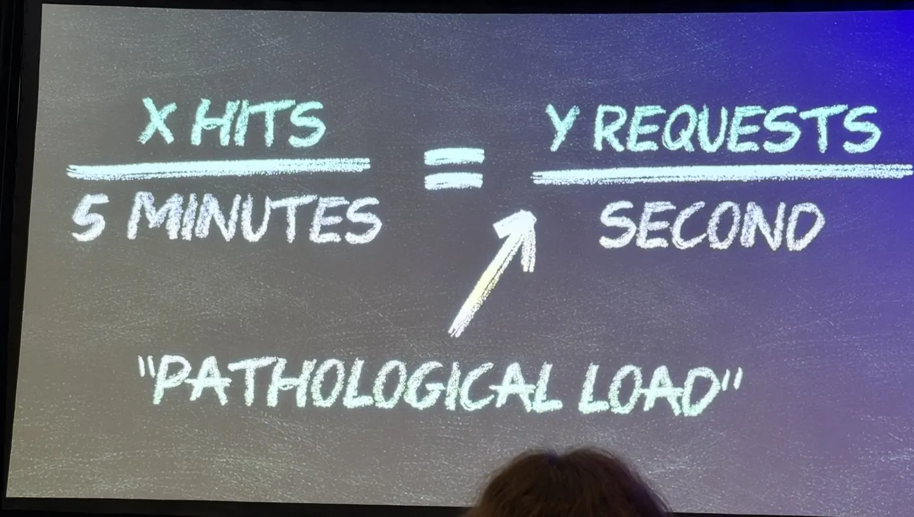

*Slide 40: Pathological load*

The metric came from other companies’ Super Bowl traffic (hits in a period of time) mapped onto Ro’s own funnel and drop-off points, giving a requests-per-second target for each service at peak. The number was high enough that they called it pathological load. A service that held its target for five minutes was done, which also stopped teams from over-investing. The tests moved to k6 browser tests covering the whole journey, from the first landing page to submitting the intake, with a simple UI on top to compare runs day over day. Reviewing them became a daily ritual.

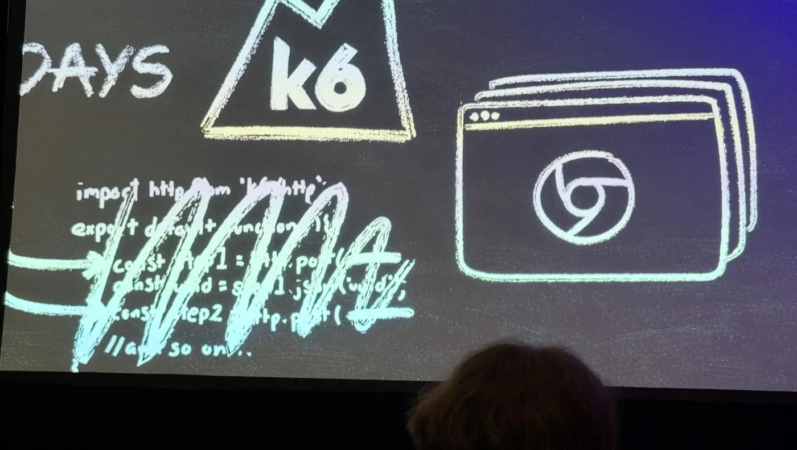

*Slide 42: Browser tests*

*Slide 43: Day-over-day results*

The results table on slide 43, as drawn (the slide labels no request names or units):

| Count  | Min | p95   | Max    |
|--------|-----|-------|--------|
| 13,925 | 200 | 583   | 751    |
| 13,925 | 50  | 87    | 111    |
| 13,925 | 34  | 449   | 1,092  |
| 43,523 | 480 | 550   | 585    |
| 6,141  | 632 | 1,164 | 4,810  |
| 802    | 132 | 422   | 10,047 |
| 4      | 630 | 1,035 | 3,451  |

### From 60 calls to 2: the request handler layer (Slides 44-50)

Next they asked the opposite question: what is the minimum number of API calls a full healthcare intake needs, counting state-by-state rules, privacy, security and identity checks? The answer was two, against the roughly 60 the flow made. They sorted every call into four groups:

| Category                    | What it was                                                                                 | What they did                               |
|-----------------------------|---------------------------------------------------------------------------------------------|---------------------------------------------|
| 1\. Cruft                   | Calls for dead features nobody cleaned up                                                   | Deleted them                                |
| 2\. Configuration           | Config built as an API call because it would change often; now it changes about once a year | Bundled it into the code                    |
| 3\. Essential               | The two calls the intake can’t work without                                                 | Kept, at the end of the flow                |
| 4\. Progressive enhancement | Nice to have live, fine if they fail: analytics, phone verification                         | Fire-and-forget, or retried after the visit |

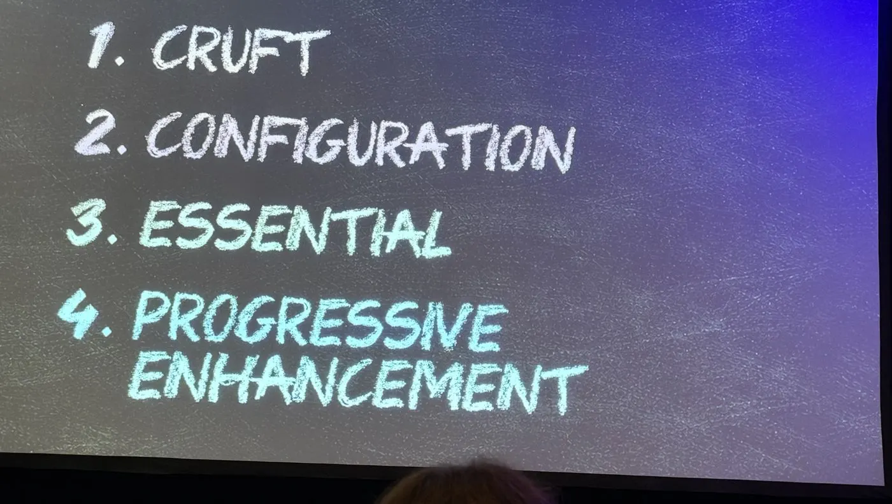

*Slide 44: Four kinds of API call*

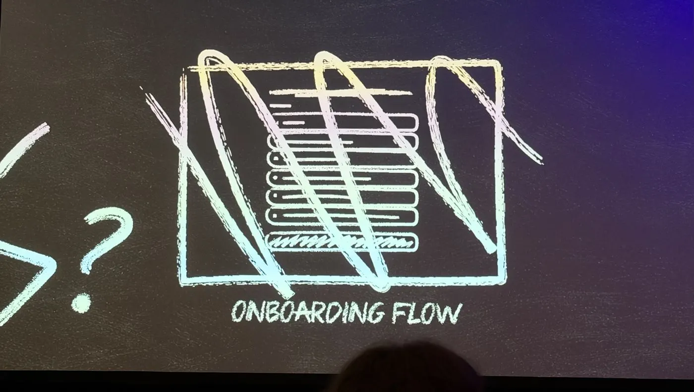

*Slide 46: Not a rewrite*

They didn’t rebuild the flow. It held years of business logic, and a fast-growing startup ships to onboarding all the time, so a rewrite would always be chasing features. Instead they added a request handler layer in the browser, between the existing app and the network. The app makes its calls and gets what looks like a server response, while the layer collects the data for one final payload. Unknown calls are blocked by default and reported, so the next personalized icon can’t sneak back in. Phone verification moved to an asynchronous retry, which also protects patients when a third party like Twilio has an outage. The layer ran in shadow mode first, logging what the final payload would have been, which caught a few more calls and confirmed the count of two.

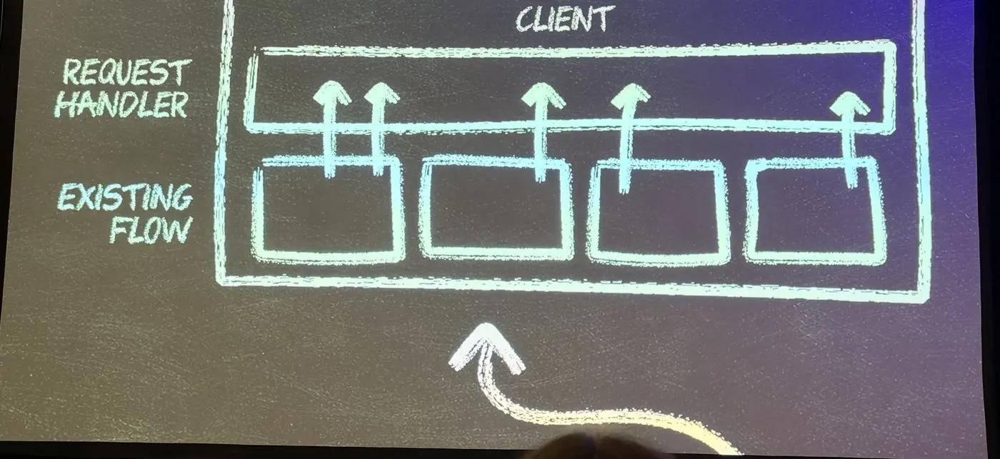

*Slide 47: The request handler layer*

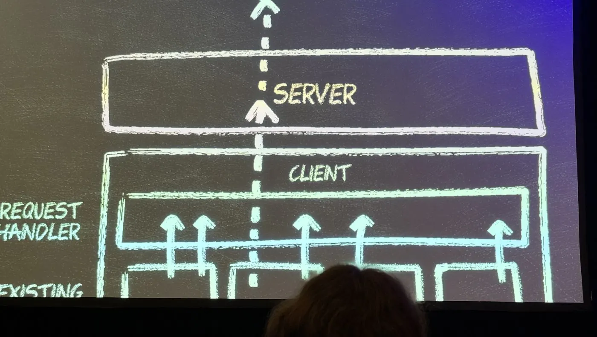

*Slide 49: Blocked by default*

> you can change what a legacy flow sends without rewriting it, if you put a layer between the flow and the network.

### Throughput = capacity × time (Slides 51-59)

The final payload carries the small calls the client used to make one by one, so the server can process them asynchronously from the person but in order relative to each other, keeping the dependency on the member UUID. Once nobody is watching a spinner, the server doesn’t have to be fast. With capacity capped by old systems, time is the lever. The submit path put the payload on a queue and drained it at a controlled rate (queue-based load leveling).

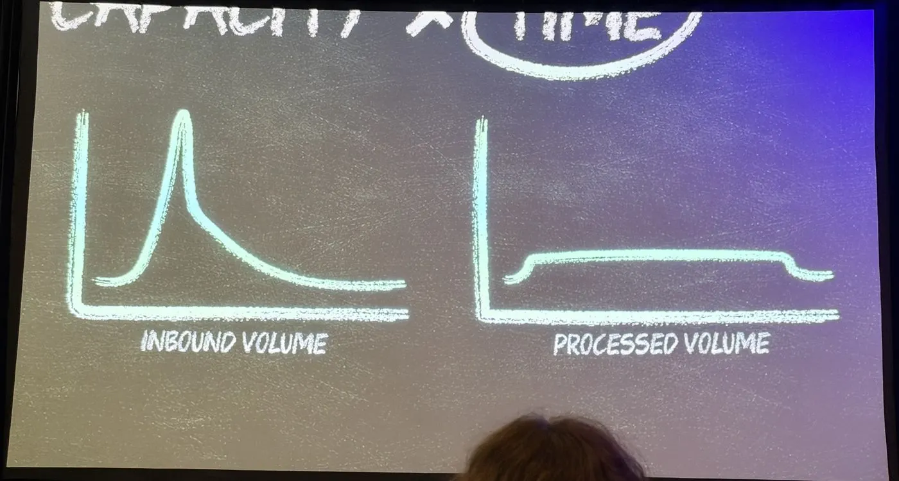

*Slide 52: Leveling the spike*

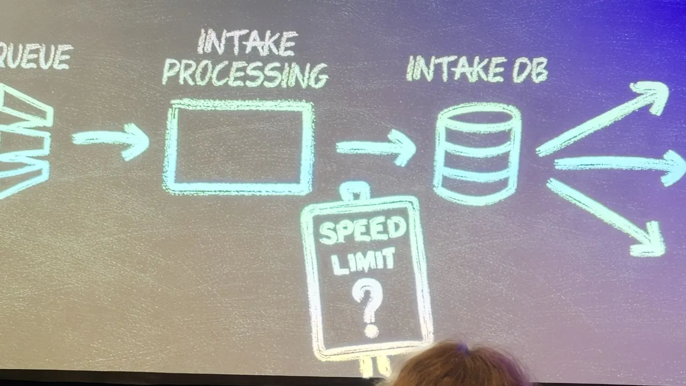

*Slide 55: Speed limits*

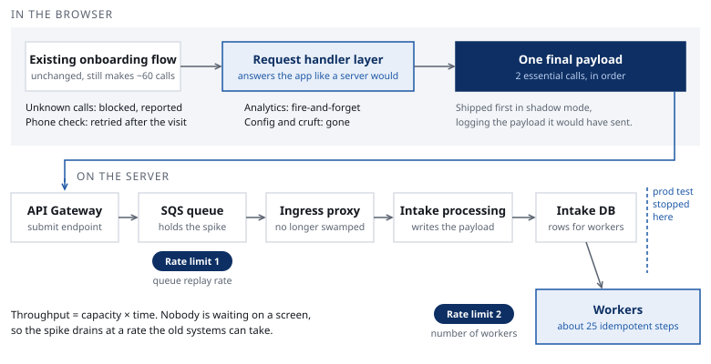

Our drawing of slides 47-58: the 2026 intake path as Plum described it. Service names are from the slides; the layout is mine.

The server side: API Gateway into an SQS queue, whose replay rate is the first rate limit and keeps the ingress proxy from being overwhelmed again. The proxy hands each payload to the intake processing service, which writes it straight to a database. Workers pick rows up, run the steps and record progress for retries. The worker count is the second rate limit. After cutting cruft and moving enhancements out, the 58 non-essential calls became about 25 worker steps. They considered Temporal or another workflow engine, but a proof of concept with one service, one table and a pool of workers survived everything they threw at it. Plum said AWS checked in to ask if everyone was all right, and the engineer who built it spent two days in the logs because he didn’t believe it worked.

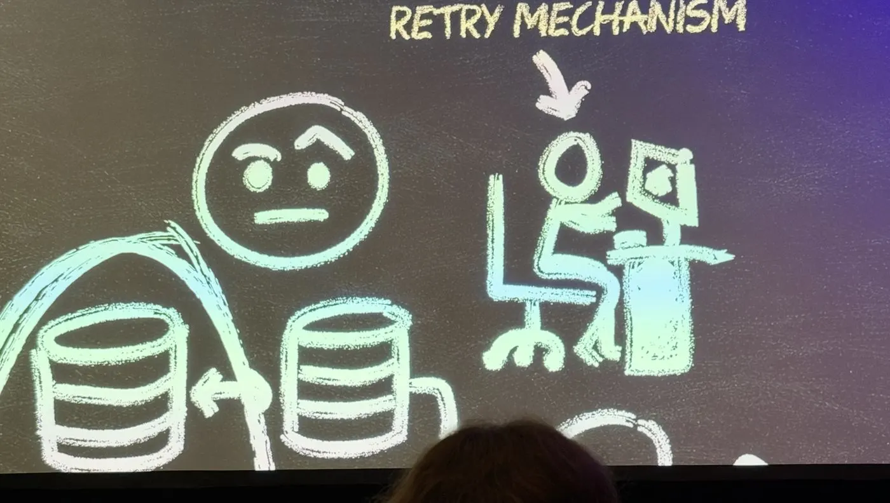

*Slide 57: Retries*

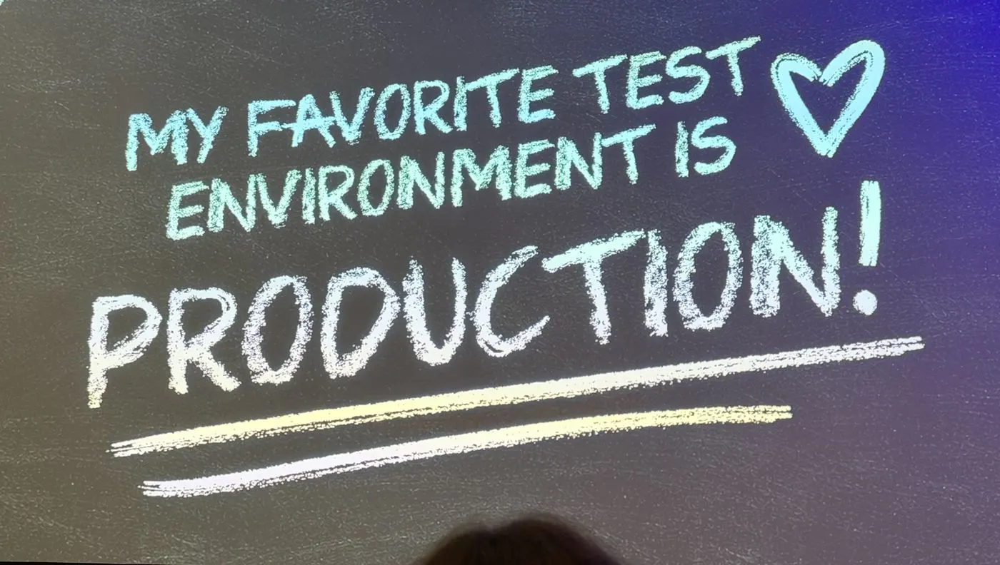

*Slide 59: Production*

Retries were the hard part. A synchronous flow has a free retry mechanism, the person at the computer who clicks again or comes back later. With that gone, the fix was mostly making services idempotent so workers could resume from their recorded progress. Those were small changes that helped the services even before the new flow went live. The whole shift shipped in pieces over a couple of weeks: cruft removal and bundling, the request layer in shadow mode, performance work, then the orchestration layer, tested in production with no code freeze and no downtime. They turned it on as the default quietly, before the game. Plum didn’t pretend it was clean: steps got reordered more than once, and there were several 10-to-12-hour Saturday debugging calls.

### Will it work, and what will go wrong? (Slides 60-61)

In mid-January 2026 they ran the last D&D session against a flow chart of the full journey, from the first landing page to the treatment queue for provider review (the slide shows about a sixth of it). About 18 people from engineering and other teams walked it step by step, asking what could go wrong, and marked each risk with a sticky note. The first rabbit hole came at step one: what if Cloudflare is down, and then what if AWS is down in every region. Plum stopped it there.

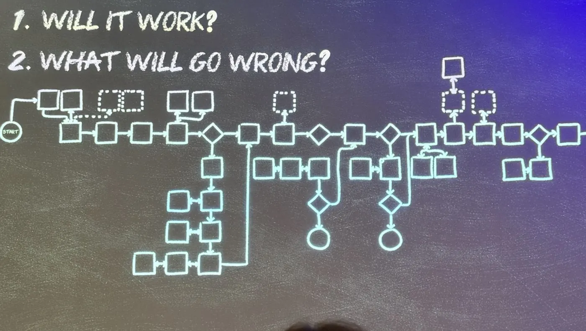

*Slide 60: Will it work?*

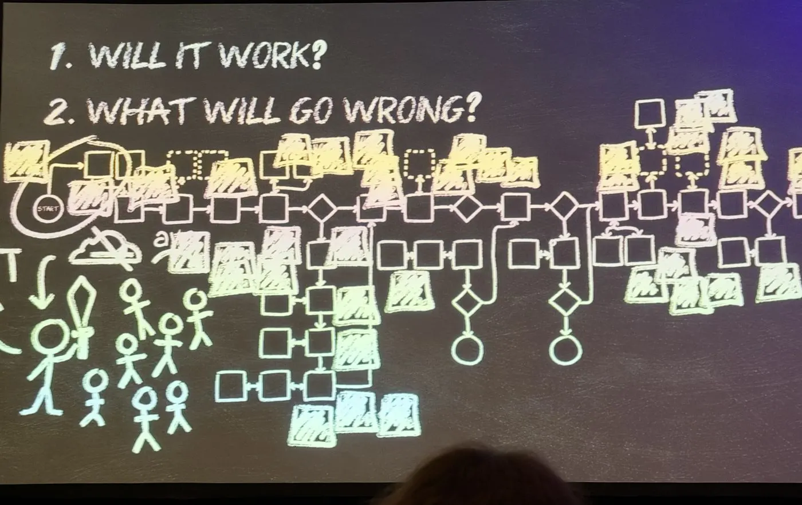

*Slide 61: Sticky notes*

Then they tested in production. A couple of days before the game they ran pathological load against production, but only up to the intake database write. Workers didn’t process the records, because flooding the queues with thousands of fake patients would have set off legal and security. Staging showed the workers could burn the backlog down. Plum’s summary: they went in with high, measurable confidence, but confidence isn’t certainty, and the only full end-to-end test at scale would be the game itself.

### Game day 2026 and the recap (Slides 62-66)

On Super Bowl Sunday, engineering sat in a situation room next to the office party, with playbooks for internal and external failures, including Cloudflare and AWS going down. The ad cost about \$7 million by Plum’s figure and aired early. Ro saw more traffic in one minute and onboarded more patients in one hour than at any point in its seven-year history. On the system side it was business as usual. The only thing that made Plum scream was Lady Gaga’s surprise halftime appearance. Plum’s line: a properly scaled system is boring, and the journey to get there is the interesting part.

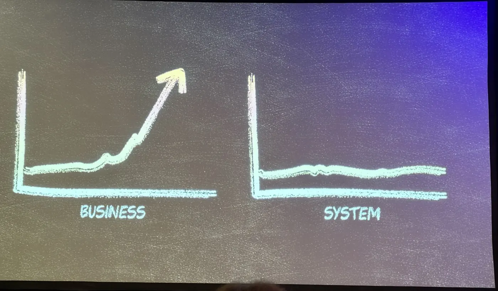

*Slide 63: Game day*

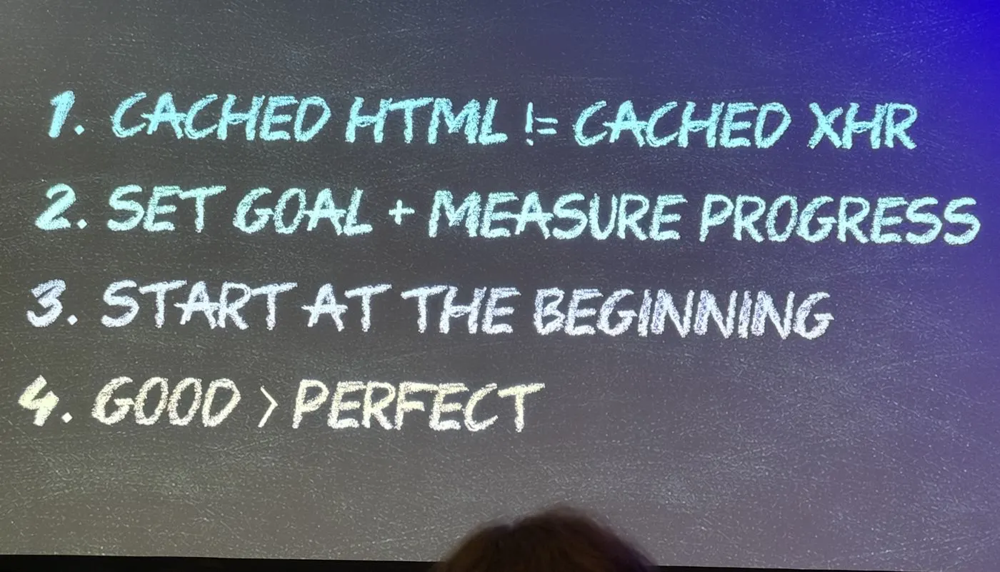

*Slide 65: Recap*

| If you have one week                                     | If you have one year      |
|----------------------------------------------------------|---------------------------|
| Find quick wins                                          | Big change = time + focus |
| Know your limits, including what you can’t fix this week | Find wins along the way   |

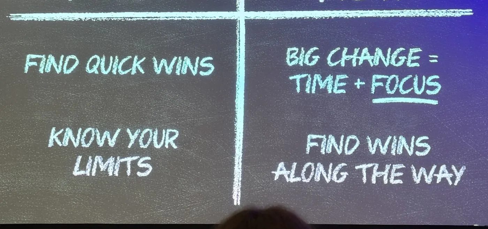

*Slide 66: One week, one year*

## Numbers I checked

Status: Checked found in the source; Caveat holds with a condition; Slide only taken from the slide or the recording, not verified. Ro’s internal figures can’t be checked from outside.

| Claim                                                          | Figure                                | Source                                                                                                                                                                                                                                                                                                     | Status     |
|----------------------------------------------------------------|---------------------------------------|------------------------------------------------------------------------------------------------------------------------------------------------------------------------------------------------------------------------------------------------------------------------------------------------------------|------------|
| Super Bowls among the 20 most-watched US telecasts             | 19 of 20                              | [Wikipedia’s Nielsen list](https://en.wikipedia.org/wiki/List_of_most-watched_television_broadcasts_in_the_United_States): the M\*A\*S\*H finale is the only non-Super Bowl in the top 20 (11th)                                                                                                           | Checked    |
| Super Bowl audience                                            | Over 100 million                      | [Fox](https://www.foxcorporation.com/?p=6207): Super Bowl LIX averaged 127.7 million viewers                                                                                                                                                                                                               | Checked    |
| Last-minute streaming ad, late January 2025                    | About a week’s notice                 | [Tubefilter](https://www.tubefilter.com/2025/02/07/tubi-free-ad-supported-tv-fast-super-bowl-ads/): Fox sold Super Bowl LIX spots on its free Tubi stream, some offered as late as Jan 31. The talk didn’t name the platform                                                                               | Caveat     |
| Load-testing estimate vs build time                            | 6 weeks → 1.5 days                    | Slides 12-13                                                                                                                                                                                                                                                                                               | Slide only |
| k6 browser tests “still in beta” in January 2025               | Stable in k6 1.0                      | [k6 1.0 release notes](https://grafana.com/docs/k6/latest/release-notes/v1.0.0/) (May 2025) list k6/browser among modules now production-ready                                                                                                                                                             | Checked    |
| Member UUID logic                                              | 7+ years of rules                     | Recording                                                                                                                                                                                                                                                                                                  | Slide only |
| Load times at the choke point, 2025                            | 15-22 seconds                         | Recording only                                                                                                                                                                                                                                                                                             | Slide only |
| Monthly D&D sessions                                           | 3 (March, April, May 2025)            | Slide 38                                                                                                                                                                                                                                                                                                   | Slide only |
| D&D first published                                            | 1974                                  | [Wikipedia](https://en.wikipedia.org/wiki/Dungeons_%26_Dragons)                                                                                                                                                                                                                                            | Checked    |
| ARPANET’s “first outage” in 1980, with a misconfigured monitor | Oct 27, 1980                          | [RFC 789](https://www.rfc-editor.org/info/rfc789) (Eric Rosen, BBN) documents a network-wide outage of several hours that day. It says no such disturbance had happened “in several years”, so it was not the first. I did not check the monitor detail                                                   | Caveat     |
| Preparation time for 2026                                      | Just over 5 months                    | Recording                                                                                                                                                                                                                                                                                                  | Slide only |
| Pathological load held for                                     | 5 minutes                             | Slides 39-40 and recording                                                                                                                                                                                                                                                                                 | Slide only |
| API calls the intake needs                                     | 2 of about 60                         | “2 \< 60” on slide 64 and the recording                                                                                                                                                                                                                                                                    | Slide only |
| Worker steps after cleanup                                     | About 25                              | Recording                                                                                                                                                                                                                                                                                                  | Slide only |
| Final D&D session size                                         | About 18 people                       | Recording                                                                                                                                                                                                                                                                                                  | Slide only |
| Cost of the 2026 ad                                            | About \$7 million                     | [Ro co-founder Saman Rahmanian](https://ro.co/perspectives/making-of-super-bowl-ad/): at least \$233,000 per second; [Campaign](https://campaignlive.com/article/ro-makes-super-bowl-debut-serena-williams-shift-glp-1-narrative-vanity-vitals/1946604): a 30-second spot. 30 × \$233,000 = \$6.99 million | Checked    |
| The 2026 ad                                                    | Ro’s first Super Bowl ad, Feb 8, 2026 | [Ro press release](https://ro.co/press/super-bowl-2026/), Jan 28, 2026: Serena Williams, “Healthier on Ro”, Super Bowl LX on NBC                                                                                                                                                                           | Checked    |
| Ro’s history                                                   | Seven years                           | [Front Office Sports](https://frontofficesports.com/?p=238525): Ro was founded in 2017                                                                                                                                                                                                                     | Checked    |
| Record minute of traffic and record hour of onboarding         | No figures given                      | Recording; slide 63 shows business up, system flat                                                                                                                                                                                                                                                         | Slide only |
| Lady Gaga as a surprise halftime guest                         | Super Bowl LX                         | [Billboard](https://ca.billboard.com/music/pop/lady-gaga-bad-bunny-super-bowl): she joined Bad Bunny’s halftime show unannounced                                                                                                                                                                           | Checked    |

## About the speaker

Plum Ertz (they/them) is Senior Director of Engineering at [Ro](https://ro.co/), a direct-to-patient telehealth company. Their [QCon speaker page](https://qconsf.com/speakers/plumertz) describes a background in digital accessibility, UI development and scaling both systems and teams, and says they have been employee number 8 and number 800 at companies in marketing, media and fintech. Past projects include interactive multimedia for live events. The page lists no prior QCon talks. They are on [LinkedIn](https://www.linkedin.com/in/plumertzi/) and [GitHub](https://github.com/s-plum).

Ro, by its own description, is direct-to-patient healthcare. In the talk, Plum named metabolic health, dermatology and sexual health as its areas. Ro’s first Super Bowl ad, starring Serena Williams, ran during Super Bowl LX on Feb 8, 2026.

## Terms and technologies

### Load and performance testing

[Grafana k6](https://grafana.com/docs/k6/latest/)  
An open source load-testing tool that runs JavaScript or TypeScript test scripts. Ro used its HTTP API in 2025, with a script built from Chrome network logs.

[k6 browser](https://grafana.com/docs/k6/latest/using-k6-browser/)  
k6’s browser module, which drives a real Chromium browser through a user journey and collects front-end metrics. It became stable with [k6 1.0](https://grafana.com/docs/k6/latest/release-notes/v1.0.0/) in May 2025. Ro’s 2026 tests ran from landing page to intake submit.

[Load testing](https://en.wikipedia.org/wiki/Load_testing)  
Putting expected or extreme demand on a system to see how it behaves. Plum called it a Super Bowl simulator.

[p95](https://en.wikipedia.org/wiki/Percentile)  
The 95th percentile: 95% of requests were at or faster than this. One of the columns in Ro’s day-over-day results table.

[N+1 queries](https://blog.appsignal.com/2020/06/09/n-plus-one-queries-explained.html)  
A performance anti-pattern where code runs one query for a list and then one more per item. One of the two quick-win targets in 2025.

### Architecture

[XHR](https://developer.mozilla.org/en-US/docs/Web/API/XMLHttpRequest)  
XMLHttpRequest, the browser API for calls a page makes after it loads. The first takeaway: a cached HTML page can still make uncached XHR calls.

[UUID](https://en.wikipedia.org/wiki/Universally_unique_identifier)  
A universally unique identifier. Ro’s member UUID is created synchronously at the start of onboarding, and every later call depends on it.

[Ingress proxy](https://en.wikipedia.org/wiki/Reverse_proxy)  
The proxy that routes traffic into Ro’s internal network. In 2025 it was overwhelmed by the user-icon calls, taking other services with it.

[Queue-based load leveling](https://learn.microsoft.com/en-us/azure/architecture/patterns/queue-based-load-leveling)  
Putting a queue between a bursty source and a service so the service works at a steady rate. The pattern behind “throughput = capacity × time”.

[Amazon API Gateway](https://aws.amazon.com/api-gateway/)  
AWS’s managed front door for APIs. Ro’s intake submit endpoint.

[Amazon SQS](https://aws.amazon.com/sqs/)  
AWS’s managed message queue. Its replay rate into the rest of the system was Ro’s first rate limit.

[Temporal](https://temporal.io/)  
A durable workflow engine. Ro considered it for the worker steps, but a simpler proof of concept made it unnecessary.

[Idempotency](https://en.wikipedia.org/wiki/Idempotence)  
An operation that has the same effect whether it runs once or several times. Making services idempotent let workers retry safely once no person was there to click again.

[Rate limiting](https://en.wikipedia.org/wiki/Rate_limiting)  
Capping how fast work enters a system. Ro had two limits: the queue’s replay rate and the number of workers.

[Progressive enhancement](https://en.wikipedia.org/wiki/Progressive_enhancement)  
Normally a web design approach where the core works everywhere and extras layer on top. Plum used it for API calls that improve the experience but can fail without blocking care.

Fire-and-forget  
Sending a call without waiting for or checking the response. Ro’s analytics after the change.

Deny by default  
Blocking anything not explicitly allowed. Ro’s request handler layer blocks unknown API calls and reports them.

[Shadow mode (dark launching)](https://martinfowler.com/bliki/DarkLaunching.html)  
Running new code in production alongside the old path and logging its results without letting it affect users. Ro used it to check the request layer’s final payloads.

### Practices

[Tabletop exercise](https://csrc.nist.gov/glossary/term/tabletop_exercise)  
A discussion-based walkthrough of a scenario by the people who would handle it (NIST’s definition). Ro’s D&D sessions.

[Dungeons & Dragons](https://en.wikipedia.org/wiki/Dungeons_%26_Dragons)  
The tabletop role-playing game first published in 1974, run by a Dungeon Master. Ro kept the format and renamed it Durability and Dependability.

[Kriegsspiel](https://en.wikipedia.org/wiki/Kriegsspiel)  
The 19th-century Prussian war game, an early tabletop scenario exercise. Plum noted that militaries have used tabletop games for planning for centuries.

[Testing in production](https://copyconstruct.medium.com/testing-in-production-the-safe-way-18ca102d0ef1)  
Running tests and staged releases against the real system, because staging never matches it. Cindy Sridharan’s essay is a widely cited reference. Ro tested in production with small releases and a load test that stopped at the database write.

Pathological load  
Ro’s name for its peak requests-per-second target for each service, derived from other companies’ Super Bowl traffic and Ro’s funnel. Holding it for five minutes defined done.

### Services named in the talk

[Datadog](https://www.datadoghq.com/)  
The monitoring platform behind the dashboards in Ro’s sessions, where someone asked which chart said the system was safe.

[Twilio](https://www.twilio.com/)  
A communications API provider. Making phone verification asynchronous protects Ro’s intake from Twilio outages.

[Cloudflare](https://www.cloudflare.com/)  
The CDN in front of Ro’s landing pages. “What if Cloudflare is down” was the first rabbit hole of the final session and one of the game-day playbooks.

[ARPANET](https://en.wikipedia.org/wiki/ARPANET)  
The precursor of the internet. Its October 1980 outage, documented in [RFC 789](https://www.rfc-editor.org/info/rfc789), was Plum’s aside on incidents.

## Reading and tools

- [Session page](https://qconsf.com/keynote/nov2026/game-time-how-unsuccessfully-10x-week-successfully-10x-year) and [speaker page](https://qconsf.com/speakers/plumertz).
- [RFC 789: Vulnerabilities of Network Control Protocols: An Example](https://www.rfc-editor.org/info/rfc789), Eric Rosen, BBN. The 1980 ARPANET outage the speaker told the room to look up.
- [Using k6 browser](https://grafana.com/docs/k6/latest/using-k6-browser/).
- [Queue-based load leveling pattern](https://learn.microsoft.com/en-us/azure/architecture/patterns/queue-based-load-leveling), Azure Architecture Center.
- [Testing in production, the safe way](https://copyconstruct.medium.com/testing-in-production-the-safe-way-18ca102d0ef1), Cindy Sridharan.
- [Dark launching](https://martinfowler.com/bliki/DarkLaunching.html), Martin Fowler.
- [The making of Ro’s first Super Bowl ad](https://ro.co/perspectives/making-of-super-bowl-ad/), from the marketing side. It says nothing about engineering readiness.
- Related sessions this week, all already past: the [Uber software factory talk](https://qconsf.com/presentation/nov2026/running-software-factory-efficiently-uber-scale-holding-agent-spend-steady) (break spend into terms you can steer), the [Netflix SDLC talk](https://qconsf.com/presentation/nov2026/how-netflix-retrofitted-its-sdlc-ai-coding-agents) (results measured over quarters), and the observability control plane talk (test in production with canaries, flags and SLOs). This was the last session of the conference.

