# Generation Got Cheap, Trust Didn't: Scaling Agentic Changes from Prompt to Prod at Roblox

**Speakers:** Kushan Mehta (Principal Software Engineer, Tech Lead for AI-Native Engineering, Roblox); Jay Moorthi (Senior Engineering Manager, Diagnostics, Roblox)  
QCon SF 2026 · Architectures You've Always Wondered About · Mon Nov 16, 15:55 · Ballroom BC  
[Session page](https://qconsf.com/presentation/nov2026/generation-got-cheap-trust-didnt-scaling-agentic-changes-prompt-prod-roblox)

> Roblox's Kushan Mehta and Jay Moorthi showed how agent-written changes reach production. AI review is built from Roblox's own review history, owners set the risk gates, and telemetry traces every merged line and LLM call.

## Key points

- Kushan said review, not generation, is now the bottleneck: one engineer runs many agents in parallel while each PR still waits for one human.
- Roblox mines years of review comments into clustered themes, and experts promote the real patterns as exemplars with the reason behind each one.
- Each exemplar is tested against historical PRs with an expected outcome before it ships, like a unit test for a review rule.
- The review agent is scored on what merged: 72% of its flags led to a code change, and 88% of its clean sign-offs held up with no later human finding.
- Eval sets come from incidents, missed bugs and rejected findings: 600+ curated PRs, about 500 that must be caught and 100+ that must stay silent.
- Owners set merge policy as code. Agent judgment covers correctness, change type and blast radius; deterministic checks cover code owners, file paths, tests and branch protection.
- A purpose-built harness with shallow clones, parallel sub-agents, bug finders from two or more providers and layered prompt caching cut review cost by about 86%, Kushan said.
- Jay described fingerprinting that ties each merged line to the agent, model and conversation that wrote it, combining client telemetry, edit hooks and merge events.
- All LLM traffic runs through Roblox's existing OpenTelemetry pipeline into Kafka and StarRocks, feeding cost reporting, online LLM judges and offline evals built on Harbor.
- Slide 26 reported cost per token halved while usage more than doubled, and $2M a year saved from one model switch. Turning off MCP eager loading saved 15% of coding-agent spend.

From an audio recording and 28 photos of the 32-slide deck. The title slide and three slides between 11 and 22 were not photographed; the recording covers them. Slide numbers are printed on slides 4, 9, 23, 25 and 27, and the rest are placed by order. Roblox ran the system described here for its own engineers; the figures are Roblox’s, not independently measured.

## The talk in brief

Almost everyone in the room said they let a coding agent auto-accept edits; far fewer would let its work merge with no human review. That gap is the talk. Kushan Mehta argued that when one engineer runs many agents in parallel, a single human reviewing one PR at a time becomes the bottleneck, and agents just make the queue longer. Roblox’s answer is a review agent that knows how Roblox builds, measured on what actually merges, that auto-approves only inside risk limits the code owners set. Kushan said it has reviewed more than 400,000 PRs.

Jay Moorthi covered what happens after merge. Roblox fingerprints every merged line back to the agent, model and conversation that wrote it, a kind of git blame for agents. It runs all LLM and agent traffic through the OpenTelemetry pipeline it already had, adding StarRocks for the new data shape. That one stream feeds cost reporting, always-on LLM judges in production, and offline evals built on Harbor that gate every model and tool change. The pieces join into a “trust receipt” for each change, from the alert that started it to how it behaves in production.

> “The cost of producing a change dropped. The cost of trusting it didn’t.” (Slide 4)

## In depth

The talk ran in two parts: Kushan on review (five things that have to be true), then Jay on the audit trail and observability. Gallery numbers marked “11+” are photos from slides 11 to 22 whose exact number wasn’t printed.

### The vibe check and the gap (slides 2–6)

Kushan opened with two polls. Who lets a coding agent run in “YOLO mode”, auto-accepting all edits? Almost everyone, compared with barely anyone when he asked the same question eight months earlier. Who would let that agent’s work merge to main with no human review? Far fewer. Before agents, one engineer produced one change at a time. Now one engineer fans out to many agents, each opening a PR, while review stays serial.

The north star is an illustrative 2 a.m. incident. At 1:52 reconnect errors spike after a failover. By 1:55 an agent has traced it to a retry storm, and at 2:04 a coding agent opens a fix. At 2:09 review flags an overflow, fixed in a second revision, and at 2:14 the change auto-merges as low risk with all checks green. Today that would still wait for a human on call to approve. The question is how to know the agent’s fix won’t take the platform down, and do it safely: “Not YOLO.”

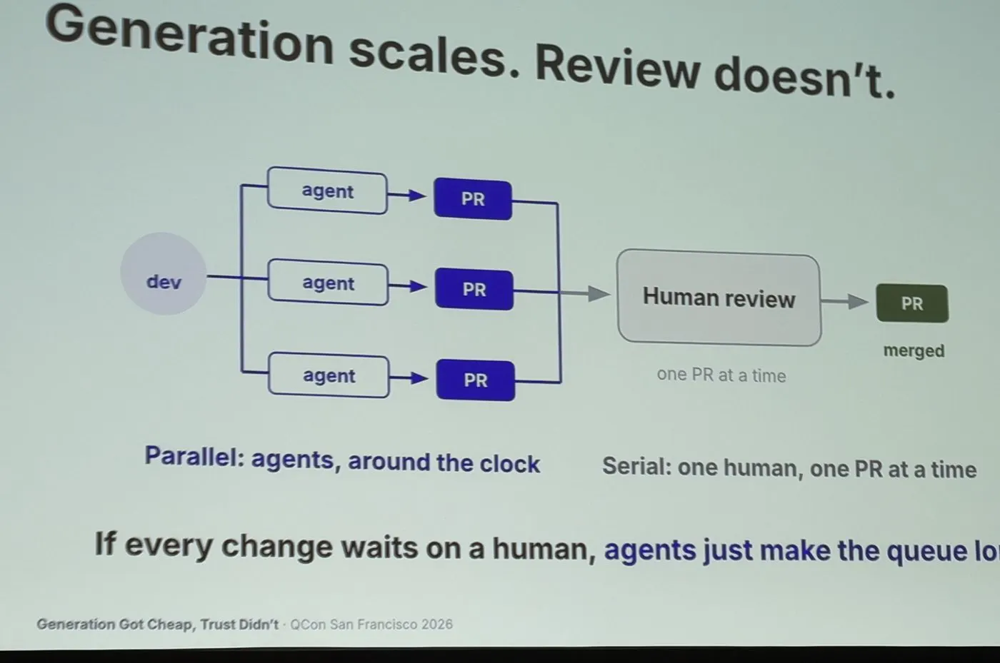

Slide 5. Parallel generation, serial review.

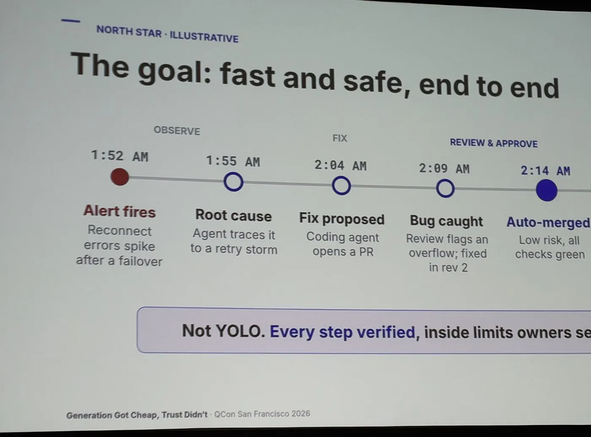

Slide 6. The 22-minute north star (illustrative).

Five things have to be true to get there: the reviewer knows how Roblox builds, its quality is proven rather than assumed, risk gates are layered, it holds up at thousands of PRs a day, and every change is auditable end to end.

### 1. Knows how we build: exemplars and the alignment engine (slides 7–10)

Models are trained on public code, Stack Overflow and open docs. They have never seen Roblox’s millions of merged PRs or the years of review comments that carry its reasoning. AGENTS.md files and agent skills help, he said, but don’t close that gap. The alignment engine does it in three steps. **Discover:** filter noise from historical comments, diffs and PR context, embed the comments, cluster them into recurring themes and extract ranked candidate patterns with citations. **Capture:** an expert reviews each candidate and promotes or discards it, so a one-off comment from an intern doesn’t become a rule. **Enforce:** every PR matching an exemplar is checked against it. The goal, in his words, is the best reviewer at the company reviewing every PR without doing it.

Experts write and tune exemplars in a playground. Each one names the pattern, its category, when it should fire, which file patterns it applies to, and the business reason. It is then run against real historical PRs with an expected outcome, “should find violation” or “should be clean”. The playground shows the model’s reasoning, reports precision, recall and F1, and works like a unit test for the rule before it reaches production.

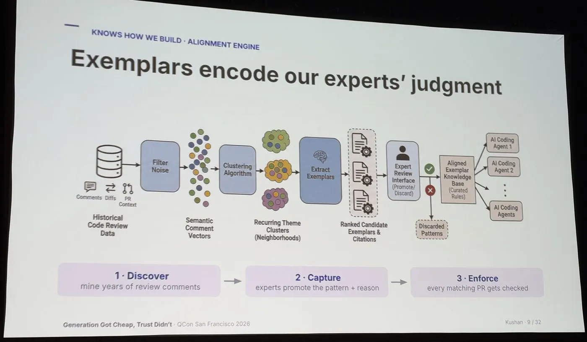

Slide 9. Discover, capture, enforce.

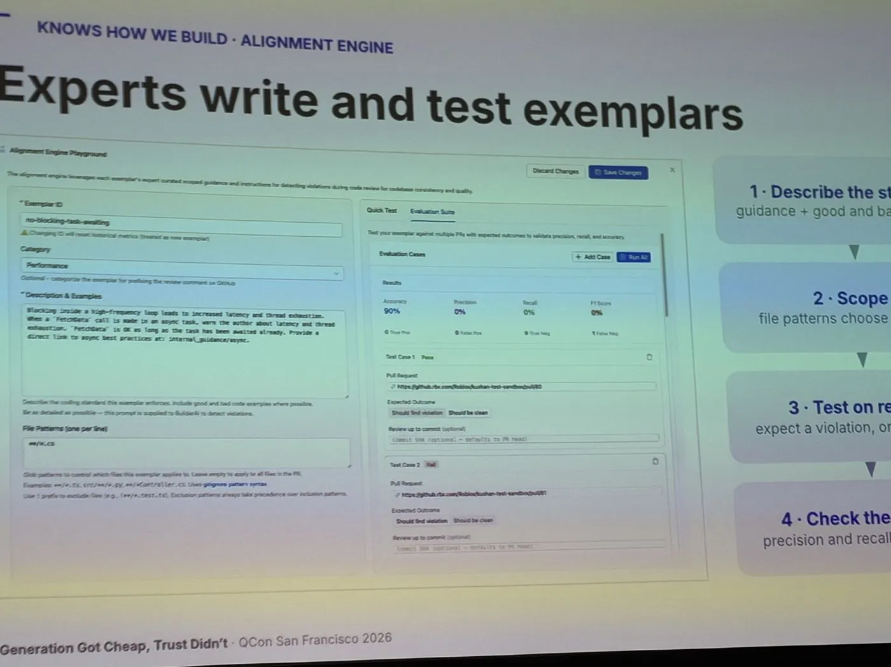

Slide 10. Each exemplar is tested on real PRs before it ships.

Roblox described this pipeline in a January 2026 blog post; Kushan mentioned it in Q&A as published “in February”. The post adds detail the talk skipped: about 700,000 PRs merged over three years, 1.7 million review comments, and greedy clustering followed by LLM refinement. In Q&A he said a funnel of cheaper models and heuristics trims the data before a frontier model sees it.

**Takeaway:** your review history is the context source a generic model lacks, and it only becomes trustworthy once an expert curates it and it is tested like code.

### 2. Proven, not assumed: measure on what merged (slides 11–13)

At thousands of reviews a day, anecdotes from engineers aren’t enough. As in machine learning, precision and recall pull against each other. A reviewer tuned for precision rarely flags anything and misses real problems; one tuned for recall flags every nit and gets ignored. Roblox measures both on outcomes:

| Measure                     | Question         | How Roblox scores it                                                                                                      | Now |
|-----------------------------|------------------|---------------------------------------------------------------------------------------------------------------------------|-----|
| Precision (acceptance rate) | Is it too noisy? | After merge, trace each flagged issue: did it lead to a code change? Upvotes, downvotes and resolved threads don’t count. | 72% |
| Recall (LGTM alignment)     | Is it too quiet? | When the agent finally signs off clean, does any human reviewer later find something it missed?                           | 88% |

Precision was poor at launch a few months earlier; the transcript garbles the starting figure, and Kushan said they have roughly tripled it since. The method is a flywheel. Incidents (with their incident reviews), missed bugs, rejected findings and historical PRs become candidate cases. An agent rebuilds each PR’s context and checks that the bug was discoverable from pre-merge evidence alone. Humans curate the result into a bug set and a clean set: 600+ PRs, about 500 that must be caught and 100+ where the reviewer must stay silent. Candidate reviewers, models and prompts are compared on the same cases. Public benchmarks, he said, tell you whether a model is good in general but not on your tasks. Every rejected comment also goes into a shared memory that later reviews build on.

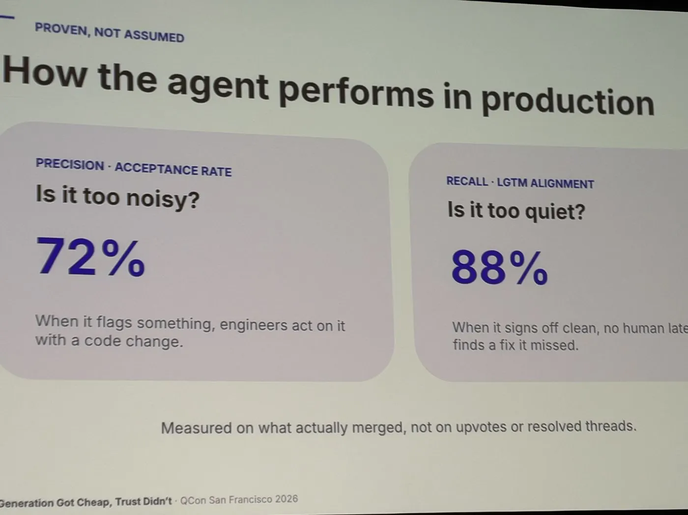

Slide 11+. Measured on what actually merged.

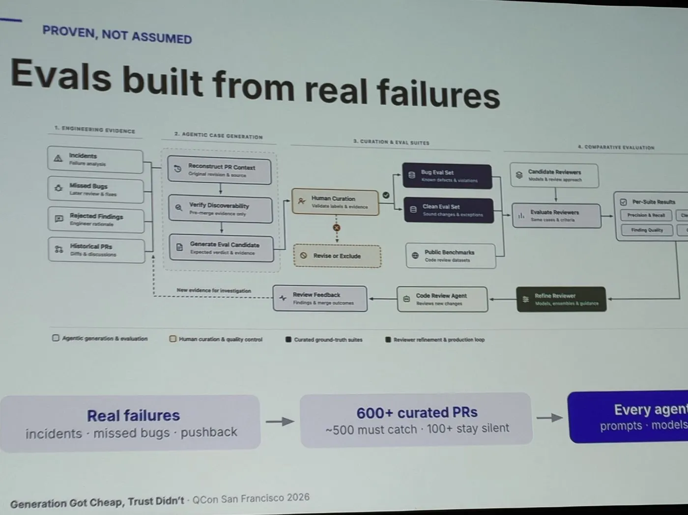

Slide 11+. Evals built from real failures.

**Takeaway:** score an AI reviewer by what happened to the code, and grow its test set from your own incidents and rejected comments.

### 3. Layered risk gates: correct isn’t safe to ship (slides 14–15)

The goal, Kushan said, is not to remove humans but to move them: from reading lines of code to setting the policies that define acceptable risk. The same retry-backoff fix with zero findings is auto-approved in a service of its own with easy rollback, and escalated to a human in a shared auth library every service depends on. A PR with unresolved findings never qualifies.

Each team owns an approval policy, managed as code, that overrides a company baseline. Model-produced signals check correctness and confidence, whether the change type is one the owner allows (docs versus feature, for example), and blast radius in three parts: reach, severity and recoverability. Deterministic checks enforce that the author or their team are code owners of every changed file, that only permitted paths are touched (sensitive files always need a human), that required tests and CI pass, and that branch protections hold. If every condition is met the change merges on its own; otherwise it goes to engineers with the findings and the risk rationale attached. He added that agents remove some reviewer bias, because they flag the same issue whoever wrote the PR.

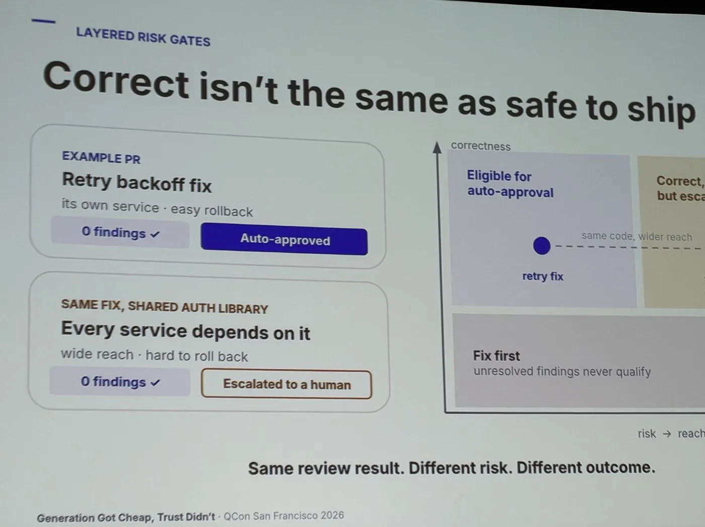

Slide 11+. Same review result, different risk, different outcome.

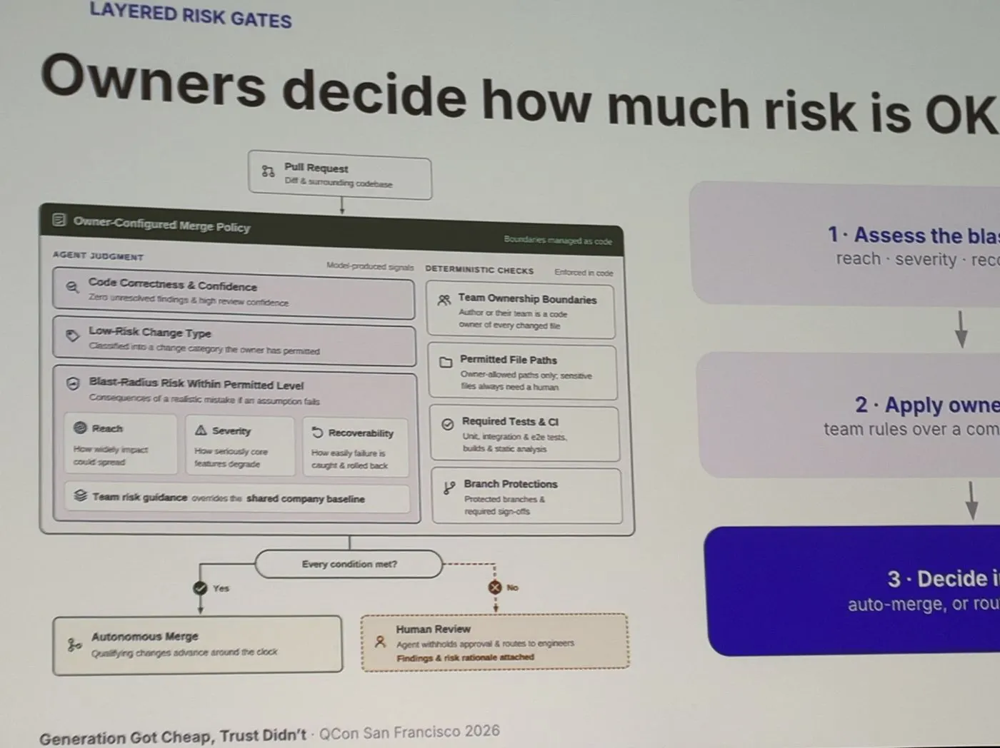

Slide 11+. Owners decide how much risk is OK.

**Takeaway:** separate “is it correct” from “is it safe here”, and let the owners of each area write the second rule.

### 4. Holds up at scale: the harness and the cache (slides 16–17)

Deep review needs the whole repository. Done naively, Kushan said, review clones would generate more Git traffic than all of Roblox engineering combined. They built a custom clone orchestrator that pre-warms and fetches only what each diff needs, at the exact commit and shallow, getting context in a second or two. An orchestrator routes the review and sets its depth. Exemplar checks run as parallel sub-agents, because piling every rule into one prompt degrades the model and isolated sub-agents let rules keep growing. Bug finders run on models from at least two providers, so the reviewer is independent of the agent that wrote the code (“like grading your own homework” otherwise), which also matters for compliance. A verifier cross-checks and drops noise. Depth adapts: a docs change doesn’t get the same treatment as an auth change. The slide claims 38x more reviews per host and about 97% less memory for the purpose-built harness.

Cost came down through prompt caching. The messages are layered as a prefix tree with cache breakpoints: context shared across all reviews, then within a repository, within a review, and finally what is unique to each sub-agent. Parallel sub-agents race to write the same cache entry, so the harness sends one cheap pre-warm call with truncated output first; every other call then reads the cache at about a tenth of the price. In Q&A Kushan said that with three or more parallel calls a pre-warm is almost always worth it. He put the overall saving at about 86%; the slide’s headline figure is cut off in the photo.

| Parallel calls on one prefix | No caching | All race to write | Pre-warm, then read |
|------------------------------|------------|-------------------|---------------------|
| 1                            | 1.00       | 1.25              | 1.35                |
| 2                            | 2.00       | 2.50              | 1.45                |
| 3                            | 3.00       | 3.75              | 1.55                |
| 5                            | 5.00       | 6.25              | 1.75                |

Our arithmetic: input cost of the shared prefix in units of one uncached read, using Anthropic’s published multipliers (5-minute cache write 1.25x, cache read 0.1x). It ignores the pre-warm call’s small output cost, which is why Kushan’s rule of three leaves a margin.

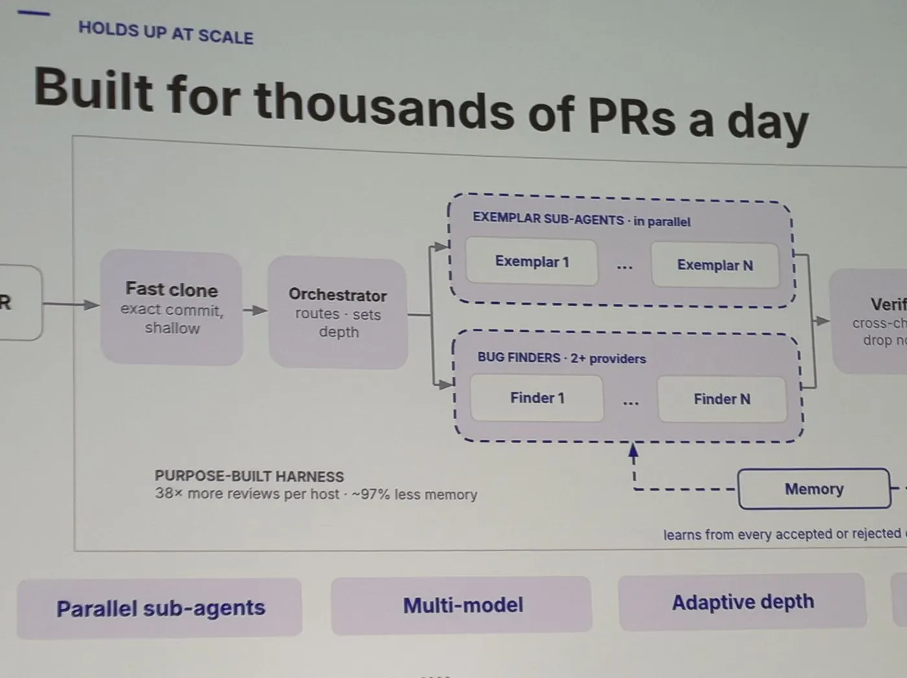

Slide 11+. Built for thousands of PRs a day.

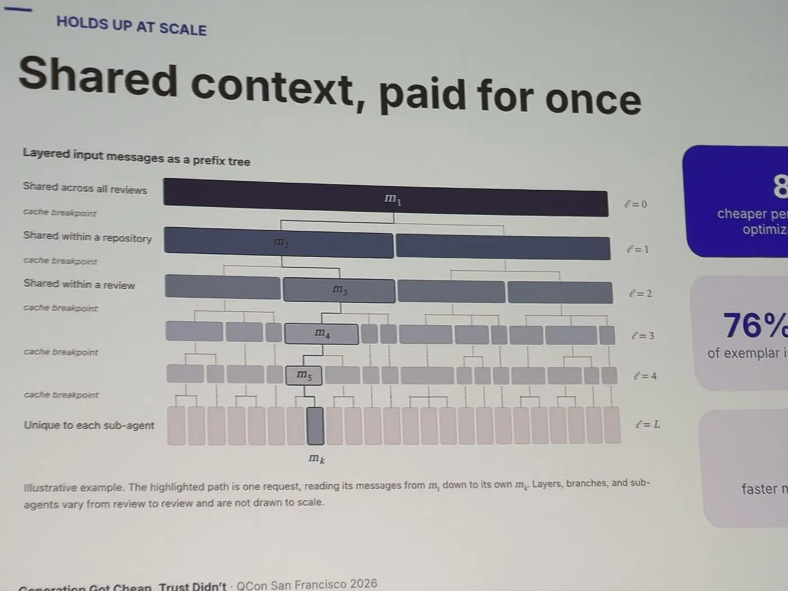

Slide 11+. Shared context, paid for once.

**Takeaway:** structure prompts so most of each call is a shared, cached prefix, and give each rule its own small sub-agent.

### 5. Auditable end to end: fingerprinting merged code (slides 18–23)

Jay picked up after merge. Roblox engineers use more than one coding harness, agent and model in a day, and Roblox wanted to know where its production code came from. Vendor telemetry fell short in three ways: each vendor reports only its own generation; agents increasingly edit files with shell, Python or `sed` rather than their edit tools, which evades the statistics; and vendors count everything generated, not what survived review and merged.

So Roblox built a fingerprinting pipeline. It combines client telemetry, its own hooks that annotate every way an agent can change a local file, and a stream of PR merge events from source control. A funnel narrows about 100 million AI line edits fleet-wide over 14 days by author, repository, file path, exact line hash and “edited before commit” to a single fingerprint: the conversation, model and tool behind a merged line. Roblox merges over 500,000 lines a day. The finding: most engineers use AI, the vast majority of new code is attributed to an AI tool or generator, and a large share comes from automation engineers built before AI. Unattributed lines are an upper bound on hand-written code.

Engineers see it in a familiar UI: click a line and open the conversation that wrote it. The example traces a ticket about players stuck reconnecting after a regional failover. The agent added an empty-list guard; review caught that `1<<attempt` could overflow and wrap the delay to zero; the agent capped the exponent and clamped to the maximum. That gives an audit trail for retros, troubleshooting and incident response, plus a golden dataset of conversations that led to merged PRs.

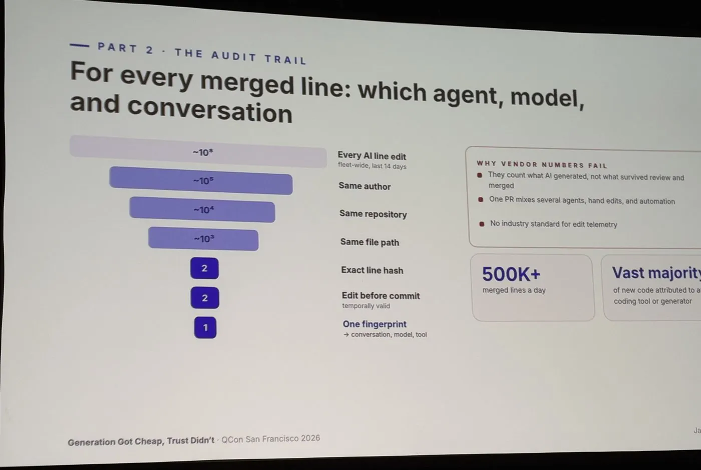

Slide 11+. One fingerprint per merged line.

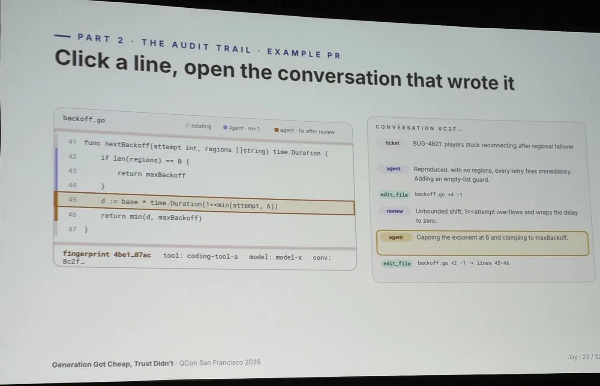

Slide 23. Click a line, open the conversation.

### Seeing what agents do: one telemetry stack (slides 24–26)

In a given week Roblox’s AI infrastructure handles about 250 million LLM calls, over 3 trillion tokens and over a million conversations, from 100+ production agents (doubling in three months), 12 coding agents and 50 models. Jay said eight months earlier they had perhaps 5 to 10 agents. The problems were visibility (no standard for availability, performance, safety, security or correctness), spend (leadership needed precise team and user attribution) and efficiency (no company-wide levers).

Rather than build an AI-only stack, they extended the OTel pipeline that already carries over 10 million messages a second. An LLM gateway is the zero-touch capture point, on by default for every service behind it. Coding agents and any service that opts in add richer client telemetry. The OpenTelemetry Collector normalizes, enriches, redacts and routes into Kafka and then StarRocks, an OLAP database on object storage, because agent traces didn’t fit their existing stores. Engineers read it through a Grafana plugin and agents through an MCP server. The goal is 100% of LLM and agent traffic, because “the problems hide in the outliers”.

Usage dashboards and a Mac and Windows desktop widget show every employee their usage against budget. The wins from looking at aggregate data were large:

| Lever                                                                                                                             | Result (slide 26)                                             |
|-----------------------------------------------------------------------------------------------------------------------------------|---------------------------------------------------------------|
| Cost per token across the company                                                                                                 | Cut in half while usage more than doubled                     |
| One workload moved to a cheaper model that did the job as well                                                                    | About \$2M a year saved                                       |
| One coding-agent config change rolled out fleet-wide: no eager loading of MCP tools (see tool search) (Jay also mentioned skills) | 15% of coding-agent spend saved, permanently                  |
| Spend tied to merged PRs through fingerprinting                                                                                   | “The first real link from spend to return”, still in progress |

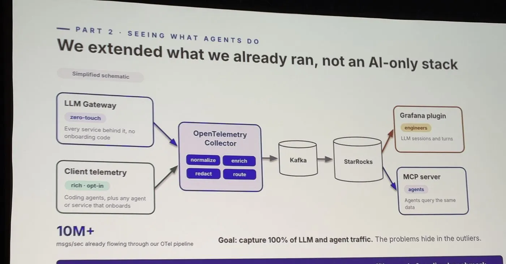

Slide 25. Extend what you already run.

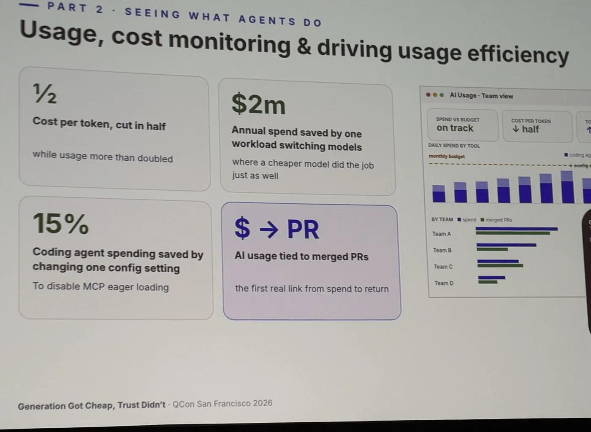

Slide 26. Usage and cost wins.

### Online evals: continuous LLM judges (slides 27–28)

Service dashboards stay green while an agent gives off-topic answers, an SRE agent asks whether it may delete code during a research question, or a model provider starts returning garbled or wrong-language text. With 100+ agents, team-by-team monitoring stopped working, so Roblox made LLM judges standard and on by default, fed from the same pipeline. Jay said they judge about 9 million prompts a day.

LLM traffic is highly repetitive: each call repeats all prior context, and sub-agents, retries and compaction add more. After redaction at ingest, the pipeline stores only the delta of each event, 12 to 28 times less data, and assigns consistent turn numbers. A judge is an event filter plus a prompt, from a shared Judge Library that any team can mix, match or extend. Judges default to the smallest model available, with a daily re-judge by a frontier model at a lower sample rate to catch disagreements. The slide puts that at 50x cheaper than judging everything with a frontier model. Verdicts arrive in about 15 minutes on existing dashboards and alerts; there are 19 judges so far.

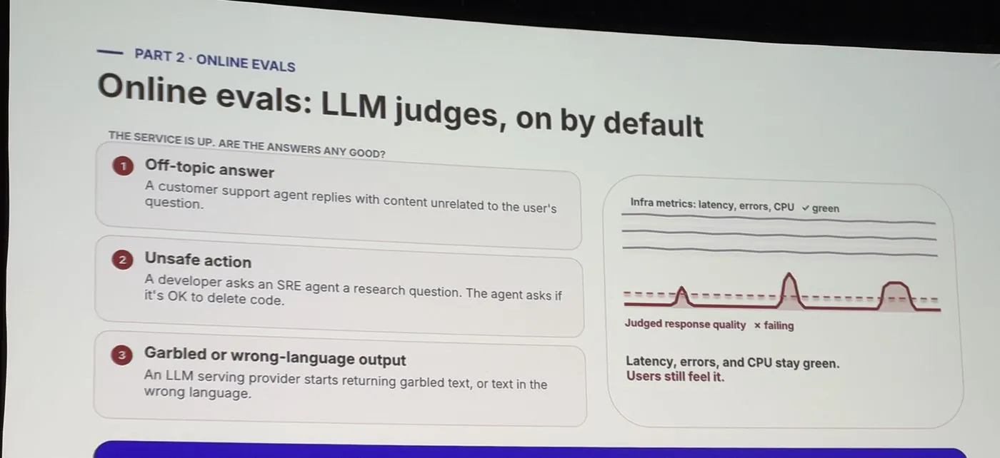

Slide 27. The service is up; are the answers any good?

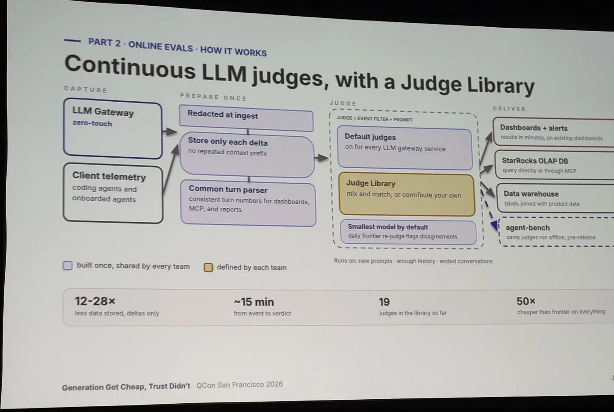

Slide 28. Judges as an event filter plus a prompt.

### Offline evals: gate changes before they ship (slide 29)

Before release, every run is scored on correctness, cost and latency. The shared framework is built on Harbor, the open-source agent eval framework behind Terminal-Bench, with each trial in its own container in a VM for isolation and cheat detection. The same graders as the production judges run here too, so trajectory problems are caught before release. For coding tools and models, Roblox built an internal task benchmark from merged PRs and the conversations that produced them, a Roblox SWE-bench with sealed tasks so the agent can’t look up the answer. A multi-LLM panel picks the best cases for human review. It gates every new model and coding tool before rollout. Teams building agents bring their own suites; one landed 500+ cases in its first week, and the platform reached 900+ cases in seven weeks.

### Closing the loop: the trust receipt (slides 30–32)

Fixing one piece, review or observability, isn’t enough; every step from observe to approve has to improve and connect, with human checks at diagnose, review and approve, and human decisions and production lessons flowing back into evals, judges and policy. The trust receipt for the example PR records who wrote the fix (agent, model, conversation), what review found and how it was fixed, why approval was allowed (owner scope, limited reach, easy rollback, nothing open), what it cost, and how it is behaving (canary passed, no reverts, judges clean). Their takeaways: speed with control, measure before you trust, build on what you already run, and close the loop. Trust isn’t granted once at merge; it’s verified continuously.

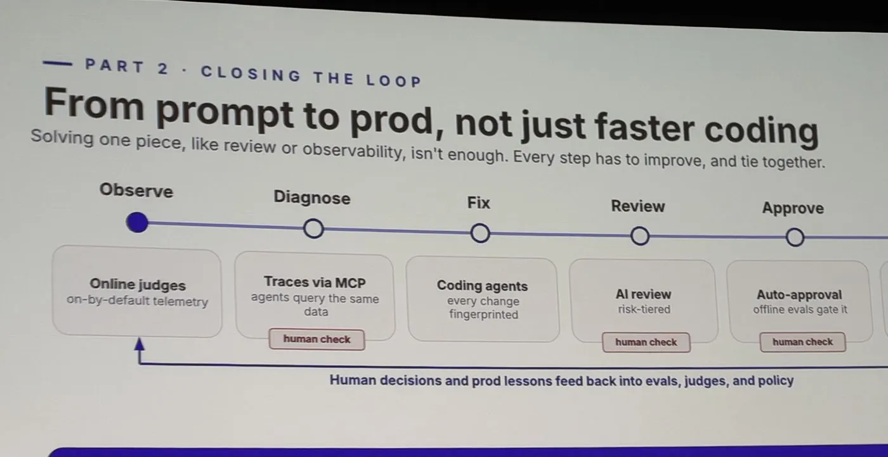

Slide 30. From prompt to prod, not just faster coding.

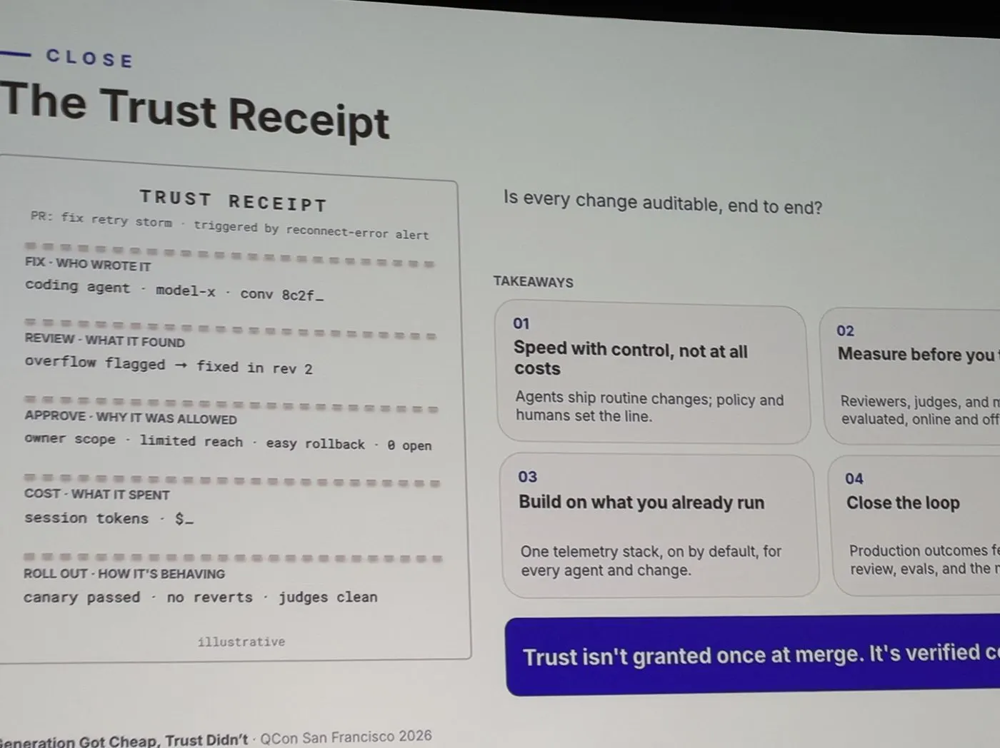

Slide 31. The trust receipt.

### Q&A (recording only)

- **Do you coach developers on waste?** Broadly so far, through the widget and shared tips. Targeted coaching for power users is next. Kushan described an internal chat bot that looks at your usage and suggests what to try.
- **How big is the team, and what should a small shop do?** Jay estimated 15 to 20 people for several months. His advice for small teams: wire agents into the observability you already run, and start mining your own review history; a basic review bot is surprisingly easy to build.
- **How do you condense years of comments for a model?** A funnel of heuristics and cheaper models before anything reaches a frontier model, shaped by tribal knowledge of which people and areas matter.
- **What makes a change safe enough to skip a human?** Replaying millions of historical PRs whose outcomes are known, working with the reliability team on reverts and incidents caused by agent-approved changes, and adding “why didn’t our agent catch it?” to every incident review.

## Numbers we checked

Figures from the talk against their sources. Checked found in a published source; Caveat holds with a condition; On slide read off a slide, not independently verified; Talk only heard in the room only. All are Roblox’s own measurements.

| Claim                                           | Figure                                                                 | Source                                                                                                                                                                                                                                                                                                                                                                                                                                                                                       | Status    |
|-------------------------------------------------|------------------------------------------------------------------------|----------------------------------------------------------------------------------------------------------------------------------------------------------------------------------------------------------------------------------------------------------------------------------------------------------------------------------------------------------------------------------------------------------------------------------------------------------------------------------------------|-----------|
| AI review precision (flag led to a code change) | 72%                                                                    | Slide 11+. Roblox has published other acceptance figures on different measures: about 30% to over 60% for AI PR suggestions across 10,000 PRs ([Roblox blog, Jan 12, 2026](https://about.roblox.com/newsroom/2026/01/doubled-ai-code-acceptance-teaching-models-think-like-roblox-engineers)) and about 20% at first, nearly 70% later, for AI review comments ([DX podcast with Andrew Swerdlow](https://getdx.com/podcast/robloxs-approach-to-tripling-ai-code-review-acceptance-rates/)). | Caveat    |
| Precision roughly tripled since launch          | ≈3x                                                                    | Talk; starting figure garbled in the transcript. 20% to 72% would be 3.6x. Consistent with the DX podcast title.                                                                                                                                                                                                                                                                                                                                                                             | Caveat    |
| AI review recall (clean sign-off held up)       | 88%                                                                    | Slide 11+                                                                                                                                                                                                                                                                                                                                                                                                                                                                                    | On slide  |
| PRs reviewed by the agent                       | 400,000+                                                               | Recording. The DX podcast says “many thousands of PRs per day” and about 5% auto-merged.                                                                                                                                                                                                                                                                                                                                                                                                     | Talk only |
| Review history mined                            | 700K PRs, 1.7M comments                                                | [Roblox blog](https://about.roblox.com/newsroom/2026/01/doubled-ai-code-acceptance-teaching-models-think-like-roblox-engineers): PRs merged over three years; comments from experienced reviewers                                                                                                                                                                                                                                                                                            | Checked   |
| Curated eval set                                | 600+ PRs: ~500 catch, 100+ silent                                      | Slide 11+                                                                                                                                                                                                                                                                                                                                                                                                                                                                                    | On slide  |
| Review harness efficiency                       | 38x reviews/host, ~97% less memory                                     | Slide 11+                                                                                                                                                                                                                                                                                                                                                                                                                                                                                    | On slide  |
| Review cost reduction from harness and caching  | ~86%                                                                   | Recording; the slide’s figure is cut off and starts with “8”. 86% is about 7x cheaper. The DX podcast cites a 90% cut in the cost of each exemplar evaluation through caching.                                                                                                                                                                                                                                                                                                               | Caveat    |
| Prompt cache pricing behind the pre-warm trick  | write 1.25x · read 0.1x                                                | [Anthropic pricing](https://platform.claude.com/docs/en/about-claude/pricing) (5-minute writes; 1-hour writes 2x; some newer models read cheaper). Kushan didn’t name a provider. Our arithmetic in section 03.                                                                                                                                                                                                                                                                              | Checked   |
| AI line edits fleet-wide, 14 days               | ~10⁸                                                                   | Slide 18                                                                                                                                                                                                                                                                                                                                                                                                                                                                                     | On slide  |
| Merged lines per day                            | 500K+                                                                  | Slide 18                                                                                                                                                                                                                                                                                                                                                                                                                                                                                     | On slide  |
| Weekly AI traffic                               | ~250M calls · 3T+ tokens · 1M+ conversations                           | Slide 24. The transcript’s token figure is garbled; the slide wins.                                                                                                                                                                                                                                                                                                                                                                                                                          | On slide  |
| Agents and models                               | 100+ production agents (2x in 3 months) · 12 coding agents · 50 models | Slide 24                                                                                                                                                                                                                                                                                                                                                                                                                                                                                     | On slide  |
| Existing OTel pipeline throughput               | 10M+ msgs/sec                                                          | Slide 25                                                                                                                                                                                                                                                                                                                                                                                                                                                                                     | On slide  |
| Cost per token                                  | halved, usage \>2x                                                     | Slide 26                                                                                                                                                                                                                                                                                                                                                                                                                                                                                     | On slide  |
| One workload switched to a cheaper model        | \$2M/yr                                                                | Slide 26                                                                                                                                                                                                                                                                                                                                                                                                                                                                                     | On slide  |
| Disabling MCP eager loading                     | 15% of coding-agent spend                                              | Slide 26. Claude Code’s own docs say tool search, which defers MCP tool definitions, is [on by default](https://code.claude.com/docs/en/agent-sdk/tool-search), with exceptions. Which agent Roblox changed wasn’t named on the slide.                                                                                                                                                                                                                                                       | Caveat    |
| Prompts judged a day                            | ~9M                                                                    | Recording                                                                                                                                                                                                                                                                                                                                                                                                                                                                                    | Talk only |
| Judge pipeline                                  | 12–28x less data · ~15 min · 19 judges · 50x cheaper                   | Slide 28. 50x is smallest model versus frontier on everything.                                                                                                                                                                                                                                                                                                                                                                                                                               | On slide  |
| Offline eval cases                              | 900+ in 7 weeks (52, 87, ~800)                                         | Slide 29                                                                                                                                                                                                                                                                                                                                                                                                                                                                                     | On slide  |
| Team size                                       | 15–20 people, several months                                           | Recording, Q&A estimate                                                                                                                                                                                                                                                                                                                                                                                                                                                                      | Talk only |

## About the speakers

**Kushan Mehta** is a Principal Software Engineer at Roblox and tech lead for AI-native engineering. His [QCon profile](https://qconsf.com/speakers/kushanmehta) describes work on agentic systems across the development lifecycle, grounding frontier models in institutional knowledge, and the safeguards and infrastructure that let agents run in production. He co-wrote Roblox’s [January 2026 post on exemplar alignment](https://about.roblox.com/newsroom/2026/01/doubled-ai-code-acceptance-teaching-models-think-like-roblox-engineers) with Andrew Swerdlow, Sepideh Setayeshfar and David Rahn.

**Jay Moorthi** is a Senior Engineering Manager at Roblox leading observability and diagnostics within Engineering Acceleration. Per his [QCon profile](https://qconsf.com/speakers/jaymoorthi), he founded Solano Labs, a parallel CI/CD company later acquired by GE Digital, led engineering at Domino Data Lab and Qumulo, and built storage systems at NetApp and cloud security systems at Cisco.

Their group’s leader, Andrew Swerdlow, gave an earlier version of the strategy as [Prompt to Prod: Engineering an Autonomous SDLC at Scale](https://infoq.com/presentations/autonomous-ai-software-development-roblox) at QCon AI.

## Terms and technologies

### Review and quality

Exemplar  
Roblox’s name for a curated review rule: a pattern, the reason behind it, when it applies and good and bad examples, mined from past review comments and promoted by an expert. The unit the alignment engine enforces. See the [Roblox post](https://about.roblox.com/newsroom/2026/01/doubled-ai-code-acceptance-teaching-models-think-like-roblox-engineers).

[Precision, recall and F1](https://en.wikipedia.org/wiki/Precision_and_recall)  
Precision is the share of flags that were right; recall is the share of real problems that were caught; F1 combines them. Roblox defines both by merge outcomes.

[Clustering](https://en.wikipedia.org/wiki/Cluster_analysis) and embeddings  
Turning comments into vectors so similar feedback groups together. Roblox uses this to find recurring review themes across years of comments.

[CODEOWNERS](https://docs.github.com/en/repositories/managing-your-repositorys-settings-and-features/customizing-your-repository/about-code-owners)  
A GitHub file naming the people or teams responsible for paths in a repository. One of Roblox’s deterministic merge checks.

[Branch protection](https://docs.github.com/en/repositories/configuring-branches-and-merges-in-your-repository/managing-protected-branches/about-protected-branches)  
Repository rules such as required reviews and status checks before merge. Another deterministic gate in the merge policy.

Blast radius  
How far a mistake would spread. Roblox splits it into reach, severity and recoverability.

[Canary release](https://martinfowler.com/bliki/CanaryRelease.html)  
Rolling a change out to a small slice first and watching it. “Canary passed” is a line on the trust receipt.

### Agents and context

[AGENTS.md](https://agents.md/)  
A conventional file of instructions for coding agents in a repository. Kushan said these help but don’t close the context gap on their own.

Agent skills  
Packaged instructions and scripts an agent loads when relevant. Also cited as helpful but insufficient.

[Model Context Protocol (MCP)](https://modelcontextprotocol.io/)  
An open standard for connecting AI applications to tools and data. Roblox exposes its telemetry to agents through an MCP server, and saved 15% by not loading MCP tool definitions eagerly.

[Tool search (deferred tool loading)](https://code.claude.com/docs/en/agent-sdk/tool-search)  
Claude Code’s way of withholding tool definitions from context and loading them on demand. Relevant to the 15% config change.

[Agent hooks](https://code.claude.com/docs/en/hooks)  
Scripts that run on agent events such as file edits. Roblox wrote its own to record every way an agent changes a file.

Harness, model and sub-agents  
The harness is the program around a model (prompts, tools, loop); sub-agents are focused child runs. Roblox built its own review harness to control caching and parallelism.

[Prompt caching](https://platform.claude.com/docs/en/build-with-claude/prompt-caching)  
Providers store a repeated prompt prefix so later calls read it cheaply. The core of Roblox’s cost cut.

[Prefix tree](https://en.wikipedia.org/wiki/Trie)  
A tree where shared beginnings are stored once. Roblox arranges prompts this way so layers can be cached.

[Shallow clone](https://git-scm.com/docs/git-clone)  
A Git clone of just the needed commit history (`--depth`). Part of the fast-clone step.

[git blame](https://git-scm.com/docs/git-blame)  
Shows which commit last changed each line. Roblox’s fingerprinting is “blame for agents”, adding the conversation and model.

### Observability and data

[OpenTelemetry and the Collector](https://opentelemetry.io/docs/collector/)  
A vendor-neutral standard for traces, metrics and logs; the Collector receives, processes and exports them. Roblox’s backbone for AI telemetry.

LLM gateway  
A proxy all model calls pass through, giving one place for auth, routing and capture. Roblox’s zero-touch capture point.

[Apache Kafka](https://kafka.apache.org/)  
A distributed event streaming platform; the buffer between the collector and storage.

[StarRocks](https://www.starrocks.io/)  
An open-source, real-time analytical (MPP) database that can run on object storage. Added because agent traces didn’t fit Roblox’s existing stores.

[OLAP](https://en.wikipedia.org/wiki/Online_analytical_processing)  
Databases built for analytical queries over large data rather than transactions.

[Grafana](https://grafana.com/)  
Dashboards and alerting. Roblox built a plugin to browse LLM sessions and turns.

### Evaluation

[LLM-as-a-judge](https://arxiv.org/abs/2306.05685)  
Using a model to grade another model’s output against a rubric. Roblox runs judges continuously on production traffic.

Online and offline evals  
Online evals judge live traffic in production; offline evals score a candidate on fixed cases before release. Roblox shares graders between the two.

[Harbor](https://github.com/laude-institute/harbor)  
An open-source framework from the Laude Institute for running agent evaluations in containers, the official harness for Terminal-Bench 2.0. Roblox’s offline eval base.

[Terminal-Bench](https://github.com/harbor-framework/terminal-bench-2)  
A benchmark of agent tasks in containerized terminals, run on Harbor.

[SWE-bench](https://www.swebench.com/)  
A public benchmark where an agent must fix real GitHub issues so the project’s tests pass. Roblox built a private version from its own merged PRs.

## Reading and tools

### From Roblox

- [How We Doubled AI Code Acceptance by Teaching Models to Think Like Roblox Engineers](https://about.roblox.com/newsroom/2026/01/doubled-ai-code-acceptance-teaching-models-think-like-roblox-engineers), Jan 12, 2026, the exemplar pipeline in detail.
- [Prompt to Prod: Engineering an Autonomous SDLC at Scale](https://infoq.com/presentations/autonomous-ai-software-development-roblox), Andrew Swerdlow at QCon AI (InfoQ video and transcript).
- [Roblox’s approach to tripling AI code review acceptance rates](https://getdx.com/podcast/robloxs-approach-to-tripling-ai-code-review-acceptance-rates/), DX Engineering Enablement podcast.

### Tools to look at

- [Claude Code tool search](https://code.claude.com/docs/en/agent-sdk/tool-search) and [Claude Code monitoring with OpenTelemetry](https://code.claude.com/docs/en/monitoring-usage), the two settings closest to Roblox’s cost and telemetry wins.
- [Harbor](https://github.com/laude-institute/harbor) for container-based agent evals.
- [Agent Blame](https://mesa.dev/blog/agentblame-deep-dive) (Mesa), an open approach to line-level AI attribution using edit hooks and line hashes, similar in spirit to Roblox’s fingerprinting.
- [Judging LLM-as-a-Judge](https://arxiv.org/abs/2306.05685), the paper on judge agreement and biases.

### Related sessions at QCon

- **Still ahead** Wed 3:55: [How To Kill the Code Review](https://qconsf.com/presentation/nov2026/how-kill-code-review) (Aviator).
- **Still ahead** Wed 2:45: [You Can’t Read the Code Anymore: Verifying Software in the Age of AI](https://qconsf.com/presentation/nov2026/you-cant-read-code-anymore-verifying-software-age-ai) (Forter).
- **Still ahead** Wed 11:45: [Making Production Legible to Agents](https://qconsf.com/presentation/nov2026/making-production-legible-agents-lessons-building-observability-mcp) (Honeycomb), on the MCP-over-telemetry idea.
- **Still ahead** Wed 10:35: [How Netflix Retrofitted Its SDLC for AI Coding Agents](https://qconsf.com/presentation/nov2026/how-netflix-retrofitted-its-sdlc-ai-coding-agents).
- **Still ahead** Tue 2:45: [Trust, but Verify: Delivering Quality with Agentic Workflows](https://qconsf.com/presentation/nov2026/trust-verify-delivering-quality-agentic-workflows) (Antithesis).
- **Earlier Monday**: [Wait, You’re Still Doing PRs?](https://qconsf.com/presentation/nov2026/wait-youre-still-doing-prs) (Atomic), the other answer to the same review problem.

## All slides

[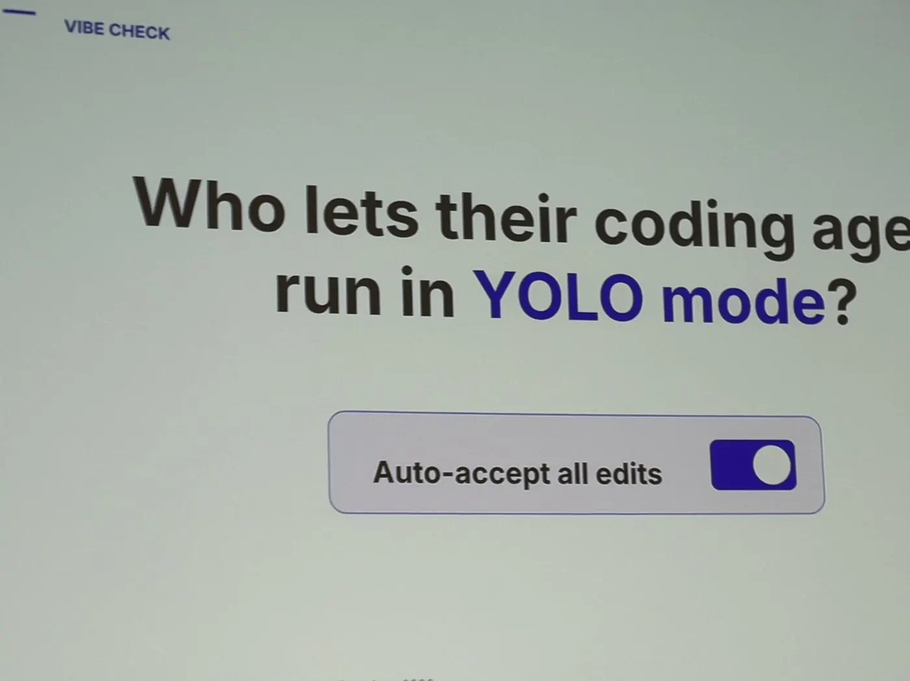](../slides/generation-got-cheap-trust-didnt/deep/s02.webp)

Slide 2. Vibe check: who runs agents in YOLO mode?

[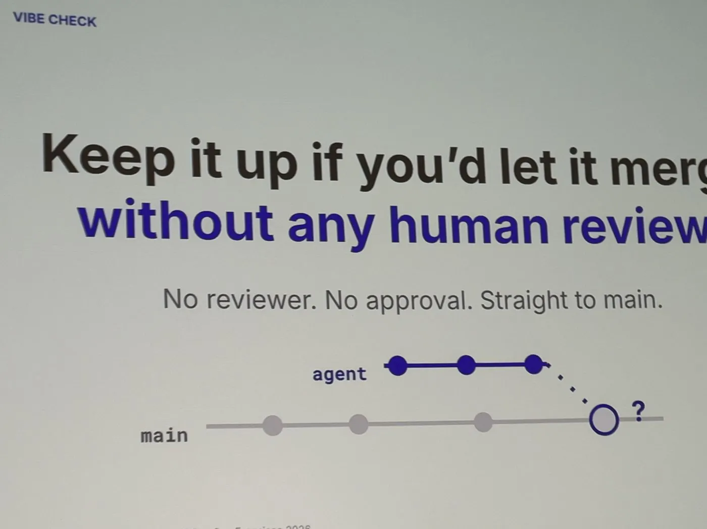](../slides/generation-got-cheap-trust-didnt/deep/s03.webp)

Slide 3. Vibe check: would you let it merge with no human review?

[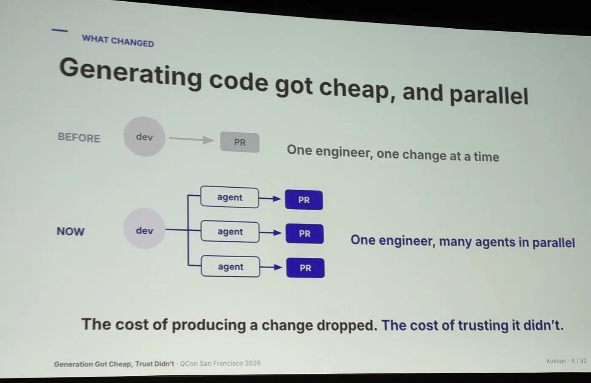](../slides/generation-got-cheap-trust-didnt/deep/s04.webp)

Slide 4. Generating code got cheap, and parallel

Slide 5. Generation scales. Review doesn't.

Slide 6. North star: alert to auto-merge in 22 minutes

Slide 7. Five things have to be true

Slide 8. The context gap

[![Slide 9: Alignment engine, slide 9 of 32. Exemplars encode our experts' judgment. Historical code review data (comments, diffs, PR context) goes through filter noise, semantic comment vectors, a clustering algorithm, recurring theme clusters, extract exemplars, ranked candidate exemplars with citations, then an expert review interface to promote or discard, into an aligned exemplar knowledge base of curated rules used by AI coding agents. 1 Discover: mine years of review comments. 2 Capture: experts promote the pattern and reason. 3 Enforce: every matching PR gets checked.](../slides/generation-got-cheap-trust-didnt/deep/s09.webp)](../slides/generation-got-cheap-trust-didnt/deep/s09.webp)

Slide 9. Exemplars encode experts' judgment

[![Slide 10: Experts write and test exemplars. Screenshot of the Alignment Engine Playground: exemplar ID no-blocking-task-awaiting, category Performance, a description warning about blocking calls inside a high-frequency loop, file patterns for C# files, and an evaluation suite with test cases pointing at sandbox PRs and expected outcomes (should find violation or should be clean), reporting accuracy, precision, recall and F1. Steps: describe the standard with good and bad examples, scope by file pattern, test on real PRs, check precision and recall.](../slides/generation-got-cheap-trust-didnt/deep/s10.webp)](../slides/generation-got-cheap-trust-didnt/deep/s10.webp)

Slide 10. Experts write and test exemplars

Slide 11. 72% precision, 88% recall

[![Slide 11+: Proven, not assumed. Evals built from real failures. Engineering evidence (incidents, missed bugs, rejected findings, historical PRs) feeds agentic case generation (reconstruct PR context, verify discoverability with pre-merge evidence only, generate eval candidate), human curation, then a bug eval set and a clean eval set alongside public benchmarks, comparative evaluation of candidate reviewers, refine reviewer, code review agent, review feedback loops back as new evidence. Real failures, 600+ curated PRs: about 500 must catch, 100+ stay silent; every agent prompt and model change is tested.](../slides/generation-got-cheap-trust-didnt/deep/s12.webp)](../slides/generation-got-cheap-trust-didnt/deep/s12.webp)

Slide 12. Evals built from real failures

[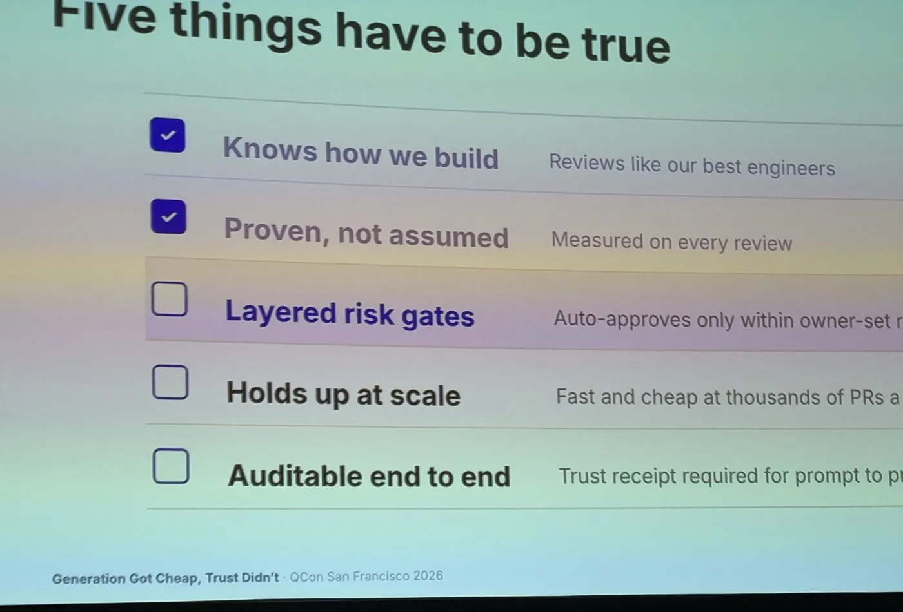](../slides/generation-got-cheap-trust-didnt/deep/s13.webp)

Slide 13. Checklist: two of five done

Slide 14. Correct isn't the same as safe to ship

[![Slide 11+: Layered risk gates. Owners decide how much risk is OK. A pull request goes through an owner-configured merge policy with boundaries managed as code. Agent judgment, model-produced signals: code correctness and confidence, low-risk change type, blast-radius risk within the permitted level (reach, severity, recoverability), with team risk guidance overriding the shared company baseline. Deterministic checks enforced in code: team ownership boundaries, permitted file paths (sensitive files always need a human), required tests and CI, branch protections. Every condition met leads to autonomous merge; otherwise human review with findings and risk rationale attached.](../slides/generation-got-cheap-trust-didnt/deep/s15.webp)](../slides/generation-got-cheap-trust-didnt/deep/s15.webp)

Slide 15. Owners decide how much risk is OK

Slide 16. Built for thousands of PRs a day

Slide 17. Shared context, paid for once

[![Slide 11+: Part 2, the audit trail. For every merged line: which agent, model, and conversation. Funnel: about 10 to the 8 AI line edits fleet-wide in the last 14 days, narrowed by same author (10 to the 5), same repository (10 to the 4), same file path (10 to the 3), exact line hash (2), edit before commit (2), one fingerprint linking conversation, model and tool. Why vendor numbers fail: they count what AI generated, not what survived review and merged; one PR mixes several agents, hand edits and automation; no industry standard for edit telemetry. 500K+ merged lines a day. Vast majority of new code attributed to an AI coding tool or generator.](../slides/generation-got-cheap-trust-didnt/deep/s18.webp)](../slides/generation-got-cheap-trust-didnt/deep/s18.webp)

Slide 18. For every merged line: agent, model, conversation

Slide 19. Anyone can see how their code got written

[![Slide 23: Part 2, example PR, slide 23 of 32. backoff.go lines 41 to 47, nextBackoff with an empty-regions guard added by the agent in rev 1 and a capped exponent added after review. Conversation 8c2f: ticket BUG-4821, players stuck reconnecting after regional failover; agent reproduced and added an empty-list guard; review found an unbounded shift that overflows and wraps the delay to zero; agent capped the exponent at 6 and clamped to maxBackoff. Fingerprint 4be1, tool coding-tool-a, model model-x.](../slides/generation-got-cheap-trust-didnt/deep/s23.webp)](../slides/generation-got-cheap-trust-didnt/deep/s23.webp)

Slide 23. Click a line, open the conversation that wrote it

[![Slide 24: Part 2, seeing what agents do. What Roblox scale means for AI, in a given week: about 250M LLM calls, 3T+ tokens, 1M+ conversations, coming from 100+ production agents (2x in 3 months), 12 coding agents, 50 models. Problems: visibility (no shared standard for availability, performance, safety, security, correctness), spend (fast-growing, leadership needs team and user attribution), efficiency (no levers company-wide). Needs: handles today's scale, room to grow, lives in developers' daily workflow. We didn't build an AI-only stack. We extended the one we already run.](../slides/generation-got-cheap-trust-didnt/deep/s24.webp)](../slides/generation-got-cheap-trust-didnt/deep/s24.webp)

Slide 24. What Roblox scale means for AI

[![Slide 25: Slide 25 of 32. We extended what we already ran, not an AI-only stack. Simplified schematic: LLM gateway (zero-touch, every service behind it) and client telemetry (rich, opt-in, coding agents and onboarded agents) feed an OpenTelemetry Collector that normalizes, enriches, redacts and routes into Kafka, then StarRocks, read by a Grafana plugin for engineers and an MCP server for agents. 10M+ msgs/sec already flowing through the OTel pipeline. Goal: capture 100% of LLM and agent traffic. Powers code fingerprinting, usage and cost reporting, online LLM judges, offline evals and a coding benchmark.](../slides/generation-got-cheap-trust-didnt/deep/s25.webp)](../slides/generation-got-cheap-trust-didnt/deep/s25.webp)

Slide 25. We extended what we already ran

Slide 26. Usage, cost monitoring and efficiency

Slide 27. Online evals: LLM judges, on by default

[![Slide 28: Continuous LLM judges with a Judge Library. Capture from the LLM gateway and client telemetry; prepare once (redacted at ingest, store only each delta with no repeated context prefix, common turn parser); judge = event filter + prompt, with default judges on every gateway service, a Judge Library teams contribute to, and the smallest model by default with a daily frontier re-judge flagging disagreements; deliver to dashboards and alerts, StarRocks, the data warehouse and agent-bench. 12 to 28x less data stored, about 15 min event to verdict, 19 judges, 50x cheaper than frontier on everything.](../slides/generation-got-cheap-trust-didnt/deep/s28.webp)](../slides/generation-got-cheap-trust-didnt/deep/s28.webp)

Slide 28. Continuous LLM judges with a Judge Library

[![Slide 29: Offline evals gate changes before they ship, scored on correctness, cost and latency. Shared framework built on the Harbor OSS agent eval framework, each trial in its own container in VMs for isolation and cheat detection. A Roblox-internal task benchmark for coding agents and skills across every model and coding tool, with a Roblox SWE-bench from merged PRs using sealed tasks. Agent-specific eval suites; one team landed 500+ cases in its first week. 900+ eval cases in the first 7 weeks: 52 in week 1, 87 in weeks 2 to 5, about 800 in weeks 6 to 7.](../slides/generation-got-cheap-trust-didnt/deep/s29.webp)](../slides/generation-got-cheap-trust-didnt/deep/s29.webp)

Slide 29. Offline evals gate changes before they ship

Slide 30. From prompt to prod, not just faster coding

Slide 31. The trust receipt and takeaways

[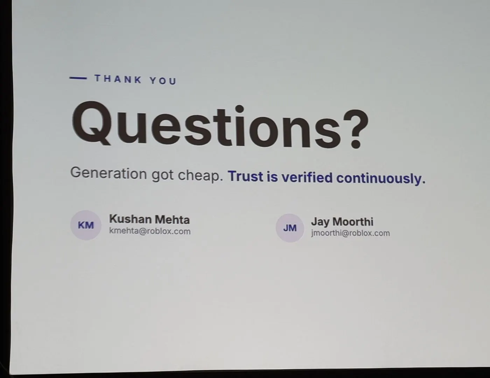](../slides/generation-got-cheap-trust-didnt/deep/s32.webp)

Slide 32. Questions
