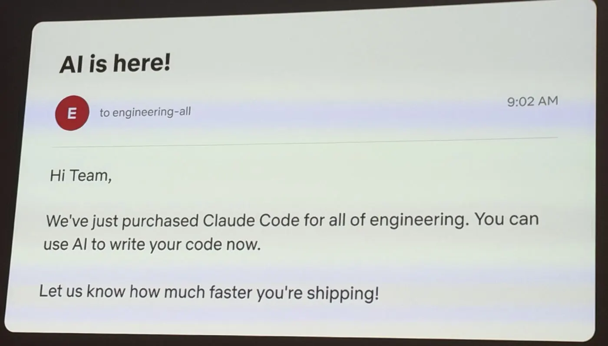
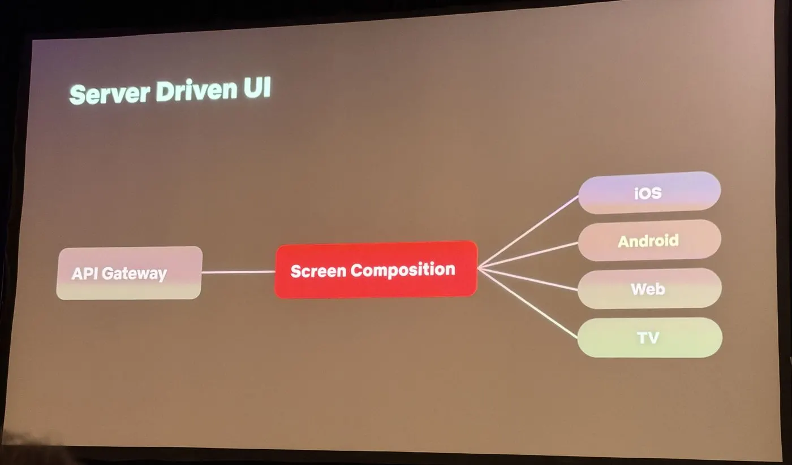
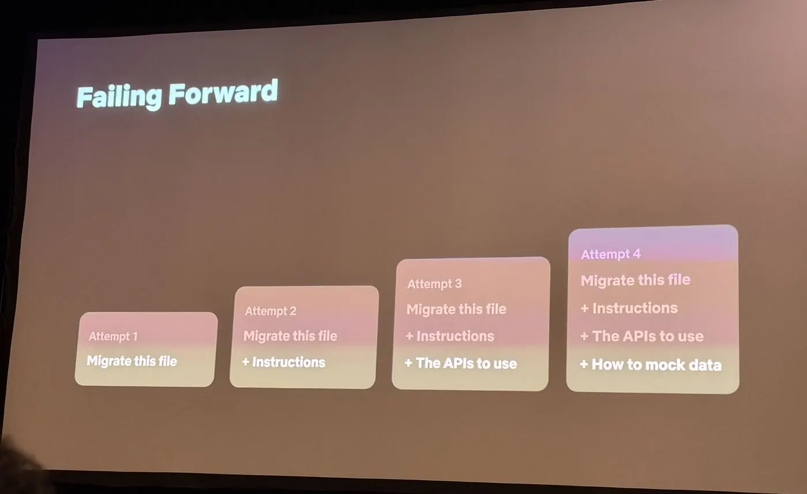
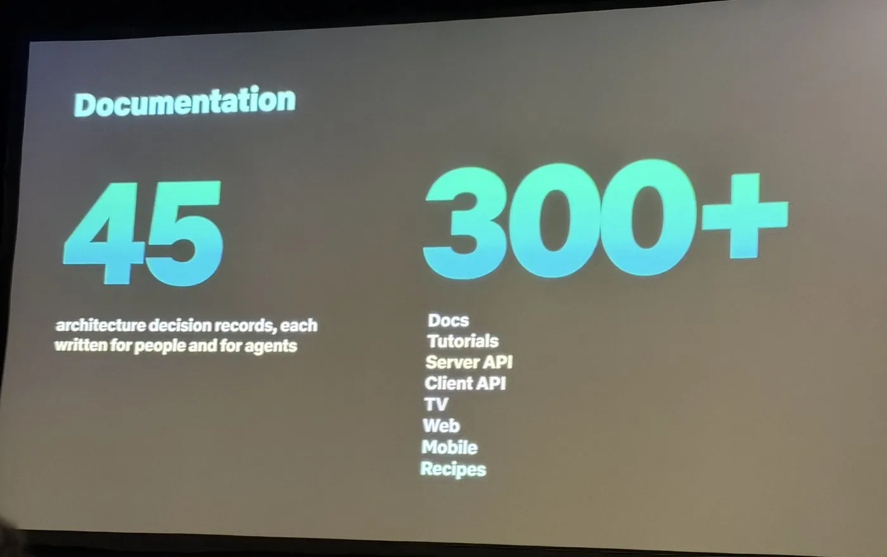
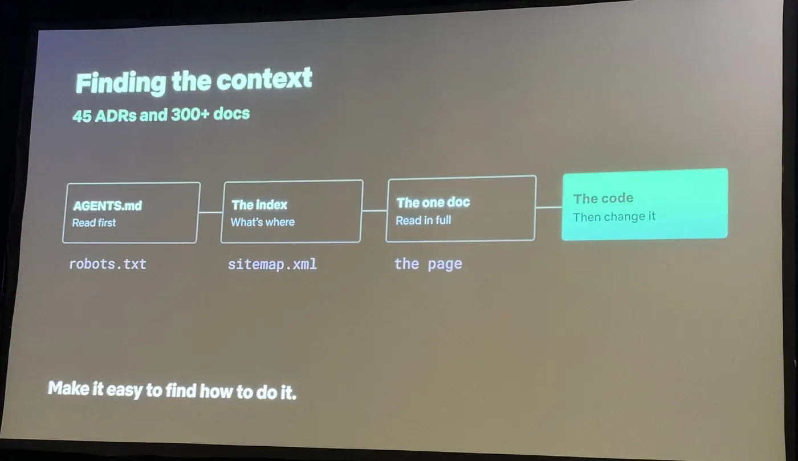
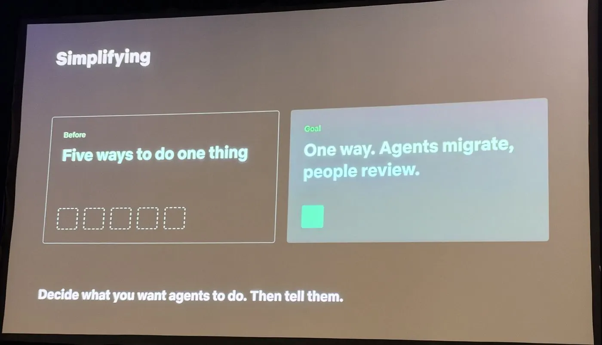
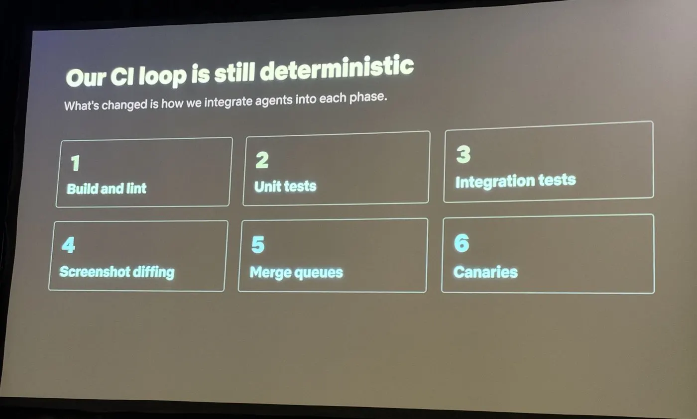
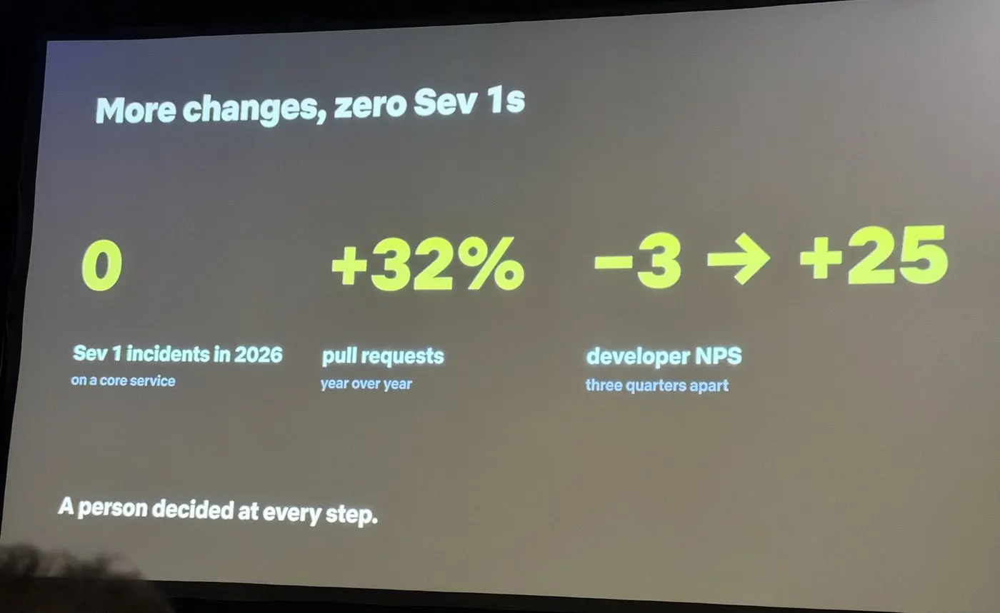
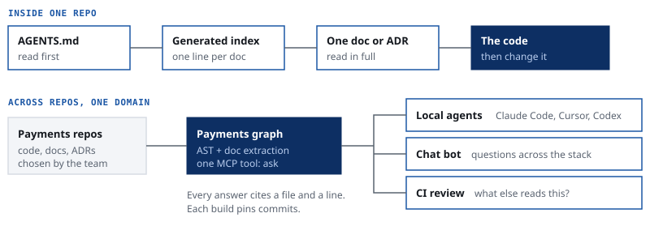

# How Netflix Retrofitted Its SDLC for AI Coding Agents

**Speaker:** Mark Khuzam (Senior Software Engineer, Netflix)  
QCon SF 2026 · Architecting for Agents: Beneath the Loop · Wed Nov 18, 10:35 · Ballroom BC  
[Session page](https://qconsf.com/presentation/nov2026/how-netflix-retrofitted-its-sdlc-ai-coding-agents) · [All 35 slides](../gallery/how-netflix-retrofitted-its-sdlc-for-ai-coding-agents.md)

> How Netflix's commerce UI team made coding agents reliable by recording one way to do each thing in the repo, then adding agents to CI and shared context.

## Key points

- Agents first failed on a test migration. The docs were written for people who already knew the architecture, were hard to find, and tests were written differently everywhere. Reading docs, code and tests filled a 200K-token window.
- He said agents copy whatever exists, so five ways to log errors means the agent picks one. Deciding which patterns stay took the team weeks to months, and he called it the hardest part.
- The team wrote about 45 architecture decision records with context, decision, pattern and anti-pattern, AI usage notes and metadata, alongside 300+ docs. Agents then migrated old code to the chosen patterns and people reviewed it.
- Agents read AGENTS.md first, then a generated index of one-sentence doc summaries, then one doc in full, then the code. He compared it to robots.txt and a sitemap.
- CI stays deterministic: build and lint, unit and integration tests, screenshot diffing, merge queues and canaries. The review agent posts only verified blockers with evidence, a fix and the rule; a revise label lets an agent fix the PR; nothing is auto-merged.
- The review agent also flags docs a change makes stale, and about 9% of merged PRs needed a docs update. ADRs stay human-owned. After each 10% canary an RCA agent reports to on-call, who decides whether it ships.
- His team's slides report zero Sev 1 incidents in 2026 on a core service and pull requests up 32% year over year. Developer NPS rose from -3 to +25 over three quarters.
- For cross-service work, loading every repo, Git submodules, a Git MCP server and a shared repo all failed. Each domain now has a GraphRAG index built from AST parsing and doc extraction. One MCP tool, ask, serves it, and answers cite a file and line. Each team also has a plugin.

From an audio recording in three parts and 35 slide photos. The deck shows no slide numbers, so slides are numbered here in photo order. There are no photos of the team-plugins section or the closing takeaways; those parts come from the recording. Two short gaps in the recording are filled from the slides. Where the recording and a slide disagree, the slide wins: it corrects three figures the recording got wrong.

## The talk in brief

Mark’s team owns the server-driven UI framework behind Netflix’s commerce screens, from signup through billing. When the team first pointed coding agents at it, the agents failed: docs were written for people who already knew the system, there were five ways to do most things, and reading the docs, code and tests filled the context window before the agent understood the task. The fix was mostly discipline. The team chose one way to do each thing, wrote it down as about 45 architecture decision records stored in the repo, pointed agents at them through AGENTS.md and a generated index, and used agents to migrate the old code to match.

On that foundation, agents were added inside an unchanged, deterministic CI pipeline: a review agent that stays silent unless it finds a blocker, a “revise” label that fixes the PR from context already on it, a check that opens a docs PR when a change makes the docs stale, and a root-cause agent that reads each canary. A person decides every merge and every release. For features that span services, each domain gets a GraphRAG index behind a one-tool MCP server, and each team packages its workflows as a plugin. He reported zero Sev 1 incidents on a core service in 2026, 32% more PRs year over year, and developer NPS up from -3 to +25.

**What it rests on.** Every part of this assumes the team’s docs and decision records live in the repo next to the code. That is why a PR can update its docs, why the review agent can check a diff against the ADRs, and why the graph can index docs and code together. When Netflix tried moving ADRs to a shared repo, the copies went stale.

> “Every answer cites a file and a line.” (Slide 35, on the per-domain graph)

## In depth

The talk ran in two parts: loops inside one codebase, then context across Netflix’s services. Slide numbers are photo order (1 to 35).

### The setup: an email and a gap (slides 1–7)

He opened with a mock all-engineering email announcing that the company had bought Claude Code and asking how much faster everyone was shipping. His point was the gap between installing a tool and having it do what you want. Agents promised speed, but for 20 years the team had built code, docs and process for people, and at first nobody trusted the agent.

Commerce supports the whole member lifecycle: signup, sign-in, identity, payments and upsells. The slide gives 300M+ members, 190 countries and \$45B+ a year in revenue, so “I can’t log in to Netflix” is not acceptable. In 2025, he said, his engineers would have said no agent could ship a full feature into the web of services on slide 5. His team builds a server-driven UI framework: screen layout and business logic live on the server, a screen-composition service sends them through the API gateway, and iOS, Android, web and TV clients render them. He pointed to a colleague’s earlier talk, Christopher Luu’s [Server-Driven UI for Mobile and Beyond](https://www.infoq.com/presentations/server-ui-mobile) (QCon London 2024), for background.

*Slide 2: The email that opened the talk.*

*Slide 6: Server-driven UI: one composition service, four clients.*

### Context engineering: the failed test migration (slides 8–13)

He defined context engineering as getting what engineers know into what agents see. Each new agent session is a teammate who has to be onboarded from scratch. The team started where platform teams usually start, with a migration: they had changed how tests were defined and run and wanted agents to move every test across, as a more flexible codemod.

Slide 10 shows four attempts, each adding to the last: migrate this file; plus instructions; plus the APIs to use; plus how to mock data. Each failure exposed a test with its own needs. Slide 11 names the causes: docs written for humans, who filled gaps from what they knew of the architecture; docs hard to find, so the context window ran out before the agent found the right one and understood the code; and tests that worked but were written differently everywhere. Engineers used to React, Swift or Kotlin also had to learn a bespoke server-side framework that no model had seen in training. A developer survey scored the framework at an NPS of -3.

The goal then widened from one test to a whole feature: an agent should define a screen, fetch its data, route between screens and write the tests. “We had to teach the agent how we build here.”

*Slide 10: Four attempts at one test migration.*

*Slide 11: Why the docs failed the agent.*

### Entropy, decisions and ADRs (slides 14–16)

The underlying problem was entropy: many ways to do the same thing. People learn over time why code is the way it is. Agents use whatever they find in the code, docs or context window as the example. The team had kept its API flexible, which produced screens built many different ways that should have been defined the same. So the team went API by API asking what stays, what goes, and what confuses agents and people. He called this the hardest part, weeks and closer to months of discussion.

Each decision became an ADR with five parts (slide 15). Netflix added the last two.

| Part                     | What it holds                  |
|--------------------------|--------------------------------|
| Context                  | Why this came up               |
| Decision                 | What we chose                  |
| Pattern and anti-pattern | What right and wrong look like |
| AI usage notes           | What an agent should do        |
| Metadata                 | Related docs, ADRs, code       |

That left 45 ADRs, each written for people and agents, plus a doc site of 300+ pages covering docs, tutorials, the server and client APIs, TV, web, mobile and recipes (slide 16). The recording says 345; the slide says 300+.

*Slide 15: Netflix’s ADR template, with two rows added for agents.*

*Slide 16: 45 ADRs and 300+ docs.*

### Finding the context, and migrating the old code (slides 17–19)

Coming from web platforms, he borrowed how crawlers handle huge sites. The agent reads AGENTS.md first, the way a crawler reads robots.txt. AGENTS.md points to an index that says what lives where, like a sitemap; a small utility regenerates it whenever a doc changes, with a one-sentence summary and keywords per page. The agent then reads the one relevant doc in full, and only then reads and changes the code.

Docs alone weren’t enough. With the old patterns still in the code, an agent several hundred thousand tokens into a task could still copy the wrong one. So the team gave agents the target pattern and the list of inconsistent files and let them migrate in bulk, with people reviewing. Code became predictable and review became pattern-matching. His takeaway: decide what you want the agents to do, then tell them.

*Slide 17: AGENTS.md, index, one doc, then the code.*

*Slide 18: Five ways to one way.*

### Loops inside loops (slides 20–22)

Slide 21 nests the loops from the inside out: local (write, test, repeat); every PR (build, lint and tests); review (the CI agent pre-reviews); fix (a comment or the revise label); after merge (docs follow); release (a canary on 10% of traffic, which the RCA agent reports on). The CI loop itself stays deterministic, in six phases: build and lint, unit tests, integration tests, screenshot diffing, merge queues and canaries. Agents are added inside these phases, not in place of them.

*Slide 21: Six nested loops.*

*Slide 22: The deterministic CI phases.*

### Review: verified blockers only (slides 23–25)

The team chose to speed up the human reviewer rather than let an agent approve and auto-merge; he said they are still discussing what auto-merge might look like. The review agent does three things: checks the diff against the docs and ADRs, flags blockers (code that uses an anti-pattern), and looks downstream at what depends on the change. He credited the earlier groundwork for making the review accurate.

The first version posted a summary of what the PR did, praise, suggestions and focus areas. Slide 24’s example has 23 comments, mostly renames and nits. Engineers dismissed it as AI slop. The current version is silent unless it finds a blocker. The slide’s example: the confirm screen rebuilds the price from a number, so it drops the local currency format; fix by using the formatted price the service sends; rule, the pricing ADR. Easy fixes come as a GitHub suggested change the engineer can accept.

When review or a colleague finds a problem, the context to fix it is already on the PR: the description, the diff, the agent review and the human comments. A comment or the *revise* label triggers an agent in CI to make the fix and push it to the same PR, and the engineer reviews it. Slide 25: never auto-merged; engineers own the code.

*Slide 24: 23 comments then; one verified blocker now.*

*Slide 25: The revise label.*

### Docs follow the merge; the engineer ships (slides 26–28)

The same review agent checks every change for docs it makes stale. The engineer can update them in the same PR; if not, the PR is labelled stale at merge and the agent opens a follow-up docs PR and tags the engineer to approve it. About 9% of merged PRs needed a docs update (slide 26). The recording says 9% “make changes to the API”; I follow the slide. ADRs stay human-owned, because people should keep reading and writing the decisions that everything else rests on.

Releases go out, by his estimate, about three times a day. Each gets a canary on 10% of traffic. An RCA agent then compares historical error rates with new errors from the release, reads past findings and reports anything new to the on-call engineer, who decides whether it ships. Real findings go back through the same loop. Slide 28 closes the first part: zero Sev 1 incidents in 2026 on a core service, pull requests up 32% year over year, developer NPS from -3 to +25 three quarters apart. “A person decided at every step.”

*Slide 26: About 9% of merged PRs needed a docs update.*

*Slide 28: The results he reported.*

### Ownership: one feature crosses many services (slides 29–30)

A product feature lives across many services. For a platform engineer, ADRs, skills, rules and review can all live inside the one service they know deeply. A product engineer shipping across services, and that engineer’s agents, would have to stitch together each platform’s own context and loops. He called this the distributed context problem: how does context follow the work?

### Portability: what failed and what they needed (slides 31–33)

| We tried                               | It broke because                                                                   |
|----------------------------------------|------------------------------------------------------------------------------------|
| Load every repo                        | Dozens of repos. Doesn’t fit.                                                      |
| Git submodules                         | Brittle. Extra setup for everyone, and nobody wanted them committed to every repo. |
| A Git MCP server (GitHub, Sourcegraph) | Sees one file, not the system. Easy to miss an important file.                     |
| A shared repo, plus copies             | Goes stale. Many copies, many truths.                                              |

Source: slide 32. The first row fell in a gap in the recording.

The requirement above all was accuracy: the right context, and correct. Then three more: portable (any agent in any environment), per domain (the team decides what’s in it) and fresh (keeps up with the code). He added simple: nobody should have to update docs in several places after a change.

### GraphRAG per domain, behind one “ask” tool (slides 34–35)

| Step      | What it does                                                    | Gives           |
|-----------|-----------------------------------------------------------------|-----------------|
| 1 Parse   | AST parsing: symbols, calls, imports                            | Accurate        |
| 2 Extract | Semantic extraction from docs and ADRs (he added: maybe images) | Accurate        |
| 3 Group   | Community labels, one namespace per domain                      | Per domain      |
| 4 Serve   | One MCP tool: ask. Each build pins commits                      | Portable, fresh |

Labelling communities lets a concept that spans many services be found once and then expanded. The MCP server has one tool, `ask`, which takes a namespace and a question. He chose this over returning a list of relevant files, which would make the working agent read and reason over all of them. A thin agent on the other side searches the graph, retrieves related concepts, reasons with that domain’s context and answers. Each answer cites a file and a line. The point is to keep the working agent’s context window on its own task: “structure from the code, meaning from the docs.”

His example: the payments team picks the repos in its graph and gets one MCP address. Local agents (Claude Code, Cursor, Codex), a Slack bot answering questions that span the stack, and CI review asking what else reads a change all query the same graph.

*Slide 34: Parse, extract, group, serve.*

*Slide 35: One graph, three kinds of caller.*

### Team plugins (not photographed)

That still left where a cross-service team’s own context lives. Netflix’s answer is a plugin per team, usually forked from an open-source plugin and then made the team’s own. It holds how the team plans, reviews, hands off and debugs, plus its glossary. As the team’s needs change, the plugin is updated and every harness picks up the new version, which he said ends “it works for my agent.” A plugin can also declare its own MCP servers, so it carries the team’s graph namespace and connections to observability and testing MCPs.

### Close (not photographed)

Back to his opening question: could an agent ship here now? He said yes. Agents can find where a domain lives, what each service provides and what must change in each. One-shotting a feature across services is not the goal; easy-to-find context and easy-to-define code are. None of it is magic, he said, just good practice that matters more now.

**Slow down to speed up.** Decide what you want the agents to do, then tell them.

**Make it easy to find how to do work.**

**Keep humans in the loop.** Someone still has to know what is happening inside the systems.

## Has this been tried elsewhere?

He talked about GraphRAG as settled, so we looked for whether Netflix or anyone else has published how well it works for code. Searched on Nov 18, 2026.

### Netflix has not published this system

I found no Netflix TechBlog post, paper or earlier talk describing per-domain GraphRAG for code or the “ask” MCP server. The session abstract describes the context layer only in general terms: architecture decisions seed every agent session, plans are checked against them, drift is flagged before review and docs update after merge. No cost, latency or answer-accuracy figures for the graph were shown. What Netflix has published is related graph work by other teams:

- [Ontology-driven observability](https://www.infoq.com/news/2026/03/ontology-at-netflix) (QCon London, March 2026; [InfoQ, November 2026](https://infoq.com/news/2026/11/netflix-ai-driven-observability)): an operational knowledge graph built on RDF, OWL, SHACL and SPARQL, stored in Netflix’s QuipuDB, with an AutoRCA system of specialist agents that rank likely root causes. This is a formally modelled graph, not one extracted by an LLM. It is likely related to the RCA agent in this talk, but he didn’t say so.
- [UDA (Unified Data Architecture)](https://netflixtechblog.com/uda-unified-data-architecture-6a6aee261d8d), presented Monday by Aarti Gupta in [Stop Fighting the Remodel](https://qconsf.com/presentation/nov2026/stop-fighting-remodel-api-design-models-outgrew-their-boundaries): a knowledge graph of business meaning that generates schemas.
- [JetBrains and Netflix, October 2026](https://blog.jetbrains.com/ai/2026/10/how-netflix-made-ai-coding-agents-more-efficient/): headless IDE code intelligence for agents in Java and Kotlin, benchmarked on an internal service and Netflix’s open-source DGS framework. Vendor-published.

### What public research says about graphs for code

| Study                                                                                                                                    | What it found                                                                                                                                                                                                                                                                        | Caveat                                                    |
|------------------------------------------------------------------------------------------------------------------------------------------|--------------------------------------------------------------------------------------------------------------------------------------------------------------------------------------------------------------------------------------------------------------------------------------|-----------------------------------------------------------|
| [Reliable Graph-RAG for Codebases](https://arxiv.org/abs/2601.08773) (arXiv, Jan 2026)                                                   | On Java repos, a graph built deterministically from ASTs with Tree-sitter beat an LLM-extracted graph on coverage and indexing cost, and scored highest on correctness. The LLM-built graph missed 377 files in one repo. Vector-only retrieval did worst on architecture questions. | Three repos, 15 questions each. Single author.            |
| [Codebase-Memory](https://arxiv.org/abs/2603.27277) (arXiv, Mar 2026)                                                                    | An agent querying a Tree-sitter code graph over MCP scored 83% on answer quality against 92% for an agent reading files, using about ten times fewer tokens and 2.1 times fewer tool calls, across 31 repos.                                                                         | Graded by the author. Cheaper, but less accurate overall. |
| [TDAD](https://arxiv.org/html/2603.17973v1) (arXiv, Mar 2026)                                                                            | Graph-based impact analysis given to a coding agent cut test regressions from 6.08% to 1.82% and raised resolution from 24% to 32% on SWE-bench Verified.                                                                                                                            | Small local models; 100 and 25 instances.                 |
| [Microsoft LazyGraphRAG](https://www.microsoft.com/en-us/research/blog/lazygraphrag-setting-a-new-standard-for-quality-and-cost/) (blog) | Full [GraphRAG](https://github.com/microsoft/graphrag) indexing is expensive: LazyGraphRAG’s indexing costs the same as vector RAG and 0.1% of full GraphRAG’s.                                                                                                                      | Measured on text corpora, not code.                       |

Read together, Netflix’s design matches where the evidence points. Structure comes from deterministic AST parsing, which is cheap and complete; an LLM extracts meaning only from docs and ADRs, which is where it adds something. The open questions are the ones the research raises. Netflix gave no cost per question for the “ask” agent and no evaluation of its answers. “Each build pins commits” suggests the graph is rebuilt on each build, but he didn’t say how long that takes.

## Numbers I checked

Checked means we found it in a published source; Caveat means it holds with a condition; Slide only means I took it from the slide; Talk only means I heard it in the room and found it nowhere else.

| Claim                                        | Figure      | Source                                                                                                                                                                                                        | Status                                                 |
|----------------------------------------------|-------------|---------------------------------------------------------------------------------------------------------------------------------------------------------------------------------------------------------------|--------------------------------------------------------|
| Netflix members                              | 300M+       | Slide 4. Netflix passed 300M paid memberships in Q4 2024 and reported [325M+ at the end of 2025](https://www.techloy.com/netflix-hits-325-million-subscribers-beats-earnings-as-ad-revenue-tops-1-5-billion/) | Checked                                                |
| Countries                                    | 190         | Slide 4                                                                                                                                                                                                       | Slide only                                             |
| Revenue a year                               | \$45B+      | Slide 4. [FY2025 revenue \$45.2B](https://thedesk.net/2026/01/netflix-q4-2025-earnings-report/)                                                                                                               | Checked                                                |
| Context window when they started             | 200K tokens | Recording, “pre Opus 4.5”                                                                                                                                                                                     | Talk only                                              |
| Framework developer NPS, before              | -3          | Slide 12                                                                                                                                                                                                      | Slide only                                             |
| ADRs; docs                                   | 45; 300+    | Slides 16, 17 (the recording says 345)                                                                                                                                                                        | Slide only                                             |
| Comments from the first review agent, one PR | 23          | Slide 24, an example                                                                                                                                                                                          | Slide only                                             |
| Merged PRs that needed a docs update         | ~9%         | Slide 26 (the recording says changes to the API)                                                                                                                                                              | Slide only                                             |
| Deploys a day                                | ~3          | Recording, “I think”                                                                                                                                                                                          | Talk only                                              |
| Canary share of traffic                      | 10%         | Slides 21, 27                                                                                                                                                                                                 | Slide only                                             |
| Sev 1 incidents in 2026, one core service    | 0           | Slide 28                                                                                                                                                                                                      | Caveat one service, not all of commerce                |
| Pull requests, year over year                | +32%        | Slide 28                                                                                                                                                                                                      | Caveat no control for headcount or other changes given |
| Developer NPS, after                         | -3 → +25    | Slide 28, “three quarters apart” (the recording sounded like “about 3/4” of the work done)                                                                                                                    | Slide only                                             |

## About the speaker

Mark Khuzam is a Senior Software Engineer at Netflix on the Commerce Experience Capabilities team, where he builds CLCS, Netflix’s internal server-driven UI framework for consumer experiences across signup, billing, Games and Ads, according to his [QCon speaker page](https://qconsf.com/speakers/markkhuzam). Before Netflix he led the consumer web platform team at OpenTable. He has spent six years on platform teams after starting as a full-stack engineer. His title slide reads “Software Engineer, Commerce at Netflix”. The recording spells his name “Kazam”; the slides and session page give Khuzam.

## Terms and technologies

Everything the talk names, in plain English, with a link to the real thing.

### Context and decisions

Context engineering  
Deciding what an agent sees, when and in what form, so the right information fits in its context window. His definition: getting what engineers know into what agents see.

[Architecture decision record (ADR)](https://adr.github.io/)  
A short document recording one design decision with its context and consequences. Netflix’s version adds blessed patterns, anti-patterns, AI usage notes and metadata linking related docs, ADRs and code.

[AGENTS.md](https://agents.md/)  
An open convention for a file at the root of a repo that coding agents read first. Netflix uses it to point agents at a generated doc index.

[robots.txt](https://en.wikipedia.org/wiki/Robots.txt)  
The file a web crawler reads first on a site. His analogy for AGENTS.md.

[Sitemap](https://www.sitemaps.org/)  
An XML list of a site’s pages that tells crawlers what exists. His analogy for the generated doc index.

Context window  
The amount of text a model can consider at once. Reading the docs, code and tests used up a 200K-token window before the agent understood the task.

Entropy  
His word for many ways of doing the same thing in one codebase. Agents copy whichever example they find.

### The framework and the migration

Server-driven UI (SDUI)  
The server sends a description of each screen and its logic, and each client renders it. No canonical page; [Christopher Luu’s 2024 QCon talk](https://www.infoq.com/presentations/server-ui-mobile) covers Netflix’s approach.

[CLCS](https://www.infoq.com/news/2024/07/netflix-server-driven-ui)  
Netflix’s Customer Lifecycle Component System, the server-driven UI framework Mark’s team builds. InfoQ’s 2024 report describes it as a wrapper over Netflix’s Hawkins design system that renders with native controls.

[Codemod](https://github.com/facebookarchive/codemod)  
A script that rewrites code across a codebase. Linked to Facebook’s original tool. He said codemods break down when the code is inconsistent, which is why the team tried agents.

[Net promoter score (NPS)](https://en.wikipedia.org/wiki/Net_promoter_score)  
A survey score from -100 to 100 for how likely people are to recommend something. Here, building on the team’s framework.

### Review and delivery

[GitHub suggested changes](https://docs.github.com/en/pull-requests/collaborating-with-pull-requests/reviewing-changes-in-pull-requests/commenting-on-a-pull-request)  
A review comment that proposes exact replacement lines the author can commit with one click. The review agent uses them for easy fixes.

Screenshot diffing  
Visual regression testing: render screens before and after a change and compare the images. One of the six deterministic CI phases.

[Merge queue](https://docs.github.com/en/repositories/configuring-branches-and-merges-in-your-repository/configuring-pull-request-merges/managing-a-merge-queue)  
Lines up approved PRs and re-tests each against the latest main before it merges.

[Canary release](https://martinfowler.com/bliki/CanaryRelease.html)  
Sending a new version to a small share of traffic first. Netflix uses 10%.

Root cause analysis (RCA) agent  
An agent that compares a release’s errors with historical error rates and past findings, and reports anything new to the on-call engineer. Related Netflix work is described under section 04.

Sev 1  
The highest severity level of production incident.

### Retrieval and portability

[GraphRAG](https://github.com/microsoft/graphrag)  
Retrieval over a knowledge graph instead of flat text chunks: extract entities and relationships, group them into communities, and answer by finding a community and expanding from it. Microsoft’s open-source version is the reference; Netflix didn’t say whose implementation it uses.

[Abstract syntax tree (AST)](https://en.wikipedia.org/wiki/Abstract_syntax_tree)  
The parsed tree of a program’s structure. Parsing it gives exact symbols, calls and imports, which is why he called that step accurate.

[Community detection](https://en.wikipedia.org/wiki/Leiden_algorithm)  
Grouping densely connected nodes in a graph. Microsoft’s GraphRAG uses the Leiden algorithm; Netflix labels communities and gives each domain a namespace.

[Model Context Protocol (MCP)](https://modelcontextprotocol.io/)  
An open standard for exposing tools and data to agents. Netflix’s graph server exposes one tool, ask.

[GitHub MCP server](https://github.com/github/github-mcp-server)  
GitHub’s official MCP server for repos, issues and PRs. Tried for cross-repo context; it finds files but not the architecture.

[Sourcegraph MCP server](https://sourcegraph.com/docs/api/mcp)  
Code search and navigation across indexed repos through MCP. Set aside for the same reason.

[Git submodules](https://git-scm.com/book/en/v2/Git-Tools-Submodules)  
Embedding one Git repo inside another. Tried for sharing context and dropped as brittle.

[Claude Code plugins](https://claude.com/plugins)  
Installable bundles of skills, commands, hooks and MCP servers. Netflix gives each team one, holding its workflows, glossary and MCP connections. He didn’t name the plugin format, but the features he described match Claude Code’s.

Claude Code, Cursor, Codex  
The coding agents he listed as callers of the graph: [Claude Code](https://code.claude.com/docs/en/mcp) (Anthropic), [Cursor](https://cursor.com) and [Codex](https://openai.com/codex/) (OpenAI).

## Reading and tools

### On the talk

- [Session page](https://qconsf.com/presentation/nov2026/how-netflix-retrofitted-its-sdlc-ai-coding-agents), with the abstract.
- [Server-Driven UI for Mobile and Beyond](https://www.infoq.com/presentations/server-ui-mobile), Christopher Luu, QCon London 2024: the earlier Netflix talk he recommended.

### Graph retrieval for code

- [Microsoft GraphRAG](https://github.com/microsoft/graphrag) and [LazyGraphRAG](https://www.microsoft.com/en-us/research/blog/lazygraphrag-setting-a-new-standard-for-quality-and-cost/), on indexing cost.
- [Reliable Graph-RAG for Codebases: AST-Derived Graphs vs LLM-Extracted Knowledge Graphs](https://arxiv.org/abs/2601.08773), arXiv, 2026.
- [Codebase-Memory: Tree-Sitter-Based Knowledge Graphs for LLM Code Exploration via MCP](https://arxiv.org/abs/2603.27277), arXiv, 2026.
- [TDAD: Test-Driven Agentic Development](https://arxiv.org/html/2603.17973v1), arXiv, 2026.

### Other Netflix work

- [Ontology-Driven Observability](https://www.infoq.com/news/2026/03/ontology-at-netflix), InfoQ on the QCon London 2026 talk.
- [UDA: Model Once, Represent Everywhere](https://netflixtechblog.com/uda-unified-data-architecture-6a6aee261d8d), Netflix TechBlog, 2025.
- [How Netflix Made AI Coding Agents More Efficient with JetBrains IDE Intelligence](https://blog.jetbrains.com/ai/2026/10/how-netflix-made-ai-coding-agents-more-efficient/), JetBrains blog, October 2026.

### Related sessions at QCon

- **Already held** Mon 1:35: [Stop Fighting the Remodel](https://qconsf.com/presentation/nov2026/stop-fighting-remodel-api-design-models-outgrew-their-boundaries) (Netflix), on UDA and agents calling internal APIs.
- **Still ahead** Wed 11:45: [Making Production Legible to Agents](https://qconsf.com/presentation/nov2026/making-production-legible-agents-lessons-building-observability-mcp) (Honeycomb).
- **Still ahead** Wed 3:55: [How To Kill the Code Review](https://qconsf.com/presentation/nov2026/how-kill-code-review) (Aviator).

