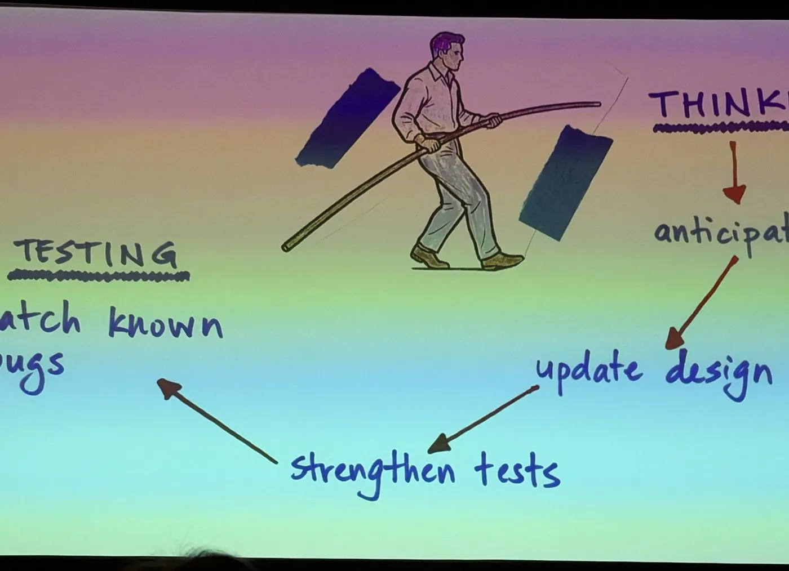
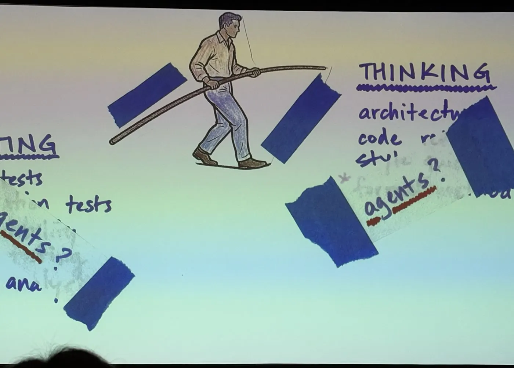
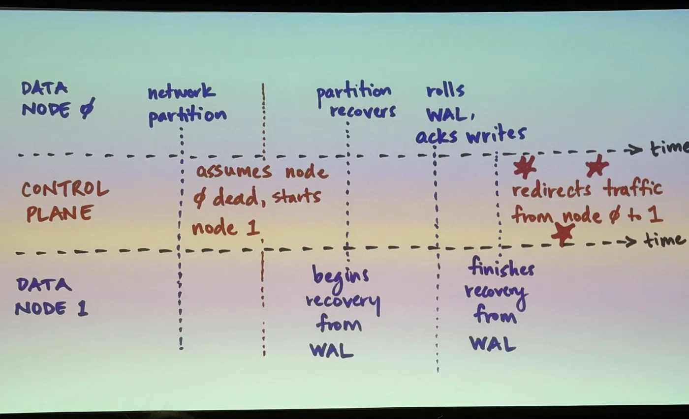
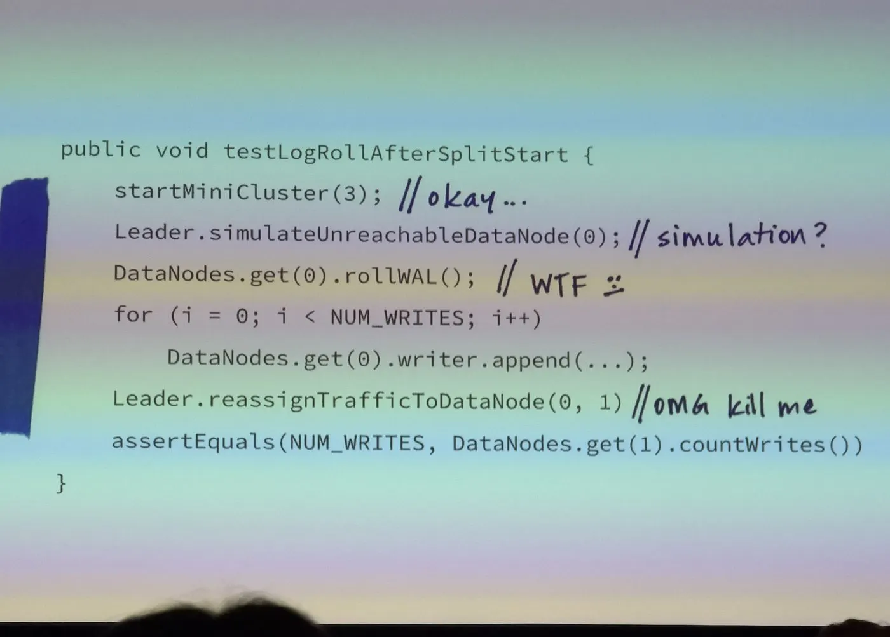
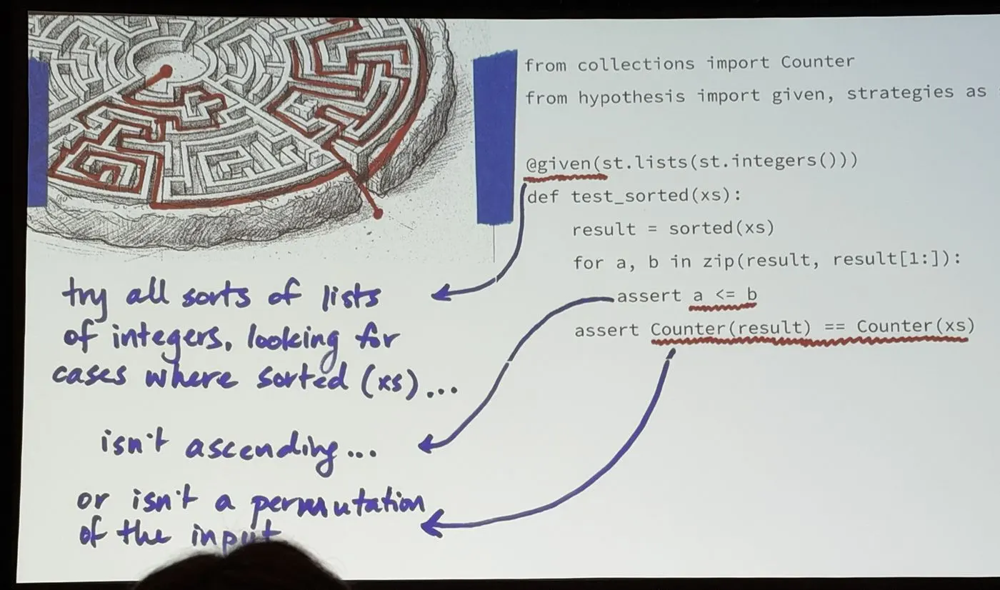
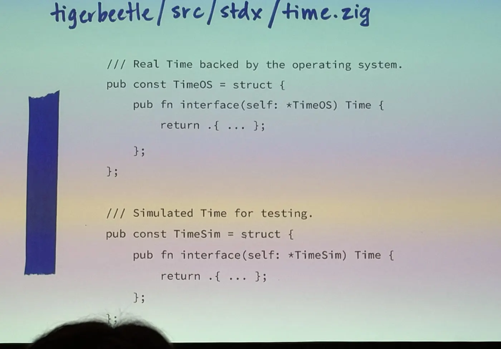
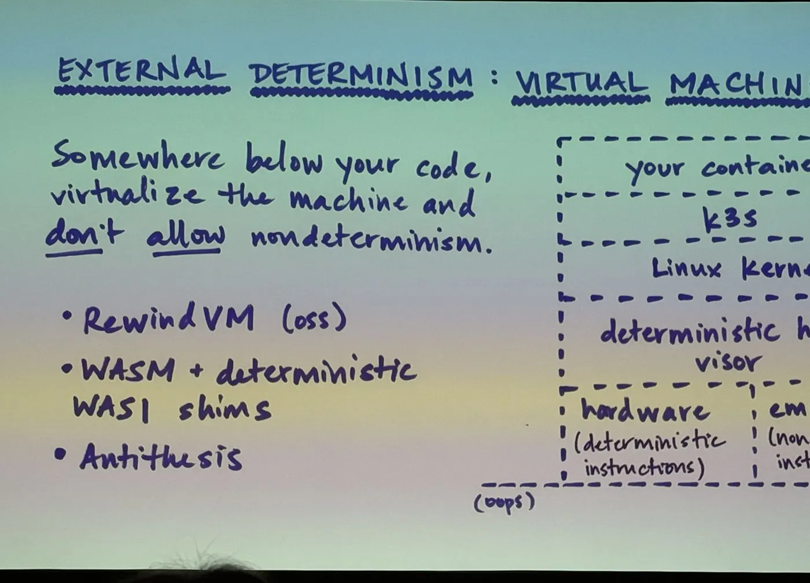
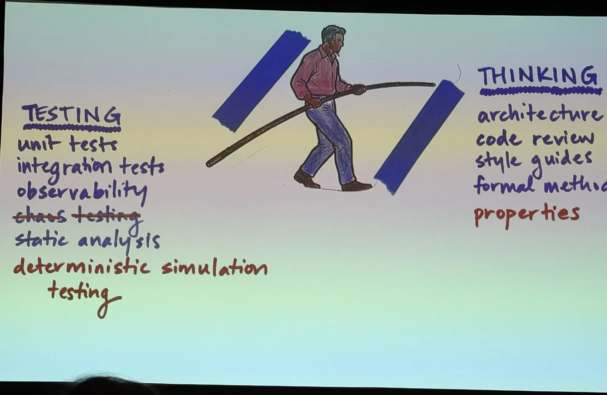
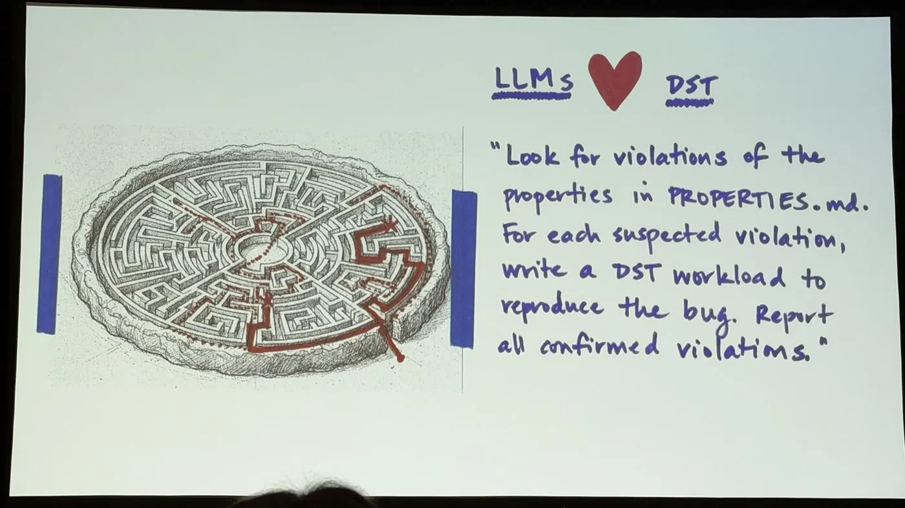

# Into the Labyrinth: What Distributed Systems Have Taught Us About Guardrails

**Speaker:** Akshay Shah (Field CTO, Antithesis)  
QCon SF 2026 · Guardrails & Safety Nets for the New Landscape · Mon Nov 16, 17:05 · Ballroom A  
[Session page](https://qconsf.com/presentation/nov2026/labyrinth-what-distributed-systems-have-taught-us-about-guardrails) · [All 42 slides](../gallery/into-the-labyrinth.md)

> Why agent-written code should be treated like a distributed system, and how property-based testing, fault injection and deterministic simulation let people state what correct means while machines search for violations.

## Key points

- He said shipping software has balanced thinking and testing. Thinking covers architecture, code review, style guides and formal methods; testing covers unit and integration tests, observability, chaos testing and static analysis. Handing both sides to agents removes the human understanding that kept them in balance.
- He quoted Jepsen's October 2026 report on ParticleDB, a database built with heavy LLM use. Jepsen found 96 issues. LLM tooling repeatedly claimed bugs were fixed when they were not, and the vendor could explain few of the causes.
- He cited a 2014 University of Toronto study of 198 failures in five distributed systems, which found 77% could be reproduced by a unit test. He showed an HBase write-loss bug whose test needs a partition, a log roll and a traffic switch in one order, which nobody writes in advance.
- He presented property-based testing, from QuickCheck to Hypothesis, as a corpus and strategies producing inputs, properties checking outputs, and shrinking failures to a minimal case. He described Jepsen as the same idea with fault injection and the Elle consistency checker.
- He said stateful systems need a tree of small property-based sessions with backtracking, which requires removing nondeterminism from randomness, scheduling, the network, the clock and hardware.
- He gave two ways to get determinism. One injects time, randomness and I/O inside the code, as TigerBeetle does in Zig. The other runs the code in a deterministic VM such as RewindVM, WebAssembly or Antithesis. Injection is simple and fast but rules out external dependencies; a VM works for any language but is complex.
- He defined deterministic simulation testing as property-based testing plus fault injection plus determinism, invented independently at AWS and FoundationDB. He proposed that people write properties and agents find violations. Each finding must come with a replayable workload, which filters out false positives.
- He called search over huge state spaces unsolved, listed coverage, swarm testing and snapshot pruning, and asked whether models could help concolic testing get past narrow conditions.

## The talk in brief

Code written by agents is starting to feel like a distributed system: too big and too unfamiliar to hold in your head, so you can’t anticipate where it will break. Distributed-systems engineers have lived with that for decades, and Akshay’s argument is that their answer applies now. Spend scarce human thinking on properties, plain statements of what correct behavior looks like from the outside, and hand them to a machine that searches the program’s state space for violations.

He builds up to deterministic simulation testing (DST) one monster at a time: property-based testing for exploring inputs, state trees for stateful systems, determinism so any failure can be replayed, and search strategy for state spaces too big to wander randomly. The payoff for agents: an agent can propose suspected bugs against your properties and then prove each one with a replayable DST run, which filters out its false positives.

> “Look for violations of the properties in PROPERTIES.md. For each suspected violation, write a DST workload to reproduce the bug. Report all confirmed violations.” (Slide 37, the prompt he suggests)

## In depth

Slide numbers follow the order photographed (42 slides).

### The tightrope: thinking and testing (slides 3–7)

Akshay pictures shipping software as walking a tightrope over a pit of fire. Teams have kept their balance by pairing two kinds of work. **Thinking** (architecture, code review, style guides and, for the ambitious, formal methods like TLA+ or Lean) builds intuition about how the software will fail and feeds better designs and stronger tests. **Testing** (unit and integration tests, observability, chaos testing, static analysis) catches the classes of bugs you’ve already anticipated. Thinking looks ahead; testing looks back.

Now people on the safe side of the cliff are shouting for more tokens and more speed, and every item on both lists is getting an “agents?” sticker: agents design, agents review, agents write TLA+, agents write the tests. He isn’t against that future, but the human understanding that kept the two sides balanced goes missing.

*Slide 5: Thinking anticipates; testing catches what you anticipated.*

*Slide 7: Every item on both lists gets handed to agents.*

### Jepsen and ParticleDB (slide 8)

Kyle Kingsbury’s Jepsen analyses are the industry’s hardest test of database claims. A typical engagement runs 2.5 to 4 weeks and finds 10 to 30 issues. His October 31, 2026 report on ParticleDB, a database Orkes built with heavy use of LLMs, found 96 issues across versions 1.1.4 through 1.1.18.11.rc-22, and all but three happened on a healthy single node with no faults injected.

The report’s discussion section is the part Akshay quoted on stage: LLM tooling repeatedly claimed bugs were fixed when they weren’t, the database was harder to understand than typical ones, and Orkes, whose engineers could explain every bug Jepsen found in their earlier product Conductor, could explain almost none in ParticleDB. New builds appeared without changelogs. Two further details from the report make the point sharper: ParticleDB’s home page said it was “formally proven” with a TLA+ proof, yet no TLA+ specification was available during the work; and Orkes said it had run Jepsen’s existing Postgres test suite beforehand, but that suite failed immediately against 1.1.4. Jepsen recommended users halt deployment and migrate. Orkes says later builds fix the remaining issues.

Akshay was careful not to call the team incompetent; the same engineers shipped Conductor, which tested well weeks earlier. His point is that when nobody builds a mental model of the code, nobody can predict where it will fail, which is exactly how distributed systems have always felt.

### Why distributed systems feel cursed (slides 9–12)

[Leslie Lamport](https://en.wikipedia.org/wiki/Leslie_Lamport), inventor of the Paxos consensus algorithm, defined a distributed system as one where a computer you didn’t know existed can make yours unusable. You can’t keep it all in your head, yet the industry built S3, Spanner and Google Search anyway.

Not without pain. The University of Toronto’s OSDI 2014 study by Yuan et al. sampled 198 user-reported failures from Cassandra, HBase, HDFS, MapReduce and Redis, and reproduced many of them by hand. Its Finding 9: **77% of the production failures can be reproduced by a unit test**. Almost all need three nodes or fewer, and the paper found that 92% of the catastrophic ones came from mishandling errors the software had already flagged.

So just write better unit tests? Akshay walked through one HBase failure. Data node 0 loses its network; the control plane assumes it’s dead and has node 1 rebuild its data from the write-ahead log. Node 0’s partition heals; it rolls to a new log file and keeps acknowledging writes. Node 1 finishes recovering from the old log, traffic switches over, and acknowledged writes vanish. The unit test that catches this needs a simulated partition, a manual log roll and a forced traffic switch in exactly that order. Nobody writes that test before getting burned.

*Slide 11: The HBase write-loss sequence.*

*Slide 12: The “simple” unit test that would have caught it.*

### The labyrinth (slides 13–14)

A system like HBase can be in more states than there are particles in the universe. Running it is a walk through a maze, and a bug is a pit of spikes on one path that doesn’t even lead to the center. You can’t think through every path, and with agent-written code half the maze is in fog. Yet Kyle Kingsbury finds dozens of bugs in unfamiliar codebases in a few weeks (slide 14 lists 36 Jepsen analyses back to 2016). How?

### Property-based testing (slides 15–21)

He reaches back to QuickCheck, the Haskell paper by Koen Claessen and John Hughes, which describes randomly exploring a program in a smart way. Today it goes by property-based or generative testing; AWS calls the approach lightweight or semi-formal methods.

The sorting example makes it concrete. `assert sorted([2, 1, 3]) == [1, 2, 3]` covers one path; adding the empty and single-element lists covers three. With Hypothesis, the framework generates lists for you and you assert two properties: the output is in ascending order, and it’s a permutation of the input. The second property is what stops a broken sort from returning an empty list.

Corpus  
Starting values: edge cases like empty, zero and min/max, plus every input that failed before, so regression testing comes free. AFL++ ships a hard-coded list of “interesting” integers and still finds deep bugs in production software.

Strategies  
Ways to mutate a value into something new but nearby: bigger, smaller, inverted.

Properties  
The checks that say whether the output is right.

Shrinking  
Making a failing input as small as possible while it still fails, so you debug `[1]` instead of a 700-element list.

*Slide 18: Two properties define “sorted.”*

![Slide 21: Corpus \[3\], strategy \[3,1\], output \[\], shrink to \[1\].](../slides/into-the-labyrinth/deep/s21.webp)

*Slide 21: One pass through the loop, ending in a shrunk counterexample.*

### Jepsen is property-based testing (slides 22–23)

Jepsen’s corpus is a workload of random client commands (reads, writes, compare-and-swap, transactions) shaped by Kingsbury’s instinct for what breaks things. Its strategy is fault injection into the network, clock, processes and disk. Its property checker is Elle, a sophisticated transactional consistency checker. Shrinking is the unsolved part. The catch is speed: Kingsbury runs a large workstation flat out during analyses, and finding a bug in something like HBase can take days, then two weeks to learn whether a fix worked.

### Monster one: state (slides 24–25)

A sort is a pure function, so you can turn the crank fast. A database call touches thousands of functions and stashes state on disk, in memory and in caches. Instead of one giant random run, he wants to apply one operation, check the system’s state, and branch: a tree of small PBT sessions, with the option to backtrack to an interesting state and try again.

### Monster two: nondeterminism (slides 26–34)

Backtracking only works if you can replay. Randomness, performance, thread scheduling, network operations, the clock and faulty hardware all vary from run to run. Two ways to remove them:

|          | Internal determinism                                                                                | External determinism                                     |
|----------|-----------------------------------------------------------------------------------------------------|----------------------------------------------------------|
| How      | Dependency injection and mocks for every nondeterministic operation                                 | Run the code in a deterministic virtual machine          |
| Examples | TigerBeetle (in Zig), Turmoil (Rust)                                                                | RewindVM, WASM with deterministic WASI shims, Antithesis |
| Pros     | Simple, fast, works with your normal debugger and tracer, no third-party cost                       | Any language, any dependency, no code changes            |
| Cons     | Tedious; no external dependencies like libraries or databases; hard or impossible in many languages | Complex, may need new tools, few open-source options     |

TigerBeetle’s clock shows the internal style. Its `Clock` takes a `Time` interface as a constructor argument instead of reading the system clock. One implementation, `TimeOS`, asks the operating system; the other, `TimeSim`, returns the same instant until the test ticks it forward. TigerBeetle does the same for randomness, threads and I/O, so a given seed produces exactly the same run every time, and you can fast-forward or rewind.

Antithesis takes the external route: your containers run on k3s on the Linux kernel, on top of a deterministic hypervisor. Instructions that are already deterministic, like adding two numbers, run on real hardware at full speed; the rest, like reading the clock, go to a slower emulation layer. Compiled to WebAssembly, even an unmodified Postgres becomes deterministic.

*Slide 31: TigerBeetle: real time and simulated time behind one interface.*

*Slide 33: The external approach, virtualizing the machine below your code.*

### Deterministic simulation testing (slides 35–37)

Put it together, **DST = property-based testing + fault injection + determinism**. It was invented independently in the 2000s at AWS and FoundationDB, and the slide lists TigerBeetle, MongoDB, AWS, Confluent and Cloudflare as users today. Until recently he’d have said it was only for databases.

His updated tightrope adds **properties** to the thinking side and **deterministic simulation testing** to the testing side. Spend a bounded amount of precious human thought writing down what correct behavior looks like from the outside, as simply as the sorting properties, and hand those properties to a machine that explores the whole maze.

That’s where agents come in. Ask an agent to find bugs against your properties and you get a pile of hallucinated false positives. Ask it to prove each suspicion with a DST workload, and what comes back is a perfectly replayable reproduction of bugs as tangled as the HBase one.

*Slide 36: The rebalanced tightrope.*

*Slide 37: Agents propose; DST proves.*

### Monster three: state space explosion (slides 38–40)

Trees that go on forever grow exponentially. Random exploration of real programs is slow when it works at all, so DST becomes a search problem. Known approaches: coverage guidance (head for code you haven’t run), swarm testing, and snapshot pruning. He called this a frontier worth spending tokens on.

The idea he finds most exciting is concolic testing, concrete plus symbolic: explore blindly until you hit a narrow door like `if hash(x) == 0xDEADBEEF`, then use an SMT solver to compute the input that opens it. It’s rarely used because it’s expensive and struggles with nondeterminism. His open question: could an LLM play the symbolic part, stepping in when the fuzzer is stuck at a door? He knows of no code that does this yet.

### Where to start (slides 41–42)

For property-based testing: QuickCheck, Hypothesis, Hegel, Tyche and Bombadil, which he singled out as property-based testing for web UIs. For DST: TigerBeetle, RewindVM, Turmoil and Antithesis. There was no time for questions. The talk’s title borrows from book 6 of the Death Gate Cycle, which he refuses to admit he has read.

## Numbers I checked

Checked means we found it in the source or a write-up of it; Caveat means it holds with a condition; Slide only means I took it from the slide.

| Claim                                                | Figure           | Source                                                                                                  | Status                           |
|------------------------------------------------------|------------------|---------------------------------------------------------------------------------------------------------|----------------------------------|
| Issues Jepsen found in ParticleDB                    | 96               | [Jepsen](https://jepsen.io/), Oct 31, 2026                                                              | Caveat single node; Orkes-funded |
| Issues outside healthy single-node runs              | 3                | Jepsen report, slide 8                                                                                  | Checked                          |
| Typical Jepsen findings and duration                 | 10–30 / 2.5–4 wk | Speaker                                                                                                 | Speaker only                     |
| Failures studied / catastrophic                      | 198 / 48         | [Yuan et al., OSDI 2014](https://www.usenix.org/conference/osdi14/technical-sessions/presentation/yuan) | Checked                          |
| Failures reproducible by a unit test                 | 77%              | Yuan et al., Finding 9                                                                                  | Checked                          |
| Catastrophic failures from mishandled flagged errors | 92%              | Yuan et al.                                                                                             | Checked not on a slide           |
| DST invented independently at AWS and FoundationDB   | 2000s            | Slide 35                                                                                                | Slide only                       |

The transcript dates QuickCheck to 1999; the paper was published at ICFP in 2000.

## About the speaker

Akshay Shah is Field CTO at [Antithesis](https://antithesis.com). His title slide describes him as an infrastructure and platform engineer with stints at Uber and Microsoft, his own startup and other people’s startups, and he says he mostly works on networking, RPC and distributed systems. The session host also mentioned an unusual earlier path: a medical degree, public school teaching and a coffee shop where he roasted his own beans. He has spoken at LeadDev on using clear specifications and property-based testing to take bolder roadmap risks with LLMs.

Antithesis builds a deterministic simulation testing platform around a custom hypervisor; its CEO, Will Wilson, came from FoundationDB, one of the two places DST was invented. The company also builds Hegel, a family of libraries based on Hypothesis, and the UI testing tool Bombadil, so the talk’s recommendations include its own products. The ideas stand on their own, but weigh the vendor angle.

Akshay drew the slides by hand with his kids, cutting out generated images and coloring them in, as a deliberate choice not to put machine-written slides in front of an audience without a “defensive” model to read them.

## Terms and technologies

Everything the talk names, in plain English, with a link to the real thing.

### Testing approaches

[Property-based testing](https://en.wikipedia.org/wiki/Software_testing#Property_testing)  
Instead of writing example inputs, you describe the range of valid inputs and the properties that must always hold; the library generates many inputs, checks them, and shrinks any failure to a minimal case.

[Deterministic simulation testing](https://antithesis.com)  
Property-based testing plus fault injection, run on a system made fully deterministic so any failure can be replayed from a seed. The talk’s main recommendation.

[Fault injection](https://en.wikipedia.org/wiki/Fault_injection)  
Deliberately causing failures (network partitions, clock jumps, process pauses, disk corruption) to see how a system copes.

[Fuzzing](https://en.wikipedia.org/wiki/Fuzzing)  
Feeding a program large volumes of generated or mutated input, usually looking for crashes. A close cousin of property-based testing.

[Chaos testing](https://principlesofchaos.org)  
Injecting failures into real, often production, systems. Struck out on his updated slide, since DST does it reproducibly before production.

[Static analysis](https://en.wikipedia.org/wiki/Static_program_analysis)  
Checking code for bugs without running it. He counts it as testing “in spirit.”

[Coverage guidance](https://en.wikipedia.org/wiki/Code_coverage)  
Steering generated inputs toward code that hasn’t run yet, as coverage-guided fuzzers do.

[Swarm testing](https://www.cs.utah.edu/~regehr/papers/swarm12.pdf)  
Running many test configurations that each randomly leave out some features, which turns out to reach odd corners better than one configuration that uses everything.

[Concolic testing](https://en.wikipedia.org/wiki/Concolic_testing)  
CONCrete plus symbOLIC: run real inputs, and when a branch is hard to reach, solve symbolically for an input that takes it.

[SMT solver](https://en.wikipedia.org/wiki/Satisfiability_modulo_theories)  
A program, such as Microsoft’s [Z3](https://github.com/Z3Prover/z3), that finds values satisfying a set of logical constraints; the symbolic half of concolic testing.

[Dependency injection](https://en.wikipedia.org/wiki/Dependency_injection)  
Passing a component the things it depends on (a clock, a random source, I/O) instead of letting it reach for the real ones, so tests can substitute fakes. In Java, [`java.time.Clock`](https://docs.oracle.com/en/java/javase/21/docs/api/java.base/java/time/Clock.html) exists for exactly this.

### Formal methods

[TLA+](https://lamport.azurewebsites.net/tla/tla.html)  
Leslie Lamport’s language for writing precise specifications of concurrent and distributed systems and model-checking them for design errors. Used at AWS and elsewhere; ParticleDB claimed a TLA+ proof that Jepsen never saw.

[Lean](https://lean-lang.org)  
A programming language and proof assistant for writing machine-checked mathematical proofs, including proofs about programs.

[Paxos](https://en.wikipedia.org/wiki/Paxos_(computer_science)) and [Raft](https://raft.github.io)  
Consensus algorithms that let a group of machines agree on a value despite failures. Raft (2014) was designed to be easier to understand than Paxos.

### Tools and libraries

[Jepsen](https://jepsen.io)  
Kyle Kingsbury’s testing library and consultancy that checks whether distributed databases live up to their consistency claims. Analyses run 2016 to today across 36 systems on slide 14.

[Elle](https://github.com/jepsen-io/elle)  
Jepsen’s checker that infers transaction dependencies from a test history and finds consistency anomalies.

[QuickCheck](https://hackage.haskell.org/package/QuickCheck)  
The original property-based testing library, for Haskell, from Koen Claessen and John Hughes’s ICFP 2000 paper.

[Hypothesis](https://hypothesis.works)  
The leading property-based testing library for Python, used in the sorting example.

[Hegel](https://antithesis.com/blog/2026/hegel/)  
Antithesis’s family of property-based testing libraries that brings Hypothesis’s engine to other languages (Rust, OCaml and more) and integrates with Antithesis. Written by Hypothesis’s author.

[Tyche](https://github.com/tyche-pbt/tyche-extension)  
A VS Code extension from university researchers that visualizes what your property-based tests actually generated, so you can tell whether they’re effective.

[Bombadil](https://github.com/antithesishq/bombadil)  
Antithesis’s open-source property-based testing for web and terminal UIs; it explores an interface autonomously and checks properties as it goes.

[AFL++](https://github.com/AFLplusplus/AFLplusplus)  
A widely used coverage-guided fuzzer. Its config file’s short list of “interesting” integers (overflow boundaries) was his example of a simple corpus that finds deep bugs.

[TigerBeetle](https://tigerbeetle.com)  
A financial-transactions database written in Zig and built for DST from the start, with time, randomness, threads and I/O all injected.

[Zig](https://ziglang.org)  
A systems programming language. Its explicit style makes passing dependencies everywhere practical.

[Turmoil](https://github.com/tokio-rs/turmoil)  
A Rust framework for testing distributed systems that runs many simulated hosts on one thread with a simulated network.

[RewindVM](https://github.com/fzakaria/rewindvm)  
Open-source deterministic Linux VMs you can rewind and fork, aimed at replaying flaky builds and tests.

[WebAssembly](https://webassembly.org) and [WASI](https://wasi.dev)  
A portable bytecode and its system interface. Because programs can only touch the outside world through WASI, swapping in deterministic WASI functions makes compiled code deterministic.

[Antithesis](https://antithesis.com)  
A commercial DST platform that runs your whole containerized system in a deterministic hypervisor and searches for bugs. The speaker’s employer.

[k3s](https://k3s.io)  
A lightweight Kubernetes distribution; the layer Antithesis runs customer containers on.

### Systems in the examples

[HBase](https://hbase.apache.org)  
An open-source distributed key-value store on Hadoop, the source of the write-loss example.

[Write-ahead log](https://en.wikipedia.org/wiki/Write-ahead_logging)  
A log a database writes before changing its data, so it can recover after a crash. Recovering from the wrong log file caused the HBase bug.

[FoundationDB](https://www.foundationdb.org)  
A distributed database, now owned by Apple, famous for pioneering simulation testing.

[Orkes](https://orkes.io) and ParticleDB  
Orkes makes the Conductor workflow platform; ParticleDB is its multi-model database for AI workloads, the subject of the Jepsen report.

## Reading and tools

- [Jepsen: ParticleDB 1.1.4](https://jepsen.io). Kyle Kingsbury, Oct 31, 2026. Read the Discussion section first.
- [Simple Testing Can Prevent Most Critical Failures](https://www.usenix.org/conference/osdi14/technical-sessions/presentation/yuan). Yuan et al., OSDI 2014; [The Morning Paper summary](https://blog.acolyer.org/2016/10/06/simple-testing-can-prevent-most-critical-failures/).
- [QuickCheck: A Lightweight Tool for Random Testing of Haskell Programs](https://www.cs.tufts.edu/~nr/cs257/archive/john-hughes/quick.pdf). Claessen and Hughes, ICFP 2000.
- [Introducing Hegel](https://antithesis.com/blog/2026/hegel/). Antithesis, 2026.
- [Deterministic simulation testing for async Rust](https://s2.dev/blog/dst). S2, a practical write-up using Turmoil.
- [Build bravely: delivering risky projects](https://leaddev.com/software-quality/build-bravely-delivering-risky-projects). Akshay Shah at LeadDev.

### Property-based testing libraries by language

- [jqwik](https://jqwik.net) for Java and JUnit 5.
- [Hypothesis](https://hypothesis.works) for Python.
- [fast-check](https://fast-check.dev) for TypeScript and JavaScript.

