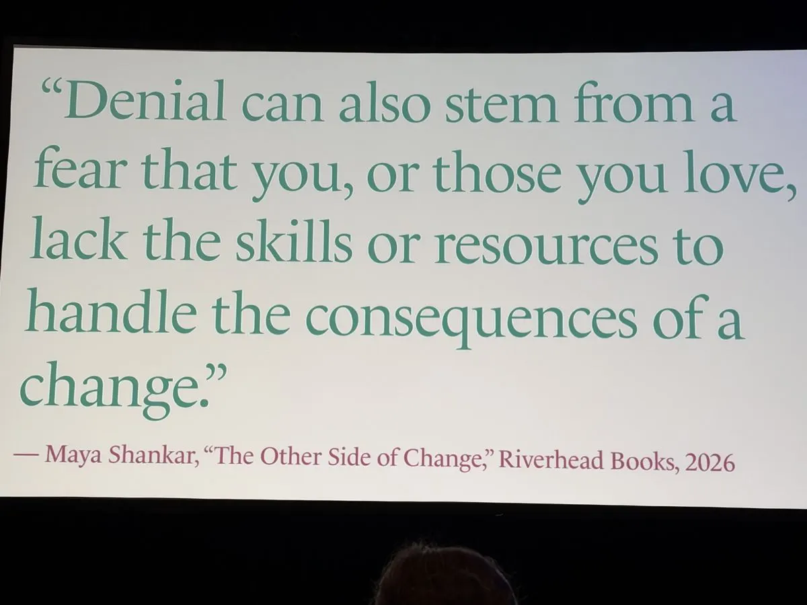
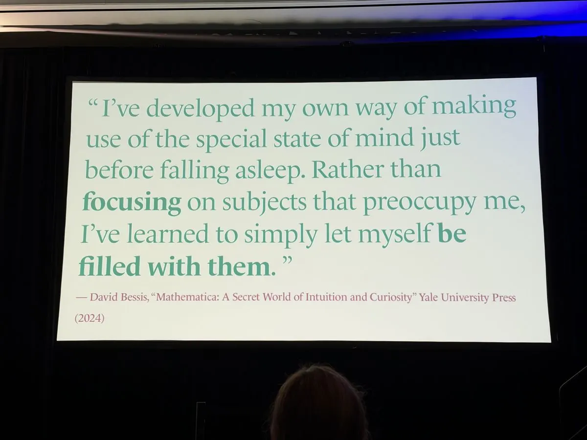
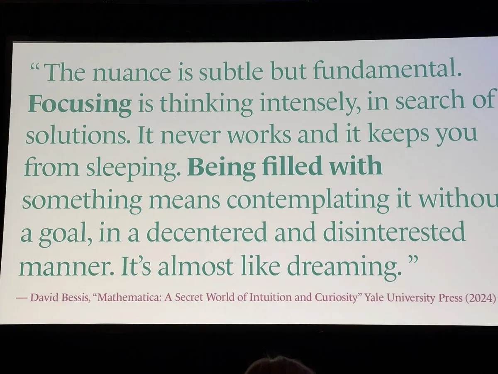
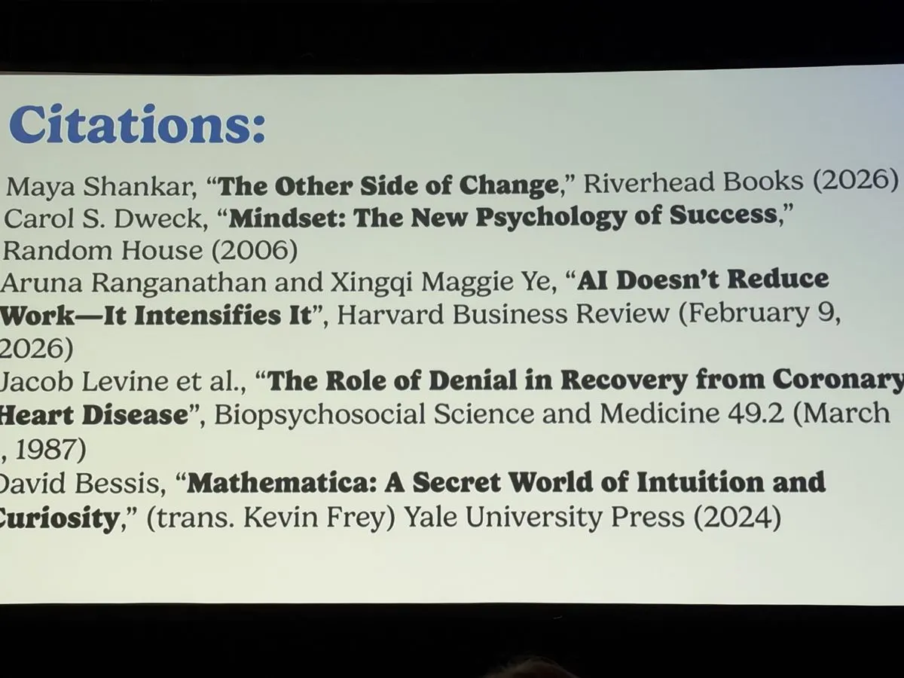

# Learning Out Loud (Under Near-Existential Pressure)

**Speaker:** Laura Savino (Software Engineer, Adobe Photoshop)  
QCon SF 2026 · Keynote · Tue Nov 17, 09:00 · Grand Ballroom  
[Session page](https://qconsf.com/keynote/nov2026/learning-out-loud-under-near-existential-pressure) · [All 6 slides](../gallery/learning-out-loud-under-near-existential-pressure.md)

> Photoshop engineer and former language teacher Laura Savino argued that the engineers who adapt fastest to AI are the ones willing to learn in public. Enthusiasts, she said, spread adoption by invitation, not pressure.

## Key points

- Laura said the people who grew most when Swift replaced Objective-C were those who posted beginner questions and rough code in public.
- She cited a 1987 study: heart patients in denial did better in hospital and worse after discharge. Denial can start you down a hard road but does not last.
- Lower the stakes to learn: build a toy no one sees. Evaluation pressure teaches people to pass the test, not to learn the skill.
- She asked people to answer AI adoption surveys honestly, and said she still reads code with her own eyes before checking it in.
- She recorded her own first session with an AI tool on a real Photoshop feature and posted it to a 600-person team channel.
- To enthusiasts: invite people onto the dance floor, don't drag them or call everywhere else lava, and don't gloat when a skeptic comes around.
- Agents take the easy decisions and leave people the hard ones. She cited HBR research that AI intensifies work, and said adoption needs real support such as office hours.
- From David Bessis: intuition grows by being filled with a problem without a goal, not by focusing hard. She asked for scheduled rest.
- Senior people should ask the basic question out loud. When everyone is a beginner, she said, that is what leadership looks like.

From the session audio and six photos. The deck was mostly quotations and a citations slide, so the recording carries most of this. The phone transcript garbles names and some phrases; where a word is reconstructed, the text says so. A TV clip she played is described, not reproduced.

## The talk in brief

Tuesday’s opening keynote was not about tools. Laura Savino, a Photoshop engineer and former language teacher, talked about what it takes for experienced engineers to keep learning while AI changes the job under them. Her answer: stop trying to look like an expert while you learn. The people who grew fastest through Apple’s move from Objective-C to Swift, she said, were the ones who asked basic questions in public and posted rough code. The ones who protected their expert image fell behind.

She built the case from short stories (a karaoke remote, a language-school placement test, wedding dance floors) and a handful of sources: a 1987 study on denial in heart patients, Carol Dweck’s work on fixed and growth mindsets, David Bessis on how intuition develops, and a 2026 HBR study finding that AI intensifies work. She also had pointed advice for AI enthusiasts: dragging people onto the dance floor doesn’t work, adoption needs real support, and nobody should gloat when a skeptic comes around.

> “Denial can also stem from a fear that you, or those you love, lack the skills or resources to handle the consequences of a change.” (Maya Shankar, quoted on slide 2)

## In depth

The talk ran as a chain of short stories, which she called “parables of AI”. The parts below follow her order.

### The frog, reframed

She opened with the boiling-frog fable, then admitted it is debunked: real frogs move when the water gets too hot. She still likes it, reframed. The point is not that you ignore growing danger and get cooked. It is that you change too. Hard conditions that arrive gradually give you time to build the skills and support to handle them, and you only have to solve month eight after you have solved month seven.

> gradual change is survivable because you adapt with it, which is the opposite of how the fable is usually told.

### Zealots, and the friend who isn’t one

Her friend TJ loved Haskell in the years when functional programming had true believers who treated everyone else as doomed. TJ just called it a really interesting tool, which made them the first FP fan she wanted to be more like. Today’s AI zealots, she said, are mostly not jerks. They are excited and can’t imagine a reasonable person with all the facts not joining them, so they either decide you are unreasonable or give you more facts. She played a clip of an endlessly optimistic TV runner whose goal is to run to the moon: he means well, and nobody watching wants to put on running shoes.

### When Swift replaced Objective-C

Savino came up writing iOS apps. For years Apple developers knew all the tricks, took pride in craft, and big companies paid well for that knowledge. Then Apple moved its new APIs to Swift, and people who had shipped software for decades had to relearn beginner tasks. New names appeared overnight writing the best tutorials. Her observation: the people who grew most were the ones who learned in public, posting early questions and rough code and accepting the internet’s eagerness to correct them.

> in a platform shift, the expert identity is the thing that slows you down.

### Denial, the useful kind and the harmful kind (slide 2)

She described “second-order denial” about AI: accepting that the technology is here while denying what it implies for you. She quoted Maya Shankar on denial as a fear of lacking the skills to handle a change. Then the research: a 1987 longitudinal study of heart patients found that high deniers spent fewer days in intensive care and had fewer cardiac symptoms in hospital, but did worse after discharge. Denial can get you started on a hard road. It is not a plan.

*Slide 2: Denial as fear of not coping.*

### Lower the stakes

She improved her Spanish by reading the Twilight novels in translation: “brain candy” in the domain you are learning keeps you going. The same goes for building a tool or toy no one else will see. Evaluation changes behavior: people learn to pass the test rather than learn the skill. At a summer language school in Japan, a placement test put her in the beginners’ class, and because her identity was “good at languages” she avoided mistakes by barely speaking. A classmate who chattered constantly, full of errors, learned faster because she got feedback early.

Years later, learning to code, she froze at a karaoke night because an engineering manager was in the room and she couldn’t work the remote; she had turned a party into a job interview. Her AI version: the company survey on AI adoption. She asked people to answer it honestly, and admitted she still reads code with her own eyes before she checks it in.

> notice when the only thing at risk is your ego, and say out loud that the interface doesn’t make sense.

### Skill is trainable, so not knowing is ordinary

Shankar’s book argues that the person who finishes a change is different from the person who starts it. Savino came to software late. She compared herself to a racehorse born in December: every Northern Hemisphere thoroughbred turns a year older on January 1, so a December foal races against horses almost a year older. On every team she has sat mid-pack for raw coding speed, so she never built an ego around it, but she did learn how to learn.

She cited a Dweck study in which researchers led participants to believe a skill was either innate or trainable. Those in the innate group avoided an effective learning task because others would see them fail; the trainable group took it. Her concrete practice: the first time a colleague walked her through an AI tool on a real Photoshop feature, she recorded the session, rookie questions and all, and posted it to the 600-person Photoshop channel. Diagrams don’t teach, she said; seeing a real tool on a real problem does.

> show your steps, including the ones where you don’t know what you’re doing.

### The dance floor

At weddings she dances like there is no downside to looking goofy, so others decide it looks fun and join. Being mediocre in public draws out other intermediate people and even shy experts, because the bar to join is clearly low. She noted the limit: this is easy for things outside your core identity and hard for the thing you are known for. Her goal is to make the meta-skill of learning part of her identity, so the soreness of being bad at something feels like the day after a good workout.

Then she spoke to the AI enthusiasts in the room. Dragging someone onto the dance floor and dancing away makes them flee as soon as your back is turned. Shouting that everything off the floor is lava doesn’t work either. She used pandemic risk-taking as a mirror: everyone knew someone more relaxed and someone more cautious, and found both irritating. Risk profiles shift and people shift with them. When a reluctant colleague finally comes around, don’t gloat.

> adoption spreads by invitation; pressure and “I told you so” push people back to the wall.

### AI intensifies work, and support costs money

She asked an AI agent to plan a basement clean-out. It wisely said to start with low-decision, high-impact tasks, and the day went well. The next day at work, she joked, the agents had saved all the high-decision tasks for her. That matches the HBR study on her citations slide: AI tools made people take on more and work longer rather than less. Her line, reconstructed from the recording, was that a new tool is free “as in puppy”: someone has to feed and look after it. If you insist on adoption, provide material support. Photoshop’s strongest AI advocates run weekly office hours where they keep re-explaining things like which environment variables to export.

She also pushed back on the reassurance that developers “were always problem solvers, not programmers”, and on handing people diagrams instead of teaching. Telling people to “stay curious”, she said, mostly makes the speaker feel better.

### Focus versus being filled with a problem (slides 3–5)

For real advice on curiosity she turned to mathematician David Bessis. Beyond the fast and slow modes of Thinking, Fast and Slow, Bessis describes a third: noticing when your intuition doesn’t match the right answer and turning the idea over until intuition catches up. His method contrasts two French verbs. *Se focaliser*, to focus, is thinking hard for a solution, which he says never works and keeps you awake. *Être rempli de*, to be filled with, is contemplating a problem without a goal, almost like dreaming.

*Slide 3: Bessis on being filled with a problem.*

*Slide 5: The difference, in his words.*

She asked for scheduled, required rest: an hour at a conference to do a puzzle or stare at a wall after a dense session. And Bessis says nobody reads math books cover to cover, because understanding one fully is nearly as hard as writing it. Applied to work: when someone hands you a workflow diagram and you don’t get it, you haven’t rebuilt their whole mental model from its undocumented foundations yet. Ask “what are they thinking?” instead of “what were they thinking?”

### Seniors, ask the question

She closed on the moment in an advanced meeting when someone senior asks what a term means and everyone else is relieved. Senior people need to be the ones raising their hands: “I’ve never seen X take precedence over Y. What made it the right choice here?” You learn something, and several others feel safe sharing their own confusion. When everyone is a beginner, that is leadership. Her last line: she is someone who learns out loud.

> the most useful thing a senior engineer can do in an AI rollout is ask the basic question in public.

## Sources I checked

The talk had few numbers. These are the studies and claims it rested on, checked on Nov 17, 2026.

| Claim in the talk                                                        | What the source says                                                                                                                                                           | Source                                                                                                                                            | Status    |
|--------------------------------------------------------------------------|--------------------------------------------------------------------------------------------------------------------------------------------------------------------------------|---------------------------------------------------------------------------------------------------------------------------------------------------|-----------|
| Heart patients in deep denial did better short term and worse long term  | High deniers had fewer days in intensive care and fewer signs of cardiac dysfunction in hospital; denial was maladaptive after discharge                                       | [Levine et al., 1987](https://experts.arizona.edu/en/publications/the-role-of-denial-in-recovery-from-coronary-heart-disease/)                    | Checked   |
| Citation slide gives the journal as Biopsychosocial Science and Medicine | The paper ran in *Psychosomatic Medicine* 49(2); the journal took its new name in 2025                                                                                         | [SBSM](https://thesbsm.org/?p=478)                                                                                                                | Caveat    |
| AI doesn’t reduce work, it intensifies it                                | An eight-month study of about 200 employees at a US tech company: people took on more tasks and longer hours, often unasked                                                    | [HBR, Feb 9, 2026](https://hbr.org/2026/02/ai-doesnt-reduce-work-it-intensifies-it)                                                               | Checked   |
| People told a skill was innate avoided a public-failure learning task    | Closest match: incremental theorists were more likely to take remedial action after poor performance. I could not confirm the public-versus-private task design she described | [Hong, Chiu, Dweck et al., 1999](https://rims.cityu-dg.edu.cn/en/publications/implicit-theories-attributions-and-coping-a-meaning-system-approa/) | Caveat    |
| The boiling-frog story is debunked                                       | Frogs heated gradually try to escape; moving to regulate temperature is how ectotherms survive                                                                                 | [Wikipedia](https://en.wikipedia.org/wiki/Boiling_frog)                                                                                           | Checked   |
| Racehorses share an official birthday                                    | January 1 in the Northern Hemisphere, August 1 in most of the Southern                                                                                                         | [Kentucky Derby](https://www.kentuckyderby.com/horses/news/thoroughbred-birthdays-along-the-road-to-the-kentucky-derby/)                          | Checked   |
| She posted her learning session to a 600-person Photoshop channel        | Her own account                                                                                                                                                                | Recording                                                                                                                                         | Talk only |

## About the speaker

Laura Savino is a software engineer on Adobe Photoshop, where she has worked for about seven years, after roughly a decade on iOS apps. Before software she taught French and English, in Seattle, France and South Korea. She has keynoted CppCon and Qt World Summit, and gave this talk as a keynote at QCon London in March 2026. [QCon speaker page](https://qconsf.com/speakers/laurasavino).

## Terms and references

[Boiling frog](https://en.wikipedia.org/wiki/Boiling_frog)  
The fable that a frog in slowly heated water won’t notice until it is cooked. Biologists say it is false. She used it, reframed, as a story about adapting to gradual change.

[Haskell](https://www.haskell.org/)  
A purely functional programming language. Her example of a technology whose fans once treated it as the only right way.

[Swift](https://www.swift.org/about)  
Apple’s programming language, introduced in 2014 to replace Objective-C. The platform shift she lived through as an iOS developer.

Second-order denial  
Her term for accepting that a technology exists while denying what it implies for you.

[Fixed and growth mindset](https://en.wikipedia.org/wiki/Implicit_theories_of_intelligence)  
Carol Dweck’s research on whether people see ability as fixed (entity theory) or trainable (incremental theory), and how that changes their response to failure.

[Thoroughbred universal birthday](https://www.kentuckyderby.com/horses/news/thoroughbred-birthdays-along-the-road-to-the-kentucky-derby/)  
All Northern Hemisphere racehorses age on January 1, so a December foal competes against horses nearly a year older. Her picture of coming to tech late.

[Free as in puppy](https://www.linuxtoday.com/news/free-as-in-puppy-the-hidden-costs-of-free-software)  
An open-source saying: free to adopt, but it needs ongoing care. Reconstructed from the recording, which garbled the word.

[Thinking, Fast and Slow](https://en.wikipedia.org/wiki/Thinking,_Fast_and_Slow)  
Daniel Kahneman’s 2011 book on fast, intuitive System 1 and slow, deliberate System 2 thinking. Bessis adds a third mode.

[David Bessis, Mathematica](https://www.harvard.com/book/9780300270884)  
A mathematician’s book on how intuition develops, translated by Kevin Frey (Yale University Press, 2024). Source of the focus versus “filled with” distinction.

[Maya Shankar, The Other Side of Change](https://www.penguinrandomhouse.com/books/729180/the-other-side-of-change-by-maya-shankar/audio/)  
A cognitive scientist’s 2026 book on how people get through unwanted change (Riverhead).

[AI Doesn’t Reduce Work, It Intensifies It](https://hbr.org/2026/02/ai-doesnt-reduce-work-it-intensifies-it)  
Aruna Ranganathan and Xingqi Maggie Ye, Harvard Business Review, February 2026. Recommends that companies set norms for AI use, which they call an “AI practice”.

## Reading

### From her citations slide

- Maya Shankar, [*The Other Side of Change*](https://www.penguinrandomhouse.com/books/729180/the-other-side-of-change-by-maya-shankar/audio/), Riverhead, 2026.
- Carol S. Dweck, *Mindset: The New Psychology of Success*, Random House, 2006.
- Aruna Ranganathan and Xingqi Maggie Ye, [“AI Doesn’t Reduce Work, It Intensifies It”](https://hbr.org/2026/02/ai-doesnt-reduce-work-it-intensifies-it), HBR, Feb 9, 2026.
- Jacob Levine et al., [“The Role of Denial in Recovery from Coronary Heart Disease”](https://experts.arizona.edu/en/publications/the-role-of-denial-in-recovery-from-coronary-heart-disease/), *Psychosomatic Medicine* 49(2), 1987.
- David Bessis, [*Mathematica: A Secret World of Intuition and Curiosity*](https://www.harvard.com/book/9780300270884), trans. Kevin Frey, Yale University Press, 2024.

*Slide 6: Her citations.*

### Related sessions this week

- **Nobody Knows Everything (and That’s OK): Building Alignment in Complex, Rapidly Changing Environments**, Teams and Orgs track, Tuesday (time not listed).
- **How Netflix Retrofitted Its SDLC**, Wednesday 10:35. Still ahead.

