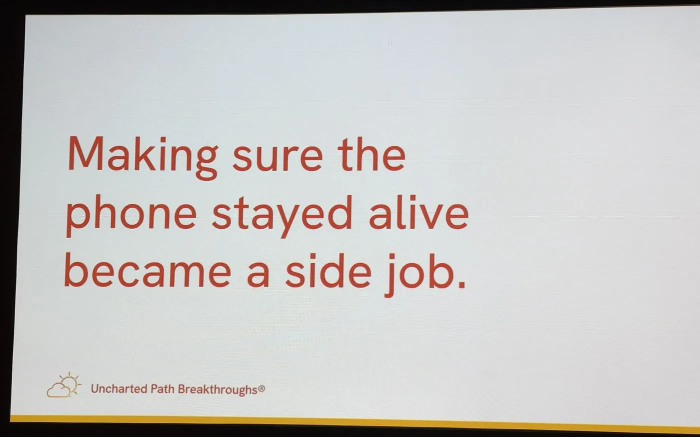
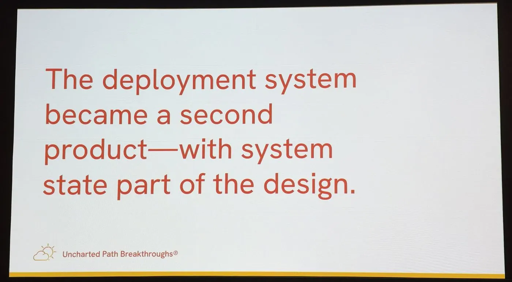
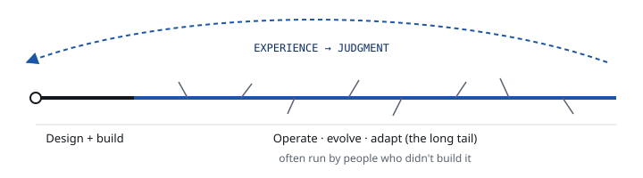
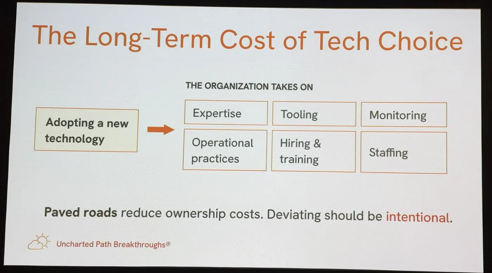
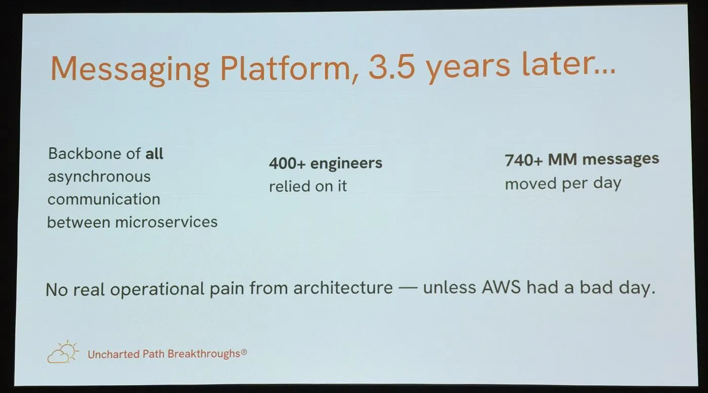
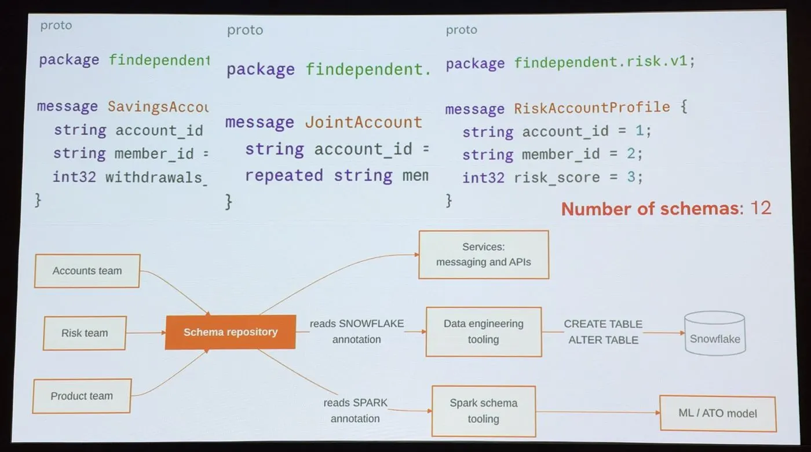
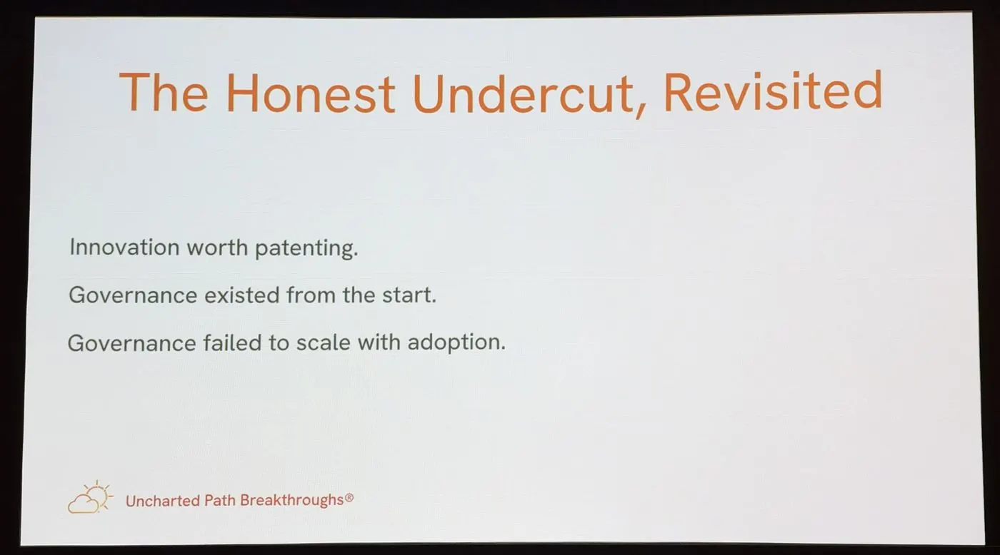
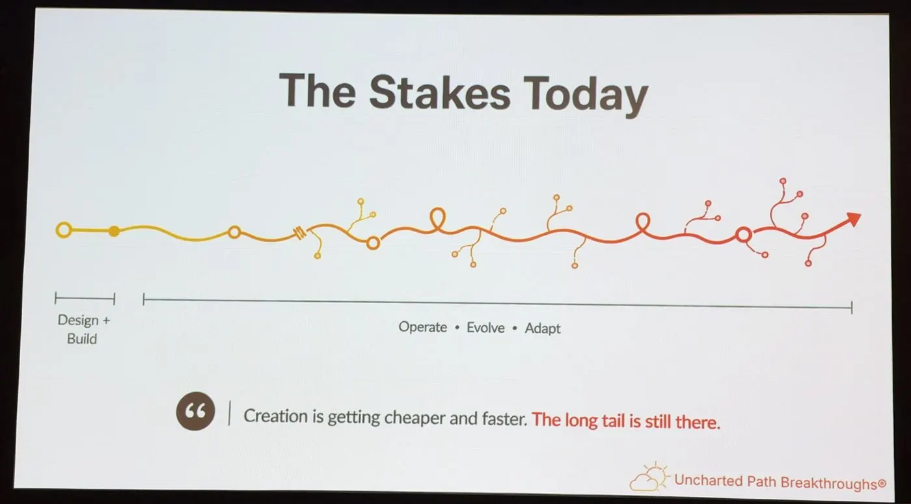
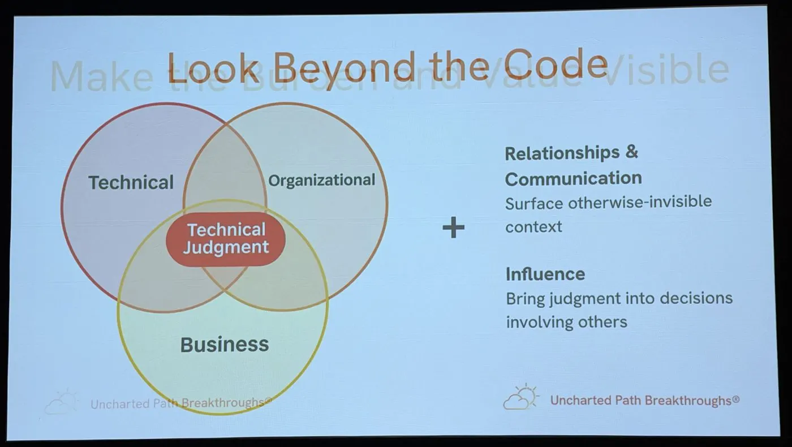
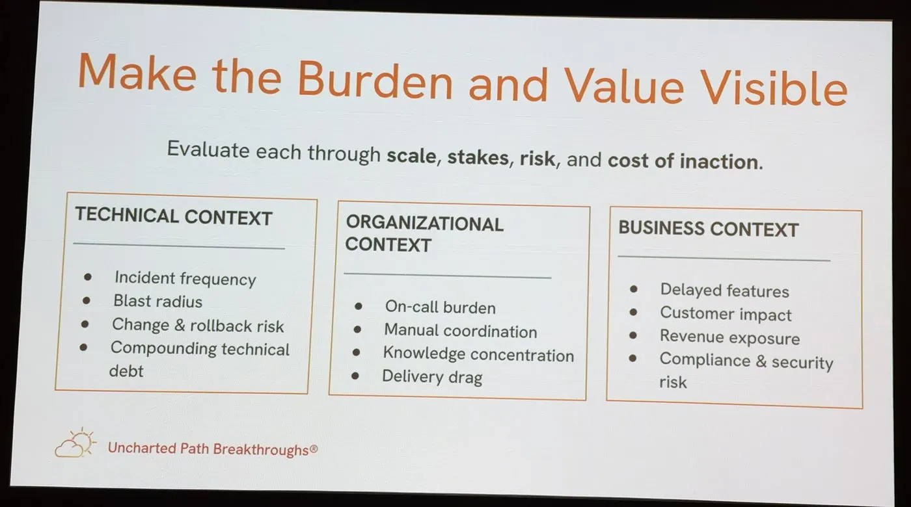

# Legacy as Leverage: How Brownfield Work Builds Technical Judgment

**Speaker:** Shine Garg (Founder; former Staff Software Engineer, Uncharted Path Breakthroughs)  
QCon SF 2026 · Code Beyond Engineers & Engineering Teams · Wed Nov 18, 11:45 · Seacliff ABC  
[Session page](https://qconsf.com/presentation/nov2026/legacy-leverage-how-brownfield-work-builds-technical-judgment) · [All 39 slides](../gallery/legacy-as-leverage-how-brownfield-work-builds-technical-judgment.md)

> Shine Garg on how years of legacy work built her technical judgment, and why judgment alone couldn't stop a schema ecosystem from outgrowing its governance.

## Key points

- A phone in a lockbox forwarded partner signup texts to the backend. Meant as a stopgap, it ran in production for more than three years, and keeping it alive became a side job.
- Automating releases across 150+ servers in 5 environments showed that redeploying an old version doesn't restore the old system after a partial failure. The deployment system became a second product.
- Training, interviews, design reviews and promotion packets reward building over maintaining. Most of a system's life is the long tail after launch, often run by people who didn't build it.
- For a shared messaging platform she chose SNS and SQS over Kafka and Kinesis because the team could operate it. By her figures, 3.5 years later it served 400+ engineers and 740M+ messages a day.
- Adopting a technology commits the organization to expertise, tooling, monitoring, operations, hiring, training and staffing. Her slide: paved roads reduce ownership costs, and deviating should be intentional.
- A sound rule that every message needs a schema grew to 2,000+ protobuf schemas in two years, with overlapping definitions of the same entity. A manual review board was disbanded within months.
- She said experience made her faster at spotting decisions calcifying, not able to stop it. Changing the outcome needed ownership, incentives and organizational support.
- AI makes creation cheaper while the long tail remains, so judgment becomes a stronger marker of seniority. Acting on it takes organizational and business context.
- Her advice: leaders should use legacy work as training, not a dumping ground. Hiring should ask what happened 6 months later. Engineers should make the burden and their contribution visible.
- She sizes legacy burden by scale, stakes, risk and cost of inaction across technical, organizational and business context. She retold her deployment project for three audiences.

From the session audio and 54 photos of the deck (39 distinct slides). The deck had no slide numbers, so they follow photo order. Several figures were only spoken, not shown; section 04 marks which.

## The talk in brief

From the session audio and 54 photos of the deck (39 distinct slides). The deck had no slide numbers, so they follow photo order. Several figures were only spoken, not shown; section 04 marks which.

Shine Garg spent about five years early in her career on [legacy systems](https://en.wikipedia.org/wiki/Legacy_system) while peers got the [greenfield](https://en.wikipedia.org/wiki/Greenfield_project) projects. It felt like falling behind. Her argument is that it was the opposite: [brownfield](https://en.wikipedia.org/wiki/Brownfield_(software_development)) work gave her a front-row seat to decisions and their consequences long before she was senior enough to make big ones herself. She walks through three legacy systems (a phone in a lockbox that ran a production feature, a deployment automation project, and a daily email service) and then shows how that experience shaped a staff-level technology choice that held up for years.

The talk is honest about the limits. The same messaging platform grew a [Protocol Buffers](https://protobuf.dev/) schema ecosystem that outgrew its governance, and her experience didn't stop it. She closes on why this matters more now: AI makes creation cheaper and faster, but the long tail of operating what we build hasn't gone anywhere. Judgment comes from living through that tail, and acting on judgment takes organizational context and influence, not just technical skill.

> "You only understand the long tail by living through it." (Slide 12, The Long Tail)

## In depth

### Origin story and three legacy systemsslides 1–10

Garg opens with the magic phone. A retail partner's systems could report signups by date but not by time, and she said adding the timestamp would have cost the partner more than \$1M. So the partner texted each signup to a phone in the office, an app on the phone forwarded the message to the backend, and the backend sent the customer a temporary password. It sat in a "group lockout" box bolted to the wall, on its own power and network, with an app that alarmed if anyone unplugged it. Moving offices meant a project to move the phone.

The second system was deployment automation with [Ansible](https://docs.ansible.com/) across 5 environments and 150+ [bare-metal servers](https://en.wikipedia.org/wiki/Bare-metal_server). The first fully automated release took about three months. The lesson came from rollback: if a [Java](https://en.wikipedia.org/wiki/Java_version_history) 6 to 8 upgrade fails halfway, redeploying the previous release doesn't restore the previous system, because the machines have already changed. Containers have since solved that specific pain, but the same reasoning about partial failure, state, sequencing and rollback still applies to database and queue migrations.

The third was a daily email service that sends personalized recommendations. As she told it, it launched for 2M members with one query per campaign and finished in about two hours; five years later it served 65M members across 100+ campaigns and barely finished in 24 hours. She worked on it for its last two and a half years, when the team kept it alive with more servers and fewer campaigns while building the replacement.

Slide s05. The magic phone's real cost was the attention it took.

Slide s07. Deployment as a product in its own right.

| System        | Built to         | What it became                     | Lesson                                                            |
|---------------|------------------|------------------------------------|-------------------------------------------------------------------|
| Magic phone   | Enable a feature | Keeping it alive became a side job | Temporary workarounds create long-term operational burden         |
| Auto-deploy   | Ship the product | A second product                   | Reason about partial failure, recovery and unplanned states       |
| Email service | Send emails      | Too costly to maintain             | Organic growth makes critical systems expensive to run and change |

> None of these consequences show up in a design document or in tests. You see them by living with the system.

### The long tailslides 11–12

Formal training, interviews, design reviews and promotion packets all reward building over maintaining. Most of a system's life comes after launch: running in production, maintaining, enhancing and adapting it, often by people who didn't build it. The value of living through that tail is that it closes the loop from maintenance back to design, and at tech-lead and staff+ levels, closing that loop becomes your job.

Redrawn from slides 11–12.

> If you never stay through the long tail, you carry the same operational mistakes into the next system you design.

### Choosing the messaging platformslides 13–15

As a staff engineer at a fintech, Garg owned the choice of technology for a shared messaging platform. She weighed three options and picked the least exciting one, validating the design and projected volume with AWS.

| Option                                                                  | Her assessment (slide 13)                                                              |
|-------------------------------------------------------------------------|----------------------------------------------------------------------------------------|
| [Apache Kafka](https://kafka.apache.org/)                               | Powerful, but operationally heavy, and poor support for their primary tech stack       |
| [Amazon Kinesis](https://aws.amazon.com/kinesis/data-streams/)          | Better stack support, but nobody on the team had real hands-on experience operating it |
| [SNS](https://aws.amazon.com/sns/) + [SQS](https://aws.amazon.com/sqs/) | Low operational burden; validated directly with AWS experts                            |

Her framing on slide 14: adopting a new technology means the organization takes on expertise, tooling, monitoring, operational practices, hiring and training, and staffing. "Paved roads reduce ownership costs. Deviating should be intentional." The choice held up: 3.5 years later the platform carried all async communication between microservices for 400+ engineers, at 740M+ messages a day. Over time they added [dead-letter queues](https://docs.aws.amazon.com/AWSSimpleQueueService/latest/SQSDeveloperGuide/sqs-dead-letter-queues.html), [idempotency](https://en.wikipedia.org/wiki/Idempotence), backlog and latency visibility, and deduplication, and asked AWS to raise some service limits. Most of the remaining pain came on days AWS itself had problems.

Slide s14. What a technology choice commits the organization to.

Slide s15. The outcome 3.5 years later.

> Kafka and Kinesis are capable. The lesson is to choose for the organization's existing capabilities and long-term cost of ownership, not novelty.

### The honest undercut: schema sprawlslides 16–27

On the same platform, a senior engineer made an early call that every message needs a schema. That gave clear contracts, [code generation](https://protobuf.dev/overview/) across languages, breaking-change detection and shared ownership of the contracts. Adoption took off. Garg walks through how one entity at a fictional company, "Findependent", multiplies into many schemas, and how her own work made the schemas more central: she used protobuf reflection to drive downstream workflows from [custom field options](https://protobuf.dev/programming-guides/proto3/).

| Step             | What was added                                                                                                                   | Schemas |
|------------------|----------------------------------------------------------------------------------------------------------------------------------|---------|
| Entity           | `Account` message                                                                                                                | 1       |
| Async event      | `AccountCreated` wrapping Account, published via SNS to SQS queues                                                               | 2       |
| Sync API         | CreateAccount RPC request and response                                                                                           | 4       |
| More RPCs        | Update and deactivate request/response pairs                                                                                     | 8       |
| Analytics        | `destination = "SNOWFLAKE"` option; tooling generates `CREATE TABLE` / `ALTER TABLE` for [Snowflake](https://www.snowflake.com/) | 8       |
| Batch processing | `schema_format = "SPARK"` option; reflection generates [Apache Spark](https://spark.apache.org/) schemas                         | 8       |
| Risk and ML      | `AccountRiskFeatures` for [account takeover](https://www.okta.com/identity-101/account-takeover-fraud/) detection                | 9       |
| New products     | `SavingsAccount`, `JointAccount`, `RiskAccountProfile`                                                                           | 10–12   |

Each addition made sense to the team that made it. Together they produced overlapping definitions of the same business entity. With code generation in five or six languages, builds slowed, tooling got harder to maintain and the [schema monorepo](https://en.wikipedia.org/wiki/Monorepo) got hard to navigate. A manual review process existed from the start, but reviews slowed teams, approvals felt tedious and reviewers got little credit, so the board was disbanded within months. By the time oversight came back, inconsistent standards were entrenched.

Slide s25. Three teams, three overlapping account definitions.

Slide s26. Governance existed; it didn't scale with adoption.

Her candid conclusion: recognizing that decisions calcify didn't make her immune to it. It made her faster at spotting the pattern, not always fast enough to stop it before other teams built on top. Changing the outcome needed ownership, incentives and organizational support, which the review board and the product teams didn't have.

> "Experience alone doesn't give you a clean escape hatch from architectural debt." (slide 27). It shows you the debt you're creating, not a way out.

### The stakes today and engineering seniorityslides 28–31

AI helps teams design and implement faster than ever, tiger teams form and disband, and dev and ops are merging into end-to-end ownership. The lessons about maintainability, operability, failure and recovery still have to be learned somewhere. Slide 28 puts it as creation getting cheaper and faster while the long tail is still there. Garg's conclusion: experience that builds judgment is getting harder to come by, which makes judgment a stronger marker of seniority.

She frames seniority as the "playing field" you can navigate: larger systems, more dependencies, competing priorities, ambiguous requirements, organizational dynamics and more consequential decisions. From her coaching practice, the common failure is "I've explained the architectural risks repeatedly, but nobody listens." Usually the PM is protecting a customer deadline, leadership accepted the debt for a higher priority, or several teams aligned before the concern came up.

Slide s28. Cheaper creation, same long tail.

Slide s31. Understand the constraints, then act on them.

> Sound technical judgment requires broader context. Relationships surface invisible context; influence brings judgment into decisions involving other people.

### What we can do, and making it visibleslides 32–37

| Audience  | Her advice (slide 32)                                                                                                                                                   |
|-----------|-------------------------------------------------------------------------------------------------------------------------------------------------------------------------|
| Leaders   | Use legacy work as training, not a dumping ground. Give people context, ownership and visibility. Create incentives and support so people can act on their judgment.    |
| Hiring    | Don't dismiss legacy-heavy work as less strategic. Probe for judgment: what happened 6 months later, which assumptions broke in production, what they'd do differently. |
| Engineers | Experience the long tail at least once. Remove or automate work that consumes outsized team time. Make the work and the burden visible so the organization can act.     |

To make the burden visible, evaluate it through scale, stakes, risk and cost of inaction in three contexts: technical (incident frequency, [blast radius](https://docs.aws.amazon.com/wellarchitected/latest/reliability-pillar/rel_fault_isolation_use_bulkhead.html), change and rollback risk, compounding debt), organizational (on-call burden, manual coordination, knowledge concentration, delivery drag) and business (delayed features, customer impact, revenue exposure, compliance and security risk). Then translate. Her worked example retells the Ansible project three ways:

| For                            | Burden                                                                       | Value                                                                  |
|--------------------------------|------------------------------------------------------------------------------|------------------------------------------------------------------------|
| Staff / principal engineer     | Inconsistent configurations made failures and rollbacks hard to reason about | Repeatable deployments made releases safer and more reliable           |
| Engineering manager / director | Firefighting and manual coordination consumed engineering capacity           | Less toil freed engineers for product work and improved predictability |
| Business leader                | Unreliable releases delayed features and frustrated customers                | Faster, more reliable releases improved time to market and confidence  |

Slide s33. Judgment sits where technical, organizational and business context meet. (Photo caught a slide transition.)

Slide s34. The sizing checklist.

### Take the judgment with youslides 38–39

The close returns to the magic phone: experience the consequences over time, and carry the judgment forward. Her four steps, also the structure of her free field guide:

1.  Experience the long tail
2.  Prioritize high-leverage work
3.  Make the burden and value visible
4.  Carry the judgment into better design

The [Technical Judgment Field Guide](https://unchartedpathbreakthroughs.notion.site/Technical-Judgment-Field-Guide-416bfec45da080b0998bdf019ae1df44) holds worksheets and reflection prompts for applying these to your own systems. Her pre-talk interview suggests a quick start: pick one system you maintain or inherited and answer which assumptions proved wrong in production, which operational burdens built up and who carries them, and what you'd design differently today.

## Numbers I checked

Status: Checked found in an independent source. Caveat holds with a condition. Slide only taken from a slide, not verified. Transcript only spoken, not on any captured slide; transcripts garble numbers, so treat as approximate.

| Claim                                        | Figure               | Source                                                                                                                                              | Status                                           |
|----------------------------------------------|----------------------|-----------------------------------------------------------------------------------------------------------------------------------------------------|--------------------------------------------------|
| Messages per day on the SNS + SQS platform   | 740M+                | Slide 15; repeated in the [session abstract](https://qconsf.com/presentation/nov2026/legacy-leverage-how-brownfield-work-builds-technical-judgment) | Caveat; Self-reported; employer not named        |
| Engineers relying on the platform            | 400+                 | Slide 15; [speaker bio](https://qconsf.com/speakers/shinegarg)                                                                                      | Caveat; Self-reported                            |
| Time from platform launch to that state      | 3.5 years            | Slide 15                                                                                                                                            | Slide only                                       |
| Schemas within two years                     | 2,000+               | Slide 16                                                                                                                                            | Slide only                                       |
| Domains covered by schemas                   | 100+                 | Transcript                                                                                                                                          | Transcript only                                  |
| Deployment automation scope                  | 150+ servers, 5 envs | Slide 6                                                                                                                                             | Slide only                                       |
| Magic phone in production                    | 3+ years             | Transcript; "over three years" in the session interview                                                                                             | Caveat; Speaker's own account in both            |
| Partner's quoted cost to add a timestamp     | \$1M+                | Transcript                                                                                                                                          | Transcript only                                  |
| Email service growth                         | 2M → 65M members     | Transcript                                                                                                                                          | Transcript only                                  |
| Email daily run time                         | ~2h → ~24h           | Transcript                                                                                                                                          | Transcript only                                  |
| Years on legacy systems                      | ~5                   | Slide 2; abstract says "about five years"                                                                                                           | Checked                                          |
| Patents from the platform work               | 3                    | [Speaker bio](https://qconsf.com/speakers/shinegarg); she said in the talk she was lead inventor                                                    | Bio only; Patent numbers not given; not verified |
| SNS fanout to SQS is a supported AWS pattern | n/a                  | [AWS SNS docs](https://docs.aws.amazon.com/sns/latest/dg/sns-sqs-as-subscriber.html)                                                                | Checked                                          |

## About the speaker

[Shine Garg](https://www.linkedin.com/in/shinegarg) is the founder of [Uncharted Path Breakthroughs](https://www.unchartedpathbreakthroughs.com/), where she coaches senior, staff and principal engineers on ambiguity, scope, technical judgment and influence. Before that she spent 15+ years as a hands-on engineer across backend, data, ML and platform systems. In the talk she described starting at Microsoft and finishing as a staff engineer at a fintech with 400+ engineers, where she led platform and architecture work that her bio says produced three patents. Earlier, as a senior engineer at Credit Karma, she was [one of the first members of the notifications platform team](https://engineering.creditkarma.com/author/shine-garg).

She gave an earlier version of this talk at [LeadDev New York in September 2026](https://leaddev.com/culture/legacy-as-leverage-how-brownfield-work-builds-technical-judgment), and runs [courses on Maven](https://maven.com/uncharted-path-breakthroughs) for senior engineers.

## Terms and technologies

#### Legacy and delivery

[Brownfield](https://en.wikipedia.org/wiki/Brownfield_(software_development)) / [greenfield](https://en.wikipedia.org/wiki/Greenfield_project)  
Brownfield work builds on or alongside existing systems; greenfield starts from a blank slate. The talk's whole argument is that brownfield teaches what greenfield can't.

[Legacy system](https://en.wikipedia.org/wiki/Legacy_system)  
Her working definition: a system old enough to have history, original authors gone, fragile integrations, undocumented workarounds, baked-in assumptions and an outdated stack.

Long tail  
Garg's term for the operate, evolve and adapt phase after launch, which is most of a system's life. Not a technology; the core idea of the talk.

[Ansible](https://docs.ansible.com/)  
Open-source IT automation for configuring machines and deploying software. She used it to automate releases across 150+ servers.

[Bare-metal server](https://en.wikipedia.org/wiki/Bare-metal_server)  
A physical machine dedicated to one tenant, without a virtualization or container layer. Each one drifts in its own way, which is what made rollback hard.

[Java 6 to Java 8](https://en.wikipedia.org/wiki/Java_version_history)  
Major Java platform versions; Java 8 shipped in 2014. Her example of an upgrade that leaves machines in mixed states if it fails partway.

[Blast radius](https://docs.aws.amazon.com/wellarchitected/latest/reliability-pillar/rel_fault_isolation_use_bulkhead.html)  
How much of a system a failure or change can affect. One of her technical measures for sizing legacy burden.

#### Messaging and data platforms

[Apache Kafka](https://kafka.apache.org/)  
Distributed event streaming platform. Rejected as operationally heavy and poorly supported in her team's stack.

[Amazon Kinesis Data Streams](https://aws.amazon.com/kinesis/data-streams/)  
AWS managed streaming service. Rejected because nobody on the team had operated it at scale.

[Amazon SNS](https://aws.amazon.com/sns/) and [Amazon SQS](https://aws.amazon.com/sqs/)  
AWS managed pub/sub topics and message queues. Combined in the [fanout pattern](https://docs.aws.amazon.com/sns/latest/dg/sns-sqs-as-subscriber.html), they became the backbone of her platform.

[Dead-letter queue](https://docs.aws.amazon.com/AWSSimpleQueueService/latest/SQSDeveloperGuide/sqs-dead-letter-queues.html)  
A queue that collects messages that repeatedly fail processing, so they can be inspected without blocking others. One of the enhancements added over time.

[Idempotency](https://en.wikipedia.org/wiki/Idempotence) and deduplication  
Making repeated delivery of the same message safe, and dropping duplicates. Needed because queues can deliver a message more than once.

[Snowflake](https://www.snowflake.com/)  
Cloud data warehouse. Data engineering loaded events into it from tables generated off the schemas.

[Apache Spark](https://spark.apache.org/)  
Distributed data processing engine. A second annotation generated Spark-compatible schemas for large batch jobs.

#### Schemas and contracts

[Protocol Buffers (protobuf)](https://protobuf.dev/)  
Google's language-neutral schema and serialization format, with code generation for many languages. Used for both async events and sync RPC contracts on her platform.

[Custom options](https://protobuf.dev/programming-guides/proto3/) and reflection  
Protobuf lets you attach your own annotations to fields and read them at runtime through descriptors. She used them (`destination`, `schema_format`) so one schema could drive Snowflake and Spark tooling.

Contract-driven development  
Her name for letting one shared schema definition drive workflows across teams instead of maintaining duplicate copies. The success that later created the sprawl.

Breaking-change detection  
Automated checks that a schema change won't break existing producers or consumers; protobuf's [field-numbering rules](https://protobuf.dev/programming-guides/proto3/) make this possible. Listed as a benefit of schema-first messaging.

[Monorepo](https://en.wikipedia.org/wiki/Monorepo)  
One repository holding many projects. Her schemas lived in one, which became hard to navigate as it grew.

[Account takeover](https://www.okta.com/identity-101/account-takeover-fraud/)  
Fraud where an attacker gains access to a real customer's account. Her example of why the risk team needed derived signals like failed logins in the past 24 hours.

#### Engineering practice

[Golden paths / paved roads](https://engineering.atspotify.com/2020/8/how-we-use-golden-paths-to-solve-fragmentation-in-our-software-ecosystem)  
Spotify's term (Netflix says paved road) for the opinionated, supported way to build something. Her point: paved roads cut ownership costs, and leaving them should be a deliberate choice.

Staff+ engineer  
Staff, principal and above: individual contributors whose scope is cross-team. Her "playing field" model describes what changes at that level.

Tiger team  
A temporary team formed around a hard problem that disbands after shipping. Her example of how the long tail gets skipped.

## Reading and tools

#### From the speaker

- [Technical Judgment Field Guide](https://unchartedpathbreakthroughs.notion.site/Technical-Judgment-Field-Guide-416bfec45da080b0998bdf019ae1df44) (Notion; free, no email). Worksheets for the four steps. I haven't reviewed its contents yet.
- [QCon companion page](https://www.unchartedpathbreakthroughs.com/qconsf), which also offers a "Why Your Career Feels Stuck" guide (that one adds you to her email list).
- [LeadDev NY 2026 version of the talk](https://leaddev.com/culture/legacy-as-leverage-how-brownfield-work-builds-technical-judgment) (video needs a free LeadDev account).

#### Background

- [Spotify: How we use Golden Paths to solve fragmentation](https://engineering.atspotify.com/2020/8/how-we-use-golden-paths-to-solve-fragmentation-in-our-software-ecosystem)
- [AWS: Fanout SNS notifications to SQS queues](https://docs.aws.amazon.com/sns/latest/dg/sns-sqs-as-subscriber.html)
- [Protobuf language guide (proto3)](https://protobuf.dev/programming-guides/proto3/), including options and updating message types
- Garg named Jessica Tai's QCon SF 2018 talk on Airbnb's monolith-to-services migration as a past talk that stuck with her.

#### Related sessions, same track, Wed Nov 18

- 10:35 AM · Jyothi Nookula, "Builder-Driven Development: Rebuilding the Organization Around the Builder" (earlier today)
- 1:35 PM · [Laurie Voss, "Breaking Down the Interface Between Code and Strategy"](https://qconsf.com/presentation/nov2026/breaking-down-interface-between-code-and-strategy) (in progress as of this write-up)
- 2:45 PM · Omer van Kloeten, "AI You Can't Read the Code Anymore: Verifying Software in the Age of AI" **(still ahead)**
- 3:55 PM · Sanjay Singh, "When Everyone Can Code, Who Owns Production?" **(still ahead, and the closest follow-on to this talk)**

