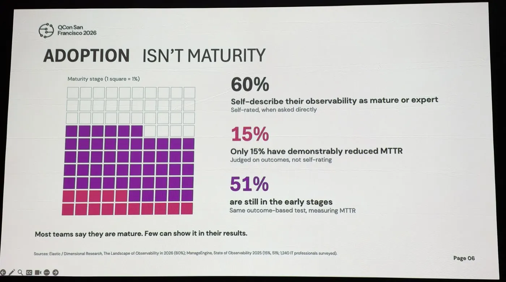
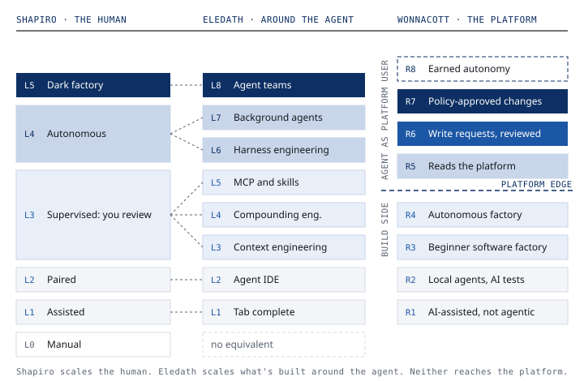
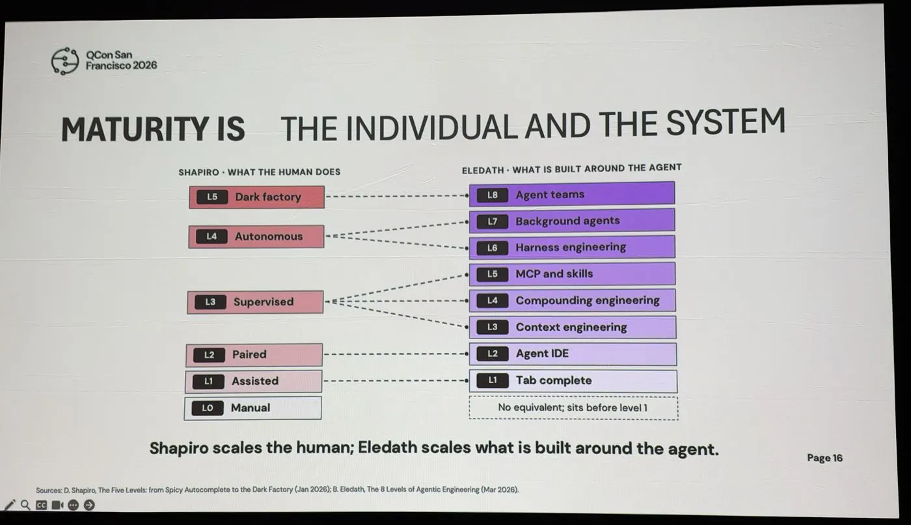
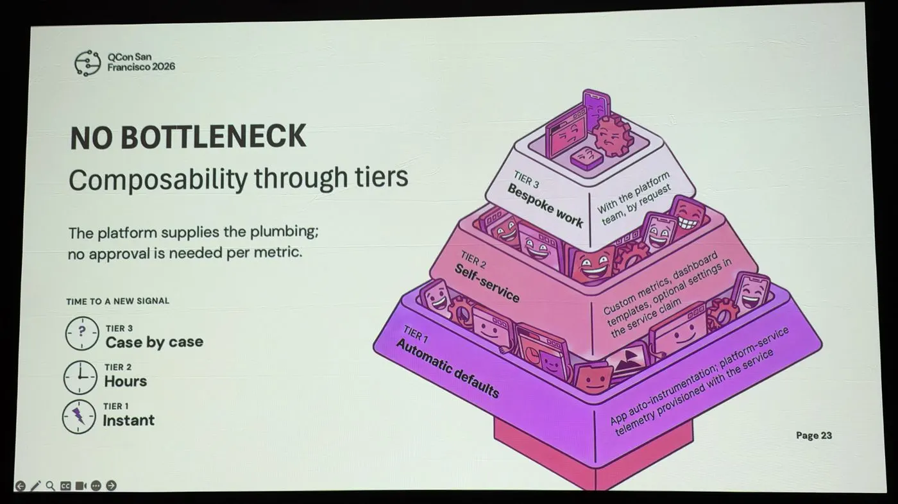
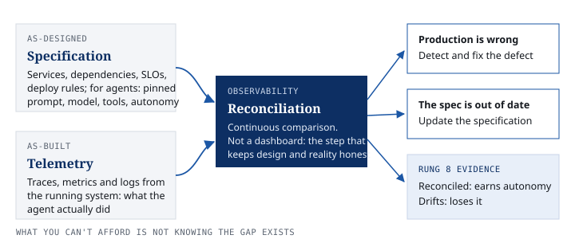
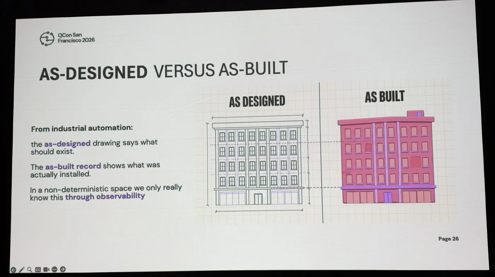
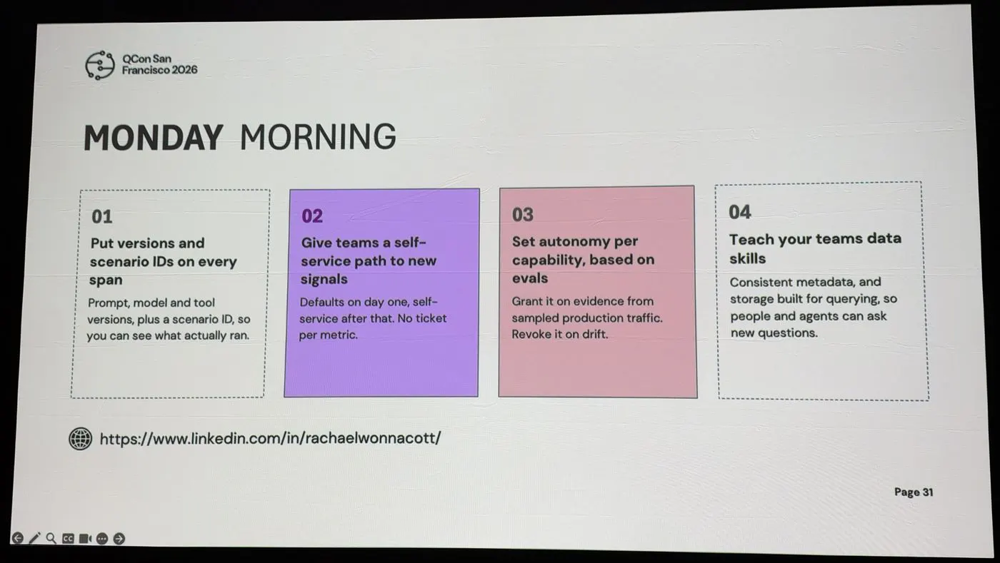

# Observability: The Missing Control Plane for Agentic Engineering

**Speaker:** Rachael Wonnacott (Global Head of Machine Learning and Applied AI Engineering, Capital Group)  
QCon SF 2026 · Real World Platform Engineering · Wed Nov 18, 13:35 · Pacific DEKJ  
[Session page](https://qconsf.com/presentation/nov2026/observability-missing-control-plane-agentic-engineering) · [All 29 slides](../gallery/observability-the-missing-control-plane-for-agentic-engineering.md)

> Rachael Wonnacott on why production observability, not more tests, should decide what an AI agent may do without a human. She adds a maturity ladder for agents that use the platform directly.

## Key points

- Most of what gets called observability is monitoring. Her rule of thumb: if answering a new question means adding a field and redeploying, you have monitoring. OpenTelemetry solves collection, not investigation.
- Self-reported maturity is far ahead of outcomes. Her slide sets 60% who call their practice mature or expert (Elastic) against 15% judged mature on outcomes such as reduced MTTR (ManageEngine).
- She called observability a data discipline handed to platform engineers and app developers who weren't trained for it. The platform should own collection, defaults, storage and guardrails; app teams own what the data means. A separate observability team is an anti-pattern; embed the specialists.
- Curate the shape of the data, not the questions: wide structured events, consistent field names and propagated IDs, with cost controlled by sampling healthy traffic. Telemetry is lossy under load, so measure the loss.
- Agents change code, tests and the deployment harness, and aren't deterministic, so tests catch only what someone predicted. Non-deterministic systems need more rigour: canaries, flags, chaos engineering and SLOs, which few teams practise.
- Shapiro's five levels measure the human and Eledath's eight levels the system around the agent; both stop at the platform edge. Her ladder adds rungs 5 to 8: the agent reads the platform, makes human-reviewed requests, gets policy-approved changes, and finally earns autonomy per capability on evidence.
- Above the edge, trace the whole scenario with user, agent, tool, model, versions, scope, cost and policy decision on every span. Treat prompt, tool and model changes as releases, and score sampled production traffic against a team-owned golden set.
- Specs, catalogs and change records are the as-designed state; only telemetry shows the as-built state. Reconciling the two turns each gap into a fix or a spec update, and is the evidence autonomy is granted or revoked on. Her goal is an ambient factory, not a dark one.

From the session audio and 33 photos of the deck (29 of 31 slides). Slides 28 and 29, two customer case studies, weren't captured; section 03 recovers them from the audio and section 04 marks what couldn't be checked.

## The talk in brief

From the session audio and 33 photos of the deck (29 of 31 slides). Slides 28 and 29, two customer case studies, weren't captured; section 03 recovers them from the audio and section 04 marks what couldn't be checked.

Rachael Wonnacott's argument is that our delivery pipelines were built on the assumption that a human reads the signals and decides what to do at every gate. Once agents change the code, the tests and even the deployment harness, that assumption fails, and the only reliable evidence about what an agent actually did is in production. So [observability](https://en.wikipedia.org/wiki/Observability), as opposed to monitoring, becomes the control plane: the evidence that decides what an agent may safely do without a person. She spends the first half honestly on why most organizations aren't there yet. Most of what gets called observability is monitoring, self-reported maturity is far ahead of measured outcomes, and doing it well is a data discipline that platform engineers and app developers were never trained for.

The second half is new material. She lines up two popular AI maturity models ([Dan Shapiro's five levels](https://simonwillison.net/2026/Jan/28/the-five-levels/) for the human, [Bassim Eledath's eight levels](https://www.bassimeledath.com/blog/levels-of-agentic-engineering) for the system around the agent), shows that both stop at the platform edge, and adds her own eight-rung ladder where agents become direct users of the platform. Above that edge, observability means tracing the whole scenario, treating prompt, tool and model changes as releases, scoring sampled production traffic against a golden set, and reconciling the "as-designed" specification with the "as-built" reality. The goal she proposes is an ambient factory, not a dark one.

> "The goal isn't a dark factory that operates without people." (Slide 30, Ambient, not dark)

## In depth

### Monitoring is not observabilityslides 1–4

She opens with a definition many people blur. Monitoring is built on prediction: you decide in advance what matters, set a threshold and alert when it's crossed, so it only catches failures someone imagined. Observability gives you the evidence to investigate questions you didn't know you'd have. She credits [Charity Majors](https://charity.wtf/) for the framing of known-unknowns versus unknown-unknowns, and recommends the new second edition of [Observability Engineering](https://www.oreilly.com/library/view/observability-engineering-2nd/9781098179915/) (Majors, Fong-Jones and Miranda, with Austin Parker; O'Reilly, June 2026).

The term comes from [control theory](https://en.wikipedia.org/wiki/Observability): Rudolf Kálmán defined it around 1960 as how well a system's internal state can be inferred from its external outputs. Facebook and Twitter popularized it in software. Then, in her telling, vendors already selling monitoring relabelled their products, and a team that buys "observability" without changing how it instruments and debugs is [cargo-culting](https://en.wikipedia.org/wiki/Cargo_cult_programming).

OpenTelemetry is her clearest example of instrumentation without capability. She's a fan: it's a vendor-neutral standard for producing and collecting telemetry, and the [CNCF](https://www.cncf.io/)'s latest annual survey has 49% of respondents running it in production. But it solves collection, not whether people actually question the data or only look at dashboards.

Slide s03. Known-unknowns versus unknown-unknowns.

Slide s04. Instrumentation alone doesn't give you the capability.

> If a new question needs a new field and a redeploy, you have monitoring. That matters more when an agent does something nobody predicted.

### Why it isn't solved: maturity, skills and ownershipslides 5–9

She contrasts self-reported maturity with measured outcomes. Elastic's sponsored survey has 60% calling their practice mature or expert. ManageEngine judged maturity by the outcomes organizations achieved and found about 15% mature and 51% still early. She argued that faster resolution is the main reason to do observability at all, so a gap that wide suggests most teams are doing monitoring.

| Source                                                                                                                                                | How maturity was judged                          | Figure                 |
|-------------------------------------------------------------------------------------------------------------------------------------------------------|--------------------------------------------------|------------------------|
| [Elastic / Dimensional Research, Landscape of Observability in 2026](https://www.elastic.co/blog/2026-observability-trends-costs-business-impact)     | Self-rated, 500+ IT decision makers              | 60% mature or expert   |
| [ManageEngine, State of Observability 2025](https://www.manageengine.com/it-operations-management/cxo-focus/insights/state-of-observability-cxo.html) | By benefits and outcomes, 1,240 IT professionals | 15% mature · 51% early |

Her first reason it's hard is uncomfortable: it's outside most people's skills. A whole vendor market exists to sell it. Doing it well means deciding what to collect with what metadata, keeping that metadata complete and consistent, choosing storage that keeps huge volumes fast to query (for example [columnar storage](https://en.wikipedia.org/wiki/Column-oriented_DBMS)), and a querying practice closer to a data analyst's job. Platform engineers usually come from infrastructure; app developers build web apps and APIs, not data-intensive systems.

The second reason is ownership. In an incident, a problem in the app belongs to the app developer and a problem in the platform to the platform engineer, and when you don't know which, you need both. Telemetry lives in the platform, so the platform team owns it, and app teams start expecting a white-glove service, the opposite of the self-service platform engineering wants. Enterprises often add a third team: an observability team that is frequently the old monitoring team renamed.

| Team               | Role                         | Where it breaks down                                                                                                                                                                                                                    |
|--------------------|------------------------------|-----------------------------------------------------------------------------------------------------------------------------------------------------------------------------------------------------------------------------------------|
| App team           | Instruments and investigates | Confusion: who provides what?                                                                                                                                                                                                           |
| Platform team      | Owns the platform and admin  | [Least privilege](https://en.wikipedia.org/wiki/Principle_of_least_privilege): observability users need near-admin access, which requires mature least-privilege and [multi-tenancy](https://en.wikipedia.org/wiki/Multitenancy) models |
| Observability team | Often monitoring, renamed    | Operational risk: changes to shared tooling can hit other services                                                                                                                                                                      |

She's careful to say specialists aren't the anti-pattern; a separate team is. Specialists belong inside the platform team, and app teams need enough literacy that self-service can exist.

Slide s06. Self-rating versus outcomes.

Slide s09. Three teams with a stake in one capability.

> The platform owns the mechanism: collection, defaults, storage, guardrails. App teams own the meaning: which events matter and what's worth alerting on. White glove doesn't scale; self-service does.

### How much to collectslide 10

| Approach                                                                           | Upside                 | Downside                                                                               |
|------------------------------------------------------------------------------------|------------------------|----------------------------------------------------------------------------------------|
| Curated                                                                            | Cheap, predictable     | Sees only what you predicted                                                           |
| Everything                                                                         | Feels safe             | Costly and disconnected: volume without context, no shared IDs, no consistent metadata |
| [Wide events](https://www.honeycomb.io/blog/structured-events-basis-observability) | Rich context per event | Sampling controls volume                                                               |

Recommended practice is wide, structured events with high [cardinality](https://en.wikipedia.org/wiki/Cardinality_(SQL_statements)) and dimensionality: many fields on one event, including unique values like user, tenant, request ID, version, feature flag and region, so you can slice by context during an incident. Her fix for the tension: curate the shape of the data, not the questions. Agree consistent field names, propagate trace and request IDs on every hop, and control cost afterwards by keeping every error and slow request in full and only a fraction of healthy ones ([tail sampling](https://pkg.go.dev/github.com/open-telemetry/opentelemetry-collector-contrib/processor/tailsamplingprocessor)). In practice, she said, the cost mostly comes from verbose unstructured logs, not wide events.

Two more points. Telemetry is lossy: agents, collectors and SDKs buffer in bounded queues, some transports are fire-and-forget, sampling discards on purpose, and drops happen mostly under load, during the incident. Measure the loss; OpenTelemetry makes that easy (the [Collector's internal metrics](https://opentelemetry.io/docs/collector/internal-telemetry/) report refused, dropped and failed-to-send data). And there's an irony: an industry that never wrote good docs for each other now demands great context for agents. If field names, units and IDs only make sense to one engineer, an agent can't find patterns in them. Curating the shape of telemetry is documentation for the next reader.

Slide s10. Curate the shape of the data, not the questions.

Slide s07. A data problem handed to non-data teams.

> Wide events plus consistent names plus sampling of healthy traffic. Measure what your pipeline drops.

### Agents change the rulesslides 11–13

CI/CD built confidence by running every change through the same unit, integration and smoke tests, on the premise that lower environments match production. Code and config are easy to replicate; user behaviour and load aren't. Tests have the same limit as monitoring: they catch only what someone predicted. Agents break the model further because they can change the code, the tests and the deployment harness, and their behaviour isn't deterministic. Many teams got away with immaturity because their systems were deterministic and senior engineers carried the tacit knowledge of where to look. With agentic workflows on the platform, and agents as platform users, that assumption gets fragile.

Her answer is [testing in production](https://www.honeycomb.io/blog/i-test-in-prod), which Majors has argued for years: keep CI and the test suites, admit lower environments don't match prod, and add [canary releases](https://martinfowler.com/bliki/CanaryRelease.html), [feature flags and dark launches](https://martinfowler.com/articles/feature-toggles.html), [blue-green deploys](https://martinfowler.com/bliki/BlueGreenDeployment.html) with fast rollback, [chaos engineering](https://en.wikipedia.org/wiki/Chaos_engineering) and game days, and [SLOs](https://sre.google/sre-book/service-level-objectives/) with [error budgets](https://sre.google/workbook/error-budget-policy/). The CNCF's [State of Cloud Native Development](https://www.cncf.io/wp-content/uploads/2025/11/cncf_report_stateofcloud_111025a.pdf) shows few teams do the advanced ones: 6% of backend developers practise chaos engineering and 7% [immutable infrastructure](https://martinfowler.com/bliki/ImmutableServer.html). The CNCF puts that down to organizational and cultural maturity, not capability, and every one of these practices depends on observability to see what actually happened.

Slide s11. Deterministic tests guarding probabilistic systems.

Slide s13. We know what to do; few do it.

> Non-deterministic systems need more rigour, not less, and every practice that provides it runs on observability.

### Maturity models and the platform edgeslides 14–17

She shows two popular maturity models. Shapiro's (January 2026, modelled on the self-driving levels) measures what the human does. The crucial line is level 3, where you stop writing code and only review; at level 5 humans step back entirely, the "dark factory", and she hasn't met anyone fully there. Eledath's (March 2026) measures what's built around the agent. Its levels 3–5 (context engineering, compounding engineering, MCP and skills) change the agent's environment, not the human's role, and the framework treats them as prerequisites for the levels above.

| Shapiro · what the human does                    | Eledath · what's built around the agent                                                                                                                    |
|--------------------------------------------------|------------------------------------------------------------------------------------------------------------------------------------------------------------|
| L0 Manual: AI is a better search engine          | No equivalent                                                                                                                                              |
| L1 Assisted: AI takes discrete tasks via prompts | L1 Tab complete: passive autocompletion                                                                                                                    |
| L2 Paired: a tight loop in an AI editor          | L2 Agent IDE: cross-file, developer-directed                                                                                                               |
| L3 Supervised: you review, not write             | L3 [Context engineering](https://www.anthropic.com/engineering/effective-context-engineering-for-ai-agents): system prompts, rule files, tool descriptions |
|                                                  | L4 [Compounding engineering](https://every.to/guides/compound-engineering): lessons carried into every session                                             |
|                                                  | L5 [MCP](https://modelcontextprotocol.io/) and skills: reusable, shared capabilities                                                                       |
| L4 Autonomous: write specs, leave for hours      | L6 [Harness engineering](https://openai.com/index/harness-engineering/): loops run unsupervised                                                            |
|                                                  | L7 Background agents: overnight work, orchestrated                                                                                                         |
| L5 Dark factory: specs in, software out          | L8 Agent teams: agents coordinate directly                                                                                                                 |

The tops don't mean the same thing: Eledath's L8 is agents coordinating with each other, Shapiro's L5 is humans being absent, and you can have the first without the second. More importantly for her, neither model touches the platform. So she built a ladder that does.

Redrawn. From slides 14–17. Dotted lines follow her Shapiro–Eledath mapping (slide 16). Her rungs line up loosely: rungs 1–2 with Shapiro's assisted and paired, rungs 3–4 with supervised and autonomous.

| Rung | What changes (from her narration)                                                                                                                                                                                                                  |
|------|----------------------------------------------------------------------------------------------------------------------------------------------------------------------------------------------------------------------------------------------------|
| 1    | AI-assisted, not agentic. Only who types has changed; every check still lives in existing CI/CD.                                                                                                                                                   |
| 2    | Local agents decide how parts fit together and write the tests. [Goodhart's law](https://en.wikipedia.org/wiki/Goodhart%27s_law) bites: a green build means less when the same agent wrote the tests.                                              |
| 3    | Beginner software factory: workflows, automated tests, coding agents, plus AI-specific governance (validation loops, human gates before users). Humans stop reviewing every change and start owning the gates.                                     |
| 4    | Autonomous factory: evals trusted enough that agents vouch their changes to production, but humans still wired the pipeline. Needing a database, the agent declares it in the contract and waits for the pipeline.                                 |
| 5    | Above the edge: the agent reads the platform (catalog, tools, skills) without changing anything. Even reading needs identity, usage limits and telemetry from day one.                                                                             |
| 6    | The agent asks the platform for things directly, often as tools over MCP, and gets back a proposed change, a risk assessment and check results. Nothing is applied; the request is marked as coming from an agent; a human reviews.                |
| 7    | Proposals are approved by [policy as code](https://www.openpolicyagent.org/docs/latest/), which promotes low-risk changes by rule, with rollback, an off switch and limits on what a change may touch. Humans review the rules and the exceptions. |
| 8    | Outlook: autonomy granted or revoked per capability, based only on evidence from evals and traces.                                                                                                                                                 |

Slide s16. Shapiro and Eledath side by side.

Slide s17. Her ladder, with the platform edge.

> Below the edge, the platform just hosts the result. Above it, the agent is a platform user, and each rung needs more evidence than the last.

### Agent first: tracing, versions and samplingslides 18–21

**Rung 5 is worth tracking from day one.** Because agents call the platform's own capabilities, you see those calls server-side without instrumenting anything: denial rates (agents reaching beyond scope), failure rates and retry loops (where throttling is needed; agents will hammer the platform), and repeated call sequences, which are candidates for a capability of their own. Which capabilities agents use is also a strong signal of agentic adoption, and you can see how many of your users are human versus agentic.

**Trace the whole scenario, not each call.** From rung 6 the reviewer must see what the agent composed and at rung 7 the policy must judge it, so the trace has to cover intent, plan, tool calls, approval, artifacts, the change that landed and any rollback. Every span carries user, agent, tool, model, versions, scope, cost, latency, error and policy decision. She pointed to the [OpenTelemetry semantic conventions for generative AI](https://opentelemetry.io/docs/specs/semconv/gen-ai/), which already cover agents; they're still in Development status, and she recommends using them anyway.

**Version changes are releases.** Her war story: an agent's behaviour is set by more than its code. The prompt (owned by the app team), the tools (owned by the platform, where a changed response shape can quietly shift an agent's plan) and the model can all change without a new build. The model is what catches people out: if a default alias moves at the gateway, or a provider updates a model behind a stable name, every agent that depends on it changes behaviour at once and nobody chose that. The version you pinned is as-designed; the version on the span is as-built. So canary a new version on a small slice of traffic, compare against current and roll back if worse. The app team defines "worse"; the platform provides the guardrails so nobody rebuilds canary logic per agent. Low-traffic agents need offline checks too. Drift is the reason to revoke autonomy.

**Sample the behaviour.** Traces say what happened, not whether it was right; that takes [evaluation](https://www.oreilly.com/library/view/evals-for-ai/9798341660717/) on real traffic. Sample a slice of production, redact it and score it continuously and per version against a golden set (examples with known-good outcomes, the "ground truth", curated by the team). The score is the evidence for granting or revoking autonomy. The platform supplies sampling with redaction, evaluator runners and results stored per version; the app team owns the meaning, the golden set and pass criteria. The catch: sampled traffic is real user content, so retention and access rules belong in the pipeline, not in each team. And telemetry is evidence, not a ledger: anything needing a guaranteed record (orders) belongs elsewhere.

**Measure the scenario.** Replace call traces (latency and errors per call) with scenario traces (what the agent did and why). Her metrics come from PlatformEngineering.org's [Agent-first IDP](https://platformengineering.org/blog/agent-first-idp-how-big-tech-and-the-clouds-are-preparing-platforms-for-agents) report (Oct 2026): share of capabilities safely available to agents, intent success rate, time to a safe change, cost per scenario, approval cycle time, policy violation rate, reduction in platform support load, and share of scenarios completed without manual escalation. Portal usage may fall, and that can be a good sign. Cost per scenario means summing tokens for every model call (including retries, and agents retry endlessly), downstream agents, tool and API calls, the compute and sandbox, and human review time. Tag every span with the scenario ID and cost is the sum. Two cost levers: every tool response goes back into the model's context, so a verbose capability response is paid for again and again; and where you already know the answer, go back to deterministic code and only defer to a model where reasoning is differentiating work.

Slide s18. Trace the whole scenario; more autonomy needs more evidence.

Slide s19. Prompt, tool and model changes ship like releases.

> Real traffic, not just CI, earns autonomy: trace the scenario, version everything that shapes behaviour, and score sampled production against a golden set.

### One scenario end to end, and no bottleneckslides 22–24

Her worked example: an on-call engineer asks an agent whether the search API in production still matches its spec. On most platforms nobody asks, because answering means finding the spec, opening dashboards and comparing config by hand. Here the platform recognizes the intent as a known drift check rather than leaving the agent to interpret it, uses one drift-check tool from the platform contract instead of ten API calls, runs read-only on behalf of the engineer, compares the spec with live telemetry, and checks the answer against golden tasks for known drift. The answer is a list of gaps, each either a defect to fix or a spec to update, all on one trace you can inspect afterwards.

Then she tackles the accusation that platforms are bottlenecks. An app team runs a support agent; every request returns HTTP 200, so auto-instrumentation says it's healthy, but what they need is how often the agent hands back to a human, which only their code knows. If adding that counter needs a ticket and a two-week queue, the platform is the bottleneck. Her answer is composability through tiers:

| Tier                   | What it is                                                                         | Time to a new signal |
|------------------------|------------------------------------------------------------------------------------|----------------------|
| 1 · Automatic defaults | App auto-instrumentation; platform-service telemetry provisioned with the service  | Instant              |
| 2 · Self-service       | Custom metrics, dashboard templates, optional settings in the service claim        | Hours                |
| 3 · Bespoke work       | With the platform team, by request; rare, and a signal of what to push into tier 2 | Case by case         |

The platform owns the plumbing: the collector accepts any metric by name with no approval, and guardrails replace gates. Labelling the counter by outcome and agent version is fine; labelling it by customer ID isn't, and the collector strips unbounded labels automatically. That isn't a contradiction of wide events: on an event, a customer ID is just another field, but on a metric every unique label value creates a new time series. High cardinality belongs on events and traces; metrics stay bounded.

Monitoring is part of the contract. When a developer or agent (rung 6) claims a [Postgres](https://www.postgresql.org/) database by type and size, the platform runs it and owns uptime, and the same claim switches on server-side metrics, tagged with namespace and team, plus one dashboard template each team fills with its own namespace. Alerts split by owner: uptime pages platform on-call, the team's own thresholds go to the team. Requests to the platform team must not grow with the number of databases, a claim isn't complete until its monitoring exists, and you alert on any database without a healthy scrape target. Client-side spans show what the app experienced; server-side metrics show what the database did.

Slide s22. A drift check as a governed, traceable chain.

Slide s23. Three tiers; no ticket per metric.

> Requests to the platform team must not grow with the number of things on the platform. Guardrails, not gates.

### As-designed versus as-builtslides 25–29

Platform engineering talks this year keep landing on three things a platform provides to developers and agents: capabilities (functions to invoke, such as provisioning infrastructure or pulling operational data), context (application metadata, architecture, configuration, change records) and controls (approvals, role-based access, non-human identity, delegated permissions). Her point is that the context is almost always the as-designed state. None of it tells you what is actually running. Production telemetry is the other half, and observability puts the two together.

The terms come from industrial automation and construction. The as-designed drawing says what should exist; the as-built record shows what was actually installed, and they never match exactly. Maintain a building from the drawing alone and sooner or later you drill into a pipe. Software always had that gap; what's new with non-deterministic systems is that you can't derive the as-built state from the design at all. The code won't tell you what the agent did. Only observing will.

Redrawn. From slides 25–27 and her narration. The specification includes, for agents, the autonomy each capability has been granted so far.

She said this loop already runs in production at large organizations and gave two case studies, which were on slides 28–29 (not captured). On the specification side, Nomura built an internal knowledge graph of application metadata and architecture and exposed it to AI, including over MCP, so the as-designed state becomes something an agent can query rather than a document someone must find. On telemetry and reconciliation, Equifax built an MCP-based platform through which agents query live platform state and compare it with records in GitHub, Jira and ServiceNow. In both cases, she said, engineers reported spending less than a quarter of their time actually coding; the rest goes on understanding requirements, architecture and dependencies, piecing together the as-designed state by hand. What neither fully closes yet is the as-built half at the level of a single scenario. I couldn't find a public source for either case study (see section 04).

![Slide: Three parts, one gap. Capabilities: functions to invoke, such as provision infrastructure, deploy applications, retrieve operational data. Context: what should exist, application metadata, architecture, configuration and change records. Controls: rules that hold, approvals, role-based access, non-human identity and delegated permissions. What's missing: every model of context describes the as-designed state. None tells the agent what is actually running. Production telemetry is the as-built half, and observability reconciles the two.](../slides/observability-the-missing-control-plane-for-agentic-engineering/deep/s25.webp)

Slide s25. Capabilities, context, controls, and the missing half.

Slide s26. The drawing and the building never quite match.

> "Observability is the reconciliation" (slide 27), and that reconciliation is the evidence rung 8 grants autonomy on.

### Ambient, not dark, and Monday morningslides 30–31

When something goes wrong, the agent meets a failure no test anticipated, investigates by querying production telemetry rather than its test suite, resolves by fixing the defect or updating the spec when production is right, and escalates to a human with what it found and couldn't confirm. People matter most at that last step: agents have little training data for rare, high-stakes incidents, which can make those harder to diagnose with an agent, and AI isn't a replacement for expertise. Autonomy is set per decision, not per agent; the agent acts alone only where reconciliation supports it, and the rules are versioned. The goal isn't to remove the human but to make people the owners of the loop rather than someone blindly "in" it. That is her ambient factory: it acts on its own when the evidence supports it and has an owner who knows what to do when it doesn't.

| Monday morning (slide 31)                   | Her detail                                                                                                                                                                             |
|---------------------------------------------|----------------------------------------------------------------------------------------------------------------------------------------------------------------------------------------|
| 1 · Versions and scenario IDs on every span | Prompt, model and tool versions plus a scenario ID, so you can see what actually ran. Your as-built record.                                                                            |
| 2 · A self-service path to new signals      | Defaults on day one (tier 1), self-service after (tier 2). No ticket per metric.                                                                                                       |
| 3 · Autonomy per capability, based on evals | Grant it on evidence from sampled production traffic; revoke it on drift. She recommended Hamel Husain's evals course and the new book.                                                |
| 4 · Teach your teams data skills            | Consistent metadata, field names, units and IDs, and storage built for querying, so people and agents can ask new questions. She pointed to Majors and Fong-Jones on columnar storage. |

Slide s30. Failure, investigate, resolve, escalate.

Slide s31. Four things to start on Monday.

> None of this requires a new tool. It requires treating observability as part of the platform and as a data discipline.

## Numbers I checked

| Claim                                                             | Figure         | Source                                                                                                                                                                                                                                                                                 | Status                                                                   |
|-------------------------------------------------------------------|----------------|----------------------------------------------------------------------------------------------------------------------------------------------------------------------------------------------------------------------------------------------------------------------------------------|--------------------------------------------------------------------------|
| OpenTelemetry running in production                               | 49%            | CNCF Annual Cloud Native Survey (Jan 2026), as reported by [o11y.news](https://buttondown.com/o11y.news/archive/2026-01-26/) and [Dash0](https://www.dash0.com/blog/moving-beyond-supports-opentelemetry-why-there-s-a-need-for-a-shared-maturity-model); another 26% evaluating       | Checked                                                                  |
| Self-describe as mature or expert                                 | 60%            | [Dimensional Research for Elastic](https://www.elastic.co/pdf/dimensional-research-2026-landscape-observability-white-paper.pdf): 49% mature + 11% expert, up from 41% in 2025; 500+ IT decision makers                                                                                | Caveat vendor-sponsored, self-rated                                      |
| Mature by outcomes                                                | 15%            | [ManageEngine State of Observability 2025](https://download.manageengine.com/it-operations-management/pdf/State-of-observability-2025-report.pdf): 15.8% mature, maturity set by benefits and outcomes                                                                                 | Caveat vendor survey; MTTR is one of several outcomes, not the sole test |
| Still in early stages                                             | 51%            | Same report: 50.2% early stage                                                                                                                                                                                                                                                         | Checked                                                                  |
| Survey size                                                       | 1,240          | Same report: 1,240 IT professionals surveyed. She said "organizations" aloud; the slide and source say professionals.                                                                                                                                                                  | Checked corrected                                                        |
| Chaos engineering / immutable infrastructure                      | 6% / 7%        | [CNCF State of Cloud Native Development, Q3 2025](https://www.cncf.io/wp-content/uploads/2025/11/cncf_report_stateofcloud_111025a.pdf), share of backend developers                                                                                                                    | Checked                                                                  |
| Use microservices                                                 | 30%            | Slide 13 cites the CNCF report pp. 6, 23. The Q3 2025 report says 46% of backend developers operate microservices; [coverage of Q1 2026](https://cloudnativenow.com/features/cncf-report-global-cloud-native-developer-community-nears-20-million/) says 39%. I couldn't find 30%.     | Slide only                                                               |
| Observability defined in control theory                           | 1960           | Rudolf Kálmán; see [Observability (Wikipedia)](https://en.wikipedia.org/wiki/Observability)                                                                                                                                                                                            | Checked                                                                  |
| Shapiro five levels / Eledath eight levels                        | Jan / Mar 2026 | [Shapiro via Simon Willison](https://simonwillison.net/2026/Jan/28/the-five-levels/) (published Jan 23); [Eledath](https://www.bassimeledath.com/blog/levels-of-agentic-engineering)                                                                                                   | Checked                                                                  |
| Scenario metrics list                                             | 8 metrics      | [PlatformEngineering.org, Agent-first IDP](https://platformengineering.org/blog/agent-first-idp-how-big-tech-and-the-clouds-are-preparing-platforms-for-agents), Eugene Sergueev, Oct 16 2026, practice 9. Slide shows 7; she added approval cycle time aloud, which is in the source. | Checked                                                                  |
| OTel GenAI conventions cover agents                               | Development    | [OTel semantic conventions](https://opentelemetry.io/docs/specs/semconv/gen-ai/): `invoke_agent`, `execute_tool`, `plan` spans exist; all `gen_ai.*` items still Development status                                                                                                    | Checked                                                                  |
| Nomura and Equifax engineers code less than a quarter of the time | \<25%          | Slides 28–29 not captured. I found no public source for either case study; the closest is an [Equifax job posting](https://careers.equifax.com/en/jobs/j00175843/principal-engineer-agentic-engineering/) describing an MCP toolset to ServiceNow, Atlassian, Datadog and GCP.         | Transcript only                                                          |

## About the speaker

Rachael Wonnacott recently joined [Capital Group](https://www.capitalgroup.com/) to lead its global machine learning and applied AI engineering team, in the Enterprise Data Office. Before that she was Head of Cloud Engineering at Fidelity International, and she has spent more than ten years in enterprise platform engineering, advocating platforms that remove undifferentiated heavy lifting so developers can focus on business problems. Her background is in astrophysics and high-performance computing, which she describes as a return to her roots in a data role. She is an OpenUK ambassador, an LFX mentor, a co-founder of FastFlowConf, and a regular speaker at KubeCon, QCon and LeadDev. (Sources: [QCon speaker page](https://qconsf.com/speakers/rachaelwonnacott), [LeadDev profile](https://leaddev.com/community/rachael-wonnacott).)

The illustrated character on her slides is her own avatar. The transcript spells her name several ways; the slide shows rachaelwonnacott.

## Terms and technologies

#### Observability foundations

[Observability (control theory)](https://en.wikipedia.org/wiki/Observability)  
How well a system's internal state can be inferred from its outputs, defined by Rudolf Kálmán around 1960. Her origin story for the term.

Monitoring  
Predefined dashboards, thresholds and alerts for failures you predicted. Valuable, but only for known-unknowns.

Known-unknowns and unknown-unknowns  
Charity Majors' framing: monitoring covers the problems you anticipated; observability lets you investigate the ones you didn't. See [charity.wtf](https://charity.wtf/).

[Observability Engineering, 2nd edition](https://www.oreilly.com/library/view/observability-engineering-2nd/9781098179915/)  
O'Reilly, June 2026, by Majors, Fong-Jones and Miranda with Austin Parker; largely rewritten for AI-era software. She recommends it.

[Cargo cult](https://en.wikipedia.org/wiki/Cargo_cult_programming)  
Copying the outward form of a practice without its substance. Her word for buying an "observability" product without changing how you instrument and debug.

[MTTR](https://en.wikipedia.org/wiki/Mean_time_to_recovery)  
Mean time to resolve or recover from an incident. The outcome she treats as the real test of maturity.

#### Telemetry and data

[OpenTelemetry (OTel)](https://opentelemetry.io/)  
The CNCF's vendor-neutral standard, APIs and SDKs for producing and collecting traces, metrics and logs. Her example of instrumentation that doesn't by itself give capability.

[OpenTelemetry Collector](https://opentelemetry.io/docs/collector/)  
A vendor-neutral service that receives, processes and exports telemetry. Her "collector that accepts any metric by name and strips unbounded labels" is one.

[OTLP](https://opentelemetry.io/docs/specs/otlp/)  
The OpenTelemetry Protocol, the wire format between SDKs, collectors and backends such as New Relic.

Traces, spans, metrics and logs  
A [trace](https://opentelemetry.io/docs/concepts/signals/traces/) is a tree of spans, one per unit of work; metrics are aggregated numbers over time; logs are timestamped records. She wants scenario-level traces with rich span attributes.

[Wide (structured) events](https://www.honeycomb.io/blog/structured-events-basis-observability)  
One record per unit of work with many fields, including unique values. Her recommended data shape.

[Cardinality](https://en.wikipedia.org/wiki/Cardinality_(SQL_statements)) and dimensionality  
How many distinct values a field has, and how many fields an event has. High cardinality is fine on events and traces but explodes metric time series.

[Columnar storage](https://en.wikipedia.org/wiki/Column-oriented_DBMS)  
Databases that store each field as a column so queries read only what they need. She pointed to Honeycomb's [Retriever](https://www.honeycomb.io/resources/why-we-built-our-own-distributed-column-store) as an example.

[Tail sampling](https://pkg.go.dev/github.com/open-telemetry/opentelemetry-collector-contrib/processor/tailsamplingprocessor)  
Deciding whether to keep a trace after it completes, so you can keep every error and slow request and a fraction of healthy ones. Her cost lever.

[Collector internal telemetry](https://opentelemetry.io/docs/collector/internal-telemetry/)  
Metrics such as refused, dropped and failed-to-send counts and queue size versus capacity. How you measure the lossiness she warns about.

[ELK](https://www.elastic.co/elastic-stack)  
Elasticsearch, Logstash and Kibana. Her example of a standalone stack that once justified a separate observability team.

#### Platform and ownership

[Platform engineering](https://platformengineering.org/) and the internal developer platform  
Building self-service internal platforms for developers, and now for agents. Her track and her lens on the whole talk.

White-glove service  
Bespoke work done for each team on request. Her anti-pattern, versus self-service.

[Least privilege](https://en.wikipedia.org/wiki/Principle_of_least_privilege) and [multi-tenancy](https://en.wikipedia.org/wiki/Multitenancy)  
Giving each user only the access needed, and serving many teams safely from one system. Why shared observability tooling is hard to open up.

[CNCF](https://www.cncf.io/)  
The Cloud Native Computing Foundation, home of Kubernetes and OpenTelemetry, and source of two of her surveys.

#### Release and resilience practice

[Testing in production](https://www.honeycomb.io/blog/i-test-in-prod)  
Majors' long-standing argument: you're already testing in prod with every deploy, so build the tooling to do it safely. Her answer to non-deterministic systems.

[Canary release](https://martinfowler.com/bliki/CanaryRelease.html)  
Ship to a small slice of traffic and compare before rolling out. She applies it to prompt, tool and model versions.

[Feature flags and dark launches](https://martinfowler.com/articles/feature-toggles.html)  
Toggles that separate deploy from release, including running code in prod invisibly to users.

[Blue-green deployment](https://martinfowler.com/bliki/BlueGreenDeployment.html)  
Two production environments, switch traffic between them for fast rollback.

[Chaos engineering](https://en.wikipedia.org/wiki/Chaos_engineering) and game days  
Deliberately injecting failure to learn how the system behaves. Practised by 6% of backend developers per the CNCF.

[Immutable infrastructure](https://martinfowler.com/bliki/ImmutableServer.html)  
Replacing servers rather than changing them in place. Practised by 7%.

[SLOs](https://sre.google/sre-book/service-level-objectives/) and [error budgets](https://sre.google/workbook/error-budget-policy/)  
Reliability targets and the allowed failure that lets teams trade reliability for speed.

[Goodhart's law](https://en.wikipedia.org/wiki/Goodhart%27s_law)  
When a measure becomes a target, it stops being a good measure. Her warning at rung 2, when the same agent writes the code and the tests.

#### Agentic maturity

[Shapiro's five levels](https://simonwillison.net/2026/Jan/28/the-five-levels/) and the dark factory  
Dan Shapiro (Glowforge) mapped AI coding to the self-driving levels, from spicy autocomplete to the dark factory, where nobody reads the code. Original on danshapiro.com, January 2026.

[Eledath's eight levels of agentic engineering](https://www.bassimeledath.com/blog/levels-of-agentic-engineering)  
Bassim Eledath's March 2026 progression from tab complete to agent teams, measuring the system around the agent.

[Context engineering](https://www.anthropic.com/engineering/effective-context-engineering-for-ai-agents)  
Curating what the agent sees: system prompts, rule files, tool descriptions. Eledath L3.

[Compounding engineering](https://every.to/guides/compound-engineering)  
Every's practice of making each unit of work teach the system, so lessons carry into future sessions. Eledath L4.

[Model Context Protocol (MCP)](https://modelcontextprotocol.io/)  
The open protocol agents use to call tools and read resources. At her rung 6, agents ask the platform for things over MCP.

[Skills](https://docs.claude.com/en/docs/agents-and-tools/agent-skills/overview)  
Packaged, reusable instructions and scripts an agent loads on demand. Eledath L5, alongside MCP.

[Harness engineering](https://openai.com/index/harness-engineering/)  
OpenAI's term for building the environment, feedback loops and guardrails that let agents run unsupervised. Eledath L6.

Software factory  
An automated pipeline where agents take work from spec to tested change. Her rungs 3 (beginner) and 4 (autonomous).

Ambient factory  
Her alternative to the dark factory: acts alone when evidence supports it, with an owner who knows when to step in.

#### Agent observability and governance

[OTel semantic conventions for generative AI](https://opentelemetry.io/docs/specs/semconv/gen-ai/)  
Standard span, metric and attribute names (`gen_ai.*`) for model calls, tool execution and agent runs. Still Development status; she says use them anyway.

Scenario ID  
One identifier on every span from intent to rollback, so cost and behaviour can be summed per scenario. Her first Monday-morning action.

Model gateway and model alias  
A gateway routes agents to models; an alias is a stable name over a model version. Her war story: an alias moved and every agent changed at once.

[Policy as code](https://www.openpolicyagent.org/docs/latest/)  
Approval rules written as versioned code (Open Policy Agent is a common engine). How rung 7 approves low-risk changes.

[Evals](https://www.oreilly.com/library/view/evals-for-ai/9798341660717/), golden set and ground truth  
Scoring AI outputs against curated examples with known-good outcomes. She recommends Hamel Husain and Shreya Shankar's book, Evals for AI Engineers.

Non-human identity and delegated permissions  
Giving agents their own identities and scoped permissions acting on behalf of a person. Listed under controls on slide 25.

Drift  
A gap between what was designed or pinned and what is running. Her trigger for revoking autonomy.

#### Context and reconciliation

Capabilities, context, controls  
Her summary of what a platform provides to developers and agents, from this year's platform engineering talks.

[As-designed and as-built](https://www.designingbuildings.co.uk/wiki/As-built_drawings_and_record_drawings)  
Construction and industrial automation terms for the design drawing versus the record of what was actually installed. Her central metaphor.

[Knowledge graph](https://en.wikipedia.org/wiki/Knowledge_graph)  
A graph of entities and relationships. Her Nomura example exposed application metadata and architecture this way.

[GitHub](https://github.com/), [Jira](https://www.atlassian.com/software/jira), [ServiceNow](https://www.servicenow.com/)  
The systems of record her Equifax example compared against live platform state.

## Reading and tools

#### Cited in the talk

- [Observability Engineering, 2nd edition](https://www.oreilly.com/library/view/observability-engineering-2nd/9781098179915/) (O'Reilly, 2026)
- [Dan Shapiro, The Five Levels: from Spicy Autocomplete to the Dark Factory](https://simonwillison.net/2026/Jan/28/the-five-levels/) (via Simon Willison's write-up, which links the original)
- [Bassim Eledath, The 8 Levels of Agentic Engineering](https://www.bassimeledath.com/blog/levels-of-agentic-engineering)
- [PlatformEngineering.org, Agent-first IDP: how big tech and the clouds are preparing platforms for agents](https://platformengineering.org/blog/agent-first-idp-how-big-tech-and-the-clouds-are-preparing-platforms-for-agents) (practice 9, telemetry, is her metrics slide)
- [Elastic, Landscape of Observability in 2026](https://www.elastic.co/blog/2026-observability-trends-costs-business-impact) · [ManageEngine, State of Observability 2025](https://www.manageengine.com/it-operations-management/observability-report-2025.html) · [CNCF, State of Cloud Native Development Q3 2025](https://www.cncf.io/wp-content/uploads/2025/11/cncf_report_stateofcloud_111025a.pdf)
- [OpenTelemetry semantic conventions for generative AI](https://opentelemetry.io/docs/specs/semconv/gen-ai/)
- [Shreya Shankar and Hamel Husain, Evals for AI Engineers](https://www.oreilly.com/library/view/evals-for-ai/9798341660717/) (O'Reilly, Oct 2026), and their AI Evals course

#### Background worth reading

- [Charity Majors, I test in prod](https://www.honeycomb.io/blog/i-test-in-prod) and her [QCon SF 2018 talk](https://www.infoq.com/presentations/testing-production-2018) on the same theme
- [Charity Majors, Live your best life with structured events](https://charity.wtf/p/live-your-best-life-with-structured-events)
- [OTel Collector internal telemetry](https://opentelemetry.io/docs/collector/internal-telemetry/), for measuring loss
- [OpenAI, Harness engineering](https://openai.com/index/harness-engineering/) · [Every, Compound engineering](https://every.to/guides/compound-engineering)

#### Related sessions

Same track: Real World Platform Engineering, hosted by Daniel Bryant. I haven't checked the rest of the track's afternoon schedule. Talks from this week that connect directly: [How Netflix retrofitted its SDLC for AI coding agents](how-netflix-retrofitted-its-sdlc-for-ai-coding-agents.md), [Running a software factory efficiently at Uber scale](running-software-factory-efficiently-at-uber-scale.md) and [Legacy as Leverage](legacy-as-leverage-how-brownfield-work-builds-technical-judgment.md).

