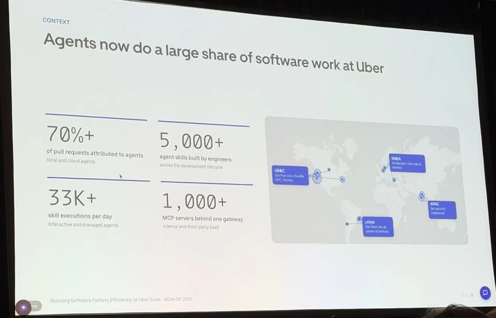
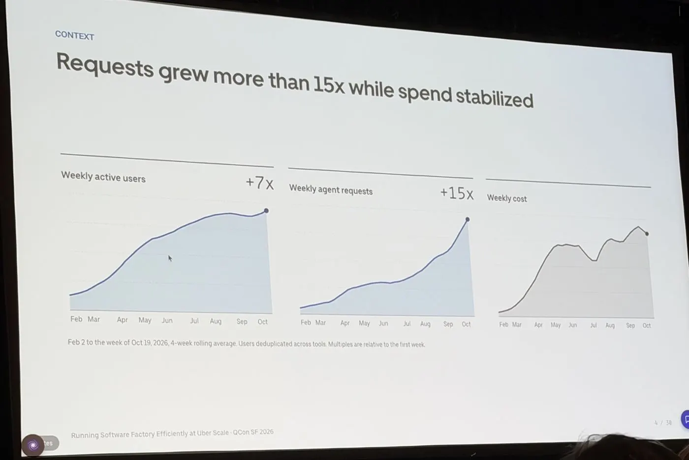
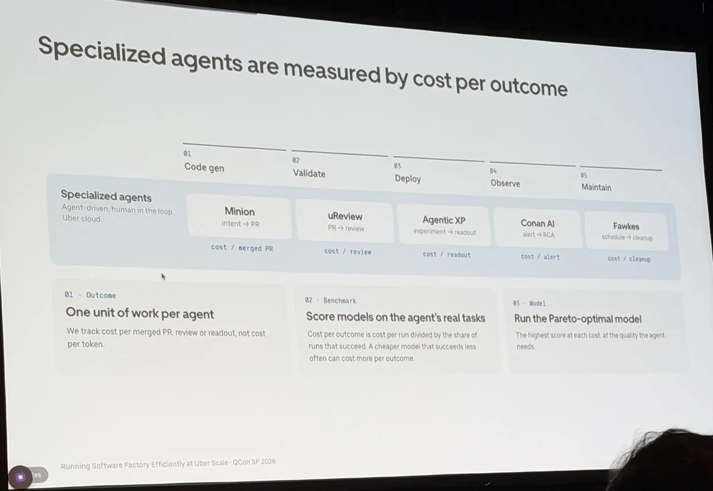
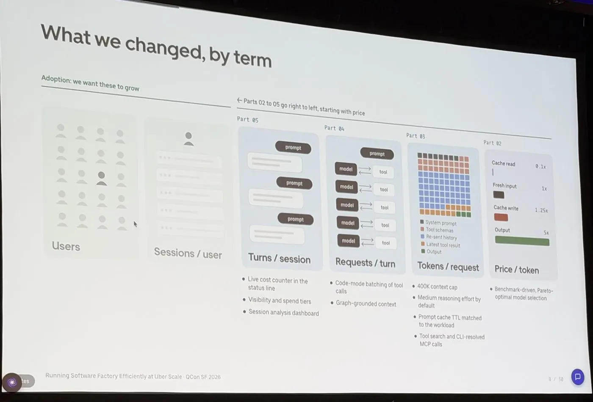
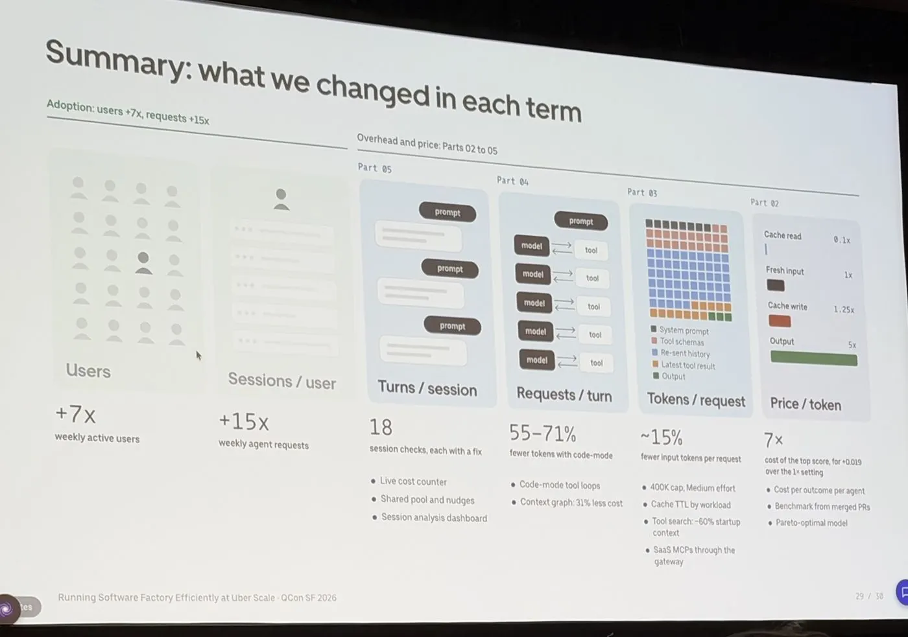
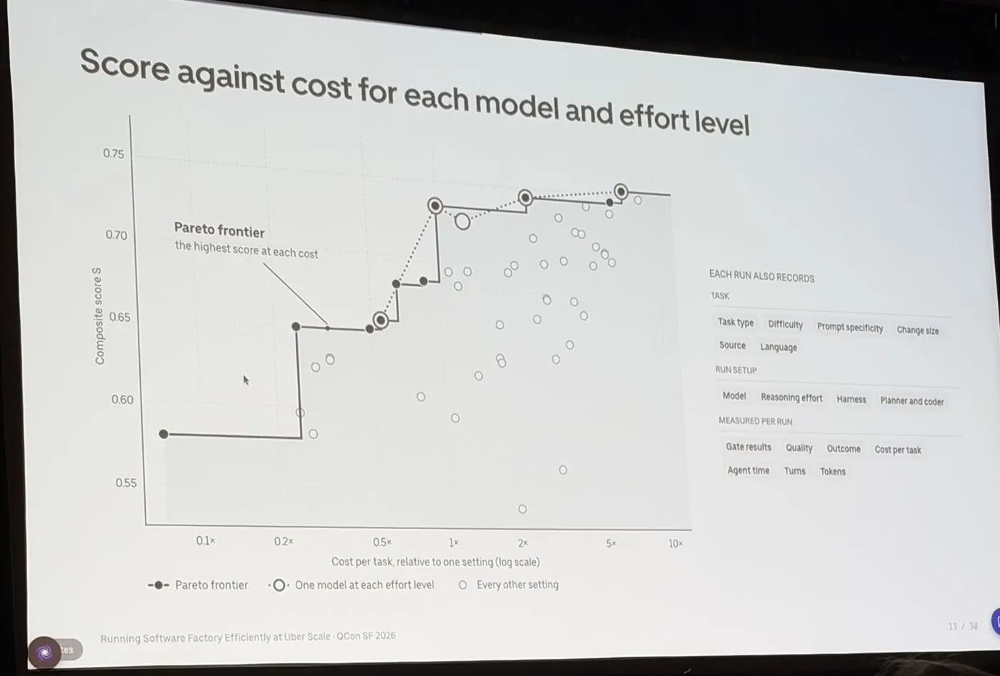
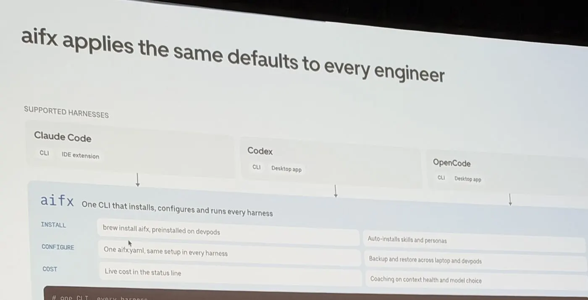
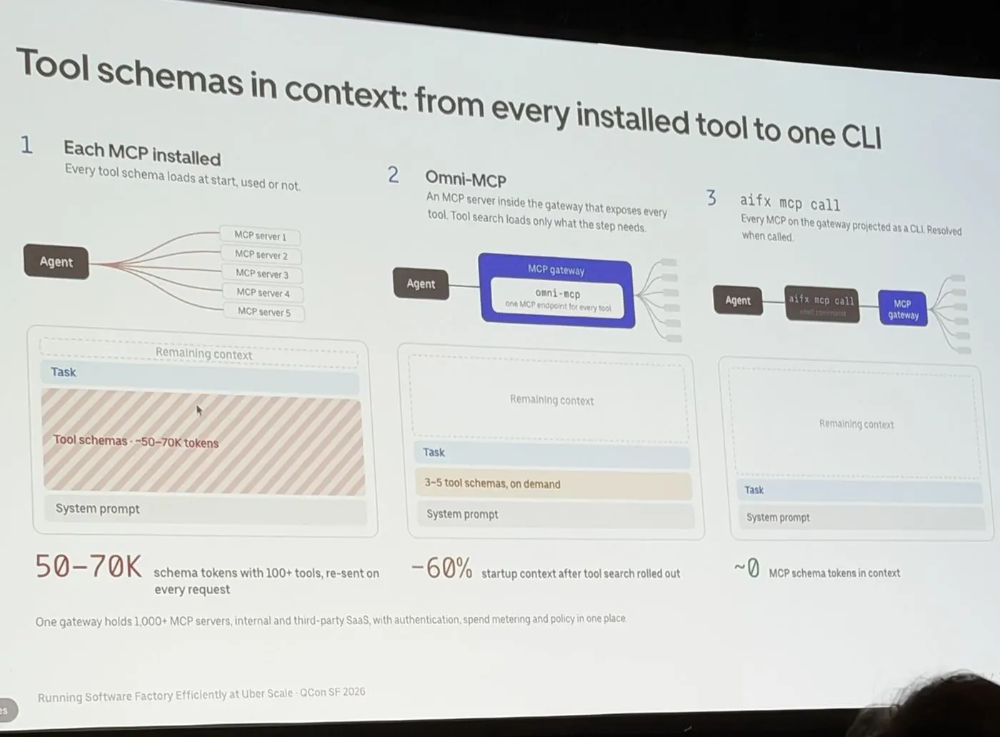
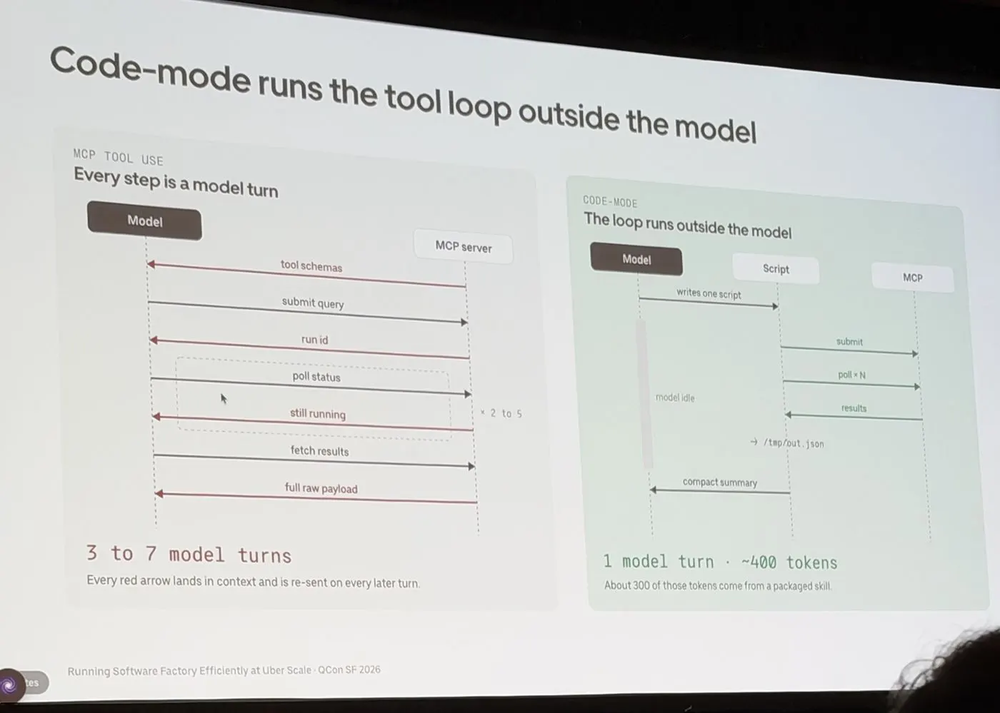
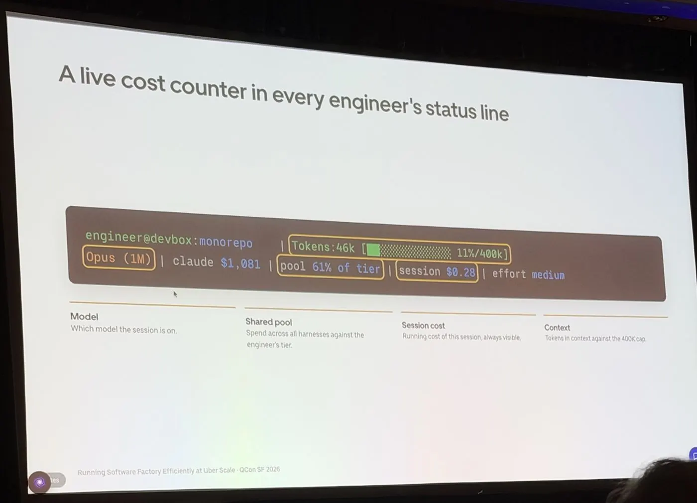

# Running Software Factory Efficiently at Uber Scale: Holding Agent Spend Steady While Requests Grew 9X

**Speaker:** Uday Kiran Medisetty (VP, Distinguished Engineer, Uber)  
QCon SF 2026 · Guardrails & Safety Nets for the New Landscape · Mon Nov 16, 10:35 · Ballroom A  
[Session page](https://qconsf.com/presentation/nov2026/running-software-factory-efficiently-uber-scale-holding-agent-spend-steady) · [All 23 slides](../gallery/running-software-factory-efficiently-at-uber-scale.md)

> How Uber grew agent requests 15x while holding weekly AI spend level, by splitting spend into six measurable terms and pulling one lever on each.

## Key points

- His slides showed more than 70% of Uber's pull requests attributed to agents, 5,000 agent skills and 33,000 skill runs a day. From February to October 2026 weekly users grew 7x and agent requests 15x, while weekly spend levelled off.
- Agent work runs in four layers. They are raw sessions, sessions with skills, general agents, and five specialized agents (Minion, uReview, Agentic XP, Conan AI and Fawkes). Each specialized agent is measured by cost per outcome.
- Uber breaks spend into users, sessions per user, turns per session, requests per turn, tokens per request and price per token. It tracks each weekly so it can explain any change.
- To choose models, Uber built a benchmark from 1,075 of its own merged pull requests, with hidden tests, scope gates and an LLM judge. It reads cost against quality by task type. The top-scoring setting cost 7x the baseline for 0.019 more score.
- One internal CLI, aifx, configures Claude Code, Codex and OpenCode from one file. Its defaults are a 400K context cap, medium reasoning effort and a one-hour cache for the main thread. He reported about 15% fewer input tokens and 39% lower main-thread cache cost.
- Engineers with 100 or more tools were re-sending 50,000 to 70,000 tokens of tool definitions per request. Tool search cut startup context 60%. Exposing every MCP tool as one command-line call brought it to about zero.
- Code mode turns 3 to 7 model turns into one. A context graph of more than 55 million nodes cut one real question from 20 minutes to 38 seconds. Across 68 questions it cut cost 31% and time 49%.
- Engineers see session cost and their shared pool on a status line, with soft tiers, Slack nudges and same-day approvals. A cost-check plugin runs 18 checks on their sessions. Asked where to start, he named cutting input tokens and raising cache hit rate.

From a 47-minute audio recording and 23 photos covering 22 of the 30 slides. Figures come from the slides first, then Uber’s published post, then the recording. Anything heard only in the room is marked as such.

## The talk in brief

More than 70% of Uber’s pull requests are now attributed to coding agents, and weekly agent requests grew more than 15 times between February and October 2026. Over the same period Uber’s weekly AI spend climbed until about May and then levelled off. Uday’s talk explains how. Uber treats spend as six numbers multiplied together, from users down to the price of a token, measures each one every week, and gives each one its own lever.

The levers are concrete: a benchmark built from 1,075 of Uber’s own merged PRs to pick a model per task; one CLI, aifx, that sets the same defaults across [Claude Code](https://code.claude.com/docs), [Codex](https://openai.com/codex) and [OpenCode](https://opencode.ai); replacing piles of MCP tool definitions with a single command; code mode for tool loops; a company-wide context graph; and a live cost counter in every engineer’s terminal. His advice for smaller companies was to start by measuring, then cut input tokens and raise the cache hit rate.

> “Every dollar maps to a unit of work.” (Slide 3, on Uber’s specialized agents)

## In depth

Each part follows the talk’s order. Slide numbers match the 30-slide deck where the photo shows them; a range means the number was not visible.

### Where Uber is now (slides 1–4)

The opening slide set the scale: more than 70% of pull requests attributed to local and cloud agents, more than 5,000 agent skills built by engineers, more than 33,000 skill executions a day, and more than 1,000 MCP servers behind one gateway, across tech sites in the US, EMEA, APAC and LATAM. In the recording Uday added that about 20% of PRs are now written end to end by autonomous agents in Uber’s cloud.

Slide 4 is the headline. From February 2 to the week of October 19, 2026, weekly active users grew 7 times and weekly agent requests more than 15 times, each relative to the first week on a four-week rolling average. The weekly cost chart rises steeply to about May and then levels off, with a dip in July and a new high in September before easing in October. “Stabilized” is fair as a trend against 15x request growth, but cost was not flat week to week. He credited cheaper models from the labs for part of the result, with Uber’s own work adding headroom on top.

*Slide 2: The scale: PRs, skills, skill runs and MCP servers.*

*Slide 4: Users +7x, requests +15x, and the weekly cost curve.*

### Four layers, and cost per outcome (slides 3, 9–10)

Every agent session at Uber runs in one of four layers. **Raw sessions** are an engineer driving Claude Code, Codex or OpenCode with their own prompt and context; tasks vary too much to benchmark, so the measure is cost per session. **Sessions with skills** run on the laptop using more than 5,000 skills; Uber can see which skill ran and optimize the most-used ones centrally. **General agents** such as Cortana run in Uber’s cloud from Slack or the web, take any skill with no setup, and are measured per query. Users never pick the harness or model there, so Uber can change both.

At the top, **specialized agents** are agent-driven with a human in the loop, one for each stage of the lifecycle:

| Stage    | Agent      | Job                   | Measured as        |
|----------|------------|-----------------------|--------------------|
| Code gen | Minion     | Intent to PR          | Cost per merged PR |
| Validate | uReview    | PR to review          | Cost per review    |
| Deploy   | Agentic XP | Experiment to readout | Cost per readout   |
| Observe  | Conan AI   | Alert to root cause   | Cost per alert     |
| Maintain | Fawkes     | Schedule to cleanup   | Cost per cleanup   |

Slide 9 or 10 spells out the method: one unit of work per agent; score models on the agent’s real tasks; run the cheapest model that meets the quality the agent needs. Cost per outcome is cost per run divided by the share of runs that succeed, so a cheaper model that fails more often can cost more per outcome.

*Slide 3: Four layers; more control over cost, quality and model higher up.*

Slide 9–10. Cost per outcome, benchmark, then the Pareto-optimal model.

> Moving work into the top layers is what makes cost controllable: there the model, the harness and the unit of work are all fixed and measurable.

### Six terms, one lever each (slides 8, 29)

Users and sessions per user are adoption, which Uber wants to grow. The middle three describe what the agent does on someone’s behalf: how often they steer it, how many model and tool calls it makes per turn, and how many tokens each call carries. Slide 8 breaks a request into system prompt, tool schemas, re-sent history, the latest tool result and output. The last term is set by the model and by token type: against fresh input at 1x, a cache read costs 0.1x, a cache write 1.25x and output 5x. The talk then took the terms from right to left.

| Term                     | What Uber changed                                                                          | Result on slide 29                   |
|--------------------------|--------------------------------------------------------------------------------------------|--------------------------------------|
| Users, sessions per user | Adoption, to grow                                                                          | +7x users, +15x requests             |
| Turns per session        | Live cost counter, shared pool and nudges, session analysis                                | 18 checks, each with a fix           |
| Requests per turn        | Code-mode tool loops, graph-grounded context                                               | 55–71% fewer tokens; graph −31% cost |
| Tokens per request       | 400K cap, medium effort, cache TTL by workload, tool search, SaaS MCPs through the gateway | ~15% fewer input tokens              |
| Price per token          | Cost per outcome per agent, benchmark from merged PRs, Pareto-optimal model                | Top score costs 7x for +0.019        |

*Slide 8: The six terms and the change made for each.*

*Slide 29: The summary slide, with a result for each term.*

> Breaking cost into terms turns “AI is expensive” into specific questions, each with an owner and a number.

### Price per token: a benchmark from Uber’s own PRs (slides 11–13)

Model choice matters most for the specialized agents, because their outcome can be measured. Uber started with code review, the easiest case. The harder benchmark was for Minion: does the model write a PR Uber would merge? Slide 11 shows how a merged PR becomes a graded task in six steps.

| Step            | What happens                                                                                                                                                                        | Output                 |
|-----------------|-------------------------------------------------------------------------------------------------------------------------------------------------------------------------------------|------------------------|
| 1 Select        | A merged, human-reviewed PR gives a base commit and the gold diff. In the recording he said they favoured PRs from before heavy AI use, with a spread of task types and difficulty. | Base commit, gold diff |
| 2 Rewrite       | The PR description is rewritten as the goal only, never the how.                                                                                                                    | instruction.md         |
| 3 Isolate       | One clean sandbox per run: pinned toolchain, dependency caches, repo at the base commit.                                                                                            | Sandbox                |
| 4 Extract tests | The gold diff is split into the held-out fix and the test oracle, with scope limits.                                                                                                | Tests, scope limits    |
| 5 Validate      | The gold tests must fail without the fix and pass with it.                                                                                                                          | TASK_VALID             |
| 6 Score         | Build and test gates, then a quality rubric.                                                                                                                                        | Score 0 to 1           |

The gates are build and lint (B1), hidden tests now pass (B2), no regressions and no test edits (B3), and the patch stays in scope (B5). A fifth gate, B4, checks each task once: the gold tests fail without the fix and pass with it. A patch that fails any gate scores zero. The composite score is the gate pass rate multiplied by the mean quality of passing patches, where quality comes from a checklist review and an LLM judge against the gold patch. The 1,075 tasks split into Go 363, Java 416 and Python 296.

Each run is an isolated agent job on Kubernetes, built on Uber’s ML platform, [Michelangelo](https://www.uber.com/blog/michelangelo-machine-learning-platform/): a job controller fans out Ray jobs, each running Claude Code, Codex or OpenCode in a clean checkout with scoped access, calling models through the GenAI gateway. Running one model across the set went from 3 days on laptops to about one hour.

The result is a Pareto chart of composite score against cost per task, for every model and effort level. Each run also records task type, difficulty, prompt specificity, change size and language; model, effort, harness and planner-coder setup; and gate results, quality, cost, agent time, turns and tokens. That lets Uber read the chart by task type: feature-flag cleanup can run cheaper than new features. The summary slide put the trade in one number: the top-scoring setting cost 7 times the baseline for 0.019 more score. He added that tasks every model solved were dropped, as were tasks too tangled to test fairly.

*Slide 11: Six steps from merged PR to graded task; 1,075 tasks.*

*Slide 13: Score against cost; the line is the best score at each price.*

> Public leaderboards don’t say which model is good enough for your codebase’s routine work. A benchmark from your own merged PRs does, and it shows how little the most expensive setting adds.

### Tokens per request: one CLI, three defaults (slides 14–17)

Engineers don’t launch a harness directly. aifx is one CLI that installs, configures and runs Claude Code (CLI and IDE extension), Codex and OpenCode. It is installed with Homebrew and preinstalled on Uber’s cloud dev environments, keeps one aifx.yaml as the same setup in every harness, auto-installs skills and personas, backs up and restores across laptop and devpods, shows live cost in the status line, and coaches on context health and model choice. Engineers run `aifx agent run claude` or `aifx agent run codex`. It also lets Uber turn a setting on for one group first and compare results.

| Default               | Setting                                                  | Result and reason (slide)                                                                                                                                |
|-----------------------|----------------------------------------------------------|----------------------------------------------------------------------------------------------------------------------------------------------------------|
| Context               | Capped at 400K on 1M-token models                        | About 15% fewer input tokens per request across the fleet. The cap balances quality against cache misses and re-sending a long context on every request. |
| Reasoning effort      | Medium (old default: High)                               | Reasoning tokens are billed as output, at 5x the input price on frontier models. In the recording he added that some models get worse above medium.      |
| Prompt cache lifetime | One hour for the main thread, five minutes for subagents | 39% lower cache cost on the main thread. Engineers leave sessions idle for more than five minutes; subagents finish within 90 seconds.                   |

Engineers can raise any setting for a task. Cache writes cost 1.25 times the input rate for five minutes or 2 times for one hour; reads cost 0.1 times.

Slide 14–17. aifx: one CLI for every harness.

Slide 14–17. Three defaults and what each saved.

> With one place to set defaults, a choice such as 400K versus 1M becomes an experiment with a measured result rather than an argument.

### Tokens per request: tool definitions (slides 14–18)

Uber stood up its first MCP gateway in spring 2025, by Uday’s account, and connected everything. With every MCP server installed, every tool schema loads at the start whether used or not: 50,000 to 70,000 tokens with 100+ tools, re-sent on every request. The fix came in three steps:

1.  **Omni-MCP**, an MCP server inside the gateway that exposes every tool, with tool search loading only the 3 to 5 schemas a step needs. Startup context fell 60%.
2.  **`aifx mcp call <server> <tool>`**, which projects every MCP server on the gateway as a CLI command resolved when called. MCP schema tokens in context: about zero. Skills were rewritten to use it.
3.  **Vendor servers through the same gateway**, which handles auth, policy and metering, signing in as each user via token exchange. Five SaaS servers (workspace 49 tools, project tracker 46, messaging 34, issue tracker 28, design 16) hold 173 tool schemas and about 57,000 tokens that never reach the model; the 49-tool workspace server alone is about 22,000.

Slide 14–17. From every installed tool to one CLI.

*Slide 18: 173 vendor tool schemas kept out of context.*

> Asked later which levers saved most, he named this one first, together with cache hit rate.

### Requests per turn: code mode and the context graph (slides 19–25)

With plain MCP tool use, every step is a model turn: submit a query, get a run ID, poll two to five times, fetch results, receive the full raw payload. That is 3 to 7 model turns, and every result lands in context and is re-sent on each later turn. In code mode the model writes one script that submits, polls and writes results to a file, and gets back a compact summary: one model turn, about 400 tokens, about 300 of them from a packaged skill. The summary slide puts code mode at 55 to 71% fewer tokens, matching the query table in Uber’s August post.

The bigger effort was context. Slide 20 shows a real question with names removed: an engineer asked whether a dataset could be queried in an internal tool. The agent needed four pieces of Uber context: which warehouse table holds the data, who already queries it (more than 50 analysts, in query history), which tables are alternatives, and how to build the query. Without help it searched service code.

Uber’s answer is the AI Context Graph, which agents query before they search. It holds more than 55 million nodes and 195 million edges, across 120+ node types and 175+ edge types, in four kinds of data: facts from 30+ systems (owners, deploys, on-call, lineage, query history); unstructured text such as docs, postmortems and design docs, with lexical and semantic search; structure extracted from that text, such as the services a postmortem mentions; and AI-written summaries of what each service does. Services alone are more than 28,000 nodes. In the recording he said it runs on Neo4j, and that gaps are logged as “paper cuts” when Cortana can’t find something.

| Same prompt, same model      | Without the graph                                                           | With the graph                                                                                        |
|------------------------------|-----------------------------------------------------------------------------|-------------------------------------------------------------------------------------------------------|
| Time                         | 20m 09s                                                                     | 38s                                                                                                   |
| Work                         | 5 tool calls, 3 errors, 2 subagents (slowest 8m 20s)                        | 4 tool calls, 0 errors, 0 subagents                                                                   |
| Answer                       | Wrong (19/30): concluded the dataset could not be queried; the table exists | Correct (30/30): found the table 50+ analysts use, ranked three alternatives, wrote four SQL patterns |
| Across 68 engineer questions | Judge score +8.3%, cost per question −31%, time to answer −49%              |                                                                                                       |

Slide 19–25. Code mode: one model turn instead of 3 to 7.

Slide 19–25. The graph’s effect on one question and on 68.

> The graph is a map with pointers. It tells the agent where to look, and the agent does the looking.

### Turns per session: showing the meter (slides 19–28)

- **Status line:** aifx installs a status line showing the model, the engineer’s spend in the harness, the shared pool as a share of their tier, the running session cost and the tokens in context against the 400K cap. In Q&A he added that it now warns before a costly cache miss, with something like “+\$4.19” if you resume a stale session.
- **One shared pool:** one spend tier across all harnesses, because per-tool budgets push engineers to whichever tool has budget left.
- **Slack nudges** at 50, 80 and 100% of expected spend, and **fast approvals:** manager sign-off for a higher tier, usually the same day. No hard caps.
- **Cost-check plugin:** `aifx plugin add cost-check` and `/cost-dashboard` read sessions on the laptop and on devpods. Codex and OpenCode count toward spend; the checks run on Claude Code. Its 18 checks are grouped by the term they reduce: 2 for turns per session, 2 for requests per turn, 9 for tokens per request and 5 for price per token. Examples: failed attempts left in context (use [/rewind](https://code.claude.com/docs/en/checkpointing)), tool results over 10,000 characters (use code mode), the first turn writing 100K of schemas (drop unused plugins), resuming after an idle hour (clear first), and subagents on Opus (set them to Haiku).
- **Model routing by intent:** an LLM classifier reads what the engineer asked, not how long the session ran, to suggest Sonnet, Opus or Fable. “A fifty-turn session fixing typos is still Sonnet work.” One recommendation is to plan in Fable and delegate to Sonnet subagents. Each recommendation shows a monthly saving and its quality impact.

The dashboard on the slide is marked as an illustrative example: \$1,387 spent over 144 sessions in 30 days, a 95% cache hit rate, \$366 (26%) lost to cache misses, and \$405 of savings found across 9 recommendations.

Slide 19–25. The status line: model, pool, session cost, context.

Slide 27–28. Session analysis: 18 checks, each with a fix.

> Visible cost and specific, per-session advice changed behaviour without hard caps.

### Questions from the room (after slide 30)

Doesn’t aifx slow people down?  
Every default is backed by experiment data, cost is visible in the session, and engineers can override defaults. Where a harness lacks an override, Uber asks the vendor to add one.

Biggest savings?  
Cutting input tokens (MCP as CLI, code mode) and raising the prompt cache hit rate. At Uber’s scale every basis point of cache hit rate matters week to week.

Where should a small company start?  
Measure first. A wrapper that adds hooks and sends OpenTelemetry metrics is not a big build. Then grow adoption and find your weak term.

How was the graph built?  
Two or three engineers started it. Early data showed which sources to add next, and other teams’ graph efforts folded in: “a monorepo for our internal data,” with teams owning their parts.

Is source code in the graph?  
Not as a semantic index. Each service points to where its code lives and the agent searches from there. Code graphs built with Tree-sitter are a prototype for large migrations.

What about stale data?  
The graph is refreshed periodically, not in real time. It holds static metadata plus pointers to the metrics, logging or other MCP servers for live data.

How do you show ROI?  
Uber used AI to backfill years of feature timelines and now measures feature velocity company-wide, plus time saved per skill run and toil removed, including 200 to 250 automated migrations covering about 12 million lines.

Is aifx a proxy?  
No. Engineers get the normal Claude Code or Codex interface; aifx writes the settings and hooks and then starts the harness. Nobody bypasses it because it is the way to reach Uber’s model gateway. Asked whether anyone sells this, he said he knew of nothing.

## Numbers I checked

Every figure in the talk against its source. Checked means we found the same number in a published source; Caveat means it holds with a condition; Slide only means I took it from the slide; Talk only means I heard it in the room and found it nowhere else.

| Claim                                       | Figure            | Source                                                                                                                                      | Status                                                     |
|---------------------------------------------|-------------------|---------------------------------------------------------------------------------------------------------------------------------------------|------------------------------------------------------------|
| PRs attributed to local or cloud agents     | 70%+              | Slide 2; [Uber blog](https://www.uber.com/blog/efficient-software-factory/)                                                                 | Checked                                                    |
| PRs written end to end by autonomous agents | ~20%              | Recording                                                                                                                                   | Talk only                                                  |
| Agent skills built                          | 5,000+            | Slide 2; [session page](https://qconsf.com/presentation/nov2026/running-software-factory-efficiently-uber-scale-holding-agent-spend-steady) | Checked                                                    |
| Skill executions per day                    | 33K+              | Slide 2; [Uber blog](https://www.uber.com/blog/efficient-software-factory/), Aug: 30K+                                                      | Checked                                                    |
| MCP servers behind one gateway              | 1,000+            | Slide 2; [Uber blog](https://www.uber.com/blog/efficient-software-factory/)                                                                 | Checked                                                    |
| Weekly active users, Feb 2 to Oct 19        | +7x               | Slide 4; [Uber blog](https://www.uber.com/blog/efficient-software-factory/) (7x to Aug)                                                     | Checked                                                    |
| Weekly agent requests, Feb 2 to Oct 19      | +15x              | Slide 4; blog gives 9.4x to Aug                                                                                                             | Caveat longer window; schedule title says 9X               |
| Weekly spend                                | Levelled off ~May | Slide 4 chart; blog says April, session page May                                                                                            | Caveat dips in Jul, new high in Sep                        |
| Cost per 1,000 requests; cost per session   | −34%; −52%        | [Uber blog](https://www.uber.com/blog/efficient-software-factory/)                                                                          | Caveat to Aug, model held constant; not on captured slides |
| Graded benchmark tasks                      | 1,075             | Slide 11 (Go 363, Java 416, Python 296; sums to 1,075); session page                                                                        | Checked                                                    |
| Time to run one model on the benchmark      | 3 days → ~1 h     | Slide 12                                                                                                                                    | Slide only                                                 |
| Cost of the top score vs the 1x setting     | 7x for +0.019     | Slide 29                                                                                                                                    | Slide only                                                 |
| Context cap on 1M-token models              | 400K              | Slide 16; [Uber blog](https://www.uber.com/blog/efficient-software-factory/)                                                                | Checked                                                    |
| Input tokens per request after the defaults | ~−15%             | Slides 16, 29                                                                                                                               | Slide only                                                 |
| Default reasoning effort                    | Medium (was High) | Slide 16; [Uber blog](https://www.uber.com/blog/efficient-software-factory/)                                                                | Checked                                                    |
| Output price vs input on frontier models    | 5x                | Slide 16; [Claude models](https://platform.claude.com/docs/en/about-claude/models/overview) (\$5 in, \$25 out per MTok on Opus)             | Checked for Claude                                         |
| Main-thread cache cost with a 1-hour TTL    | −39%              | Slide 16                                                                                                                                    | Slide only                                                 |
| Cache write 5 min / 1 h; read               | 1.25x / 2x; 0.1x  | Slide 16; [Anthropic prompt caching](https://platform.claude.com/docs/en/build-with-claude/prompt-caching)                                  | Caveat reads 0.05x on Opus 5.5 and Sonnet 5.5              |
| Subagents finish within                     | 90 s              | Slide 16                                                                                                                                    | Slide only                                                 |
| Tool schemas with 100+ tools                | 50–70K tokens     | Slide on tool schemas; [Uber blog](https://www.uber.com/blog/efficient-software-factory/)                                                   | Checked                                                    |
| Startup context after tool search           | −60%              | Slides on tool schemas and 29                                                                                                               | Slide only                                                 |
| Workspace server: tools, schema tokens      | 49; ~22K          | Slide 18; [Uber blog](https://www.uber.com/blog/efficient-software-factory/)                                                                | Checked                                                    |
| Five SaaS servers: schemas, tokens kept out | 173; ~57K         | Slide 18 (49+46+34+28+16 = 173)                                                                                                             | Slide only                                                 |
| Code mode: model turns; tokens              | 3–7 → 1; ~400     | Code-mode slide                                                                                                                             | Slide only                                                 |
| Code mode token reduction                   | 55–71%            | Slide 29; [Uber blog](https://www.uber.com/blog/efficient-software-factory/) table (4 of 5 queries)                                         | Checked                                                    |
| Context graph nodes; edges                  | 55M+; 195M+       | Graph slide; blog in Aug: 24M; 80M                                                                                                          | Caveat grown since Aug; slide only                         |
| One question, without vs with the graph     | 20m 09s → 38s     | Graph slide; [Uber blog](https://www.uber.com/blog/efficient-software-factory/)                                                             | Checked                                                    |
| 68 questions: judge, cost, time             | +8.3%, −31%, −49% | Graph slide                                                                                                                                 | Caveat Uber-run, same model; slide only                    |
| Session analysis checks                     | 18                | Slides 27–29 (2+2+9+5); blog in Aug: 16                                                                                                     | Slide only                                                 |
| Spend nudges                                | 50, 80, 100%      | Slide 26; [Uber blog](https://www.uber.com/blog/efficient-software-factory/)                                                                | Checked                                                    |
| Cache-miss warning example                  | +\$4.19           | Recording                                                                                                                                   | Talk only                                                  |
| First MCP gateway                           | Apr–May 2025      | Recording                                                                                                                                   | Talk only                                                  |
| Automated migrations; lines                 | 200–250; ~12M     | Recording; [AI Engineer talk](https://ai.engineer/talks/17-YSUHo6Lk-agentic-sdlc-at-uber-building-blocks-ubers), Aug: 250+; 9M              | Caveat newer, unpublished                                  |
| Years at Uber                               | 11                | [Pragmatic Engineer](https://newsletter.pragmaticengineer.com/p/ubers-ai-infra-from-the-inside): joined 2015                                | Checked                                                    |

All of Uber’s figures are self-reported and none has been independently verified. The session-analysis dashboard figures are labelled illustrative on the slide and are not counted here.

## About the speaker

Uday Kiran Medisetty is a VP and Distinguished Engineer at Uber, which he joined in 2015 when, by his account to [The Pragmatic Engineer](https://newsletter.pragmaticengineer.com/p/ubers-ai-infra-from-the-inside), it ran two services. Uber’s blog describes him as leading engineering-productivity work (agentic coding, AI debugging, code review and large-scale refactoring) and co-leading the company-wide engineering community on architecture and standards.

Before the agent work he helped build Uber’s real-time push platform and co-wrote Uber’s account of Edge Gateway, its API platform. In 2026 he presented [Agentic SDLC at Uber](https://ai.engineer/talks/agentic-sdlc-at-uber-building-blocks-for-uber-s-software-factory) with Adam Huda at the AI Engineer World’s Fair, covering the building blocks (model gateway, MCP gateway, dev pods, skills marketplace) that this talk’s cost work sits on, and wrote the [August 2026 post](https://www.uber.com/blog/efficient-software-factory/) this talk updates.

## Terms and technologies

Everything the talk names, in plain English, with a link to the real thing.

### Agents and harnesses

[Agent harness](https://openai.com/index/harness-engineering/)  
The software around a model that gives it context and tools and runs its actions. Claude Code, Codex and OpenCode are harnesses; Uday uses the word throughout.

[Claude Code](https://code.claude.com/docs)  
Anthropic’s coding agent for the terminal and IDE, one of the three harnesses aifx manages.

[Codex](https://openai.com/codex)  
OpenAI’s coding agent (CLI, desktop app and cloud), the second harness under aifx.

[OpenCode](https://opencode.ai)  
An open-source terminal coding agent that can use many model providers; the third harness under aifx.

[aifx](https://newsletter.pragmaticengineer.com/p/ubers-ai-infra-from-the-inside)  
Uber’s internal CLI that installs, configures and runs every harness from one aifx.yaml and keeps settings, skills and plugins in step. Not public; best described in The Pragmatic Engineer’s episode with Uday.

[Homebrew](https://brew.sh)  
The macOS and Linux package manager; how engineers install aifx on laptops.

[Agent skills](https://agentskills.io)  
An open format, started by Anthropic, for packaging instructions and scripts as a folder with a SKILL.md file that agents load only when a task needs it. Uber has more than 5,000.

[Subagents](https://code.claude.com/docs/en/sub-agents)  
Helper agents the main agent starts for a piece of work, each with its own context. Uber’s finish within 90 seconds, so they keep the five-minute cache.

[Hooks](https://code.claude.com/docs/en/hooks)  
Commands a harness runs automatically before or after tool calls. aifx uses them to send timing and cost data to Uber’s observability.

[Status line](https://code.claude.com/docs/en/statusline)  
A bar at the bottom of Claude Code that runs a script you choose and can show model, context use and cost. Uber’s shows session cost and the shared pool.

[Checkpointing and /rewind](https://code.claude.com/docs/en/checkpointing)  
Claude Code saves a checkpoint before each prompt; /rewind (or Esc twice) rolls back. Uber’s cost check suggests it to clear failed attempts out of context.

### Uber’s own systems

Minion, uReview, Agentic XP, Conan AI, Fawkes  
Uber’s five specialized agents, for code generation, review, experiment readouts, alert root cause and scheduled cleanup. All internal; only [uReview](https://www.uber.com/blog/ureview/) has a public write-up. Names as on slide 3.

Cortana  
Uber’s general-purpose agent, started from Slack or the web, with access to every skill, repo and tool. Internal; no relation to Microsoft’s assistant.

Omni-MCP  
An MCP server inside Uber’s gateway that exposes every tool and uses tool search to load only what a step needs. Internal; spelling from the slide.

[Michelangelo](https://www.uber.com/blog/michelangelo-machine-learning-platform/)  
Uber’s machine-learning platform since 2016, extended to run model benchmarks as isolated agent jobs. The slide also names Uniflow and an AES runtime, both internal.

Devpods and GenAI gateway  
Uber’s cloud development environments (aifx comes preinstalled) and its single gateway for model calls, with spend tracking per user.

### Tokens, context and cost

[Context window](https://docs.claude.com/en/docs/build-with-claude/context-windows)  
The amount of text a model can see at once. Uber caps it at 400K on 1M-token models.

[Prompt caching](https://platform.claude.com/docs/en/build-with-claude/prompt-caching)  
Storing the start of a prompt so later calls reuse it at a fraction of the price. The cache expires after a set time (TTL); a miss means paying to write it again. “Cache hit rate” is the share of input served from cache.

[Reasoning effort](https://platform.claude.com/docs/en/build-with-claude/effort)  
A setting that controls how many tokens a model spends thinking and answering. Reasoning tokens are billed as output. Uber moved its default from high to medium.

[Haiku, Sonnet, Opus, Fable](https://platform.claude.com/docs/en/about-claude/models/overview)  
Anthropic’s Claude model tiers, from cheapest and fastest to most capable. Uber’s classifier routes work among them by what was asked.

### Tools and access

[Model Context Protocol (MCP)](https://modelcontextprotocol.io)  
An open standard for connecting agents to tools and data. Every tool’s schema sits in the model’s context unless deferred, which is where Uber’s 50,000 to 70,000 tokens came from.

[Tool search](https://code.claude.com/docs/en/mcp)  
Deferring tool schemas and letting the model look up only the tools it needs. Claude Code does this for MCP tools; Uber’s Omni-MCP does it at the gateway.

[Code mode](https://blog.cloudflare.com/code-mode/)  
Letting the model write one script that calls tools, instead of calling each tool itself turn by turn. Popularized by Cloudflare.

[OAuth token exchange](https://datatracker.ietf.org/doc/html/rfc8693)  
A standard way for a gateway to swap a user’s token for one a downstream service accepts. How Uber’s gateway reaches vendor tools as the engineer.

### Evaluation and infrastructure

Gold diff, held-out fix, test oracle  
The human PR a task came from, the part of it the model must reproduce, and the tests that judge the attempt.

[LLM as judge](https://arxiv.org/abs/2306.05685)  
Using a model to grade another model’s output, here against the gold patch with a checklist.

[Pareto frontier](https://en.wikipedia.org/wiki/Pareto_front)  
The set of options where you can’t get more quality without paying more. Uber’s chart shows which model and effort sit on that line at each price.

[Kubernetes](https://kubernetes.io)  
The container orchestration platform each benchmark run is scheduled on.

[Ray](https://www.ray.io)  
An open-source framework for distributed Python jobs; each benchmark run is a Ray job.

### Context and observability

[Context graph](https://en.wikipedia.org/wiki/Knowledge_graph)  
Uber’s AI Context Graph of services, people, deploys, alerts, query history and documents, which agents query before searching code or data.

Lexical and semantic search  
Matching exact words versus matching meaning. The graph offers both over docs and postmortems.

[Neo4j](https://neo4j.com)  
A graph database; what Uber’s context graph runs on, per the recording.

[Tree-sitter](https://tree-sitter.github.io/tree-sitter/)  
A parser that turns source code into syntax trees in many languages. Uber is prototyping code graphs with it for migrations.

[OpenTelemetry](https://opentelemetry.io)  
An open standard for traces and metrics. aifx’s hooks send agent events through it.

[Monorepo](https://en.wikipedia.org/wiki/Monorepo)  
One repository holding many projects. Uber’s benchmark runs inside its largest ones.

## Reading and tools

### Primary sources

- [Running a Software Factory Efficiently at Uber Scale](https://www.uber.com/blog/efficient-software-factory/), Uber blog, Aug 27, 2026. The written version, linked from the final slide.
- [Agentic SDLC at Uber](https://ai.engineer/talks/agentic-sdlc-at-uber-building-blocks-for-uber-s-software-factory), AI Engineer World’s Fair 2026. The building blocks underneath.
- [Uber’s AI infra, from the inside](https://newsletter.pragmaticengineer.com/p/ubers-ai-infra-from-the-inside), The Pragmatic Engineer. Covers aifx, spend tiers and the CI load from agents.
- [uReview: Scalable, Trustworthy GenAI for Code Review at Uber](https://www.uber.com/blog/ureview/), Uber blog, Aug 2025.
- [Uber cuts AI costs even as usage jumps](https://axios.com/2026/08/27/ai-uber-spending), Axios. Context: Uber had reported overrunning its 2026 AI budget in April.

### Docs for the levers

- [Prompt caching](https://platform.claude.com/docs/en/build-with-claude/prompt-caching) and [effort](https://platform.claude.com/docs/en/build-with-claude/effort), Claude docs.
- [MCP and tool search](https://code.claude.com/docs/en/mcp), [status line](https://code.claude.com/docs/en/statusline) and [hooks](https://code.claude.com/docs/en/hooks), Claude Code docs.
- [Code Mode: the better way to use MCP](https://blog.cloudflare.com/code-mode/), Cloudflare.

### Related sessions at QCon

- Already happened (Mon): [Data-Driven Optimization of AI Agents](https://qconsf.com/presentation/nov2026/data-driven-optimization-ai-agents-hand-tuned-harnesses-model-harness-co) (Lucidic AI, same slot); [Optimized Application Infrastructure](https://qconsf.com/presentation/nov2026/why-optimized-application-infrastructure-not-just-gpus-and-llms-can-scale-your) (Azul, AI cost); [Building a Safe Software Factory](https://qconsf.com/presentation/nov2026/building-safe-software-factory) (Sonar); [Generation Got Cheap, Trust Didn’t](https://qconsf.com/presentation/nov2026/generation-got-cheap-trust-didnt-scaling-agentic-changes-prompt-prod-roblox) (Roblox).
- **Still ahead** Tue 1:35: [Drawing the Rest of the Owl: A Blueprint for Your Software Factory](https://qconsf.com/presentation/nov2026/drawing-rest-owl-blueprint-your-software-factory) (Harness).
- **Still ahead** Tue 2:45: [Lessons from Building a \$100M Product in Six Weeks at OpenAI](https://qconsf.com/presentation/nov2026/lessons-building-100m-product-six-weeks-openai).
- **Still ahead** Wed 10:35: [How Netflix Retrofitted Its SDLC for AI Coding Agents](https://qconsf.com/presentation/nov2026/how-netflix-retrofitted-its-sdlc-ai-coding-agents).
- **Still ahead** Wed 11:45: [Making Production Legible to Agents](https://qconsf.com/presentation/nov2026/making-production-legible-agents-lessons-building-observability-mcp) (Honeycomb), on MCP and observability.
- **Still ahead** Wed 3:55: [How To Kill the Code Review](https://qconsf.com/presentation/nov2026/how-kill-code-review) (Aviator).

