# Wait, You're Still Doing PRs?

**Speaker:** Lee Faus (Founder and CEO, Atomic Software)  
QCon SF 2026 · Mon Nov 16  
[Session page](https://qconsf.com/presentation/nov2026/wait-youre-still-doing-prs)

> Lee Faus of Atomic argued that pull requests don't fit agent-written code and showed Atomic, which records each change against an intent and has a separate identity review it.

## Key points

- He said the pull request began as a light way for non-maintainers to offer changes, and enterprises then added settings, checks and compliance rules until it became heavy again.
- He compared agents to crowds that won't wait for an elevator. They start from a cloned repo and a prompt, can't see what other agents are doing, and lack the whiteboard alignment people do first.
- He said Git's history model makes parallel agents expensive. Ten agents from one commit need repeated rebases and many-way merges, and worktrees multiplied disk use to 500 to 600 GB in Atomic's Rust demos.
- He cited Anthropic replacing Git with Scion and OpenAI buying Pierre and building a new Git backend as signs that Git is strained by agent workloads.
- Atomic stores changes as a causal graph built on patch theory, from Darcs and Pijul. A change is inserted between the changes it depends on, with no rebase, and agents work in isolated draft views of one live graph.
- Every change starts from an intent with a why, acceptance criteria, tasks, files, scope and constraints. Atomic records the session, model, tokens and cost against it, and goals group intents so spend can map to business KPIs.
- He proposed reviewing the intent graph rather than the diff, and showed a triage review that summarised the change and answered follow-up questions about one part.
- For SOX separation of duties, a reviewer grant creates a short-lived reviewer identity with read and record rights. In the demo the gate refused to publish because the author sessions lacked completion signatures.

From an audio recording and 17 photos: 4 of the 12 deck slides and 13 shots of the live demo. Most of the talk was story and demo, so the recording carries much of it. The QCon site lists this slot only as a sponsored session, with no time, room or abstract published, so there is no session page to link. This is a vendor talk: claims about Atomic are the company’s own.

## The talk in brief

Lee Faus spent years at GitHub and GitLab teaching companies the pull-request workflow. His argument: the PR was a lightweight fix for a heavyweight open-source process, enterprises then bolted their governance onto it until it became heavy again, and agents now produce changes faster than that ceremony can absorb. Making Git faster, he said, mostly makes CI fail faster. The deeper problems are that agents working in parallel can’t see each other’s work, Git’s history forces constant rebasing, and a diff carries too little context to review.

His company, Atomic, replaces Git’s snapshot history with a patch-theory graph descended from Darcs and Pijul, so changes can be inserted where they belong rather than restacked. On top sits the Atomic workflow: every change starts from an intent with acceptance criteria, and Atomic records the agent session, model, tokens and cost against it in a per-change knowledge graph. Review becomes walking that graph, checked criterion by criterion, by an ephemeral reviewer that is never the author, which is what SOX separation of duties asks for. The live demo built a small TypeScript CLI with full provenance; the review gate then refused to publish because the author sessions hadn’t been signed off, which showed the control working but left the end-to-end loop unfinished on stage.

> “A workflow of its own.” (Slide 1, on what autonomous work needs)

## In depth

The deck had 12 slides in six acts; we have 4 of them. The parts below follow the talk’s order, using the recording where no slide was captured. Photo numbers refer to the gallery.

### The setup: a self-driving car with a man and a flashlight (photo 1)

Lee opened by asking who had opened a pull request in the last 24 hours. Doing that with agents, he said, is like buying a self-driving car and asking someone to run ahead of it with a flashlight. We generate far more changes and still keep the old ceremonies.

Some of those ceremonies no longer work at scale. He once trained teams to search existing PRs before opening a new one; that was easy when a project had 25 PRs and is impractical at the 150,000 he now sees at customers. He said PR search covers only titles and descriptions, and code search only the default branch. So an agent searching through an MCP server sees nothing on long-running release branches or in closed PRs that may still matter.

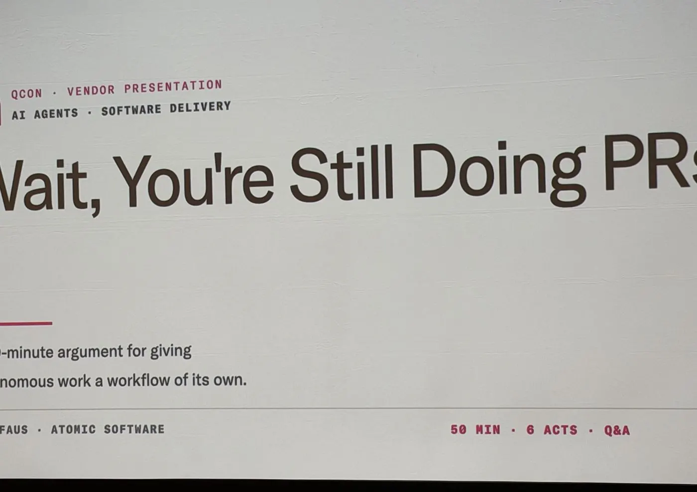

Slide 1. Title slide: six acts, a workflow of its own.

### Act 1, the dark ages: Bugzilla, SVN and a mailing list (photo 2)

In the early 2000s at Red Hat, Lee tried to land a first patch in Fedora with help from his friend [Greg DeKoenigsberg](https://fedoraproject.org/wiki/GregDeKoenigsberg), then a Fedora community leader. He needed a Bugzilla account under a business email, an SVN diff committed under the same address, and a ticket whose attached diff matched what he emailed, because regular expressions stitched the lineage together. Then the review started: maintainers replayed the SVN history, applied his diff and ran linters and checks. Every failure meant going round again.

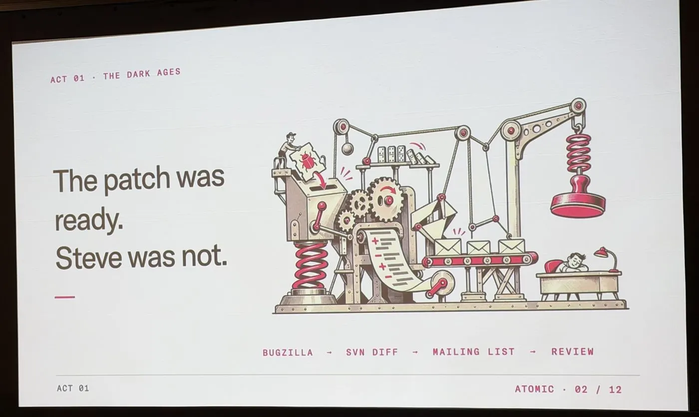

Slide 2. “The patch was ready. Steve was not.”

### How the pull request was born, and grew heavy (recording only)

GitHub turned that machine into the pull request. The point was trust: a maintainer didn’t want to give every contributor commit rights, so you forked the project, made your change in your fork, and asked the maintainer to pull it. (Lee placed the first PR in late 2008 or early 2009; GitHub’s own blog announced pull requests in February 2008.)

From about 2009 to 2012 enterprises asked for the same workflow without forks, because their developers were already trusted. GitHub answered with a settings page for every scenario: security teams turned on checks, platform teams added CI statuses, admins managed teams and permissions. All of that state lives in a central database, which is why “GitHub is down” and “Git is down” are different things. Git is distributed; GitHub is a hub, and it blocks pushes when its validation services (pre-receive and post-receive hooks, identity checks, CI triggers) are unavailable. His first PR needed a title, a description and a linked issue. Today’s also carry SOX, PCI and FedRAMP controls. “We created yet another Rube Goldberg machine.”

### Agents in the elevator (recording only)

His analogy was a 55-floor New York office building at 9 a.m. When only people use the elevators, they wait their turn and nobody asks for faster elevators. Agents don’t wait. And people do something before they start that agents don’t: they get the developers, product manager and architect in front of a whiteboard and agree what to build. The first agent users he watched simply cloned a repo and typed a prompt. That works for a one-shot app but not for an enterprise application spread across 22 repositories, where people have always held the connections in their heads.

He said he told GitLab’s CEO three years ago that GitLab wouldn’t survive AI-generated code, then left to start Atomic about a year ago. Since then, he said, Anthropic announced Scion and OpenAI bought Pierre and built Pando, which suggested Git may not be the right primitive. Most enterprises he talks to keep authentication and authorization “inside our four walls”, built for how their own engineers work. Their instinct is to make Git faster. His reply: faster for what, so CI fails faster? The hooks and checks around Git are the bottleneck, and speed doesn’t fix missing context.

### Why Git’s history model fights parallel agents (recording only)

Git records an ancestral history: each commit points at its parent. His example was a hamburger. To add cheese on top of the patty you undo the lettuce, tomato, onion and bun, add the cheese, and restack the rest in order. That’s a rebase, and agents hate it; they want to append at the end. Start ten agents from the same commit and each comes back wanting to land on it. Most must be rebased, rebases cause conflicts, and instead of the two-sided merges humans are used to, you face ten-way ones.

The usual answer, one Git worktree per agent, copies the working directory each time. Atomic is written in Rust, and in their demos ten agents in worktrees used 500 to 600 GB of build output, with no agent aware of what the others did. People are adding open-source tools and MCP servers to let worktrees talk and to track tokens and session logs. On the server side he said GitHub Enterprise, when he sold it in 2015, only offered hot/warm high availability with one writable server, so self-managed Git didn’t scale out. Changing Git’s storage format, he said, needs agreement from the large companies that depend on it, so he started over. His book analogy: if one agent writes chapter 2, where Bob dies, and another writes chapter 6, where the dead character is Sally, the story falls apart. Agents fill gaps with guesses when they can’t see each other’s work.

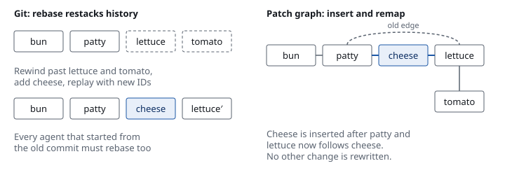

Lee’s hamburger example, redrawn: a rebase rewrites what comes after; a patch graph inserts the change and remaps two edges.

### Atomic’s answer: a causal graph built on patch theory (recording only)

Through open source, Lee met people using a causal graph instead of an ancestral one, as in Darcs and Pijul. (Almost nobody in the room had used either. He added that he preferred Mercurial to Git in 2010, but GitHub built the better workflow.) In a causal graph every piece of the hamburger is a node. To add cheese, Atomic only needs to know which node is the patty and which is the lettuce; it inserts the change between them and remaps the dependencies. That is patch theory, and he said it had him relearning college algebra at 55. Atomic’s internal training on it was planned for 90 minutes and took a day.

Atomic keeps three graphs: the causal graph of changes, a semantic graph of the code (with Tree-sitter syntax-tree search), and an intent graph that holds the knowledge graph. Work happens in views. Shared views are like long-lived branches; draft views are private, isolated subgraphs of the same live graph, so agents can see what other agents are doing in real time without worktrees. Deleting a draft removes its whole subgraph.

### The Atomic workflow: intent, change, review, gate (photos 3–4)

Lee said nobody will adopt a better version control system on its own merits, just as GitHub won with a workflow rather than with Git. So Atomic builds a knowledge graph per change. It starts with an intent: the problem statement, acceptance criteria and tasks, written before the work, like a GPS route for the agent. As the agent works, Atomic listens to its events and stores the whole session log against the change, including the model, the tool, the tokens used and the price. Goals sit above intents and can be mapped to the KPIs a CFO or CIO already tracks, so token spend rolls up to business goals.

Because it is a graph, it is queryable. His examples: which intent cost the most last week, the total cost of all intents created last week, and the acceptance rate per prompt across many changes.

| Step          | Object             | What it is                                                                                                      |
|---------------|--------------------|-----------------------------------------------------------------------------------------------------------------|
| 01 Intent     | Feature WorkIntent | The authored spec the work is held to: why, acceptance criteria, tasks, files, scope in, scope out, constraints |
| 02 Capture    | Change             | Each change comes from a planned session turn, with model, tokens and cost recorded                             |
| 03 Subject    | ReviewSubject      | One content-addressed scope, pinned, so the reviewer sees exactly what was produced                             |
| 04 Conclusion | PublicationReview  | A signed judgment, criterion by criterion                                                                       |
| 05 Gate       | PublicationGate    | A signed judgment, criterion by criterion; failures loop back to the intent                                     |

Slide 3. Intent → change → review subject → review → gate.

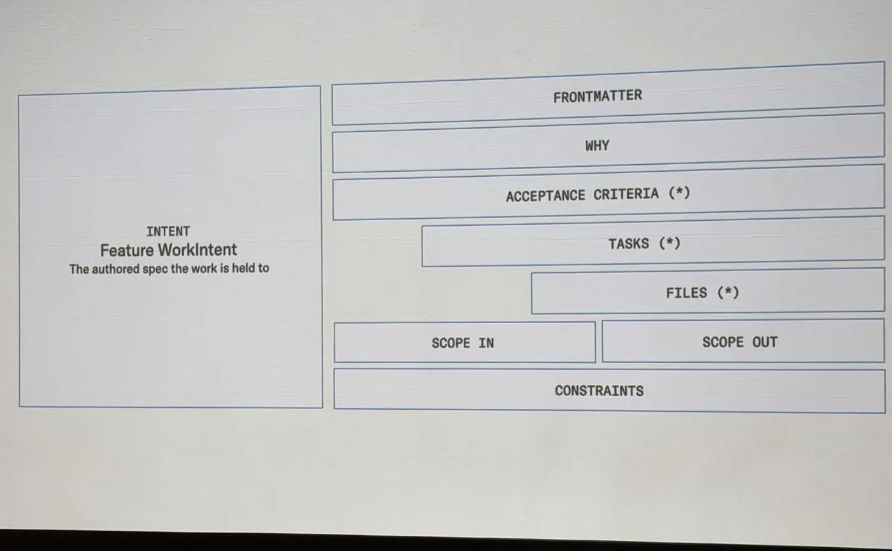

Slide 4. What an intent holds.

**Takeaway.** The unit of work is the intent, not the commit. Everything an agent does is recorded against what it was asked to do.

### Reviewing a graph instead of a diff (recording only)

The PR’s purpose is review, and a review is a diff. Lee told a story about a CTO who, at his suggestion, reviewed code under an anonymous account. Some teams answered his comments; others left the PRs untouched for two weeks. Bonuses were tied to PR closure and production pushes, so some managers held back other groups’ PRs. The CTO later walked the whole engineering org through both lists. The point: a simple review step had picked up politics.

With agents there are thousands of PRs. “When was the last time you read a 5,000-page book in an afternoon because your boss said it had to go out on Friday?” Atomic’s answer is to review the knowledge graph instead: did the agent follow the path the intent set, and did it do everything asked? The reviewer walks the graph in reverse and decides where to click in. In the demo he asked for a triage review explaining the change “like a third grader”, got three bullet points, and showed how a follow-up question queries just that part of the graph. It is still human in the loop, with the agent doing the driving.

### Demo, part 1: from a bad prompt to an attested change (photos 5–14)

The demo ran in VS Code with OpenCode using the Atomic agent and GPT-6.1 Sol through OpenRouter, in an empty project holding only Atomic’s folders. He typed a deliberately poor prompt, “let’s build a typescript hello world cli”. Atomic’s code-intelligence skills searched the vault and the code, wrote an intent, then built and tested the CLI in about a minute for 14.3K tokens and \$0.08.

An Atomic skill rewrites a bad prompt into a “why” statement that describes the problem rather than a solution. He credited the idea to Jackie Porter, his product manager at GitLab, who told him to bring problems, not solutions. The intent page shows the description, one acceptance criterion marked met with its verification evidence (the commands run and their results), and the task that satisfied it.

Slide 7. Built, tested and attested, then marked “needs review”.

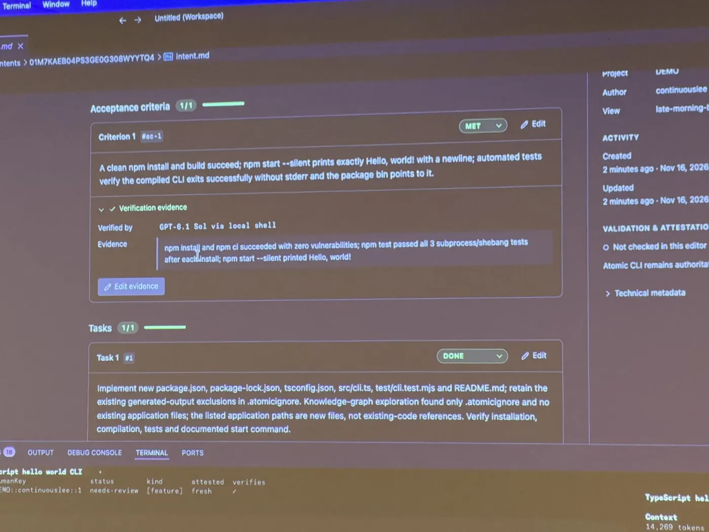

Slide 9. Each criterion carries its evidence.

Underneath, the intent is Markdown using generic directives rather than plain headings. Directives carry IDs and attributes, so a task can point at the acceptance criterion it satisfies, and links can target sections rather than whole files, which he noted Obsidian-style linking can’t do. He recommended directives to anyone building their own software factory, and said the files are meant for agents, not people to maintain by hand. The links are RDF relationships in an ontology; he said semantic web ideas (RDF, SPARQL, OWL) are seeing a resurgence.

Running `atomic intent graph` printed the intent as a tree and then as typed nodes with predicates such as “has turn”, “generated change” and “turn explained by”. He presented this as Atomic’s equivalent of a Git commit, which holds only a title, description, author and diff. An HTML view drew the graph and, for one change, showed its BLAKE3 content address and its cost of \$0.076934.

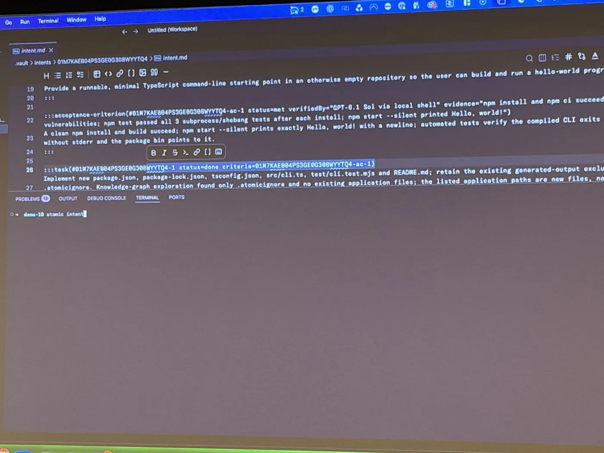

Slide 10. Directives link a task to the criterion it meets.

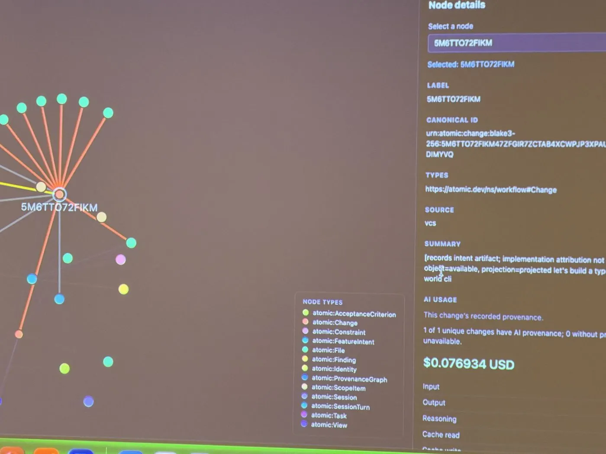

Slide 14. One change, its content address and its cost.

The tree on photo 11 lists two findings, MissingAttestation and MissingPlanId, and the graph header on photo 13 reads “0 implementing, 1 intent-artifact recording”. That suggests the code changes were not yet linked to the intent as implementation, which is exactly what the review in part 2 later flagged.

### Demo, part 2: an independent reviewer, and a gate that held (photos 15–17)

The first rule of SOX for code changes, he said, is that the person who wrote a change can’t be the one who approves it. So he asked who already creates ephemeral agents automatically to keep reviews compliant. In a new session he invoked a reviewer-grant skill. It creates a short-lived reviewer that is still tied to his identity, with read-and-record rights for one hour. Everything it produces is hashed with BLAKE3, attested and encrypted, so a human editing an intent after the agent validated it breaks the signature and shows up.

Reviews should not run in the session or folder that made the change. Atomic’s commercial product in progress, Outposts, will create a microVM per change and per review using smolvm, built by a friend who previously worked on Firecracker at AWS. The reviewer checks every acceptance criterion in its own file system, and a review intent links back to the feature intent to close the loop.

On stage the publication review didn’t complete. The agent reported that both author sessions were still active and lacked the completion signatures Atomic requires. It said it had not deleted anything, bypassed the gate or created a VM or production grant, and listed what remained: link the CLI’s changed files to the intent and finish an independent review. Lee had predicted the issue, since the review reused the same environment. The control did its job; the full closure was not shown.

Slide 16. A one-hour, read-and-record reviewer grant.

Slide 17. The gate refused to publish; nothing reached dev.

### Closing: 30,000 intents in two weeks (recording only)

He finished with a CTO whose team created 30,000 intents in two weeks and asked how to manage them. His reframe: the question is not managing 30,000 intents but what agents can do with that much queryable knowledge about why every change was made. Asked by customers whether Atomic will build a GitHub-style UI, he asks whether the UI is for people or for agents; agents don’t want one, and he doubts how much such a UI will matter in two to five years. His summary: agent-native source control should be designed for agents, not built by bolting agents onto existing tools.

**Takeaway.** Review moves from reading code to checking intent, criteria and evidence, with a different identity doing the checking and every step signed.

## Numbers we checked

Figures and claims from the talk against their sources. Checked found in a published source; Caveat holds with a condition or needed correcting; On screen read off the demo screen; Talk only heard in the room and not found elsewhere.

| Claim                                                                         | Figure                               | Source                                                                                                                                                                                                                                                                                            | Status    |
|-------------------------------------------------------------------------------|--------------------------------------|---------------------------------------------------------------------------------------------------------------------------------------------------------------------------------------------------------------------------------------------------------------------------------------------------|-----------|
| Anthropic replaced Git with Scion as merges grew                              | 2,500 → 30,000+ a day                | [Anthropic engineering, Oct 13, 2026](https://anthropic.com/engineering/redesigning-source-control); coverage reports 7 engineers in 5 months. Lee said “six weeks ago”; it was about five.                                                                                                       | Checked   |
| OpenAI acquired Pierre “last week”                                            | announced Nov 4                      | [Axios via Yahoo Finance](https://finance.yahoo.com/technology/ai/articles/exclusive-openai-targets-microsofts-github-112906674.html); [DevOps.com](https://devops.com/openai-acquires-pierre-computer-to-expand-codex-challenge-github). About 12 days before the talk; deal subject to closing. | Checked   |
| OpenAI built a new Git system, heard as “Panda”                               | Pando                                | [OpenAI, Scaling Git at OpenAI, Nov 2](https://openai.com/index/scaling-git-at-openai/): median push latency down nearly 80%, close to 1 PB of Git data a day. Name corrected; Pando is a Git backend, not a Git replacement.                                                                     | Caveat    |
| A former GitHub CTO now heads source control at OpenAI                        | n/a                                  | Not found. Reports name Taylor Blau, a long-time Git contributor formerly of GitHub, among the Pando authors ([Startup Fortune](https://startupfortune.com/openai-built-its-own-git-backend-called-pando-to-survive-a-commit-surge/)). Unverified as stated.                                      | Caveat    |
| First pull request, late 2008 or early 2009                                   | Feb 2008                             | [GitHub blog, Feb 23, 2008](https://github.blog/2008-02-23-oh-yeah-there-s-pull-requests-now/). Earlier than he said.                                                                                                                                                                             | Caveat    |
| PR search covers titles and descriptions; code search the default branch only | n/a                                  | Recording                                                                                                                                                                                                                                                                                         | Talk only |
| PRs in a large customer’s org                                                 | 150,000                              | Recording                                                                                                                                                                                                                                                                                         | Talk only |
| Disk for ten agents in Git worktrees, Rust builds                             | 500–600 GB                           | Recording, Atomic’s own demos. Vendor-run.                                                                                                                                                                                                                                                        | Talk only |
| GitHub Enterprise in 2015: hot/warm HA, one writable server                   | n/a                                  | Recording                                                                                                                                                                                                                                                                                         | Talk only |
| Demo: build the CLI                                                           | 1m 3s · 14.3K tokens · \$0.08        | Photo 7                                                                                                                                                                                                                                                                                           | On screen |
| Demo: cost of one change                                                      | \$0.076934                           | Photo 14                                                                                                                                                                                                                                                                                          | On screen |
| Demo: review session                                                          | 88.9K tokens · \$0.43                | Photo 17. Review did not complete.                                                                                                                                                                                                                                                                | On screen |
| Reviewer grant scope                                                          | read, record · 1 hour                | Photo 16                                                                                                                                                                                                                                                                                          | On screen |
| Intents one customer created                                                  | 30,000 in 2 weeks                    | Recording                                                                                                                                                                                                                                                                                         | Talk only |
| Atomic is open source, based on patch theory                                  | Apache-2.0                           | [github.com/atomicdotdev/atomic](https://github.com/atomicdotdev/atomic). Outposts is commercial.                                                                                                                                                                                                 | Checked   |
| Agents Atomic integrates with                                                 | Claude Code, Copilot, Devin and more | [Atomic docs, agent command](https://docs.atomic.dev/commands/agent). Vendor docs; depth of each integration unknown.                                                                                                                                                                             | Checked   |
| Atomic’s funding                                                              | \$2.5M pre-seed                      | [Vermilion Cliffs Ventures](https://vermilioncliffs.substack.com/p/hello-atomic-goodbye-git-rebuilding). Investor’s own post.                                                                                                                                                                     | Checked   |

## About the speaker

Lee Faus is the founder and CEO of Atomic Software, which he describes as rebuilding version control for AI-driven development, after two decades at Red Hat, GitHub and GitLab ([WeAreDevelopers profile](https://www.wearedevelopers.com/@lee-faus), [Sessionize](https://sessionize.com/LeeFaus)). In the talk he said he was at GitHub from 2014 to 2019 and at GitLab until about a year ago, and that he wrote the virtual file system behind Eclipse’s CVS and SVN support in the early 2000s; we didn’t verify the dates or the Eclipse work. Atomic closed a \$2.5M pre-seed round led by Slow Ventures, Irregular Expressions and Vermilion Cliffs Ventures. He also publishes Circuit Breaker, a petri-net workflow engine for pipelines and agents, as open source.

## Terms and technologies

Everything the talk named, in plain English, with a link to the real thing.

### Version control and review

[Git](https://git-scm.com/)  
The distributed version control system almost everyone uses. Each commit is a snapshot that points to its parent, which is the “ancestral” history Lee argues fits agents badly.

[Pull request](https://github.blog/2008-02-23-oh-yeah-there-s-pull-requests-now/)  
A request for a maintainer to pull changes from your branch or fork, plus the review discussion around it. GitHub introduced it in 2008; GitLab calls it a merge request.

[Rebase](https://git-scm.com/docs/git-rebase)  
Replaying commits on top of a new base, which rewrites them. Lee’s hamburger example is a rebase; ten agents from one commit means many rebases.

[Git worktree](https://git-scm.com/docs/git-worktree)  
A second working directory attached to the same repository, so you can check out several branches at once. Popular for running agents in parallel; each one costs a full working copy and build.

[Pre-receive and post-receive hooks](https://git-scm.com/docs/githooks)  
Server-side scripts that run when someone pushes. Pre-receive can reject a push; post-receive triggers things like CI. Lee named them as the checks that make GitHub block pushes when its services are down.

[Bugzilla](https://www.bugzilla.org/)  
The bug tracker used by Mozilla, Red Hat and many open-source projects, where patches were once attached to tickets.

[Subversion (SVN)](https://subversion.apache.org/)  
A centralized version control system that preceded Git’s dominance. Patches were exchanged as SVN diffs.

[Mercurial](https://www.mercurial-scm.org/)  
A distributed version control system from the same era as Git. Lee said he preferred it in 2010.

[Darcs](https://en.wikipedia.org/wiki/Darcs)  
A version control system by David Roundy that treats patches, not snapshots, as the thing being versioned, and introduced the “theory of patches”.

[Pijul](https://pijul.org/manual/why_pijul)  
A Darcs-inspired version control system built on a mathematically sound theory of patches, aimed at fixing Darcs’s soundness and performance problems. Atomic grew from it.

[Patch theory](https://pijul.com/model)  
The math of how changes combine, reorder and conflict. When two changes are independent their order doesn’t matter, so a change can be inserted where it belongs without rewriting others. Atomic is built on it.

[Scion](https://anthropic.com/engineering/redesigning-source-control)  
Anthropic’s in-house, server-based version control system, which replaced Git for its monorepo in 2026. Not available outside Anthropic.

[Pando](https://openai.com/index/scaling-git-at-openai/)  
OpenAI’s new server backend for Git, built for agent-scale pushes. Engineers and agents still use the normal Git client.

[Pierre (Code Storage)](https://devops.com/openai-acquires-pierre-computer-to-expand-codex-challenge-github)  
A startup offering Git hosting built for agents and app builders, plus open-source diff and file-tree libraries already used in Codex. OpenAI announced it would acquire Pierre in November 2026.

### Atomic’s concepts

[Atomic SCM](https://github.com/atomicdotdev/atomic)  
Atomic’s open-source version control system, written in Rust and based on patch theory. Files are graphs of changes rather than snapshots.

Views  
Atomic’s replacement for branches and worktrees: filtered perspectives on one shared graph. Shared views are long-lived; draft views are isolated workspaces for an agent or a session, and deleting one removes its subgraph.

Intent (Feature WorkIntent)  
The spec a change is held to: why, acceptance criteria, tasks, files, scope in and out, and constraints, stored as Markdown in the project’s vault. Goals group intents.

Attestation  
A signed, hashed record of what an agent session did: model, tokens, time, cost and changes. Editing an attested intent afterwards invalidates the signature. [Docs](https://docs.atomic.dev/commands/agent).

Reviewer grant  
A short-lived reviewer identity, tied to the requesting person, with limited rights (read and record, one hour in the demo), so the author and reviewer are never the same identity.

PublicationReview and PublicationGate  
Signed, criterion-by-criterion judgments that a change meets its intent and may be published to a shared view.

Outposts  
Atomic’s commercial product in progress: a microVM per change and per review, so reviews run apart from the authoring session. Described in the talk only.

Circuit Breaker  
Lee’s open-source petri-net workflow engine for running small pipelines against each change and restarting from the point of failure. Mentioned in his other public talks rather than this one.

### Knowledge graphs and meaning

Knowledge graph  
Facts stored as nodes and typed links. Atomic keeps one per change, linking intent, criteria, tasks, session turns, changes, files and identities, so you can query it.

[Ontology](https://www.w3.org/TR/owl2-overview/)  
A formal vocabulary of the kinds of things in a domain and how they relate. Atomic defines node types such as FeatureIntent, Change and SessionTurn, and predicates such as “generated change”.

[RDF](https://www.w3.org/TR/rdf11-primer/)  
The W3C model for describing things as subject–predicate–object statements identified by URIs. Atomic’s links between intents, criteria and changes are RDF relationships; its sidecar files are JSON-LD.

[SPARQL](https://www.w3.org/TR/sparql11-overview/)  
The W3C query language for RDF graphs.

[OWL](https://www.w3.org/TR/owl2-overview/)  
The W3C Web Ontology Language for defining classes and properties with formal meaning.

[Markdown generic directives](https://talk.commonmark.org/t/generic-directives-plugins-syntax/444)  
A proposed Markdown extension for custom blocks such as `:::task{status=done}`, with IDs and attributes. Not part of the CommonMark spec; supported by tools such as [remark-directive](https://github.com/remarkjs/remark-directive). Atomic writes intents this way so sections can be linked.

[Obsidian](https://obsidian.md)  
A Markdown note-taking app with a graph of links between notes. Lee’s point was that plain Markdown links target files, not sections.

[Tree-sitter](https://tree-sitter.github.io/tree-sitter/)  
An incremental parsing library that turns code into syntax trees, used for structural code search. Atomic uses tree-sitter-style syntax searches in its code intelligence.

### Identity, integrity and compliance

[BLAKE3](https://github.com/BLAKE3-team/BLAKE3)  
A fast cryptographic hash function. Atomic uses BLAKE3-256 hashes as content addresses for changes and provenance records.

[Decentralized identifier (DID)](https://www.w3.org/TR/did-1.0/)  
A W3C standard for identifiers whose holder proves control with cryptography rather than a central registry. Atomic authors appear as `did:atomic:…`.

[Sarbanes–Oxley (SOX)](https://en.wikipedia.org/wiki/Sarbanes%E2%80%93Oxley_Act)  
US law on financial reporting controls. For software changes it is usually read as separation of duties: the author of a change can’t be its approver.

[PCI DSS](https://en.wikipedia.org/wiki/Payment_Card_Industry_Data_Security_Standard)  
The card industry’s security standard, one of the regimes Lee said got baked into PR checks.

[FedRAMP](https://en.wikipedia.org/wiki/FedRAMP)  
The US government’s security authorization program for cloud services, another regime layered onto PRs.

### Agents and runtime

[OpenCode](https://opencode.ai)  
An open-source terminal coding agent, similar to Claude Code, that can use many model providers. Atomic ships an OpenCode plugin; the demo used it.

[OpenRouter](https://openrouter.ai)  
A service that routes requests to many model providers through one API. The demo ran GPT-6.1 Sol through it.

[Model Context Protocol (MCP)](https://modelcontextprotocol.io)  
The open protocol agents use to call tools and data sources. Lee’s point: an MCP server over GitHub or GitLab only sees what their search sees.

[Firecracker](https://firecracker-microvm.github.io/)  
AWS’s open-source microVM monitor behind Lambda and Fargate: lightweight virtual machines with strong isolation.

[smolvm](https://github.com/smol-machines/smolvm)  
An open-source tool for portable, fast-starting microVMs built on libkrun, pitched for sandboxing agents. Its author previously worked on containers and Firecracker at AWS. Atomic uses it to sandbox reviews.

## Reading and tools

### Atomic

- [atomicdotdev/atomic](https://github.com/atomicdotdev/atomic), the open-source version control system, and its [quick start](https://docs.atomic.dev/getting-started/quick-start).
- [AI agent workflows](https://docs.atomic.dev/getting-started/ai-agent-workflows) and the [Claude Code integration](https://github.com/atomicdotdev/atomic-claude) (hooks and skills) and [OpenCode integration](https://github.com/atomicdotdev/atomic-opencode).
- [Open source for the age of agent-native development](https://allthingsopen.org/articles/open-source-age-agent-native-development), Atomic on All Things Open, Jan 2026.
- [Control Planes over Forges](https://atomicdotdev.substack.com/p/control-planes-over-forges), Atomic’s newsletter.

### The industry moves he cited

- [Redesigning source control at Anthropic](https://anthropic.com/engineering/redesigning-source-control) (Scion), Oct 13, 2026.
- [Scaling Git at OpenAI](https://openai.com/index/scaling-git-at-openai/) (Pando), Nov 2, 2026.
- [OpenAI acquires Pierre Computer](https://devops.com/openai-acquires-pierre-computer-to-expand-codex-challenge-github), DevOps.com.

### Background

- [Pijul’s model](https://pijul.com/model) and [Why Pijul?](https://pijul.org/manual/why_pijul), for patch theory.
- [The Pull Request](https://tylercipriani.com/blog/2024/08/31/the-pull-request/), Tyler Cipriani, a history of how the PR emerged.
- [Why we got rid of our small-PR rule](https://rootly.com/blog/why-we-got-rid-of-our-small-pr-rule), Rootly, another team rethinking PRs for AI-written code.
- [Harness Agent-Ready Code Repository](https://sdtimes.com/software-development/harness-creates-source-code-management-for-agent-ready-development/), a competing take from an incumbent.

### Related sessions at QCon

- **Still ahead** Wed 3:55: [How To Kill the Code Review](https://qconsf.com/presentation/nov2026/how-kill-code-review) (Aviator), the closest match to this talk.
- **Still ahead** Tue 1:35: [Drawing the Rest of the Owl: A Blueprint for Your Software Factory](https://qconsf.com/presentation/nov2026/drawing-rest-owl-blueprint-your-software-factory) (Harness).
- **Still ahead** Wed 10:35: [How Netflix Retrofitted Its SDLC for AI Coding Agents](https://qconsf.com/presentation/nov2026/how-netflix-retrofitted-its-sdlc-ai-coding-agents).
- **Still ahead** Tue 2:45: [Lessons from Building a \$100M Product in Six Weeks at OpenAI](https://qconsf.com/presentation/nov2026/lessons-building-100m-product-six-weeks-openai).

## All slides

Slide 1. Title slide

Slide 2. Act 01: the dark ages

Slide 3. The five-step loop

Slide 4. Anatomy of an intent

[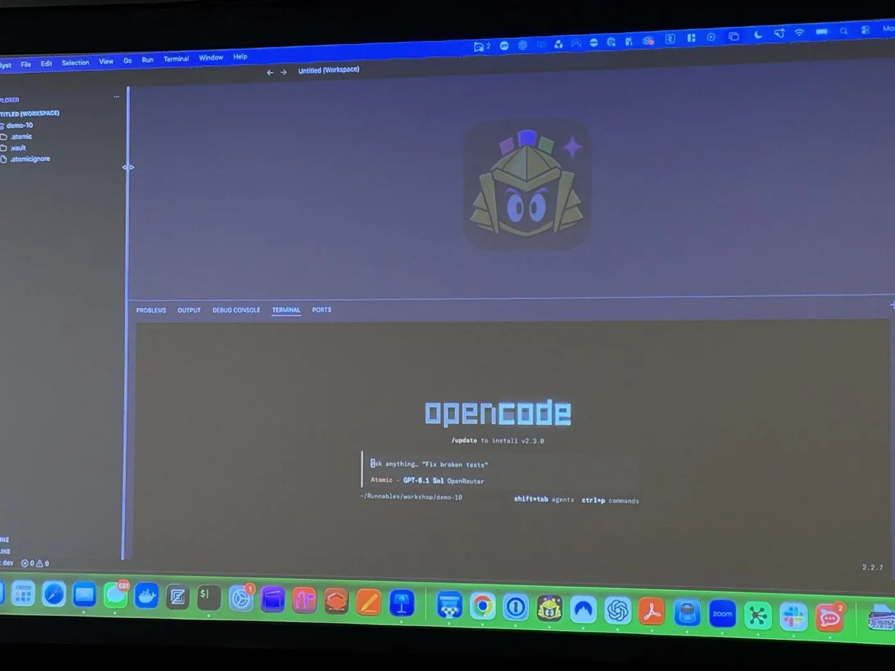](../slides/wait-you-re-still-doing-prs/deep/p05.webp)

Slide 5. Demo: empty project

[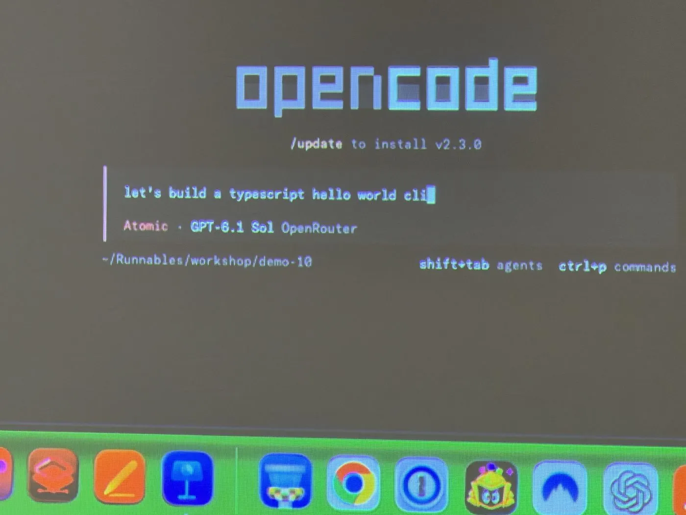](../slides/wait-you-re-still-doing-prs/deep/p06.webp)

Slide 6. Demo: the prompt

Slide 7. Demo: built, verified, needs review

Slide 8. Demo: the intent page

Slide 9. Demo: verification evidence

Slide 10. Demo: Markdown directives

[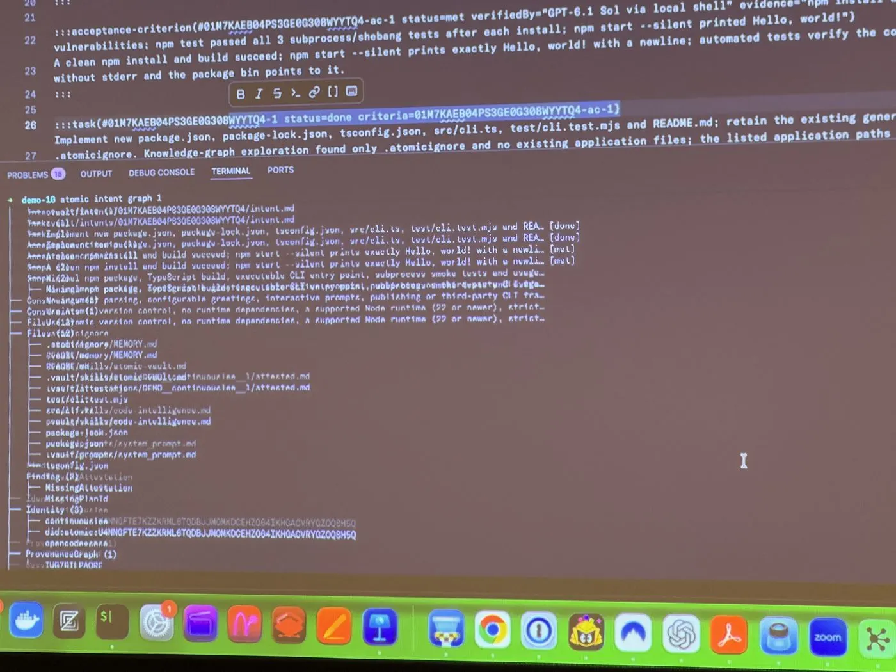](../slides/wait-you-re-still-doing-prs/deep/p11.webp)

Slide 11. Demo: intent graph tree

Slide 12. Demo: graph details

Slide 13. Demo: graph view

Slide 14. Demo: a change's cost

[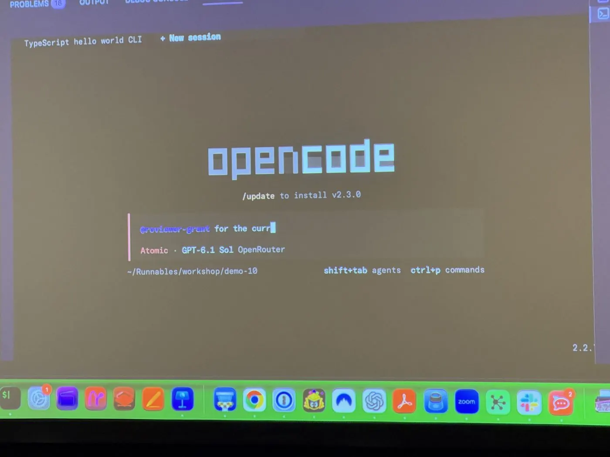](../slides/wait-you-re-still-doing-prs/deep/p15.webp)

Slide 15. Demo: asking for a reviewer

Slide 16. Demo: reviewer grant terms

Slide 17. Demo: the gate holds
