# You Can't Read the Code Anymore - Verifying Software in the Age of AI

**Speaker:** Omer van Kloeten (Principal Engineer, Forter)  
QCon SF 2026 · Code Beyond Engineers & Engineering Teams · Wed Nov 18, 14:45 · Ballroom BC  
[Session page](https://qconsf.com/presentation/nov2026/you-cant-read-code-anymore-verifying-software-age-ai) · [All 42 slides](../gallery/you-cant-read-the-code-anymore.md)

> Forter's Omer van Kloeten on reviewing behavior instead of code: agents backfill plain-English Cucumber tests into existing services, and a strict, fully faked harness makes those tests trustworthy.

## Key points

- Omer said verification, not authoring, is now the hard part. Reading code is harder than writing it, few people read what their agents generate, and agent-written tests mark their own homework.
- He proposed reviewing what a system does rather than how it is built, using plain-English Gherkin scenarios run by Cucumber that agents write and maintain.
- He listed the properties that make such tests trustworthy: black box, comprehensive (every observable behavior, citing Hyrum's Law), explicit about what must not happen, plain English, fast, deterministic and hermetic.
- Forter adds a Whitebox phase after red, green, refactor, where the agent writes green tests for behavior the implementation introduced so a human can disagree with it.
- Telem, Forter's skills plus deterministic tooling, backfills tests into existing code flow by flow. A billing engineer said it covered a repo in one quarter after three senior engineers had failed.
- On Forter's gateway it produced about 24,700 tests across flag and configuration variations, which ran in 58.4 seconds on one laptop using in-memory fakes checked by parity tests.
- A walkthrough skill explains the suite top down in HTML for review in crit; Omer said subject matter experts' surprises are a success, not a failure.
- His slide put the cost at hundreds to thousands of dollars in tokens per system and 1 to 2 agent hours per flow. Human review took days for simple systems and about four engineering months for billing.

From an audio recording and 62 photos of the deck, kept here as 41 slides plus one close-up. The deck shows no slide numbers, so slides are numbered by the order they were photographed, and earlier builds of the same slide were dropped. Gaps in the photo sequence mean a few slides may be missing; the recording covers the talk end to end. The repo section is my own reading of [forter/telem-seed](https://github.com/forter/telem-seed) at commit `4995a9d` (12 Nov 2026). All results are Forter’s own, from its internal systems.

## The talk in brief

Omer van Kloeten’s starting point: nobody reads all the code they own, coding agents now write more of it than anyone can review, and teams cope by skimming diffs and spot checking. He called that reinventing manual QA, poorly. His answer is to stop reviewing the code and review the behavior instead, as plain-English Gherkin scenarios run by Cucumber. Agents write and maintain the scenarios; humans read them and agree or disagree.

Forter built this into Telem (pronounced “tell ’em”), a set of agent skills plus deterministic tools. Its backfill walks an existing service one business flow at a time and pins today’s behavior as characterization tests: black box, comprehensive, explicit, fast, deterministic and hermetic, using in-memory fakes checked by parity tests. On Forter’s API gateway that produced about 24,700 scenarios that run in under a minute on a laptop. After backfill, new work follows a “Red, Green, Refactor, Whitebox” loop. Forter published a seed repo so other teams can have their own agent grow a Telem fitted to their stack.

> “We’ve reinvented manual QA, poorly.” (Slide 8)

## In depth

The talk ran in four movements: the problem, what a trustworthy test looks like, how Telem backfills brownfield code, and what it costs. Slide numbers follow photo order.

### The problem: scared of your own system (slides 2–8)

Forter sells fraud prevention and describes its business as trust in e-commerce. Its customer-facing gateway, Gate, is an API orchestrator: HTTP in, many calls downstream. Every bug there is seen by customers immediately, it has to stay up when downstream doesn’t, and after 13 years of decisions it looks less like a box with two arrows and more like a hand-drawn tangle of stores, queues and question marks.

The Gate team wanted to add a small feature and gave a large estimate, because they were afraid of it. Omer’s formula on slide 3 was “change + fear = bigger change”. Coding agents make it worse: more code nobody wrote or read, managers quoting “everyone else is shipping 10x as fast”, and the fear now running in parallel workstreams. When he asked who reads all the code their agents generate, almost no hands went up.

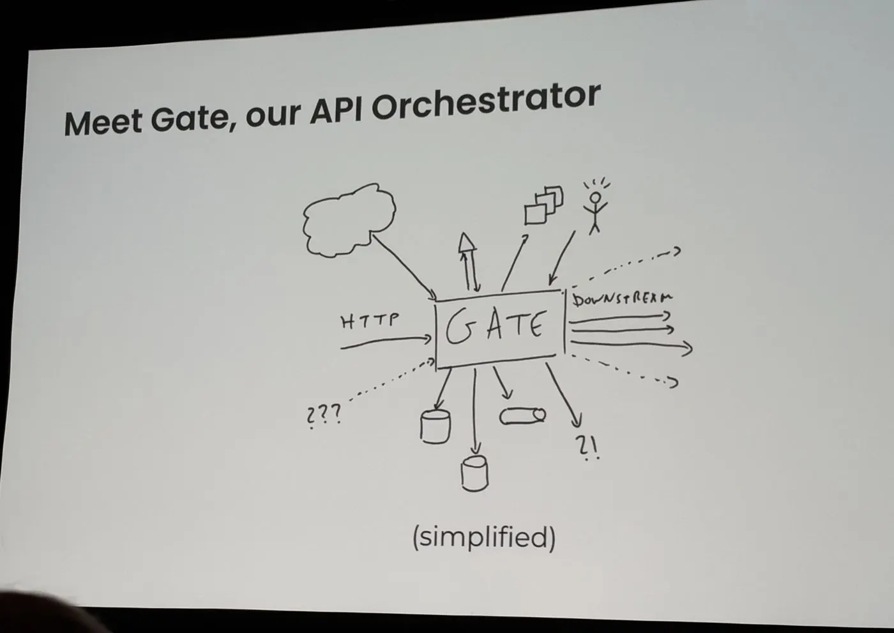

*Slide 2: Gate, Forter’s API orchestrator, “simplified”.*

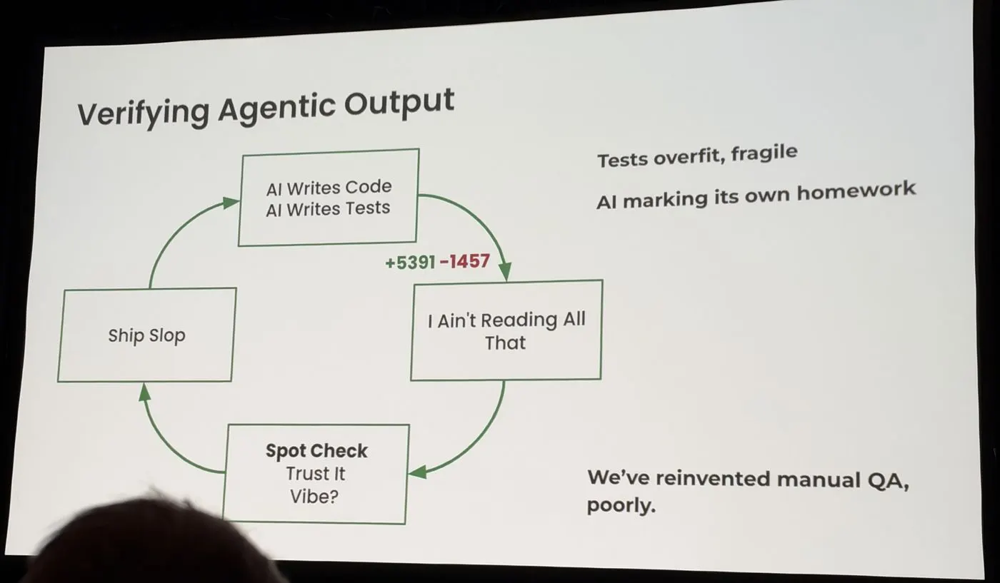

*Slide 8: The loop most teams are in today.*

> the risk is not bad code in general, it is changing behavior customers depend on without knowing it, and agents increase the rate of that.

### Review the what, in plain English (slides 9–13)

Omer split verification into three questions. Why are we building it (hopefully a human call), what does the software do, and how is it built. He expects the how to matter less over the next two to three years as models write better code, so the what is where review effort belongs. The traditional ways to learn the what were to write the code yourself (easy) or read code and tests (hard). If nobody writes the code anymore, the easy path is gone.

His replacement is Gherkin: Given, When, Then scenarios in plain English, run by Cucumber, which has existed since 2008. He admitted he was skeptical of Cucumber for years because the step definitions behind the prose add an authoring and maintenance layer. Agents remove that cost, and models already know the format well. The reframed workflow on slide 13: a human writes the spec, the human aligns with the agent on the what (the agent “grills” and the pair loops), the agent writes the implementation with the tests as its feedback loop and may not touch them, and the agent then refactors.

*Slide 11: A Gherkin scenario instead of code.*

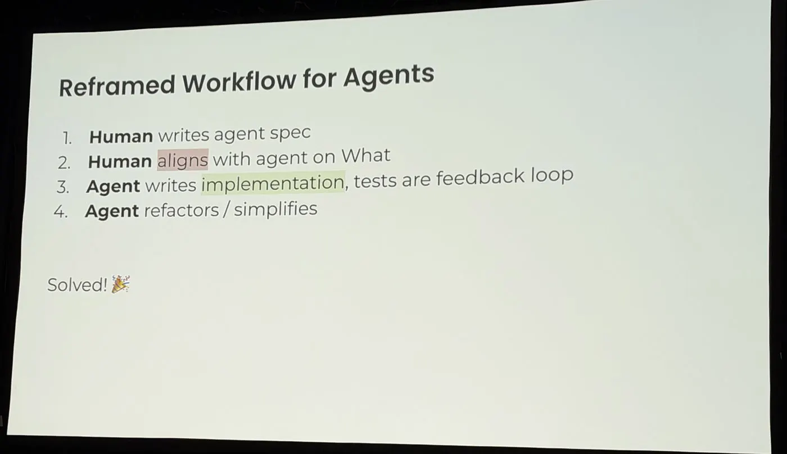

*Slide 13: The reframed workflow, before the catch.*

### What makes the tests trustworthy (slides 14–19)

“I don’t trust the tests” turned the talk. Omer listed the properties a test suite needs before a human can rely on it instead of the code:

| Property      | What it means                                                                                                                                               | Example from the slides                                                                                                                    |
|---------------|-------------------------------------------------------------------------------------------------------------------------------------------------------------|--------------------------------------------------------------------------------------------------------------------------------------------|
| Black box     | Assert behavior at the boundary: effects on users (the PM view) and on other parts of the system (the architect view). Language and framework don’t appear. | Given merchant A is configured as async, when I send a request, then I get a 202, the fraud decision is made and the audit log is written. |
| Comprehensive | Every observable behavior gets a test. Behavior exposed is behavior used (Hyrum’s Law), and a missing test becomes the agent’s assumption.                  | The same scenario with flag A off and with flag A on.                                                                                      |
| Explicit      | State what must not happen, so the agent can’t decide silently.                                                                                             | Flag A on: we should write to S3. Flag A off: we shouldn’t write to S3.                                                                    |
| Plain English | Readable by a PM, a reviewer or an SME in seconds.                                                                                                          | Gherkin throughout.                                                                                                                        |

The sidebar on slide 19 made the review case. In a normal PR the reviewer has to infer the what from the how. With plain-English tests in the same PR, the reviewer can fail fast on the behavior. His example: “Given 100 line items of \$5 each and 1% tax, the tax should be \$5”, while the code’s per-item rounding gives \$0.

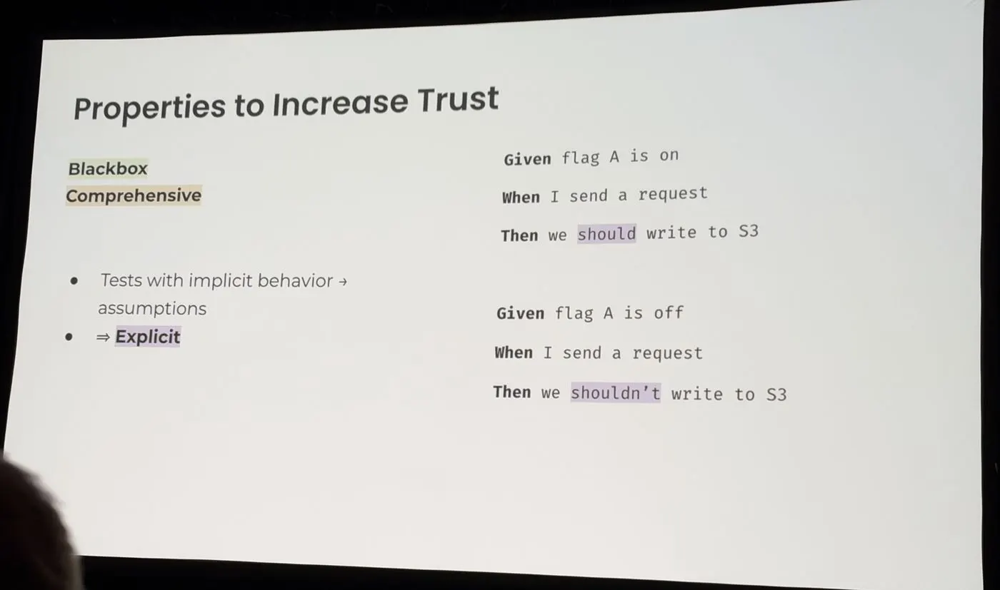

*Slide 17: Explicit: say what must not happen.*

*Slide 19: A reviewer can catch the \$0 tax bug without reading the loop.*

> “has tests” is not the bar. The bar is black box, comprehensive, explicit and readable, and each property closes a specific way an agent can quietly get it wrong.

### Red, Green, Refactor, Whitebox (slides 20–22)

Implementation erodes comprehensiveness. Nobody thinks of every edge case, dependencies bring behavior, and agents sometimes add code nobody asked for. In his example, a test for one \$500 line item passes, but per-item flooring silently makes 100 items of \$5 owe \$0 in tax. Nobody would find it, because nobody reads the code.

So Telem adds a fourth phase to red, green, refactor. After refactoring, the agent inspects the code white box and writes comprehensive green tests for behavior the suite did not yet claim. If a human disagrees with a green test (“the tax should not be \$0”), that is a disagreement about alignment: go back to red, rewrite the test as failing, and let the agent fix the code. Rework is cheap now, he said; the agent comes back 30 seconds later. Red also changes meaning: not one failing test but a whole set of them that represents mutual understanding.

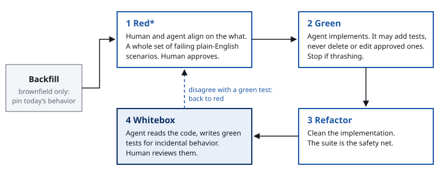

### Brownfield, and Telem (slides 23–28)

None of that works on existing code, because new code always touches old code and there is no feedback loop for the old behavior. The usual move is to write tests that pin current behavior first, which is slow and expensive. A senior engineer on Forter’s billing team said three senior engineers had tried and failed to backfill tests into their codebase over the years.

The ideal Omer described: give the agent a backfill command, let it go business flow by business flow, read the existing code (the how) and write comprehensive what tests, on the principle that what the system does today is its behavior, bugs included. Engineers then review and steer, for example removing invented explanations of why the code was written a certain way. Telem, which he has iterated on for seven months, is that command. It combines skills that guide the agent (happy path, edge cases, error cases, the de facto API, feature flags and configuration, exploration and hypotheses) with deterministic tools that don’t trust the agent:

- The agent may reference only production entry points, which forces black box tests.
- Decision tables are enumerated mechanically, so two flags A and B produce all four combinations.
- A new feature flag fails every test that reaches it until it is declared, with its values enumerated.
- Linters cover the Gherkin, the step code and the implementation. Because the tests repeat a small set of patterns, the linters can be strict.

*Slide 25: Skills plus deterministic tooling.*

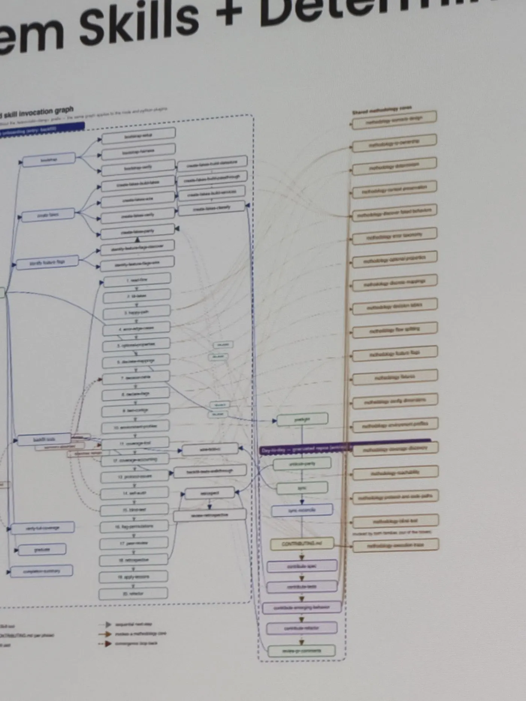

*Slide 26: Close-up of the skill invocation graph.*

On Gate the backfill produced about 8,000 business flows and more than 24,000 tests across configuration and flag variations (slide 27). Reading 8,000 tests means never seeing the forest, so a walkthrough skill has the agent build an interactive HTML explainer from the test text alone, most abstract level first. If the top level is wrong there is no point going down. The engineer discusses each level with the agent in crit, and the agent explains or corrects itself. Omer said surprises are successes: subject matter experts kept saying “I didn’t know it did that”, which is relearning their own system and lowering the risk of owning it.

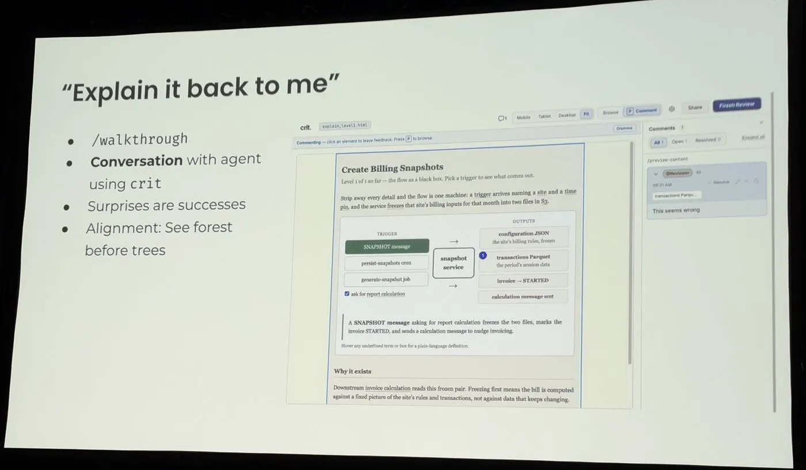

*Slide 28: The walkthrough, reviewed in crit.*

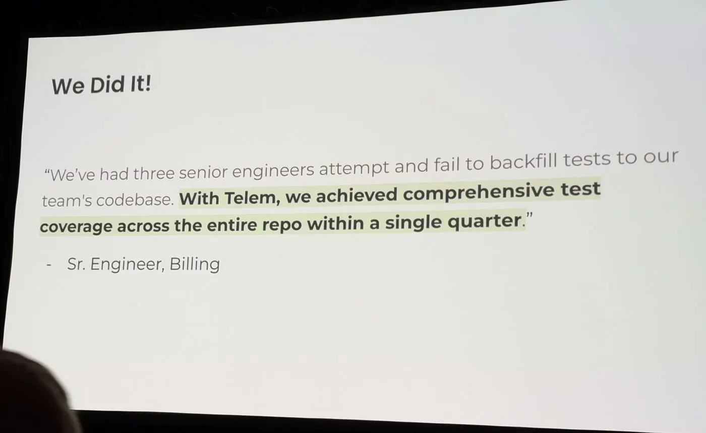

*Slide 29: The billing team’s result.*

### Results at Forter (slides 29–30, 35–37)

Slide 30 claimed more than 10,000 user-invokable behaviors not broken at Forter in the past 60 days. Omer conceded some might have been caught later by manual testing anyway. One engineer was shocked that a one-line change altered many behaviors; it was infrastructure code whose effect bubbled up into many user-observable flows, so the real size of the change was large. The Gate change from the start of the talk shipped with no incidents and no unexpected behavior, and the engineer on it said Telem gave him confidence, including on a tricky case where the internal request is routed differently.

He also described compounding value. A ticket agent that used to interrogate code to triage behavior can read the plain-English suite instead, which is validated on every run: living documentation. It also gives coding agents better context; an engineering manager said agents “come back with implementations that make sense”. Forter is experimenting with generating onboarding material and documentation from the test surface.

### Making it sustainable: speed and fakes (slides 31–34)

That many tests are only usable with a fast loop. Slide 31 shows 24,740 tests passing in 58.4 seconds of wall time on one developer laptop. The trick is fakes: in-memory implementations of each IO dependency (a key-value store becomes a map), not containers for Kafka or a database. To keep fakes honest they are checked against the real dependency with parity tests, which he called a whole other talk. Because tests never leave their runtime, they parallelize and run in milliseconds.

Two bonus properties follow. Faking everything, including the clock, removes nondeterminism, so tests are deterministic and stop being flaky. And because the test controls the whole world around the code, it can forbid any IO it didn’t declare. A test that expects a request, a response and an audit-log write will fail with “unexpected write to table Foo” if the code writes anything else: hermetic.

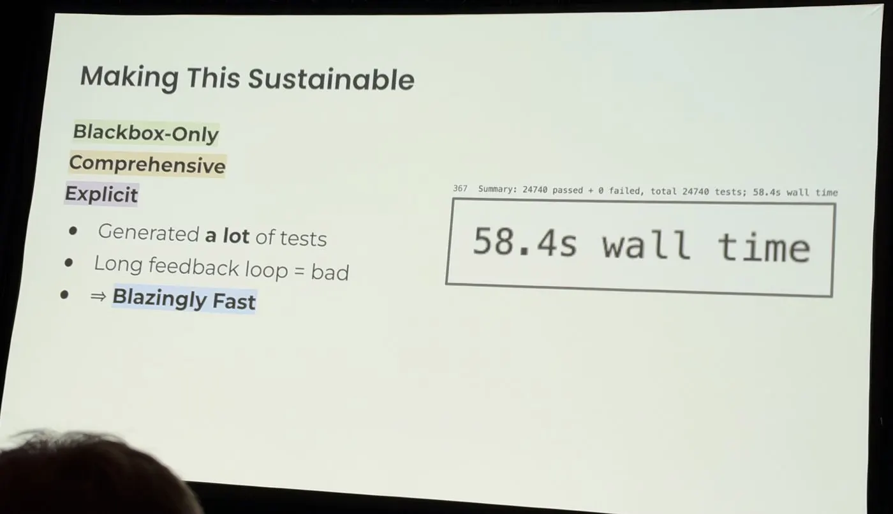

*Slide 31: 24,740 tests in 58.4 seconds.*

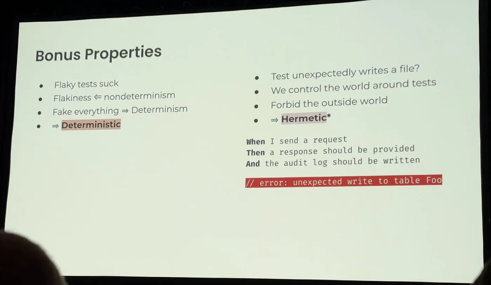

*Slide 33: Deterministic and hermetic.*

> the full list on slide 34 is black box, comprehensive, explicit, blazingly fast, deterministic, hermetic, plain-English tests. Omer’s point was that these were always the aspiration; agents now make them affordable.

### Limits, costs and adoption (slides 38–42)

Telem is specialized. It does not test black box to black box integration, run evals for agentic systems, enforce architecture constraints or trade-offs, or look at production. It targets deterministic, classical services. Compose it with other tools.

| Cost                             | What the slide said                                                                                                  |
|----------------------------------|----------------------------------------------------------------------------------------------------------------------|
| AI backfill, tokens              | \$100s to \$1,000s per system                                                                                        |
| AI backfill, time                | 1 to 2 hours in Claude Code per flow                                                                                 |
| Human attention, simple systems  | Days of review                                                                                                       |
| Human attention, complex systems | High variance. Billing case study: previously “practically impossible”, about 4 net engineering months, parallelized |

On adoption, he said the user is the team but the buyer is the engineering manager, who controls headcount and focus. Managers want to see impact and quick time to value. Forter built an internal dashboard of business cases covered and regressions prevented over time, per service and globally, plus case studies. For time to value, the first backfilled flow goes into CI immediately and starts protecting it.

The DIY slide pointed to [forter/telem-seed](https://github.com/forter/telem-seed): a seed your own agent grows into your Telem (skills, tools, methodology) fitted to your stack, team, preferences and harness, with a sample webhooks delivery service. He called it a work in progress and asked for feedback. In Q&A someone asked whether the backfilled suite could drive a rewrite into a new framework. Omer said tests sample the system through examples, so regenerating a system from them would overfit. Property-based testing might help but isn’t there yet. What the suite does give is the option to migrate or upgrade behind the scenes while keeping the same what.

*Slide 39: What it costs.*

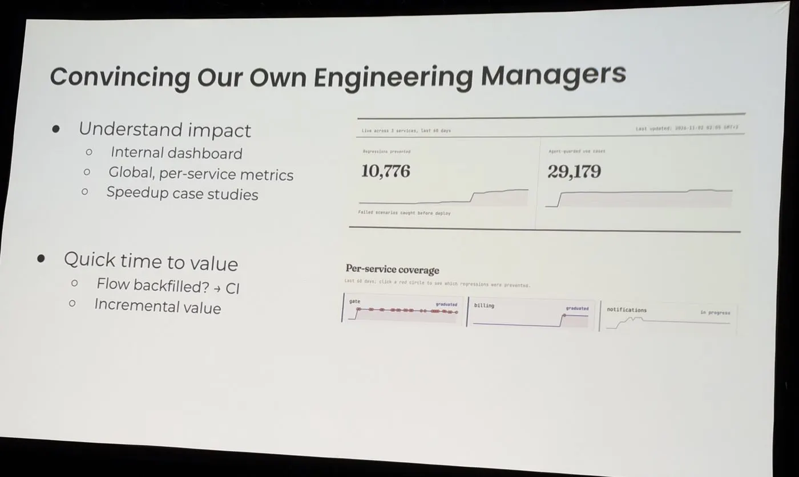

*Slide 40: The adoption dashboard.*

## Inside the telem-seed repo

I read [forter/telem-seed](https://github.com/forter/telem-seed) end to end at commit `4995a9d`. It has 53 commits between 9 and 12 November 2026, almost all by Omer, and is dual licensed: MIT for code and CC BY 4.0 for the docs. It is not a tool you install. It is about 45,000 words of specification written for a coding agent, plus a worked sample. You point your agent at it and the agent builds you a Telem implementation.

### What is in the box

| Path                                                          | What it holds                                                                                                                                                                                              |
|---------------------------------------------------------------|------------------------------------------------------------------------------------------------------------------------------------------------------------------------------------------------------------|
| `README.md`                                                   | How a human plants the seed: read the blog and principles, “become opinionated”, clone, have the agent read `seed/README.md` and build the skills, then iterate. States what Telem is not for.             |
| `seed/principles.md`                                          | The thesis and nine principles (below). The agent must get human approval to compromise on any of them.                                                                                                    |
| `seed/shape.md`                                               | What gets built: per-platform skills plugins named `/telem-{platform}`, three kinds of linters, shared tools, and per-repo runtime scaffolding.                                                            |
| `seed/skills/`                                                | Specs for `backfill` (with all its sub-skills), `sync` and the `contribute-*` skills.                                                                                                                      |
| `seed/tools/`                                                 | Specs for eight deterministic tools: the flag permutation runner, decision-table checker, flow-split auditor, branch explorer, affected-flows attributor, flag audit, lint rules and llm-lint.             |
| `seed/fakes.md`, `discovery.md`, `scenario-design.md`         | The methodology cores: how to build fakes, how to discover behavior (coverage, reachability, error taxonomy, decision tables, protocol thinking, flags, blind tests), and how to write and name scenarios. |
| `seed/runtime-artifacts.md`, `plugin-versioning.md`, `hints/` | What the skills leave in a target repo, how plugin releases are retrofitted, and platform hints (ast-grep, network blocking for Node and Python).                                                          |
| `sample/`                                                     | A small webhooks service written entirely by agents with humans steering, after Telem was applied. Sanitized of Forter’s internal libraries, so its tests can’t be executed.                               |

The seed insists the result be “hyper-specific” to the user: their stack, their agent harness (Claude Code, Codex and so on), their team’s conventions, and their infrastructure under its real names. It suggests keeping those specifics in a context skill the generic skills call.

### The nine principles

The thesis: a service’s functional tests should be a durable, executable, black-box specification of every behavior it promises at its boundaries. The zeroth principle is pragmatism; any rule can be broken if the trade-off is understood and hedged.

1.  **Contract-first.** Assert at observable boundaries (response, persisted data, emitted messages); name steps in business vocabulary, not functions.

2.  **The suite is the durable specification.** Scenario names carry the concern, descriptions the impact and rule, comments the context and links. PRDs are not committed; the tests outlive them.

3.  **Make the implicit explicit.** Defaults become Given steps, flags go in a manifest, dynamic values get shape assertions.

4.  **Complete observable behavior.** Status-only or substring checks are smoke tests. When unsure whether two cases differ, keep both.

5.  **Account for the negative space.** Every effect must be claimed; any unclaimed side effect fails the scenario.

6.  **Deterministic by construction.** Fake every source of IO, time and randomness; parallel runs are evidence of isolation.

7.  **Speed enables trust.** Scenarios should take single-digit milliseconds; hundreds of milliseconds is treated as a bug signal.

8.  **Fakes preserve behavior, not wiring.** No mocks or call counts. Fake the lowest IO seam; prove fakes with parity tests.

9.  **Mechanical evidence beats intuition.** Agents are “lazy”, so coverage loops, decision tables, flag accounting and linters replace their judgment calls.

### The lifecycle: backfill, graduate, contribute, sync

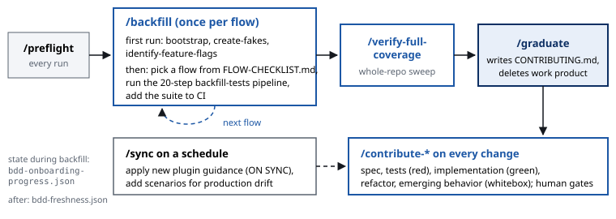

**Preflight** fails fast before any run: runtime version, required tools and MCP connections, the right model, a green suite and clean tree, and an up-to-date plugin. **Bootstrap** explores the repo into a report (entry points, IO boundaries, non-determinism, flags), installs Cucumber and coverage, makes the smallest production change needed for a test entry point, builds the World, blocks the network, and proves the harness with zero tests and then one smoke test. **Create-fakes** builds a fake and its parity tests for every IO boundary, plus clock, random and UUID fakes, and writes meta-tests proving that unowned IO and real network calls fail. **Identify-feature-flags** builds a strict flag fake that throws on any undeclared read and sets production values as the baseline.

**Graduate** salvages what was learned, writes `CONTRIBUTING.md` (linked from `AGENTS.md` and `CLAUDE.md`) and deletes the work product. **Contribute** is the gated Red, Green, Refactor, Whitebox flow, with a `review-pr-comments` skill that sorts reviewer comments into local fix, convention, methodology defect or reviewer wrong, and routes conventions into the repo guides rather than fixing one line. **Sync** runs periodically: it applies every plugin changelog entry newer than the repo’s version (each carries an `ON SYNC:` instruction), diffs production since the last checked commit, attributes each changed hunk to every flow that runs it, and asks the user when a scenario asserts behavior production no longer has.

### The backfill pipeline, one flow at a time

The flow checklist is built on the first run. The agent finds routes, consumers and crons, the user picks which technical patterns count as flows, and each flow gets a business name and complexity rating, reviewed in crit. Flows with too many combinations are split along behavior axes into sub-flows, and a tool proves every combination is resolved. Then each flow runs these steps without pausing, except at human gates:

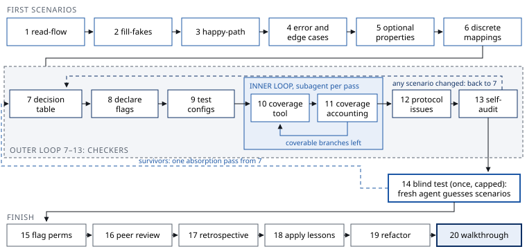

The steps that matter most for understanding how backfill actually finds behavior:

| Step                 | What it does                                                                                                                                                                                                                                              | What stops the agent cutting corners                                                                         |
|----------------------|-----------------------------------------------------------------------------------------------------------------------------------------------------------------------------------------------------------------------------------------------------------|--------------------------------------------------------------------------------------------------------------|
| 1 read-flow          | Traces the handler pipeline, call graph and service boundaries; greps for dynamically loaded code. Writes a dated `<flow>.analysis.md` of IO dependencies, config dimensions and missing fakes.                                                           | The analysis is a reviewable artifact; it can propose a flow split.                                          |
| 3 happy-path         | Writes the primary scenario, asserting the full response and every IO side effect through `takeOwnershipOf*`.                                                                                                                                             | The After hook fails any unowned IO; gplint enforces registered IO names.                                    |
| 4–6                  | Works a failure-mode catalog per operation using `fail(scenarioId, op, sequence)`, then every optional input field, then every switch, lookup or filter keyed on input.                                                                                   | Discovery checklists in `discovery.md`.                                                                      |
| 7 decision-table     | Crosses the flow’s behavioral dimensions into a grid. Each cell is `covered`, `new`, `belt` (shares a code path; short outline) or `cannot-occur`, with a reason.                                                                                         | check-decision-table fails on any missing, duplicate or unknown cell and cross-checks named scenarios exist. |
| 8 declare-flags      | Runs the suite and collects “flag not declared” failures, then classifies each flag.                                                                                                                                                                      | The strict flag fake throws on any undeclared read.                                                          |
| 10–11 coverage       | Each pass, a fresh subagent runs branch coverage, lists reachable-but-untaken arms and writes scenarios. Accounting classifies every remaining branch and statement as coverable, unreachable from this flow, instrumentation artifact or telemetry only. | explore-branches generates the worklist; the loop repeats while coverable branches remain.                   |
| 12 protocol-issues   | For each external system, thinks about what can happen on the wire as well as which branches exist; negative-asserts silent drops.                                                                                                                        | No two outcomes that look identical at every boundary get separate scenarios.                                |
| 14 blind-test        | A fresh subagent sees only the feature file, guesses missing scenarios, then may read the code to fix them.                                                                                                                                               | Capped; stops when a round adds no new category of behavior.                                                 |
| 15 flag-permutations | Records the flow’s flags in `flag-manifest.json` and runs every combination.                                                                                                                                                                              | The runner refuses to run if any feature file is missing from the manifest.                                  |
| 16 peer-review       | A subagent reviews all changed files as five personas, one representing the methodology.                                                                                                                                                                  | A confirmed llm-lint violation is always must-fix.                                                           |
| 17–18                | Writes costly lessons to `WRITING-TESTS.md` and repo gotchas to `COLLECTED-WISDOM.md`, then fans each new lesson out across every earlier feature file.                                                                                                   | No two agents write the same file at once.                                                                   |
| 20 walkthrough       | Explains the feature file to the user from the file alone, one HTML page per abstraction level, reviewed in crit. Each correction is diagnosed: I misread, unclear wording, real bug (report, don’t fix), wrong assessment, or untested behavior.         | The human gate.                                                                                              |

> backfill is not “ask the agent to write tests”. It is a fixed pipeline where coverage, decision tables, flag accounting, a blind second agent and a human walkthrough each catch a different way the first pass is incomplete. Coverage alone is not enough: the sample’s own notes say its real bugs sat on lines already covered, and were found by decision tables, config reading and protocol thinking.

### The test harness

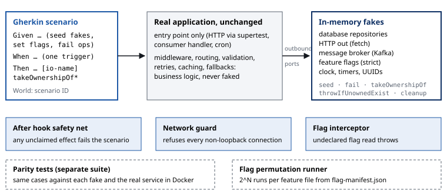

The fakes spec is the most opinionated part of the repo. Every fake exposes the same API: `seed`, `fail`, the production-facing surface (anything else crashes with a diagnostic), `takeOwnershipOf*` and a safety net. Ownership has five hard rules: claim by a concrete key, exact match only, throw when nothing matches, mark what was claimed, return deep copies. Mocks and spies are banned because asserting how code was called freezes the call graph. Out-of-process emulators (containers, memory servers, local cloud emulators) are rejected as fakes because they make the test an integration test; they belong in the parity suite instead. For SQL, the seed fakes the repository layer rather than the driver, so it doesn’t need a SQL parser, and parity tests against the real database compensate.

The sample shows what that buys. Its non-determinism fake runs every timer at zero milliseconds but records the delay production asked for, so a retry scenario must claim the backoff schedule as an effect. Its network guard wraps Node’s socket `connect`, the one choke point every client ends in. Its parity ledger compares the database fake with real MySQL 8, the HTTP fake with Node’s real fetch, and the Kafka fake with a real KafkaJS consumer on Apache Kafka 3.9.

### The eight tools you build

| Tool                    | Job                                                                                                                                                                                | Gate or advisory |
|-------------------------|------------------------------------------------------------------------------------------------------------------------------------------------------------------------------------|------------------|
| Flag permutation runner | Runs each feature file under all 2^N combinations of its declared flags (cap 10, refuse above 20), in parallel, with a serial pass for `@no-parallel`; merges JUnit XML.           | Gate             |
| check-decision-table    | Expands the declared dimensions and fails on any missing, unknown or duplicate cell or a disposition without a reason; optionally cross-checks scenario names in the feature file. | Gate             |
| audit-flow-split        | The same check for flow splits: `one-of` and `powerset` axes, every combination resolved, exclusions one by one, never by a bulk rule.                                             | Gate             |
| explore-branches        | Reads a coverage report and lists reachable-but-never-taken arms and unrun error handlers, with snippets.                                                                          | Worklist         |
| affected-flows          | For each changed hunk, which flows ran it: covered, candidate (ran the enclosing function or file) or unattributed. Used by sync.                                                  | Worklist         |
| flag-audit              | Statically extracts flag names production reads and compares them to baseline and manifest.                                                                                        | Audit            |
| Lint rules              | 13 eslint rules for Node, 15 flake8 codes for Python, 4 custom gplint rules for Gherkin (for example `then-step-ordering`, `well-known-io-names`).                                 | Gate             |
| llm-lint                | Plain-English rules checked by a cheap model, one rule per call, over changed files. Rules exist for feature files, step definitions, fakes and decision tables.                   | Advisory         |

### The sample app

The sample is a webhooks delivery service in TypeScript: an Express REST API, a Kafka consumer that fans each message out over HTTP with exponential-backoff retry, MySQL for subscribers, the delivery log and topic flags, and an OpenFeature flag served by a MySQL-backed provider. Four business flows were backfilled one at a time: subscriber management, flag management (including the provider), webhook delivery and the health check.

| Measure (our count)                                    | Value       |
|--------------------------------------------------------|-------------|
| Production TypeScript, excluding the React UI          | 686 lines   |
| Test harness, fakes, parity tests and step definitions | 8,265 lines |
| Scenario and outline headings across 7 feature files   | 335         |
| Fakes with parity coverage                             | 4 of 5      |

The ratio of test code to production code, about 12 to 1, is the clearest picture of what “comprehensive” means here; nobody would hand-write it. The webhook delivery notes are worth reading on their own. Under “known production bugs” they pin seven behaviors as they are rather than fixing them, including a non-numeric retry setting that silently drops every delivery, a delivery ID that is not stable across redelivery, a message key over 255 characters that becomes a poison message, and topic matching that is case-insensitive while blocking is exact-case. Several were confirmed against real MySQL 8 by parity tests.

Caveats from our reading: the sample can’t run as published, so the 24,740-test speed claim can’t be reproduced from it; the seed specifies Node and Python only (Java is not covered, though Cucumber has a JVM implementation); and the history is four days old, so expect churn.

### Ancillary technologies

Telem is a method over standard tools. These are the ones the seed and sample use or name, and the role each plays:

| Area                   | Technology                                                                                                                                                                 | Role in Telem                                                                                                                                    |
|------------------------|----------------------------------------------------------------------------------------------------------------------------------------------------------------------------|--------------------------------------------------------------------------------------------------------------------------------------------------|
| Test format and runner | [Gherkin](https://cucumber.io/docs/gherkin/), [Cucumber-JS](https://github.com/cucumber/cucumber-js), [behave](https://behave.readthedocs.io/)                             | Plain-English scenarios; cucumber-js for Node (v13 in the sample), behave for Python.                                                            |
| Agent harness          | [Claude Code skills](https://code.claude.com/docs/en/skills), [Codex](https://openai.com/codex/)                                                                           | Where the skills run. Forter’s implementation is a Claude Code plugin (`telem-bdd`); subagents run coverage passes, blind tests and peer review. |
| Human review           | [crit](https://crit.md)                                                                                                                                                    | Local browser review of agent output with line comments the agent reads back; used for the flow checklist and walkthroughs.                      |
| Linting                | [gplint](https://gplint.github.io), [ESLint](https://eslint.org/), [flake8](https://flake8.pycqa.org/), llm-lint                                                           | Gherkin style and custom rules, harness rules per platform, and judgment rules checked by a model.                                               |
| Code analysis          | [ast-grep](https://ast-grep.github.io)                                                                                                                                     | Structural search for flag reads, enclosing functions and error handlers, as a standalone binary.                                                |
| Coverage               | [monocart-coverage-reports](https://github.com/cenfun/monocart-coverage-reports) over V8 coverage, [coverage.py](https://coverage.readthedocs.io/)                         | Branch coverage that drives the inner discovery loop and affected-flows.                                                                         |
| Feature flags          | [OpenFeature](https://openfeature.dev/), [flagd](https://flagd.dev/)                                                                                                       | The sample’s flag SDK; the strict flag fake stands in for it.                                                                                    |
| Driving the app        | [supertest](https://github.com/ladjs/supertest), [tsx](https://tsx.is/)                                                                                                    | In-process HTTP calls to the real Express app; TypeScript loading without a build.                                                               |
| Network blocking       | [nock](https://github.com/nock/nock), [responses](https://github.com/getsentry/responses), [RESPX](https://lundberg.github.io/respx/)                                      | Named in the hints as ways to block outbound calls in Node and Python; the sample patches the socket layer directly.                             |
| Parity backends        | [Docker Compose](https://docs.docker.com/compose/), [MySQL 8](https://www.mysql.com/), [Apache Kafka](https://kafka.apache.org/) (KRaft), [KafkaJS](https://kafka.js.org/) | Real services the fakes are compared against, outside the fast suite.                                                                            |
| Reporting              | [JUnit XML](https://en.wikipedia.org/wiki/JUnit), [Mermaid](https://mermaid.js.org/)                                                                                       | Merged permutation results for CI; diagrams in the seed docs.                                                                                    |

## Numbers I checked

Figures from the talk against their sources. Checked found in a published source; Caveat holds with a condition; On slide read off a slide, not independently verified; Talk only heard in the room. Every result is Forter’s own measurement of its internal systems; Forter’s blog is the only other source and is also Forter’s.

| Claim                                    | Figure                     | Source                                                                                                                                                                                                                                                                                                              | Status    |
|------------------------------------------|----------------------------|---------------------------------------------------------------------------------------------------------------------------------------------------------------------------------------------------------------------------------------------------------------------------------------------------------------------|-----------|
| Gate suite size and run time             | 24,740 in 58.4 s           | Slide 31 terminal output, one laptop. The [blog](https://blog.forter.dev/telem-teaching-systems-to-keep-promises/) says 24,000+ scenarios in under a minute on a personal MacBook; the [session page](https://qconsf.com/presentation/nov2026/you-cant-read-code-anymore-verifying-software-age-ai) says about 25K. | Checked   |
| Gate business flows backfilled           | ≈8,000 (Σ \> 24,000)       | Slide 27. Does not reconcile with “1 to 2 hours in Claude Code per flow” (slide 39): 8,000 flows would be 8,000+ agent hours. “Business flow” on slide 27 probably means a distinct behavior, not the backfill unit. To ask.                                                                                        | Caveat    |
| Behaviors not broken, past 60 days       | 10,000+                    | Slide 30; the dashboard on slide 40 shows 10,776. Omer said some might have been caught later by manual testing, so this counts regressions the suite flagged, not incidents prevented.                                                                                                                             | Caveat    |
| Agent-guarded use cases, all services    | 29,179                     | Slide 40 dashboard tile                                                                                                                                                                                                                                                                                             | On slide  |
| Token cost of a backfill                 | \$100s–\$1,000s per system | Slide 39. The blog and session page say “a few hundred dollars” for the gateway. The talk widened the range; complexity drives it.                                                                                                                                                                                  | Caveat    |
| Agent time per flow                      | 1–2 h                      | Slide 39, in Claude Code                                                                                                                                                                                                                                                                                            | On slide  |
| Human review, billing case study         | ≈4 net eng. months         | Slide 39, parallelized across the team                                                                                                                                                                                                                                                                              | On slide  |
| Billing repo fully covered               | One quarter                | Slide 29 quote from a billing senior engineer, after three senior engineers had failed                                                                                                                                                                                                                              | On slide  |
| Flag combinations avoided                | ≈2^40                      | Blog: Telem permutes only the flags each test reads                                                                                                                                                                                                                                                                 | Checked   |
| Telem in development                     | 7 months                   | Transcript                                                                                                                                                                                                                                                                                                          | Talk only |
| Cucumber’s age                           | ≈20 years                  | Slide 11. The blog dates Cucumber to 2008, which makes it about 18.                                                                                                                                                                                                                                                 | Caveat    |
| telem-seed history                       | 53 commits, 9–12 Nov 2026  | Our clone at `4995a9d`                                                                                                                                                                                                                                                                                              | Checked   |
| Sample app: test code to production code | 8,265 : 686 lines          | Our count of `sample/test/telem` and `sample/src`                                                                                                                                                                                                                                                                   | Checked   |

## About the speaker

Omer van Kloeten is a Principal Engineer at [Forter](https://www.forter.com/), a fraud-prevention company, where he has worked for nearly six years. He has more than 25 years in software, including Staff+ and architect roles at WeWork and BigPanda. At Forter he wrote narratives for the IC career track, started a product-thinking workshop for engineers, helped create a data-sharing protocol adopted by several top-tier US banks, and shaped Forter’s billing engineering strategy and engineering north star. His [QCon bio](https://qconsf.com/speakers/omervankloeten) describes Telem as proven first on Forter’s gateway, then across Node and Python services, with the JVM next. He writes at [omervk.com](https://omervk.com) and on GitHub as [omervk](https://github.com/omervk).

## Terms and technologies

### Testing ideas

[Behavior-driven development (BDD)](https://en.wikipedia.org/wiki/Behavior-driven_development)  
Describing software by examples of behavior agreed between business and engineering, then automating those examples as tests. Telem uses its format but has agents, not people, write the steps.

[Gherkin](https://cucumber.io/docs/gherkin/)  
The plain-English Given, When, Then language for BDD scenarios, with Background, Scenario Outline and Examples tables. Telem’s readable “what”.

[Cucumber](https://cucumber.io/)  
The tool that runs Gherkin by matching each line to a step definition in code. Implementations include [Cucumber-JS](https://github.com/cucumber/cucumber-js) and [Cucumber-JVM](https://github.com/cucumber/cucumber-jvm); [behave](https://behave.readthedocs.io/) is the Python equivalent the seed names.

[Characterization test](https://en.wikipedia.org/wiki/Characterization_test)  
A test that records what code does today, right or wrong, so a change can be checked against it. Michael Feathers’ term from legacy-code work; Telem’s backfill produces these at scale.

[Test-driven development, red-green-refactor](https://en.wikipedia.org/wiki/Test-driven_development)  
Write a failing test, make it pass with the simplest code, then clean up. Telem adds a Whitebox phase and redefines Red as a whole agreed set of failing scenarios.

[Hyrum’s Law](https://www.hyrumslaw.com/)  
With enough users, every observable behavior of a system will be depended on by somebody. Omer’s reason for testing every behavior, not just the documented ones.

[Test doubles and fakes](https://martinfowler.com/bliki/TestDouble.html)  
Stand-ins for real dependencies in tests. A [fake](http://xunitpatterns.com/Fake%20Object.html) is a working, simplified implementation (an in-memory map for a key-value store), unlike a mock, which checks how it was called. Telem uses fakes only.

Parity tests  
Telem’s name for running the same cases against a fake and the real service (in containers) to prove the fake behaves the same. Similar in spirit to contract tests.

[Hermetic](https://en.wikipedia.org/wiki/Hermetic_build) and deterministic tests  
Hermetic: the test can’t reach anything outside what it declares (network, disk). Deterministic: the same input always gives the same result, because clock, randomness and IO are controlled. Together they remove flaky tests.

[Decision table](https://en.wikipedia.org/wiki/Decision_table)  
A grid of every combination of conditions and the outcome for each. Telem makes agents fill one per flow and checks it mechanically.

[Branch coverage](https://en.wikipedia.org/wiki/Code_coverage)  
Which branches of each condition the tests executed. Telem uses untaken but reachable branches as a worklist for new scenarios.

[Property-based testing](https://hypothesis.readthedocs.io/)  
Tests that state a rule and let a tool generate many inputs to try to break it, as in Hypothesis. Omer’s answer in Q&A for making a suite general enough to rebuild a system from; not in Telem yet.

[Mutation testing](https://en.wikipedia.org/wiki/Mutation_testing)  
Changing code on purpose to see if tests notice. The fakes spec uses its question (“what still passes if I delete the retry wrapper?”) to decide which retry scenarios matter.

### Telem’s own pieces

[Telem](https://github.com/forter/telem-seed)  
Forter’s methodology and skills for agent-maintained behavior tests. Hebrew for furrow; “staying in the furrow” means staying within bounds. Forter’s own implementation is internal; the seed is public.

Backfill  
The skill that brings an existing repo under Telem, one business flow per run, through a 20-step pipeline, then graduates the repo.

Walkthrough  
The last backfill step: the agent explains a feature file in HTML pages from the most abstract level down, from the tests alone, for a human to correct in crit.

Ownership (`takeOwnershipOf*`)  
How a Then step claims an effect a fake recorded. Anything not claimed fails the scenario, which is how Telem asserts that nothing else happened.

Flag manifest and permutation runner  
`flag-manifest.json` lists the flags each feature file depends on; the runner executes every on/off combination.

World  
Cucumber’s per-scenario context object. In Telem it carries the scenario ID that isolates fake state so scenarios can run in parallel.

llm-lint  
Telem’s advisory linter whose rules are plain English, judged by a cheap model one rule at a time.

### Tools and platforms

[crit](https://crit.md)  
An open-source local review tool for coding agents by Tomasz Tomczyk. It renders plans, diffs or HTML in the browser, takes line comments, and hands them to the agent as a review file. Telem uses it for checklists and walkthroughs.

[ast-grep](https://ast-grep.github.io)  
A structural code search tool that matches syntax trees rather than text. The seed’s suggested parser for its tools.

[gplint](https://gplint.github.io)  
A Gherkin linter with configurable and custom rules; Telem adds rules such as Then-step ordering and registered IO names.

[monocart-coverage-reports](https://github.com/cenfun/monocart-coverage-reports)  
A coverage reporter for V8 coverage in Node; the sample’s coverage source.

[OpenFeature](https://openfeature.dev/) and [flagd](https://flagd.dev/)  
A vendor-neutral feature-flag API and its reference flag service. The sample reads its “topic blocked” flag through OpenFeature.

[supertest](https://github.com/ladjs/supertest)  
A Node library for calling an HTTP app in process; how scenarios hit the real Express app without a socket.

[KafkaJS](https://kafka.js.org/), [Apache Kafka](https://kafka.apache.org/)  
The sample’s message broker client and broker; faked in the suite, real in the parity suite.

[Docker Compose](https://docs.docker.com/compose/)  
Runs the real MySQL and Kafka for parity tests only, never for the behavior suite.

[Claude Code skills](https://code.claude.com/docs/en/skills)  
Packaged instructions an agent loads on demand. Telem is a plugin of skills; the seed also allows other harnesses such as [Codex](https://openai.com/codex/).

API orchestrator  
A front-door service that takes a client request and coordinates calls to many downstream services. Forter’s Gate.

[CC BY 4.0](https://creativecommons.org/licenses/by/4.0/) and MIT  
The seed’s two licences: the docs may be reused with attribution, the code under MIT.

## Reading and tools

- [Telem: Teaching Systems to Keep Promises](https://blog.forter.dev/telem-teaching-systems-to-keep-promises/), Omer van Kloeten, Forter Tech Blog, 27 July 2026. The written version of the talk, with a five-level billing explainer generated from tests.
- [forter/telem-seed](https://github.com/forter/telem-seed): start with `README.md`, then `seed/principles.md`, `seed/skills/backfill.md` and `seed/fakes.md`. The README sends feedback to an omervk/telem repo, which I could not open on Nov 18 (private or not yet published).
- The sample’s `webhook-delivery.feature` and `webhook-delivery.implementation-notes.md`: the best single example of what backfilled tests and pinned bugs look like.
- [crit](https://crit.md), the review tool used for walkthroughs.
- Michael Feathers, *Working Effectively with Legacy Code*, the origin of characterization tests; and Martin Fowler on [test doubles](https://martinfowler.com/bliki/TestDouble.html).
- Related sessions in my notes: [Legacy as Leverage](https://qconsf.com/presentation/nov2026/legacy-leverage-how-brownfield-work-builds-technical-judgment) (Wed 11:45, brownfield judgment), [Generation Got Cheap, Trust Didn’t](https://qconsf.com/presentation/nov2026/generation-got-cheap-trust-didnt-scaling-agentic-changes-prompt-prod-roblox) (Roblox, review at scale) and Atomic’s “Wait, You’re Still Doing PRs?” (Mon)
- **Still ahead** Wed 3:55: [How To Kill the Code Review](https://qconsf.com/presentation/nov2026/how-kill-code-review) (Aviator), the other half of the same question.

