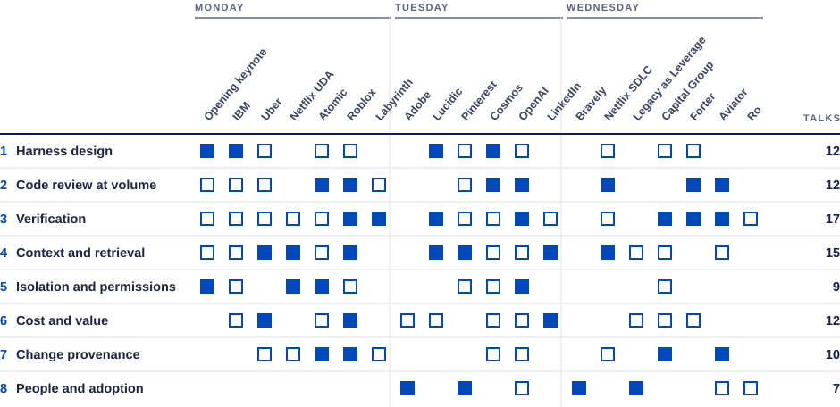

# Themes across the conference

> What the conference added up to: the topics that ran through it, how ten companies handle agent-written code and where each check sits.

## Topics that ran through the conference

The grid marks which of the twenty talks covered each topic. A filled square means the topic was a main subject of the talk; an outlined square means the talk mentioned it.

Filled: central to the talk. Outlined: the talk touched it. My read of the talks.

The agent itself was never the subject. The talks were about the controls around it, the evidence that a change works before anyone reads it, what people still need to understand once they stop reading diffs, and how people learn to work this way.

### 1. Harness design

4 central · 8 touched

The [opening keynote](talks/the-harness-is-the-new-operating-system.md) defined an agent as a model plus everything around it: context, tools, where tools run, and feedback. It showed one model scoring 65.5% to 74.2% on the same benchmark across eight harnesses. [IBM](talks/beyond-the-model-engineering-the-agent-harness.md) framed 2026 as the year of harness engineering. [Uber](talks/running-software-factory-efficiently-at-uber-scale.md) manages its harness settings fleet-wide through one CLI, and [Roblox](talks/generation-got-cheap-trust-didnt.md) built its own review harness to control caching and parallelism.

[Lucidic](talks/skills-memory-or-fine-tuning.md) gave the harness a triage method: sort every bad run into one of six failure types before choosing a fix. [Harness’s Cosmos lead](talks/drawing-the-rest-of-the-owl.md) listed what a factory box needs: a cloud agent, a sandbox, triggers, computer and browser use, and secrets kept out of the agent’s environment. [Netflix’s SDLC team](talks/how-netflix-retrofitted-its-sdlc-for-ai-coding-agents.md) treats the harness as a reading order: AGENTS.md, then a generated one-line index of docs, then one doc, then the code, plus a plugin per team. [Capital Group](talks/observability-the-missing-control-plane-for-agentic-engineering.md) asked teams to treat prompt, tool and model changes as releases, because agents change the deployment harness too. The shared lesson: when an agent struggles, check context, tools, execution and feedback before changing models.

### 2. Code review at volume

7 central · 5 touched

Agents produce more changes than people can review one diff at a time, and every company shipping at volume has changed what review means. [Atomic](talks/wait-you-re-still-doing-prs.md) wants to replace the pull request with a review of intent and evidence. Roblox kept the PR and changed who does what: AI review grounded in curated rules, and owner-set policy that lets low-risk changes merge without a person. Cosmos proposes a four-step lane: a nitpicky reviewer, an auto-fixer, a verifier that shows the change working, and a risk analyzer that decides what needs a person. [OpenAI](talks/building-a-100m-product-at-openai.md)’s Ads team targets at least 90% auto-approval of routine PRs and puts a human on critical ones, with sandbox evidence in hand.

[Aviator](talks/how-to-kill-the-code-review.md)’s Ankit Jain asked what people should read instead. Review was always mostly about shared understanding: in Microsoft’s study 44% of developers ranked finding defects first, but 14% of comments were about defects. His answer is that agents argue first, repeated comments become enforced rules, and people debate the decisions behind a change, not the diff. Netflix’s reviewer posts only verified blockers with evidence, a fix and the rule. [Forter](talks/you-cant-read-the-code-anymore.md)’s Omer van Kloeten proposed reviewing what a system does, through plain-English behavior tests, rather than how it is built. In every version, machines find the bugs, and people set the rules, check the evidence and own the decisions.

### 3. Verification

7 central · 10 touched

[Into the Labyrinth](talks/into-the-labyrinth.md) argued that agent-written code is too large to hold in your head, so people should write properties and let machines search for violations. Roblox scores its reviewer on what actually merged, and Uber picks models with a benchmark of 1,075 of its own merged PRs. OpenAI’s verification ladder is the clearest overall shape: local checks for every change, an end-to-end user journey in a browser for complex ones, and a sandbox running copies of live traffic for critical ones. Lucidic judges fixes by pass^k on held-out cases: a 90% agent passes only 73% of tasks three times running. [LinkedIn](talks/bridging-retrieval-and-ranking.md) showed the same habit outside coding, testing every model change offline with Recall@K and one-input-at-a-time ablations.

Forter’s Telem backfills black-box Gherkin tests flow by flow; on one gateway it produced about 24,700 tests that ran in 58.4 seconds on a laptop, by Forter’s figures, and a Whitebox phase writes tests for behavior the code introduced so a person can disagree with it. Aviator wants evidence per acceptance criterion and was candid that verification proves only what you asked. Capital Group added that tests catch only what someone predicted, so non-deterministic systems also need canaries, flags and SLOs. [Ro](talks/game-time-10x-in-a-week-and-in-a-year.md)’s closing keynote, a web-scale story rather than an AI one, ran its peak-load test in production up to a database write and no further.

The [mission control training](talks/ai-assisted-coding-master-class-build-your-mission-control.md) on Thursday turned this into a decision table. Dev Bali ranked checks by the question each answers: types and lint on every PR, contracts at every service boundary, end-to-end tests per module, then property-based tests, mutation testing, fuzzing, symbolic execution and formal proofs for smaller and more critical code. He cited ordinary reviewers catching seeded security flaws 3% to 21% of the time, coding agents adding mocks in 36% of commits against 26% for others, and Meta finding that 277 of 571 bug-catching tests added no line coverage. His conclusion was that for most applications good testing is enough, and formal verification is not yet worth its cost outside small, critical pieces.

### 4. Context and retrieval

7 central · 8 touched

Models know nothing about a company’s own systems, so everyone is writing that knowledge down. Roblox mined years of review comments into curated rules, Uber built a company-wide context graph, and [Netflix’s data architecture team](talks/stop-fighting-the-remodel.md) defined each business concept once. Netflix’s SDLC team picked one way to do each thing, recorded about 45 architecture decision records, migrated old code to match, and serves each domain through a GraphRAG index behind one “ask” tool; Mark Khuzam called choosing the patterns the hardest part. [Pinterest](talks/use-ai-to-multiply-your-team-as-a-staff-engineer.md) turns repeated corrections into skills, promoted from personal to repo to company-wide. Lucidic cited SkillsBench: curated skills added 16.2 points, while skills a model wrote for itself lost 1.3. Almost every booth on the expo floor sold some form of context.

Two warnings came with it. LinkedIn’s talk was about retrieval: if the first pass misses an item, nothing downstream recovers it. And [Shine Garg](talks/legacy-as-leverage-how-brownfield-work-builds-technical-judgment.md) showed how shared standards sprawl: a sound rule that every message needs a schema grew to more than 2,000 overlapping schemas in two years. Skills, instruction files and decision records will do the same without owners.

### 5. Isolation and permissions

4 central · 5 touched

The keynote argued that prompt instructions cannot enforce a limit on an agent; isolation, scoped credentials and review of risky actions can. It cited data that people approve 97% of permission prompts. Netflix gives agents their own identity and per-agent policy at the API, and Atomic runs review under a separate, short-lived identity. OpenAI told the story everyone will repeat: an agent asked to debug a slow service deleted the slow Kubernetes pods. Their fix is read-only diagnostic roles, a separate role for destructive actions, and a human second factor for production deploys. Pinterest’s adoption only took off after the team fixed the sandbox’s friction.

Capital Group’s Rachael Wonnacott extended the maturity models past the platform edge: an agent first reads, then makes human-reviewed requests, then policy-approved changes, and finally earns autonomy one capability at a time, on evidence that can also revoke it. My research on vendor sandboxes is in the [OpenAI write-up](talks/building-a-100m-product-at-openai.md) and on the tools page.

### 6. Cost and value

3 central · 9 touched

Uber’s weekly agent requests grew more than 15 times from February to October while AI spend levelled off after May, by treating cost as six multiplied terms. Roblox halved cost per token while usage more than doubled. Both tie spend to merged PRs. Others measured value per unit of cost: OpenAI gives each engineer a monthly AI budget and runs no token leaderboards; Lucidic split one long call into scoped calls for 15% more tokens and twice the closed tickets; LinkedIn shipped the smaller model because a 75 times bigger one bought 0.20% recall for 44% less throughput. Capital Group wants cost per scenario, traced end to end, and Forter put its test backfill at hundreds to thousands of dollars in tokens per system.

Two costs most plans leave out. [Adobe](talks/learning-out-loud-under-near-existential-pressure.md)’s Laura Savino cited HBR research that AI intensifies work rather than reducing it. Shine Garg priced the long tail: adopting a technology commits an organization to expertise, tooling, operations and hiring long after launch.

### 7. Change provenance

4 central · 6 touched

Uber attributes more than 70% of its PRs to agents. Roblox traces every merged line to the agent, model and conversation that wrote it. Atomic stores intent, session, cost and signed review with each change. OpenAI attaches each small PR’s rationale and test results to the batched PR a human approves, and Cosmos feeds traces to a weekly self-improvement agent.

The record is moving from “who wrote it” to “why”. Aviator captures intent, acceptance criteria and each decision, with whether it was settled, left open or deferred. Capital Group puts user, agent, tool, model, versions, cost and policy decision on every span, and reconciles that as-built record against specs and catalogs. Netflix’s review agent flags docs a change makes stale, which about 9% of merged PRs needed.

### 8. People and adoption

4 central · 3 touched

Adobe’s Laura Savino argued that the people who adapt fastest learn in public: beginner questions, rough code and recorded first attempts. She asked enthusiasts to invite rather than push, and asked for real support such as office hours. Pinterest’s Jordan Cutler found that telling his team to switch tools didn’t work, while fixing the sandbox, four recorded shadow sessions and a one-line setup script did. OpenAI rotates an AI champion every two weeks to automate one chore. Pinterest measures the gap between its top 10% and bottom half, and treats raising the bottom half as the staff engineer’s job.

[Bravely](talks/the-execution-muscle-why-great-teams-are-built-not-hired.md)’s Charlotte Mestwerdt opened with a poll where almost nobody blamed their last slipped project on purely technical causes, and offered tight-loose-tight leadership for handing over ownership: agree the why, done and boundaries, then let go of the how. Shine Garg argued that as AI makes building cheaper, judgment about the long tail becomes the marker of seniority. Ro ran monthly tabletop rehearsals that included care and clinical operations staff, scored only on what was in production.

## How ten companies handle agent-written code

From the talks. “Not covered” means the speaker did not discuss it, not that the company does nothing.

|                                                                     | Who reviews                                                                                                                   | How they know it works                                                                                     | Context source                                                                        | Record of each change                                               | Cost control                                                             |
|---------------------------------------------------------------------|-------------------------------------------------------------------------------------------------------------------------------|------------------------------------------------------------------------------------------------------------|---------------------------------------------------------------------------------------|---------------------------------------------------------------------|--------------------------------------------------------------------------|
| [Roblox](talks/generation-got-cheap-trust-didnt.md)                       | An AI reviewer built from Roblox’s review history; owner-written policy decides what still needs a person                     | Precision and recall on its own definitions, measured on merged code; evals added from real incidents      | Review rules (“exemplars”) mined from past comments and curated by experts            | Every merged line traced to its agent, model and conversation       | Prompt caching, cheaper models per workload, MCP tool search (15% saved) |
| [Atomic](talks/wait-you-re-still-doing-prs.md)                            | A separate, short-lived reviewer identity signs off each acceptance criterion                                                 | Test evidence attached to each acceptance criterion                                                        | An intent file linked to each change                                                  | Intent, session, cost and signed review stored with the change      | Cost recorded per change and rolled up to intents                        |
| [Uber](talks/running-software-factory-efficiently-at-uber-scale.md)       | uReview, one of five specialized agents, each measured with a cost-per-outcome unit                                           | A benchmark of 1,075 of its own merged PRs with hidden tests                                               | A company-wide context graph of metadata and pointers                                 | More than 70% of PRs attributed to agents                           | Spend split into six terms; defaults tested on a cohort first            |
| [Antithesis](talks/into-the-labyrinth.md)                                 | Machines search for violations of properties that people write                                                                | Deterministic simulation; every finding comes with a replayable run                                        | A PROPERTIES.md file                                                                  | Not covered                                                         | Not covered                                                              |
| [OpenAI](talks/building-a-100m-product-at-openai.md)                      | An automated checker; routine PRs auto-approve once checks pass (target 90% or more), and a person decides critical ones      | Local checks, an end-to-end journey in a browser, and a sandbox on copies of live traffic                  | The system itself: the agent reads the deployment, repo and config                    | The batched PR carries each smaller PR’s rationale and test results | A monthly AI budget per engineer, no token leaderboards                  |
| [Pinterest](talks/use-ai-to-multiply-your-team-as-a-staff-engineer.md)    | Agent review runs before human review, with risk-based review after it                                                        | Deterministic checks inside each skill: lint, CI and scripts the agent must pass                           | Skills learned from repeated corrections, promoted from personal to company-wide      | Not covered                                                         | Rate limits, added after one job opened 16 PRs in two minutes            |
| [Harness Cosmos](talks/drawing-the-rest-of-the-owl.md)                    | A nitpicky reviewer, an auto-fixer, a verifier and a risk analyzer that decides what needs a person                           | The verifier shows the change working with screenshots, video and logs; evals guard critical decisions     | Task-specific context; he called bad output mostly a context problem                  | Traces reviewed weekly by a self-improvement agent                  | Traces, per-task budget caps, cheaper models where good enough           |
| [Netflix](talks/how-netflix-retrofitted-its-sdlc-for-ai-coding-agents.md) | A review agent that posts only verified blockers; a person decides every merge and release                                    | Deterministic CI, screenshot diffing, merge queues and a 10% canary with an RCA agent reporting to on-call | About 45 ADRs, 300+ docs, AGENTS.md and a doc index; a GraphRAG “ask” tool per domain | Docs updated when a change makes them stale; ADRs stay human-owned  | Not covered                                                              |
| [Aviator](talks/how-to-kill-the-code-review.md)                           | Agents argue before the PR; people debate the decisions; line-by-line stays for auth, payments, migrations and infrastructure | Evidence per acceptance criterion, and 64 invariants checked by a system separate from the coding agent    | Intent and criteria captured from the coding session; invariants in the repo          | Decisions with their outcome and status on the PR                   | Not covered                                                              |
| [Forter](talks/you-cant-read-the-code-anymore.md)                         | People review behavior, through plain-English scenarios and an HTML walkthrough, not the code                                 | Black-box Gherkin tests run by Cucumber, plus a Whitebox phase for behavior the code introduced            | The test suite itself, explained top down for subject matter experts                  | Not covered                                                         | Hundreds to thousands of dollars in tokens per system                    |

## Where the checks sit

Taken together, the talks describe checks at each stage of an agent change, not a single review at the end. The diagram places each practice and tool at the stage where it applies.

1.  1
    **Intent** State what correct means before the agent starts

    Atomic intents with acceptance criteria · PROPERTIES.md (Labyrinth) · OpenAI: metrics first · Aviator: intent and criteria captured from the session · Forter: plain-English Gherkin · Pinterest Autoship: ticket to reviewed PR · Ro: one load target per service, done defined
2.  2
    **Context** Give the agent your rules and meaning, not just code

    Roblox exemplars · Uber context graph · Netflix UDA · Netflix ADRs behind AGENTS.md · Curated skills and memory (Lucidic, Pinterest) · a GraphRAG “ask” tool per domain (Netflix) · Augment Context Engine · Unblocked and Materialize (booths) · owners for shared context
3.  3
    **Sandbox** Limit what it can touch; don’t rely on prompts

    Claude Code sandboxing · scoped credentials · smolvm microVMs · Arcjet · OpenAI read-only debug roles · Codex, Copilot, Devin and Cosmos sandboxes · Capital Group: autonomy per capability, on evidence · YugabyteDB branches (booth)
4.  4
    **Checks while writing** Make the harness prove “done”

    Stop hooks that run tests · property tests · Antithesis · Sonar Vortex · Checks inside skills (Pinterest) · browser journey (OpenAI) · pass^k (Lucidic) · Forter black-box behavior tests and Whitebox phase · Aviator invariants checked apart
5.  5
    **Review** Independent reviewer; people read decisions and evidence

    Roblox AI review: 72% of flags acted on, 88% of sign-offs held · Atomic reviewer grant · Cosmos lane: reviewer, auto-fix, verifier, risk analyzer · Netflix: verified blockers only · Aviator: people debate decisions, not diffs · Forter: people review behavior
6.  6
    **Merge** Owners decide how much risk may skip a person

    Roblox merge policy as code · CODEOWNERS · branch protection · OpenAI: 90% routine auto-approval target · human second factor for deploys · Netflix: deterministic CI and merge queue, nothing auto-merges · teams own rules (Aviator)
7.  7
    **Production** Keep checking after merge

    Roblox LLM judges on live traffic · line-level attribution · cost per merged PR · OpenAI sandbox on copies of live traffic · Cosmos weekly self-improvement · Netflix RCA agent after each canary · Capital Group scenario traces · Ro prod load test

Pulled together from the talks and booths.

## Practices more than one company described

1.  **Build a benchmark from your own merged PRs.** Uber (1,075 graded tasks) and Roblox (sealed private tasks) choose models and tools on their own code, not public leaderboards. LinkedIn tests every retrieval change offline the same way; merged PRs can score context retrieval too.

2.  **Turn repeated corrections into reviewed rules and skills.** Roblox mines review comments into exemplars, Aviator mined 11,400 comments into 64 invariants with a scope, a check and an owner, Pinterest runs a learn-from-session loop, and Lucidic has people approve AI-drafted skills ten lines at a time. SkillsBench suggests unreviewed self-written skills make agents slightly worse.

3.  **Make the agent show the change working.** OpenAI’s verification ladder, the Cosmos verifier’s screenshots and video, Aviator’s evidence per criterion, Forter’s black-box behavior tests and Labyrinth’s rule of no finding without a reproduction. Lucidic adds pass^k, so one lucky run doesn’t count.

4.  **Write down what “correct” means first.** Atomic’s intent with acceptance criteria, Labyrinth’s PROPERTIES.md, Netflix’s one pattern per thing and its defined concepts, OpenAI’s metrics set before any agent starts, and Ro’s load target per service with done defined against it.

5.  **Review decisions and behavior, not just diffs.** Aviator puts the decisions behind a change on the PR for people to debate, Netflix records them as ADRs that agents and reviewers check against, Forter has people review what the system does, and OpenAI attaches each small PR’s rationale to the batch a person approves.

6.  **Keep the reviewer independent of the author.** Atomic’s separate reviewer identity, Roblox’s bug finders from at least two model providers, the separate verifier in the Cosmos lane, and Aviator’s invariants checked outside the coding agent. Forter’s warning: agent-written tests mark their own homework unless they test behavior from outside.

7.  **Scope permissions as if the agent will pick wrong, and grant autonomy on evidence.** The keynote’s 97% prompt-approval figure, Netflix’s agent identity, OpenAI’s pod deletion, Cosmos keeping secrets out of the agent’s environment, and Capital Group’s ladder of autonomy per capability.

8.  **Load less context, on demand.** Uber replaced piles of MCP tool definitions with a command, Roblox saved 15% by not loading MCP tools eagerly, Lucidic loads short chunks only when a task needs them, and Netflix’s agents read a one-line index before any full doc.

9.  **Put telemetry on every agent action.** Uber’s aifx, Roblox’s edit hooks, Atomic’s Claude Code integration, Pinterest’s session-end hook, the traces Cosmos reviews weekly, and Capital Group’s scenario ID on every span.

10. **Fix the friction before you mandate the tool.** Pinterest fixed the sandbox and recorded shadow sessions; Adobe argued for invitations and office hours; OpenAI rotates an AI champion; Bravely’s tight-loose-tight structure hands over the how. Uber and Roblox roll settings out to a cohort first.

11. **Rehearse the whole change with everyone it touches.** Ro’s monthly tabletop sessions, scored only on what is in production, and Netflix’s on-call deciding after each canary. Both put people outside the authoring team in the loop.

12. **Budget per person, not leaderboards.** OpenAI’s monthly AI budget per engineer, and Uber and Roblox tying spend to merged work rather than tokens.
